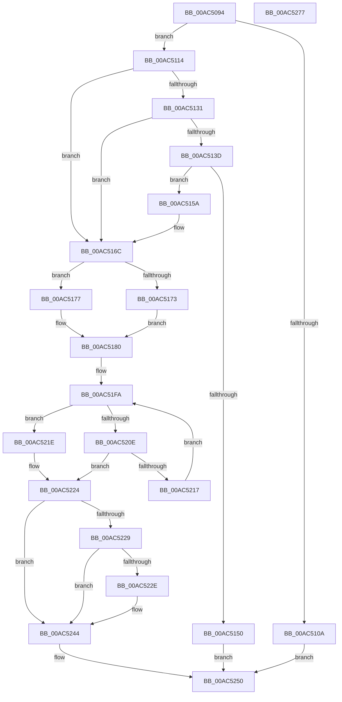

# MiGetLargePagesForSystemMapping

- RVA: `0x00AC5094`–`0x00AC5278` (길이 `484` bytes)
- VA: `0x0000000140AC5094`
- 실행 섹션: `PAGE`
- PDB 이름 있음: `예`; PDB Function 태그: `아니요`
- unwind 정보 RVA: `0x000BD158`
- 디코드: `132`개 명령, `484/484` bytes 표시
- 미해석 바이트: `0` (있으면 어셈블리에 `.byte`로 보존)

> 이 문서는 커널 이미지의 기계어와 PDB 기호를 분석해 생성했습니다. 4번과 5번은 함수 원형과 자료형을 바이너리 사용 방식에서 추정한 C 해석이며 원본 소스 복구 결과는 아닙니다.

## 1. Dependencies

- 직접 호출 지점: **6**; 고유 호출 대상: **6**
- 직접 호출자로 확인된 함수: **1**
- RIP 상대 이미지 참조: **3**

### Outgoing calls
- `0x00AC5147` → [MiObtainSystemCharges](../../text/37/MiObtainSystemCharges_function_003771F4.md) (function, `0x003771F4`)
- `0x00AC517B` → [MiThreadIdealNode](../../text/3D/MiThreadIdealNode_function_003D3480.md) (function, `0x003D3480`)
- `0x00AC51E9` → [MiInitializeDemandCoalesceContext](../../text/3D/MiInitializeDemandCoalesceContext_function_003D3350.md) (function, `0x003D3350`)
- `0x00AC51FF` → [MiAllocateLargeZeroPages](../../text/3B/MiAllocateLargeZeroPages_function_003B743C.md) (function, `0x003B743C`)
- `0x00AC523B` → [MiReturnSystemCharges](../../text/36/MiReturnSystemCharges_function_00367A48.md) (function, `0x00367A48`)
- `0x00AC5257` → [_security_check_cookie](../../text/6A/_security_check_cookie_function_006AC640.md) (function, `0x006AC640`)

### Direct callers
- [MiMakeZeroedPageTablesEx](../../text/3B/MiMakeZeroedPageTablesEx_function_003B59FC.md) at `0x003B5D9E`

### Static image references
- `0x00AC50B0` → RVA `0x00E0A740` (`.data`; read)
- `0x00AC5180` → RVA `0x00FC5000` (`ALMOSTRO`; read)
- `0x00AC5188` → RVA `0x00E2DBD0` (`.data`; read)

## 2. Other-region calls and transfers

- 다른 실행 섹션으로 향하는 call: **6**
  - `0x00AC5147` → [MiObtainSystemCharges](../../text/37/MiObtainSystemCharges_function_003771F4.md) (`PAGE` → `.text`)
  - `0x00AC517B` → [MiThreadIdealNode](../../text/3D/MiThreadIdealNode_function_003D3480.md) (`PAGE` → `.text`)
  - `0x00AC51E9` → [MiInitializeDemandCoalesceContext](../../text/3D/MiInitializeDemandCoalesceContext_function_003D3350.md) (`PAGE` → `.text`)
  - `0x00AC51FF` → [MiAllocateLargeZeroPages](../../text/3B/MiAllocateLargeZeroPages_function_003B743C.md) (`PAGE` → `.text`)
  - `0x00AC523B` → [MiReturnSystemCharges](../../text/36/MiReturnSystemCharges_function_00367A48.md) (`PAGE` → `.text`)
  - `0x00AC5257` → [_security_check_cookie](../../text/6A/_security_check_cookie_function_006AC640.md) (`PAGE` → `.text`)
- 별도 외부 분기/꼬리 이동을 확인하지 못했습니다.

## 3. Assembly (complete function range)

```asm
00AC5094  48 89 5C 24 20                  mov qword ptr [rsp + 0x20], rbx
00AC5099  55                              push rbp
00AC509A  56                              push rsi
00AC509B  57                              push rdi
00AC509C  41 54                           push r12
00AC509E  41 55                           push r13
00AC50A0  41 56                           push r14
00AC50A2  41 57                           push r15
00AC50A4  48 8D 6C 24 D9                  lea rbp, [rsp - 0x27]
00AC50A9  48 81 EC E0 00 00 00            sub rsp, 0xe0
00AC50B0  48 8B 05 89 56 34 00            mov rax, qword ptr [rip + 0x345689]
00AC50B7  48 33 C4                        xor rax, rsp
00AC50BA  48 89 45 17                     mov qword ptr [rbp + 0x17], rax
00AC50BE  33 C0                           xor eax, eax
00AC50C0  48 89 54 24 20                  mov qword ptr [rsp + 0x20], rdx
00AC50C5  0F 57 C0                        xorps xmm0, xmm0
00AC50C8  89 44 24 34                     mov dword ptr [rsp + 0x34], eax
00AC50CC  48 89 45 A7                     mov qword ptr [rbp - 0x59], rax
00AC50D0  49 8D 78 01                     lea rdi, [r8 + 1]
00AC50D4  48 89 45 BF                     mov qword ptr [rbp - 0x41], rax
00AC50D8  48 8B D9                        mov rbx, rcx
00AC50DB  48 89 45 07                     mov qword ptr [rbp + 7], rax
00AC50DF  48 C7 C1 00 00 E0 FF            mov rcx, 0xffffffffffe00000
00AC50E6  89 45 0F                        mov dword ptr [rbp + 0xf], eax
00AC50E9  48 23 F9                        and rdi, rcx
00AC50EC  48 8D 82 FF FF 1F 00            lea rax, [rdx + 0x1fffff]
00AC50F3  4C 8B CA                        mov r9, rdx
00AC50F6  48 23 C1                        and rax, rcx
00AC50F9  0F 11 45 D7                     movups xmmword ptr [rbp - 0x29], xmm0
00AC50FD  0F 11 45 E7                     movups xmmword ptr [rbp - 0x19], xmm0
00AC5101  0F 11 45 F7                     movups xmmword ptr [rbp - 9], xmm0
00AC5105  48 3B C7                        cmp rax, rdi
00AC5108  72 0A                           jb 0x140ac5114
00AC510A  B8 34 00 19 40                  mov eax, 0x40190034
00AC510F  E9 3C 01 00 00                  jmp 0x140ac5250
00AC5114  4C 8B 7B 60                     mov r15, qword ptr [rbx + 0x60]
00AC5118  48 2B F8                        sub rdi, rax
00AC511B  8B 83 80 00 00 00               mov eax, dword ptr [rbx + 0x80]
00AC5121  45 33 E4                        xor r12d, r12d
00AC5124  48 C1 EF 0C                     shr rdi, 0xc
00AC5128  45 8D 54 24 01                  lea r10d, [r12 + 1]
00AC512D  A8 08                           test al, 8
00AC512F  75 3B                           jne 0x140ac516c
00AC5131  49 8B 87 98 4C 00 00            mov rax, qword ptr [r15 + 0x4c98]
00AC5138  48 85 C0                        test rax, rax
00AC513B  74 2F                           je 0x140ac516c
00AC513D  44 8B 43 78                     mov r8d, dword ptr [rbx + 0x78]
00AC5141  48 8B D7                        mov rdx, rdi
00AC5144  49 8B CF                        mov rcx, r15
00AC5147  E8 A8 20 8B FF                  call 0x1403771f4
00AC514C  85 C0                           test eax, eax
00AC514E  75 0A                           jne 0x140ac515a
00AC5150  B8 9A 00 00 C0                  mov eax, 0xc000009a
00AC5155  E9 F6 00 00 00                  jmp 0x140ac5250
00AC515A  48 01 7B 68                     add qword ptr [rbx + 0x68], rdi
00AC515E  41 BA 01 00 00 00               mov r10d, 1
00AC5164  4C 8B 4C 24 20                  mov r9, qword ptr [rsp + 0x20]
00AC5169  45 8B E2                        mov r12d, r10d
00AC516C  8B 43 7C                        mov eax, dword ptr [rbx + 0x7c]
00AC516F  85 C0                           test eax, eax
00AC5171  74 04                           je 0x140ac5177
00AC5173  FF C8                           dec eax
00AC5175  EB 09                           jmp 0x140ac5180
00AC5177  33 D2                           xor edx, edx
00AC5179  33 C9                           xor ecx, ecx
00AC517B  E8 00 E3 90 FF                  call 0x1403d3480
00AC5180  44 0F B7 05 78 FE 4F 00         movzx r8d, word ptr [rip + 0x4ffe78]
00AC5188  48 8B 0D 41 8A 36 00            mov rcx, qword ptr [rip + 0x368a41]
00AC518F  41 8B D0                        mov edx, r8d
00AC5192  0F AF D0                        imul edx, eax
00AC5195  F7 83 80 00 00 00 00 04 00 00   test dword ptr [rbx + 0x80], 0x400
00AC519F  48 89 7D 87                     mov qword ptr [rbp - 0x79], rdi
00AC51A3  45 0F 45 C2                     cmovne r8d, r10d
00AC51A7  4C 89 4D AF                     mov qword ptr [rbp - 0x51], r9
00AC51AB  48 83 4D 9F FF                  or qword ptr [rbp - 0x61], 0xffffffffffffffff
00AC51B0  45 33 F6                        xor r14d, r14d
00AC51B3  48 C1 EF 09                     shr rdi, 9
00AC51B7  45 8B CA                        mov r9d, r10d
00AC51BA  C7 44 24 30 08 00 00 00         mov dword ptr [rsp + 0x30], 8
00AC51C2  4C 89 7C 24 38                  mov qword ptr [rsp + 0x38], r15
00AC51C7  48 8D 34 91                     lea rsi, [rcx + rdx*4]
00AC51CB  89 45 97                        mov dword ptr [rbp - 0x69], eax
00AC51CE  BA 00 02 00 00                  mov edx, 0x200
00AC51D3  C7 45 9B 04 00 00 00            mov dword ptr [rbp - 0x65], 4
00AC51DA  4E 8D 2C 86                     lea r13, [rsi + r8*4]
00AC51DE  48 89 55 8F                     mov qword ptr [rbp - 0x71], rdx
00AC51E2  4C 8B C7                        mov r8, rdi
00AC51E5  48 8D 4D D7                     lea rcx, [rbp - 0x29]
00AC51E9  E8 62 E1 90 FF                  call 0x1403d3350
00AC51EE  4C 8D 45 D7                     lea r8, [rbp - 0x29]
00AC51F2  48 89 5D C7                     mov qword ptr [rbp - 0x39], rbx
00AC51F6  4C 89 45 B7                     mov qword ptr [rbp - 0x49], r8
00AC51FA  48 8D 4C 24 30                  lea rcx, [rsp + 0x30]
00AC51FF  E8 38 22 8F FF                  call 0x1403b743c
00AC5204  48 8B 7D 87                     mov rdi, qword ptr [rbp - 0x79]
00AC5208  48 2B 7D BF                     sub rdi, qword ptr [rbp - 0x41]
00AC520C  74 10                           je 0x140ac521e
00AC520E  48 83 C6 04                     add rsi, 4
00AC5212  49 3B F5                        cmp rsi, r13
00AC5215  74 0D                           je 0x140ac5224
00AC5217  8B 06                           mov eax, dword ptr [rsi]
00AC5219  89 45 97                        mov dword ptr [rbp - 0x69], eax
00AC521C  EB DC                           jmp 0x140ac51fa
00AC521E  41 BE 01 00 00 00               mov r14d, 1
00AC5224  45 85 E4                        test r12d, r12d
00AC5227  74 1B                           je 0x140ac5244
00AC5229  48 85 FF                        test rdi, rdi
00AC522C  74 16                           je 0x140ac5244
00AC522E  44 8B 4B 78                     mov r9d, dword ptr [rbx + 0x78]
00AC5232  4C 8B C7                        mov r8, rdi
00AC5235  48 8B D7                        mov rdx, rdi
00AC5238  49 8B CF                        mov rcx, r15
00AC523B  E8 08 28 8A FF                  call 0x140367a48
00AC5240  48 29 7B 68                     sub qword ptr [rbx + 0x68], rdi
00AC5244  41 F7 DE                        neg r14d
00AC5247  1B C0                           sbb eax, eax
00AC5249  F7 D0                           not eax
00AC524B  25 17 00 00 C0                  and eax, 0xc0000017
00AC5250  48 8B 4D 17                     mov rcx, qword ptr [rbp + 0x17]
00AC5254  48 33 CC                        xor rcx, rsp
00AC5257  E8 E4 73 BE FF                  call 0x1406ac640
00AC525C  48 8B 9C 24 38 01 00 00         mov rbx, qword ptr [rsp + 0x138]
00AC5264  48 81 C4 E0 00 00 00            add rsp, 0xe0
00AC526B  41 5F                           pop r15
00AC526D  41 5E                           pop r14
00AC526F  41 5D                           pop r13
00AC5271  41 5C                           pop r12
00AC5273  5F                              pop rdi
00AC5274  5E                              pop rsi
00AC5275  5D                              pop rbp
00AC5276  C3                              ret
00AC5277  CC                              int3
```

## 4. C-style interpretation (structured pseudocode)

```c
__int64 __fastcall MiGetLargePagesForSystemMapping(__int64 a1, __int64 a2, __int64 a3)
{
    __int64 result;
    __int64 v_r12;
    __int64 v_r14;
    __int64 v_rdi;
    __int64 v_rsi;
    __int64 v_rsp;
    unsigned __int64 v_stack_m48;
    unsigned int v_stack_m50;
    unsigned __int64 v_stack_m58;
    unsigned __int64 v_stack_m5F;
    unsigned __int64 v_stack_m68;
    unsigned __int64 v_stack_m78;
    unsigned __int64 v_stack_m88;
    unsigned __int64 v_stack_m98;
    unsigned __int64 v_stack_mA0;
    unsigned __int64 v_stack_mA8;
    unsigned __int64 v_stack_mB0;
    unsigned __int64 v_stack_mB8;
    unsigned __int64 v_stack_mC0;
    unsigned int v_stack_mC4;
    unsigned int v_stack_mC8;
    unsigned __int64 v_stack_mD0;
    unsigned __int64 v_stack_mD8;
    unsigned __int64 v_stack_mE0;
    unsigned int v_stack_mE4;
    unsigned int v_stack_mE8;
    unsigned __int64 v_stack_mF8;
    unsigned __int64 v_stack_p20;

    v_stack_p20 = v_rbx;
    v_rsp = (v_rsp) - (224);
    result = (*(unsigned __int64 *)(v_rip + 3430025)) ^ (v_rsp);
    v_stack_m48 = result;
    result = 0;
    v_stack_mF8 = a2;
    v_stack_mE4 = 0;
    v_stack_mB8 = 0;
    v_stack_mA0 = 0;
    v_stack_m58 = 0;
    v_stack_m50 = 0;
    v_rdi = (a3 + 1) & (0xFFFFFFFFFFE00000ULL);
    result = (a2 + 2097151) & (0xFFFFFFFFFFE00000ULL);
    v_stack_m88 = v_xmm0;
    v_stack_m78 = v_xmm0;
    v_stack_m68 = v_xmm0;
    if (result < v_rdi) goto loc_00AC5114;
    goto loc_00AC5250;
loc_00AC5114:
    v_rdi = (v_rdi) - ((unsigned int)(0x40190034ULL));
    v_r12 = 0;
    v_rdi = (v_rdi) >> (12);
    if ((((unsigned __int8)((unsigned int)(*(unsigned int *)(a1 + 128)))) & (8)) != 0) goto loc_00AC516C;
    if (*(unsigned __int64 *)(*(unsigned __int64 *)(a1 + 96) + 19608) == 0) goto loc_00AC516C;
    result = MiObtainSystemCharges(*(unsigned __int64 *)(a1 + 96), v_rdi, (unsigned int)(*(unsigned int *)(a1 + 120)), a2);
    if ((unsigned int)(result) != 0) goto loc_00AC515A;
    goto loc_00AC5250;
loc_00AC515A:
loc_00AC516C:
    if ((unsigned int)((unsigned int)(*(unsigned int *)(a1 + 124))) == 0) goto loc_00AC5177;
    result = (unsigned int)(((unsigned int)(*(unsigned int *)(a1 + 124))) - 1);
    goto loc_00AC5180;
loc_00AC5177:
    a2 = 0;
    a1 = 0;
    result = MiThreadIdealNode(a1, a2, (unsigned int)(*(unsigned int *)(a1 + 120)), v_stack_mF8);
loc_00AC5180:
    a2 = (unsigned int)(((unsigned int)((unsigned int)(*(unsigned __int16 *)(v_rip + 5242488)))) * ((unsigned int)(result)));
    v_stack_mD8 = v_rdi;
    a3 = *(unsigned __int16 *)(v_rip + 5242488);
    if (((*(unsigned int *)(a1 + 128)) & (0x400ULL)) != 0) { a3 = 1; }
    v_stack_mB0 = v_stack_mF8;
    v_r14 = 0;
    v_rdi = (v_rdi) >> (9);
    v_stack_mE8 = 8;
    v_stack_mE0 = *(unsigned __int64 *)(a1 + 96);
    v_stack_mC8 = (unsigned int)(result);
    v_stack_mC4 = 4;
    v_stack_mD0 = 512;
    result = MiInitializeDemandCoalesceContext(v_stack_m88, 512, v_rdi, 1);
    v_stack_m98 = 0;
    v_stack_mA8 = v_stack_m88;
loc_00AC51FA:
    result = MiAllocateLargeZeroPages(v_stack_mE8, 512, v_stack_m88, 1);
    v_rdi = (v_stack_mD8) - (v_stack_mA0);
    if (condition_is_equal) goto loc_00AC521E;
    v_rsi = (*(unsigned __int64 *)(v_rip + 3574337) + a2 * 4) + (4);
    if (v_rsi == (*(unsigned __int64 *)(v_rip + 3574337) + a2 * 4 + a3 * 4)) goto loc_00AC5224;
    v_stack_mC8 = (unsigned int)((unsigned int)(*(unsigned int *)(v_rsi)));
    goto loc_00AC51FA;
loc_00AC521E:
loc_00AC5224:
    if (1 == 0) goto loc_00AC5244;
    result = (unsigned int)(*(unsigned int *)(v_rsi));
    if (v_rdi != 0) {
        a4 = *(unsigned int *)(a1 + 120);
        a3 = v_rdi;
        a2 = v_rdi;
        a1 = *(unsigned __int64 *)(a1 + 96);
        result = MiReturnSystemCharges(a1, a2, a3, a4);
    }
    v_r14 = (unsigned int)(-(1));
    result = (unsigned int)(~(result));
    result = (unsigned int)((result) & (0xC0000017ULL));
loc_00AC5250:
    a1 = (v_stack_m48) ^ (v_rsp);
    result = _security_check_cookie(a1, a2, a3, a4);
    v_rsp = (v_rsp) + (224);
    return result;
}
```

## 5. (Beta) C Style

```c
int64_t MiGetLargePagesForSystemMapping(void *Arg1, void *Arg2, void *Arg3)
{
    uint8_t *arg1 = (uint8_t *)Arg1;
    uint8_t *arg2 = (uint8_t *)Arg2;
    uint8_t *arg3 = (uint8_t *)Arg3;

    int64_t result;
    int64_t local_r12;
    int64_t local_r14;
    int64_t local_rdi;
    int64_t local_rsi;
    int64_t local_rsp;
    uint64_t v_stack_m48;
    uint32_t v_stack_m50;
    uint64_t v_stack_m58;
    uint64_t v_stack_m5F;
    uint64_t v_stack_m68;
    uint64_t v_stack_m78;
    uint64_t v_stack_m88;
    uint64_t v_stack_m98;
    uint64_t v_stack_mA0;
    uint64_t v_stack_mA8;
    uint64_t v_stack_mB0;
    uint64_t v_stack_mB8;
    uint64_t v_stack_mC0;
    uint32_t v_stack_mC4;
    uint32_t v_stack_mC8;
    uint64_t v_stack_mD0;
    uint64_t v_stack_mD8;
    uint64_t v_stack_mE0;
    uint32_t v_stack_mE4;
    uint32_t v_stack_mE8;
    uint64_t v_stack_mF8;
    uint64_t v_stack_p20;

    v_stack_p20 = local_rbx;
    local_rsp = (local_rsp) - (224);
    result = (*(uint64_t *)(v_rip + 0x345689)) ^ (local_rsp);
    v_stack_m48 = result;
    result = 0;
    v_stack_mF8 = Arg2;
    v_stack_mE4 = 0;
    v_stack_mB8 = 0;
    v_stack_mA0 = 0;
    v_stack_m58 = 0;
    v_stack_m50 = 0;
    local_rdi = (Arg3 + 1) & (0xFFFFFFFFFFE00000ULL);
    result = (Arg2 + 2097151) & (0xFFFFFFFFFFE00000ULL);
    v_stack_m88 = v_xmm0;
    v_stack_m78 = v_xmm0;
    v_stack_m68 = v_xmm0;
    if (result < local_rdi) goto loc_00AC5114;
    goto loc_00AC5250;
loc_00AC5114:
    local_rdi = (local_rdi) - ((uint32_t)(0x40190034ULL));
    local_r12 = 0;
    local_rdi = (local_rdi) >> (12);
    if ((((uint8_t)((uint32_t)(*(uint32_t *)(arg1 + 0x80)))) & (8)) != 0) goto loc_00AC516C;
    if (*(uint64_t *)(*(uint64_t *)(arg1 + 0x60) + 0x4C98) == 0) goto loc_00AC516C;
    result = MiObtainSystemCharges(*(uint64_t *)(arg1 + 0x60), local_rdi, (uint32_t)(*(uint32_t *)(arg1 + 0x78)), Arg2);
    if ((uint32_t)(result) != 0) goto loc_00AC515A;
    goto loc_00AC5250;
loc_00AC515A:
loc_00AC516C:
    if ((uint32_t)((uint32_t)(*(uint32_t *)(arg1 + 0x7C))) == 0) goto loc_00AC5177;
    result = (uint32_t)(((uint32_t)(*(uint32_t *)(arg1 + 0x7C))) - 1);
    goto loc_00AC5180;
loc_00AC5177:
    Arg2 = 0;
    Arg1 = 0;
    result = MiThreadIdealNode(Arg1, Arg2, (uint32_t)(*(uint32_t *)(arg1 + 0x78)), v_stack_mF8);
loc_00AC5180:
    Arg2 = (uint32_t)(((uint32_t)((uint32_t)(*(uint16_t *)(v_rip + 0x4FFE78)))) * ((uint32_t)(result)));
    v_stack_mD8 = local_rdi;
    Arg3 = *(uint16_t *)(v_rip + 0x4FFE78);
    if (((*(uint32_t *)(arg1 + 0x80)) & (0x400ULL)) != 0) { Arg3 = 1; }
    v_stack_mB0 = v_stack_mF8;
    local_r14 = 0;
    local_rdi = (local_rdi) >> (9);
    v_stack_mE8 = 8;
    v_stack_mE0 = *(uint64_t *)(arg1 + 0x60);
    v_stack_mC8 = (uint32_t)(result);
    v_stack_mC4 = 4;
    v_stack_mD0 = 512;
    result = MiInitializeDemandCoalesceContext(v_stack_m88, 512, local_rdi, 1);
    v_stack_m98 = 0;
    v_stack_mA8 = v_stack_m88;
loc_00AC51FA:
    result = MiAllocateLargeZeroPages(v_stack_mE8, 512, v_stack_m88, 1);
    local_rdi = (v_stack_mD8) - (v_stack_mA0);
    if (condition_is_equal) goto loc_00AC521E;
    local_rsi = (*(uint64_t *)(v_rip + 0x368A41) + Arg2 * 4) + (4);
    if (local_rsi == (*(uint64_t *)(v_rip + 0x368A41) + Arg2 * 4 + Arg3 * 4)) goto loc_00AC5224;
    v_stack_mC8 = (uint32_t)((uint32_t)(*(uint32_t *)(local_rsi)));
    goto loc_00AC51FA;
loc_00AC521E:
loc_00AC5224:
    if (1 == 0) goto loc_00AC5244;
    result = (uint32_t)(*(uint32_t *)(local_rsi));
    if (local_rdi != 0) {
        a4 = *(uint32_t *)(arg1 + 0x78);
        Arg3 = local_rdi;
        Arg2 = local_rdi;
        Arg1 = *(uint64_t *)(arg1 + 0x60);
        result = MiReturnSystemCharges(Arg1, Arg2, Arg3, a4);
    }
    local_r14 = (uint32_t)(-(1));
    result = (uint32_t)(~(result));
    result = (uint32_t)((result) & (0xC0000017ULL));
loc_00AC5250:
    Arg1 = (v_stack_m48) ^ (local_rsp);
    result = _security_check_cookie(Arg1, Arg2, Arg3, a4);
    local_rsp = (local_rsp) + (224);
    return result;
}
```

### 관측된 메모리 오프셋

구조체 형식이 확인되지 않은 접근은 인자 기준의 오프셋으로만 기록했습니다.

| 기준 인자 | 오프셋 표현 | 폭 (bit) | 접근 |
|---|---:|---:|---|
| `Arg1` | `+ 0x60` | `64` | `R` |
| `Arg1` | `+ 0x68` | `64` | `R/W` |
| `Arg1` | `+ 0x78` | `32` | `R` |
| `Arg1` | `+ 0x7C` | `32` | `R` |
| `Arg1` | `+ 0x80` | `32` | `R` |
| `Arg2` | `+ 0x1FFFFF` | `64` | `R` |
| `Arg3` | `+ 0x1` | `64` | `R` |

## 6. Execution-region graph

[열기: 2D/3D 그래프와 함수 탐색 컨트롤 패널](../../../control-panel.html?section=page&rva=0x00AC5094&view=graph)

- 2D 그래프는 위에서 아래로 흐르고, 3D 그래프는 빈 공간을 드래그해 회전합니다. Shift+드래그는 이동, 휠은 확대·축소, 함수 노드 선택은 대상 보고서 이동입니다.

### Static fallback


