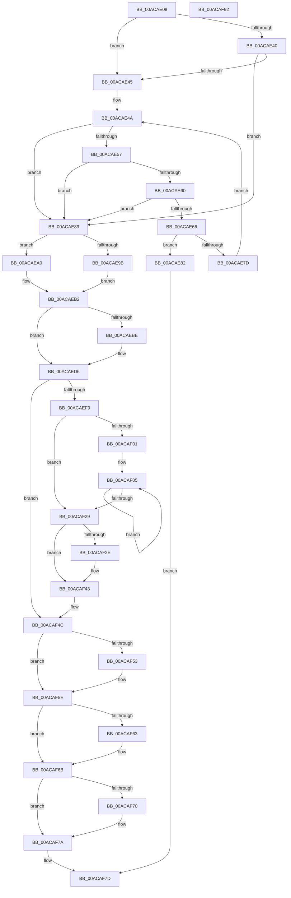

# MiGetPhysicalMemoryRanges

- RVA: `0x00ACAE08`–`0x00ACAF93` (길이 `395` bytes)
- VA: `0x0000000140ACAE08`
- 실행 섹션: `PAGE`
- PDB 이름 있음: `예`; PDB Function 태그: `아니요`
- unwind 정보 RVA: `0x000AA2A0`
- 디코드: `122`개 명령, `395/395` bytes 표시
- 미해석 바이트: `0` (있으면 어셈블리에 `.byte`로 보존)

> 이 문서는 커널 이미지의 기계어와 PDB 기호를 분석해 생성했습니다. 4번과 5번은 함수 원형과 자료형을 바이너리 사용 방식에서 추정한 C 해석이며 원본 소스 복구 결과는 아닙니다.

## 1. Dependencies

- 직접 호출 지점: **10**; 고유 호출 대상: **9**
- 직접 호출자로 확인된 함수: **1**
- RIP 상대 이미지 참조: **1**

### Outgoing calls
- `0x00ACAE4D` → [MiLockDynamicMemoryShared](../../text/3B/MiLockDynamicMemoryShared_function_003B8AA8.md) (function, `0x003B8AA8`)
- `0x00ACAE6C` → [MiUnlockDynamicMemoryShared](../../text/3B/MiUnlockDynamicMemoryShared_function_003B8A48.md) (function, `0x003B8A48`)
- `0x00ACAE74` → [MiRebuildPartitionMemoryBlock](../../text/69/MiRebuildPartitionMemoryBlock_function_00691AE8.md) (function, `0x00691AE8`)
- `0x00ACAE8E` → [MiReferencePageRuns](../../text/37/MiReferencePageRuns_function_00379540.md) (function, `0x00379540`)
- `0x00ACAEC9` → [MiGetFileOnlyRanges](../../text/67/MiGetFileOnlyRanges_function_00672684.md) (function, `0x00672684`)
- `0x00ACAEEC` → [MiAllocatePool](../../text/35/MiAllocatePool_function_0035B540.md) (function, `0x0035B540`)
- `0x00ACAF3B` → [memcpy](../../text/6C/memcpy_function_006C6840.md) (function, `0x006C6840`)
- `0x00ACAF59` → [MiUnlockDynamicMemoryShared](../../text/3B/MiUnlockDynamicMemoryShared_function_003B8A48.md) (function, `0x003B8A48`)
- `0x00ACAF66` → [MiDereferencePageRuns](../../text/3B/MiDereferencePageRuns_function_003BD388.md) (function, `0x003BD388`)
- `0x00ACAF75` → [ExFreePoolWithTag](../../poolcode/B8/ExFreePoolWithTag_function_00B82870.md) (function, `0x00B82870`)

### Direct callers
- [MmGetPhysicalMemoryRangesEx2](MmGetPhysicalMemoryRangesEx2_function_00AC3870.md) at `0x00AC38AC`

### Static image references
- `0x00ACAE25` → RVA `0x00E38D00` (`.data`; read)

## 2. Other-region calls and transfers

- 다른 실행 섹션으로 향하는 call: **10**
  - `0x00ACAE4D` → [MiLockDynamicMemoryShared](../../text/3B/MiLockDynamicMemoryShared_function_003B8AA8.md) (`PAGE` → `.text`)
  - `0x00ACAE6C` → [MiUnlockDynamicMemoryShared](../../text/3B/MiUnlockDynamicMemoryShared_function_003B8A48.md) (`PAGE` → `.text`)
  - `0x00ACAE74` → [MiRebuildPartitionMemoryBlock](../../text/69/MiRebuildPartitionMemoryBlock_function_00691AE8.md) (`PAGE` → `.text`)
  - `0x00ACAE8E` → [MiReferencePageRuns](../../text/37/MiReferencePageRuns_function_00379540.md) (`PAGE` → `.text`)
  - `0x00ACAEC9` → [MiGetFileOnlyRanges](../../text/67/MiGetFileOnlyRanges_function_00672684.md) (`PAGE` → `.text`)
  - `0x00ACAEEC` → [MiAllocatePool](../../text/35/MiAllocatePool_function_0035B540.md) (`PAGE` → `.text`)
  - `0x00ACAF3B` → [memcpy](../../text/6C/memcpy_function_006C6840.md) (`PAGE` → `.text`)
  - `0x00ACAF59` → [MiUnlockDynamicMemoryShared](../../text/3B/MiUnlockDynamicMemoryShared_function_003B8A48.md) (`PAGE` → `.text`)
  - `0x00ACAF66` → [MiDereferencePageRuns](../../text/3B/MiDereferencePageRuns_function_003BD388.md) (`PAGE` → `.text`)
  - `0x00ACAF75` → [ExFreePoolWithTag](../../poolcode/B8/ExFreePoolWithTag_function_00B82870.md) (`PAGE` → `POOLCODE`)
- 별도 외부 분기/꼬리 이동을 확인하지 못했습니다.

## 3. Assembly (complete function range)

```asm
00ACAE08  48 89 5C 24 08                  mov qword ptr [rsp + 8], rbx
00ACAE0D  55                              push rbp
00ACAE0E  56                              push rsi
00ACAE0F  57                              push rdi
00ACAE10  41 54                           push r12
00ACAE12  41 55                           push r13
00ACAE14  41 56                           push r14
00ACAE16  41 57                           push r15
00ACAE18  48 83 EC 20                     sub rsp, 0x20
00ACAE1C  65 4C 8B 2C 25 88 01 00 00      mov r13, qword ptr gs:[0x188]
00ACAE25  48 8D 35 D4 DE 36 00            lea rsi, [rip + 0x36ded4]
00ACAE2C  33 ED                           xor ebp, ebp
00ACAE2E  8B FA                           mov edi, edx
00ACAE30  40 88 6C 24 68                  mov byte ptr [rsp + 0x68], bpl
00ACAE35  44 8B E2                        mov r12d, edx
00ACAE38  48 8B D9                        mov rbx, rcx
00ACAE3B  83 E7 01                        and edi, 1
00ACAE3E  75 05                           jne 0x140acae45
00ACAE40  48 3B CE                        cmp rcx, rsi
00ACAE43  74 44                           je 0x140acae89
00ACAE45  C6 44 24 68 01                  mov byte ptr [rsp + 0x68], 1
00ACAE4A  49 8B D5                        mov rdx, r13
00ACAE4D  E8 56 DC 8E FF                  call 0x1403b8aa8
00ACAE52  48 3B DE                        cmp rbx, rsi
00ACAE55  74 32                           je 0x140acae89
00ACAE57  48 39 AB 50 48 00 00            cmp qword ptr [rbx + 0x4850], rbp
00ACAE5E  74 29                           je 0x140acae89
00ACAE60  48 39 6B 50                     cmp qword ptr [rbx + 0x50], rbp
00ACAE64  75 23                           jne 0x140acae89
00ACAE66  49 8B D5                        mov rdx, r13
00ACAE69  48 8B CB                        mov rcx, rbx
00ACAE6C  E8 D7 DB 8E FF                  call 0x1403b8a48
00ACAE71  48 8B CB                        mov rcx, rbx
00ACAE74  E8 6F 6C BC FF                  call 0x140691ae8
00ACAE79  85 C0                           test eax, eax
00ACAE7B  74 05                           je 0x140acae82
00ACAE7D  48 8B CB                        mov rcx, rbx
00ACAE80  EB C8                           jmp 0x140acae4a
00ACAE82  33 C0                           xor eax, eax
00ACAE84  E9 F4 00 00 00                  jmp 0x140acaf7d
00ACAE89  33 D2                           xor edx, edx
00ACAE8B  48 8B CB                        mov rcx, rbx
00ACAE8E  E8 AD E6 8A FF                  call 0x140379540
00ACAE93  4C 8B F0                        mov r14, rax
00ACAE96  48 85 C0                        test rax, rax
00ACAE99  75 05                           jne 0x140acaea0
00ACAE9B  48 8B F5                        mov rsi, rbp
00ACAE9E  EB 12                           jmp 0x140acaeb2
00ACAEA0  8B 08                           mov ecx, dword ptr [rax]
00ACAEA2  48 8B 83 50 48 00 00            mov rax, qword ptr [rbx + 0x4850]
00ACAEA9  48 F7 D8                        neg rax
00ACAEAC  48 1B F6                        sbb rsi, rsi
00ACAEAF  48 23 F1                        and rsi, rcx
00ACAEB2  48 89 6C 24 70                  mov qword ptr [rsp + 0x70], rbp
00ACAEB7  4C 8B FD                        mov r15, rbp
00ACAEBA  85 FF                           test edi, edi
00ACAEBC  74 18                           je 0x140acaed6
00ACAEBE  4C 8D 44 24 70                  lea r8, [rsp + 0x70]
00ACAEC3  41 8B D4                        mov edx, r12d
00ACAEC6  48 8B CB                        mov rcx, rbx
00ACAEC9  E8 B6 77 BA FF                  call 0x140672684
00ACAECE  48 8B 6C 24 70                  mov rbp, qword ptr [rsp + 0x70]
00ACAED3  4C 8B F8                        mov r15, rax
00ACAED6  48 8D 55 01                     lea rdx, [rbp + 1]
00ACAEDA  B9 40 00 00 00                  mov ecx, 0x40
00ACAEDF  48 03 D6                        add rdx, rsi
00ACAEE2  41 B8 4D 6D 50 68               mov r8d, 0x68506d4d
00ACAEE8  48 C1 E2 04                     shl rdx, 4
00ACAEEC  E8 4F 06 89 FF                  call 0x14035b540
00ACAEF1  4C 8B E0                        mov r12, rax
00ACAEF4  48 85 C0                        test rax, rax
00ACAEF7  74 53                           je 0x140acaf4c
00ACAEF9  48 8B F8                        mov rdi, rax
00ACAEFC  48 85 F6                        test rsi, rsi
00ACAEFF  74 28                           je 0x140acaf29
00ACAF01  49 8D 56 18                     lea rdx, [r14 + 0x18]
00ACAF05  48 8B 4A F8                     mov rcx, qword ptr [rdx - 8]
00ACAF09  48 C1 E1 0C                     shl rcx, 0xc
00ACAF0D  48 89 0F                        mov qword ptr [rdi], rcx
00ACAF10  48 8B 02                        mov rax, qword ptr [rdx]
00ACAF13  48 8D 52 10                     lea rdx, [rdx + 0x10]
00ACAF17  48 C1 E0 0C                     shl rax, 0xc
00ACAF1B  48 89 47 08                     mov qword ptr [rdi + 8], rax
00ACAF1F  48 83 C7 10                     add rdi, 0x10
00ACAF23  48 83 EE 01                     sub rsi, 1
00ACAF27  75 DC                           jne 0x140acaf05
00ACAF29  48 85 ED                        test rbp, rbp
00ACAF2C  74 15                           je 0x140acaf43
00ACAF2E  48 C1 E5 04                     shl rbp, 4
00ACAF32  49 8B D7                        mov rdx, r15
00ACAF35  4C 8B C5                        mov r8, rbp
00ACAF38  48 8B CF                        mov rcx, rdi
00ACAF3B  E8 00 B9 BF FF                  call 0x1406c6840
00ACAF40  48 03 FD                        add rdi, rbp
00ACAF43  48 83 27 00                     and qword ptr [rdi], 0
00ACAF47  48 83 67 08 00                  and qword ptr [rdi + 8], 0
00ACAF4C  80 7C 24 68 00                  cmp byte ptr [rsp + 0x68], 0
00ACAF51  74 0B                           je 0x140acaf5e
00ACAF53  49 8B D5                        mov rdx, r13
00ACAF56  48 8B CB                        mov rcx, rbx
00ACAF59  E8 EA DA 8E FF                  call 0x1403b8a48
00ACAF5E  4D 85 F6                        test r14, r14
00ACAF61  74 08                           je 0x140acaf6b
00ACAF63  49 8B CE                        mov rcx, r14
00ACAF66  E8 1D 24 8F FF                  call 0x1403bd388
00ACAF6B  4D 85 FF                        test r15, r15
00ACAF6E  74 0A                           je 0x140acaf7a
00ACAF70  33 D2                           xor edx, edx
00ACAF72  49 8B CF                        mov rcx, r15
00ACAF75  E8 F6 78 0B 00                  call 0x140b82870
00ACAF7A  49 8B C4                        mov rax, r12
00ACAF7D  48 8B 5C 24 60                  mov rbx, qword ptr [rsp + 0x60]
00ACAF82  48 83 C4 20                     add rsp, 0x20
00ACAF86  41 5F                           pop r15
00ACAF88  41 5E                           pop r14
00ACAF8A  41 5D                           pop r13
00ACAF8C  41 5C                           pop r12
00ACAF8E  5F                              pop rdi
00ACAF8F  5E                              pop rsi
00ACAF90  5D                              pop rbp
00ACAF91  C3                              ret
00ACAF92  CC                              int3
```

## 4. C-style interpretation (structured pseudocode)

```c
__int64 __fastcall MiGetPhysicalMemoryRanges(__int64 a1, int a2)
{
    __int64 result;
    __int64 v_r15;
    __int64 v_rbp;
    __int64 v_rdi;
    __int64 v_rsi;
    __int64 v_rsp;
    unsigned __int8 v_stack_p10;
    unsigned __int64 v_stack_p18;
    unsigned __int64 v_stack_p8;

    v_stack_p8 = v_rbx;
    v_rsp = (v_rsp) - (32);
    v_rbp = 0;
    v_stack_p10 = 0;
    v_rdi = (unsigned int)(((unsigned int)(a2)) & (1));
    if (condition_is_not_equal) goto loc_00ACAE45;
    if (a1 == (v_rip + 3595988)) goto loc_00ACAE89;
loc_00ACAE45:
    v_stack_p10 = 1;
loc_00ACAE4A:
    result = MiLockDynamicMemoryShared(a1, *(unsigned __int64 *)(gs_base + (0 + 392)), a3, a4);
    if (a1 == (v_rip + 3595988)) goto loc_00ACAE89;
    if ((*(unsigned __int64 *)(a1 + 18512)) == 0) goto loc_00ACAE89;
    if ((*(unsigned __int64 *)(a1 + 80)) != 0) goto loc_00ACAE89;
    result = MiUnlockDynamicMemoryShared(a1, *(unsigned __int64 *)(gs_base + (0 + 392)), a3, a4);
    result = MiRebuildPartitionMemoryBlock(a1, *(unsigned __int64 *)(gs_base + (0 + 392)), a3, a4);
    if ((unsigned int)(result) == 0) goto loc_00ACAE82;
    goto loc_00ACAE4A;
loc_00ACAE82:
    result = 0;
    goto loc_00ACAF7D;
loc_00ACAE89:
    a2 = 0;
    result = MiReferencePageRuns(a1, a2, a3, a4);
    if (result != 0) goto loc_00ACAEA0;
    goto loc_00ACAEB2;
loc_00ACAEA0:
    result = -(*(unsigned __int64 *)(a1 + 18512));
    v_rsi = (0) & ((unsigned int)(*(unsigned int *)(result)));
loc_00ACAEB2:
    v_stack_p18 = 0;
    v_r15 = 0;
    if ((unsigned int)(v_rdi) != 0) {
        a3 = v_stack_p18;
        a2 = (unsigned int)((unsigned int)(a2));
        a1 = a1;
        result = MiGetFileOnlyRanges(a1, a2, a3, a4);
        v_rbp = v_stack_p18;
        v_r15 = result;
    }
    a2 = (v_rbp + 1) + (v_rsi);
    a2 = (a2) << (4);
    result = MiAllocatePool(64, a2, (unsigned int)(0x68506D4DULL), a4);
    if (result == 0) goto loc_00ACAF4C;
    if (v_rsi == 0) goto loc_00ACAF29;
loc_00ACAF05:
    a1 = (*(unsigned __int64 *)(result + 24 - 8)) << (12);
    *(unsigned __int64 *)(result) = a1;
    result = (*(unsigned __int64 *)(result + 24)) << (12);
    *(unsigned __int64 *)(result + 8) = result;
    v_rdi = (result) + (16);
    v_rsi = (v_rsi) - (1);
    if (condition_is_not_equal) goto loc_00ACAF05;
loc_00ACAF29:
    if (v_rbp != 0) {
        v_rbp = (v_rbp) << (4);
        a2 = v_r15;
        a3 = v_rbp;
        a1 = v_rdi;
        result = memcpy(a1, a2, a3, a4);
        v_rdi = (v_rdi) + (v_rbp);
    }
loc_00ACAF4C:
    if (v_stack_p10 != 0) {
        a2 = *(unsigned __int64 *)(gs_base + (0 + 392));
        a1 = a1;
        result = MiUnlockDynamicMemoryShared(a1, a2, a3, a4);
    }
    if (result != 0) {
        a1 = result;
        result = MiDereferencePageRuns(a1, a2, a3, a4);
    }
    if (v_r15 != 0) {
        a2 = 0;
        a1 = v_r15;
        result = ExFreePoolWithTag(a1, a2, a3, a4);
    }
loc_00ACAF7D:
    v_rsp = (v_rsp) + (32);
    return result;
}
```

## 5. (Beta) C Style

```c
int64_t MiGetPhysicalMemoryRanges(int64_t Arg1, int32_t Arg2)
{
    int64_t result;
    int64_t local_r15;
    int64_t local_rbp;
    int64_t local_rdi;
    int64_t local_rsi;
    int64_t local_rsp;
    uint8_t v_stack_p10;
    uint64_t v_stack_p18;
    uint64_t v_stack_p8;

    v_stack_p8 = local_rbx;
    local_rsp = (local_rsp) - (32);
    local_rbp = 0;
    v_stack_p10 = 0;
    local_rdi = (uint32_t)(((uint32_t)(Arg2)) & (1));
    if (condition_is_not_equal) goto loc_00ACAE45;
    if (Arg1 == (v_rip + 3595988)) goto loc_00ACAE89;
loc_00ACAE45:
    v_stack_p10 = 1;
loc_00ACAE4A:
    result = MiLockDynamicMemoryShared(Arg1, *(uint64_t *)(gs_base + (0 + 0x188)), a3, a4);
    if (Arg1 == (v_rip + 3595988)) goto loc_00ACAE89;
    if ((*(uint64_t *)(Arg1 + 0x4850)) == 0) goto loc_00ACAE89;
    if ((*(uint64_t *)(Arg1 + 0x50)) != 0) goto loc_00ACAE89;
    result = MiUnlockDynamicMemoryShared(Arg1, *(uint64_t *)(gs_base + (0 + 0x188)), a3, a4);
    result = MiRebuildPartitionMemoryBlock(Arg1, *(uint64_t *)(gs_base + (0 + 0x188)), a3, a4);
    if ((uint32_t)(result) == 0) goto loc_00ACAE82;
    goto loc_00ACAE4A;
loc_00ACAE82:
    result = 0;
    goto loc_00ACAF7D;
loc_00ACAE89:
    Arg2 = 0;
    result = MiReferencePageRuns(Arg1, Arg2, a3, a4);
    if (result != 0) goto loc_00ACAEA0;
    goto loc_00ACAEB2;
loc_00ACAEA0:
    result = -(*(uint64_t *)(Arg1 + 0x4850));
    local_rsi = (0) & ((uint32_t)(*(uint32_t *)(result)));
loc_00ACAEB2:
    v_stack_p18 = 0;
    local_r15 = 0;
    if ((uint32_t)(local_rdi) != 0) {
        a3 = v_stack_p18;
        Arg2 = (uint32_t)((uint32_t)(Arg2));
        Arg1 = Arg1;
        result = MiGetFileOnlyRanges(Arg1, Arg2, a3, a4);
        local_rbp = v_stack_p18;
        local_r15 = result;
    }
    Arg2 = (local_rbp + 1) + (local_rsi);
    Arg2 = (Arg2) << (4);
    result = MiAllocatePool(64, Arg2, (uint32_t)(0x68506D4DULL), a4);
    if (result == 0) goto loc_00ACAF4C;
    if (local_rsi == 0) goto loc_00ACAF29;
loc_00ACAF05:
    Arg1 = (*(uint64_t *)(result + 0x18 - 0x8)) << (12);
    *(uint64_t *)(result) = Arg1;
    result = (*(uint64_t *)(result + 0x18)) << (12);
    *(uint64_t *)(result + 0x8) = result;
    local_rdi = (result) + (16);
    local_rsi = (local_rsi) - (1);
    if (condition_is_not_equal) goto loc_00ACAF05;
loc_00ACAF29:
    if (local_rbp != 0) {
        local_rbp = (local_rbp) << (4);
        Arg2 = local_r15;
        a3 = local_rbp;
        Arg1 = local_rdi;
        result = memcpy(Arg1, Arg2, a3, a4);
        local_rdi = (local_rdi) + (local_rbp);
    }
loc_00ACAF4C:
    if (v_stack_p10 != 0) {
        Arg2 = *(uint64_t *)(gs_base + (0 + 0x188));
        Arg1 = Arg1;
        result = MiUnlockDynamicMemoryShared(Arg1, Arg2, a3, a4);
    }
    if (result != 0) {
        Arg1 = result;
        result = MiDereferencePageRuns(Arg1, Arg2, a3, a4);
    }
    if (local_r15 != 0) {
        Arg2 = 0;
        Arg1 = local_r15;
        result = ExFreePoolWithTag(Arg1, Arg2, a3, a4);
    }
loc_00ACAF7D:
    local_rsp = (local_rsp) + (32);
    return result;
}
```

## 6. Execution-region graph

[열기: 2D/3D 그래프와 함수 탐색 컨트롤 패널](../../../control-panel.html?section=page&rva=0x00ACAE08&view=graph)

- 2D 그래프는 위에서 아래로 흐르고, 3D 그래프는 빈 공간을 드래그해 회전합니다. Shift+드래그는 이동, 휠은 확대·축소, 함수 노드 선택은 대상 보고서 이동입니다.

### Static fallback


