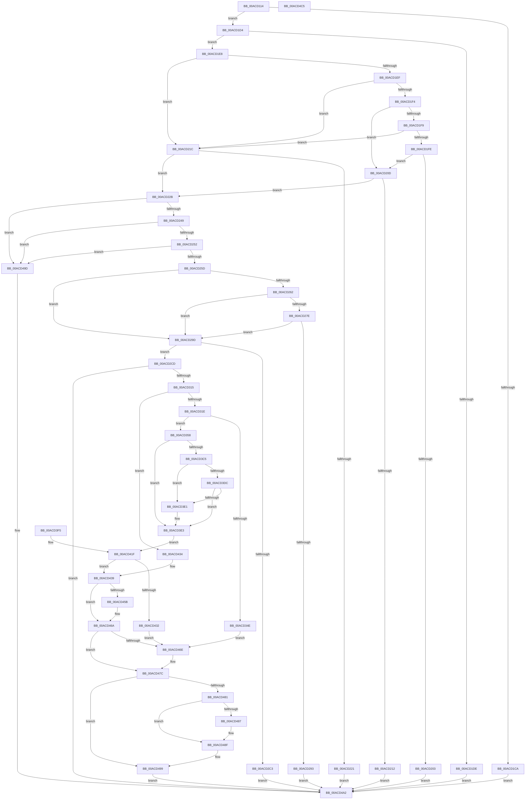

# MiLoadDataIntoVsmEnclave

- RVA: `0x00ACD114`–`0x00ACD4C6` (길이 `946` bytes)
- VA: `0x0000000140ACD114`
- 실행 섹션: `PAGE`
- PDB 이름 있음: `예`; PDB Function 태그: `아니요`
- unwind 정보 RVA: `0x000BE610`
- 디코드: `225`개 명령, `946/946` bytes 표시
- 미해석 바이트: `0` (있으면 어셈블리에 `.byte`로 보존)

> 이 문서는 커널 이미지의 기계어와 PDB 기호를 분석해 생성했습니다. 4번과 5번은 함수 원형과 자료형을 바이너리 사용 방식에서 추정한 C 해석이며 원본 소스 복구 결과는 아닙니다.

## 1. Dependencies

- 직접 호출 지점: **13**; 고유 호출 대상: **13**
- 직접 호출자로 확인된 함수: **1**
- RIP 상대 이미지 참조: **1**

### Outgoing calls
- `0x00ACD23A` → [MiMakeProtectionMask](../../text/32/MiMakeProtectionMask_function_00329480.md) (function, `0x00329480`)
- `0x00ACD2B9` → [MiCountCommittedPages](../../text/2C/MiCountCommittedPages_function_002C7950.md) (function, `0x002C7950`)
- `0x00ACD306` → [MiCommitExistingVad](../../text/32/MiCommitExistingVad_function_0032A860.md) (function, `0x0032A860`)
- `0x00ACD326` → [MmSizeOfMdl](../../text/46/MmSizeOfMdl_function_00460A10.md) (function, `0x00460A10`)
- `0x00ACD339` → [MiAllocatePool](../../text/35/MiAllocatePool_function_0035B540.md) (function, `0x0035B540`)
- `0x00ACD3B6` → [KiStackAttachProcess](../../text/21/KiStackAttachProcess_function_00216820.md) (function, `0x00216820`)
- `0x00ACD3E9` → [MmProbeAndLockPages](../../text/23/MmProbeAndLockPages_function_0023B990.md) (function, `0x0023B990`)
- `0x00ACD429` → [KiUnstackDetachProcess](../../text/21/KiUnstackDetachProcess_function_00217D30.md) (function, `0x00217D30`)
- `0x00ACD450` → [PsLoadVsmEnclaveData](../../text/5E/PsLoadVsmEnclaveData_function_005E4D5C.md) (function, `0x005E4D5C`)
- `0x00ACD477` → [MiDecommitRegion](../88/MiDecommitRegion_function_008807A0.md) (function, `0x008807A0`)
- `0x00ACD48A` → [MmUnlockPages](../../text/29/MmUnlockPages_function_0029EEE0.md) (function, `0x0029EEE0`)
- `0x00ACD494` → [ExFreePoolWithTag](../../poolcode/B8/ExFreePoolWithTag_function_00B82870.md) (function, `0x00B82870`)
- `0x00ACD4AD` → [_security_check_cookie](../../text/6A/_security_check_cookie_function_006AC640.md) (function, `0x006AC640`)

### Direct callers
- [NtLoadEnclaveData](../AF/NtLoadEnclaveData_function_00AF8DF0.md) at `0x00AF91E7`

### Static image references
- `0x00ACD129` → RVA `0x00E0A740` (`.data`; read)

## 2. Other-region calls and transfers

- 다른 실행 섹션으로 향하는 call: **12**
  - `0x00ACD23A` → [MiMakeProtectionMask](../../text/32/MiMakeProtectionMask_function_00329480.md) (`PAGE` → `.text`)
  - `0x00ACD2B9` → [MiCountCommittedPages](../../text/2C/MiCountCommittedPages_function_002C7950.md) (`PAGE` → `.text`)
  - `0x00ACD306` → [MiCommitExistingVad](../../text/32/MiCommitExistingVad_function_0032A860.md) (`PAGE` → `.text`)
  - `0x00ACD326` → [MmSizeOfMdl](../../text/46/MmSizeOfMdl_function_00460A10.md) (`PAGE` → `.text`)
  - `0x00ACD339` → [MiAllocatePool](../../text/35/MiAllocatePool_function_0035B540.md) (`PAGE` → `.text`)
  - `0x00ACD3B6` → [KiStackAttachProcess](../../text/21/KiStackAttachProcess_function_00216820.md) (`PAGE` → `.text`)
  - `0x00ACD3E9` → [MmProbeAndLockPages](../../text/23/MmProbeAndLockPages_function_0023B990.md) (`PAGE` → `.text`)
  - `0x00ACD429` → [KiUnstackDetachProcess](../../text/21/KiUnstackDetachProcess_function_00217D30.md) (`PAGE` → `.text`)
  - `0x00ACD450` → [PsLoadVsmEnclaveData](../../text/5E/PsLoadVsmEnclaveData_function_005E4D5C.md) (`PAGE` → `.text`)
  - `0x00ACD48A` → [MmUnlockPages](../../text/29/MmUnlockPages_function_0029EEE0.md) (`PAGE` → `.text`)
  - `0x00ACD494` → [ExFreePoolWithTag](../../poolcode/B8/ExFreePoolWithTag_function_00B82870.md) (`PAGE` → `POOLCODE`)
  - `0x00ACD4AD` → [_security_check_cookie](../../text/6A/_security_check_cookie_function_006AC640.md) (`PAGE` → `.text`)
- 별도 외부 분기/꼬리 이동을 확인하지 못했습니다.

## 3. Assembly (complete function range)

```asm
00ACD114  4C 8B DC                        mov r11, rsp
00ACD117  53                              push rbx
00ACD118  56                              push rsi
00ACD119  57                              push rdi
00ACD11A  41 54                           push r12
00ACD11C  41 55                           push r13
00ACD11E  41 56                           push r14
00ACD120  41 57                           push r15
00ACD122  48 81 EC F0 00 00 00            sub rsp, 0xf0
00ACD129  48 8B 05 10 D6 33 00            mov rax, qword ptr [rip + 0x33d610]
00ACD130  48 33 C4                        xor rax, rsp
00ACD133  48 89 84 24 E8 00 00 00         mov qword ptr [rsp + 0xe8], rax
00ACD13B  44 88 4C 24 60                  mov byte ptr [rsp + 0x60], r9b
00ACD140  4D 8B E8                        mov r13, r8
00ACD143  48 89 94 24 88 00 00 00         mov qword ptr [rsp + 0x88], rdx
00ACD14B  4C 8B C9                        mov r9, rcx
00ACD14E  4C 89 84 24 98 00 00 00         mov qword ptr [rsp + 0x98], r8
00ACD156  4C 8B BC 24 50 01 00 00         mov r15, qword ptr [rsp + 0x150]
00ACD15E  4C 89 BC 24 A8 00 00 00         mov qword ptr [rsp + 0xa8], r15
00ACD166  48 8B 8C 24 60 01 00 00         mov rcx, qword ptr [rsp + 0x160]
00ACD16E  48 89 4C 24 78                  mov qword ptr [rsp + 0x78], rcx
00ACD173  48 89 8C 24 B0 00 00 00         mov qword ptr [rsp + 0xb0], rcx
00ACD17B  4C 8B B4 24 68 01 00 00         mov r14, qword ptr [rsp + 0x168]
00ACD183  48 8B 84 24 70 01 00 00         mov rax, qword ptr [rsp + 0x170]
00ACD18B  48 89 44 24 70                  mov qword ptr [rsp + 0x70], rax
00ACD190  48 8B 94 24 80 01 00 00         mov rdx, qword ptr [rsp + 0x180]
00ACD198  48 89 94 24 80 00 00 00         mov qword ptr [rsp + 0x80], rdx
00ACD1A0  33 DB                           xor ebx, ebx
00ACD1A2  66 89 5C 24 64                  mov word ptr [rsp + 0x64], bx
00ACD1A7  89 5C 24 68                     mov dword ptr [rsp + 0x68], ebx
00ACD1AB  0F 57 C0                        xorps xmm0, xmm0
00ACD1AE  41 0F 11 43 90                  movups xmmword ptr [r11 - 0x70], xmm0
00ACD1B3  41 0F 11 43 A0                  movups xmmword ptr [r11 - 0x60], xmm0
00ACD1B8  41 0F 11 43 B0                  movups xmmword ptr [r11 - 0x50], xmm0
00ACD1BD  8B FB                           mov edi, ebx
00ACD1BF  48 89 1A                        mov qword ptr [rdx], rbx
00ACD1C2  48 3D 00 10 00 00               cmp rax, 0x1000
00ACD1C8  74 0A                           je 0x140acd1d4
00ACD1CA  B8 F2 00 00 C0                  mov eax, 0xc00000f2
00ACD1CF  E9 CE 02 00 00                  jmp 0x140acd4a2
00ACD1D4  83 BC 24 58 01 00 00 04         cmp dword ptr [rsp + 0x158], 4
00ACD1DC  74 0A                           je 0x140acd1e8
00ACD1DE  B8 04 00 00 C0                  mov eax, 0xc0000004
00ACD1E3  E9 BA 02 00 00                  jmp 0x140acd4a2
00ACD1E8  8B 09                           mov ecx, dword ptr [rcx]
00ACD1EA  83 E9 01                        sub ecx, 1
00ACD1ED  74 2D                           je 0x140acd21c
00ACD1EF  83 E9 01                        sub ecx, 1
00ACD1F2  74 28                           je 0x140acd21c
00ACD1F4  83 E9 01                        sub ecx, 1
00ACD1F7  74 14                           je 0x140acd20d
00ACD1F9  83 E9 01                        sub ecx, 1
00ACD1FC  74 1E                           je 0x140acd21c
00ACD1FE  83 F9 01                        cmp ecx, 1
00ACD201  74 0A                           je 0x140acd20d
00ACD203  B8 0D 00 00 C0                  mov eax, 0xc000000d
00ACD208  E9 95 02 00 00                  jmp 0x140acd4a2
00ACD20D  4D 85 F6                        test r14, r14
00ACD210  74 19                           je 0x140acd22b
00ACD212  B8 F1 00 00 C0                  mov eax, 0xc00000f1
00ACD217  E9 86 02 00 00                  jmp 0x140acd4a2
00ACD21C  4D 85 F6                        test r14, r14
00ACD21F  75 0A                           jne 0x140acd22b
00ACD221  B8 05 00 00 C0                  mov eax, 0xc0000005
00ACD226  E9 77 02 00 00                  jmp 0x140acd4a2
00ACD22B  8B B4 24 78 01 00 00            mov esi, dword ptr [rsp + 0x178]
00ACD232  8B CE                           mov ecx, esi
00ACD234  81 E1 FF FF FF 5F               and ecx, 0x5fffffff
00ACD23A  E8 41 C2 85 FF                  call 0x140329480
00ACD23F  8B C8                           mov ecx, eax
00ACD241  A8 07                           test al, 7
00ACD243  0F 84 54 02 00 00               je 0x140acd49d
00ACD249  83 F8 07                        cmp eax, 7
00ACD24C  0F 87 4B 02 00 00               ja 0x140acd49d
00ACD252  83 E0 05                        and eax, 5
00ACD255  3C 05                           cmp al, 5
00ACD257  0F 84 40 02 00 00               je 0x140acd49d
00ACD25D  F6 C1 02                        test cl, 2
00ACD260  74 3B                           je 0x140acd29d
00ACD262  65 48 8B 04 25 88 01 00 00      mov rax, qword ptr gs:[0x188]
00ACD26B  48 8B 88 B8 00 00 00            mov rcx, qword ptr [rax + 0xb8]
00ACD272  F7 81 50 07 00 00 00 01 00 00   test dword ptr [rcx + 0x750], 0x100
00ACD27C  74 1F                           je 0x140acd29d
00ACD27E  65 48 8B 04 25 88 01 00 00      mov rax, qword ptr gs:[0x188]
00ACD287  F7 80 A0 05 00 00 00 00 04 00   test dword ptr [rax + 0x5a0], 0x40000
00ACD291  75 0A                           jne 0x140acd29d
00ACD293  B8 04 06 00 C0                  mov eax, 0xc0000604
00ACD298  E9 05 02 00 00                  jmp 0x140acd4a2
00ACD29D  4D 8D A7 FF 0F 00 00            lea r12, [r15 + 0xfff]
00ACD2A4  4C 89 A4 24 A0 00 00 00         mov qword ptr [rsp + 0xa0], r12
00ACD2AC  49 81 C1 00 04 00 00            add r9, 0x400
00ACD2B3  49 8B D4                        mov rdx, r12
00ACD2B6  49 8B CF                        mov rcx, r15
00ACD2B9  E8 92 A6 7F FF                  call 0x1402c7950
00ACD2BE  48 85 C0                        test rax, rax
00ACD2C1  74 0A                           je 0x140acd2cd
00ACD2C3  B8 21 00 00 C0                  mov eax, 0xc0000021
00ACD2C8  E9 D5 01 00 00                  jmp 0x140acd4a2
00ACD2CD  48 8D 44 24 64                  lea rax, [rsp + 0x64]
00ACD2D2  48 89 44 24 50                  mov qword ptr [rsp + 0x50], rax
00ACD2D7  48 8D 44 24 68                  lea rax, [rsp + 0x68]
00ACD2DC  48 89 44 24 48                  mov qword ptr [rsp + 0x48], rax
00ACD2E1  48 89 5C 24 40                  mov qword ptr [rsp + 0x40], rbx
00ACD2E6  88 5C 24 38                     mov byte ptr [rsp + 0x38], bl
00ACD2EA  89 5C 24 30                     mov dword ptr [rsp + 0x30], ebx
00ACD2EE  48 89 5C 24 28                  mov qword ptr [rsp + 0x28], rbx
00ACD2F3  89 5C 24 20                     mov dword ptr [rsp + 0x20], ebx
00ACD2F7  44 8B CE                        mov r9d, esi
00ACD2FA  41 B8 00 10 00 00               mov r8d, 0x1000
00ACD300  49 8B D7                        mov rdx, r15
00ACD303  49 8B CD                        mov rcx, r13
00ACD306  E8 55 D5 85 FF                  call 0x14032a860
00ACD30B  8B F0                           mov esi, eax
00ACD30D  85 C0                           test eax, eax
00ACD30F  0F 88 8D 01 00 00               js 0x140acd4a2
00ACD315  4D 85 F6                        test r14, r14
00ACD318  0F 84 16 01 00 00               je 0x140acd434
00ACD31E  48 8B 54 24 70                  mov rdx, qword ptr [rsp + 0x70]
00ACD323  49 8B CE                        mov rcx, r14
00ACD326  E8 E5 36 99 FF                  call 0x140460a10
00ACD32B  48 8B D0                        mov rdx, rax
00ACD32E  B9 40 00 00 00                  mov ecx, 0x40
00ACD333  41 B8 4D 6D 64 6C               mov r8d, 0x6c646d4d
00ACD339  E8 02 E2 88 FF                  call 0x14035b540
00ACD33E  48 8B F8                        mov rdi, rax
00ACD341  48 89 84 24 90 00 00 00         mov qword ptr [rsp + 0x90], rax
00ACD349  48 85 C0                        test rax, rax
00ACD34C  75 0A                           jne 0x140acd358
00ACD34E  BE 9A 00 00 C0                  mov esi, 0xc000009a
00ACD353  E9 16 01 00 00                  jmp 0x140acd46e
00ACD358  48 89 18                        mov qword ptr [rax], rbx
00ACD35B  45 8B C6                        mov r8d, r14d
00ACD35E  41 8B C0                        mov eax, r8d
00ACD361  41 B9 FF 0F 00 00               mov r9d, 0xfff
00ACD367  49 23 C1                        and rax, r9
00ACD36A  48 8B 4C 24 70                  mov rcx, qword ptr [rsp + 0x70]
00ACD36F  48 8D 91 FF 0F 00 00            lea rdx, [rcx + 0xfff]
00ACD376  48 03 D0                        add rdx, rax
00ACD379  48 C1 EA 0C                     shr rdx, 0xc
00ACD37D  66 83 C2 06                     add dx, 6
00ACD381  66 C1 E2 03                     shl dx, 3
00ACD385  66 89 57 08                     mov word ptr [rdi + 8], dx
00ACD389  66 89 5F 0A                     mov word ptr [rdi + 0xa], bx
00ACD38D  49 8B C6                        mov rax, r14
00ACD390  48 25 00 F0 FF FF               and rax, 0xfffffffffffff000
00ACD396  48 89 47 20                     mov qword ptr [rdi + 0x20], rax
00ACD39A  45 23 C1                        and r8d, r9d
00ACD39D  44 89 47 2C                     mov dword ptr [rdi + 0x2c], r8d
00ACD3A1  89 4F 28                        mov dword ptr [rdi + 0x28], ecx
00ACD3A4  4C 8D 84 24 B8 00 00 00         lea r8, [rsp + 0xb8]
00ACD3AC  33 D2                           xor edx, edx
00ACD3AE  48 8B 8C 24 88 00 00 00         mov rcx, qword ptr [rsp + 0x88]
00ACD3B6  E8 65 94 74 FF                  call 0x140216820
00ACD3BB  90                              nop
00ACD3BC  8A 54 24 60                     mov dl, byte ptr [rsp + 0x60]
00ACD3C0  80 FA 01                        cmp dl, 1
00ACD3C3  75 1E                           jne 0x140acd3e3
00ACD3C5  48 8B 44 24 70                  mov rax, qword ptr [rsp + 0x70]
00ACD3CA  49 03 C6                        add rax, r14
00ACD3CD  48 B9 00 00 FF FF FF 7F 00 00   movabs rcx, 0x7fffffff0000
00ACD3D7  48 3B C1                        cmp rax, rcx
00ACD3DA  77 05                           ja 0x140acd3e1
00ACD3DC  49 3B C6                        cmp rax, r14
00ACD3DF  73 02                           jae 0x140acd3e3
00ACD3E1  8A 01                           mov al, byte ptr [rcx]
00ACD3E3  45 33 C0                        xor r8d, r8d
00ACD3E6  48 8B CF                        mov rcx, rdi
00ACD3E9  E8 A2 E5 76 FF                  call 0x14023b990
00ACD3EE  4C 8B 74 24 78                  mov r14, qword ptr [rsp + 0x78]
00ACD3F3  EB 2A                           jmp 0x140acd41f
00ACD3F5  8B F0                           mov esi, eax
00ACD3F7  48 8B BC 24 90 00 00 00         mov rdi, qword ptr [rsp + 0x90]
00ACD3FF  4C 8B AC 24 98 00 00 00         mov r13, qword ptr [rsp + 0x98]
00ACD407  4C 8B A4 24 A0 00 00 00         mov r12, qword ptr [rsp + 0xa0]
00ACD40F  4C 8B BC 24 A8 00 00 00         mov r15, qword ptr [rsp + 0xa8]
00ACD417  4C 8B B4 24 B0 00 00 00         mov r14, qword ptr [rsp + 0xb0]
00ACD41F  33 D2                           xor edx, edx
00ACD421  48 8D 8C 24 B8 00 00 00         lea rcx, [rsp + 0xb8]
00ACD429  E8 02 A9 74 FF                  call 0x140217d30
00ACD42E  85 F6                           test esi, esi
00ACD430  79 07                           jns 0x140acd439
00ACD432  EB 3A                           jmp 0x140acd46e
00ACD434  4C 8B 74 24 78                  mov r14, qword ptr [rsp + 0x78]
00ACD439  48 89 7C 24 20                  mov qword ptr [rsp + 0x20], rdi
00ACD43E  44 8B 8C 24 78 01 00 00         mov r9d, dword ptr [rsp + 0x178]
00ACD446  45 8B 06                        mov r8d, dword ptr [r14]
00ACD449  49 8B D7                        mov rdx, r15
00ACD44C  49 8B 4D 48                     mov rcx, qword ptr [r13 + 0x48]
00ACD450  E8 07 79 B1 FF                  call 0x1405e4d5c
00ACD455  8B F0                           mov esi, eax
00ACD457  85 C0                           test eax, eax
00ACD459  78 0F                           js 0x140acd46a
00ACD45B  48 8B 84 24 80 00 00 00         mov rax, qword ptr [rsp + 0x80]
00ACD463  48 C7 00 00 10 00 00            mov qword ptr [rax], 0x1000
00ACD46A  85 F6                           test esi, esi
00ACD46C  79 0E                           jns 0x140acd47c
00ACD46E  4D 8B C4                        mov r8, r12
00ACD471  49 8B D7                        mov rdx, r15
00ACD474  49 8B CD                        mov rcx, r13
00ACD477  E8 24 33 DB FF                  call 0x1408807a0
00ACD47C  48 85 FF                        test rdi, rdi
00ACD47F  74 18                           je 0x140acd499
00ACD481  F6 47 0A 02                     test byte ptr [rdi + 0xa], 2
00ACD485  74 08                           je 0x140acd48f
00ACD487  48 8B CF                        mov rcx, rdi
00ACD48A  E8 51 1A 7D FF                  call 0x14029eee0
00ACD48F  33 D2                           xor edx, edx
00ACD491  48 8B CF                        mov rcx, rdi
00ACD494  E8 D7 53 0B 00                  call 0x140b82870
00ACD499  8B C6                           mov eax, esi
00ACD49B  EB 05                           jmp 0x140acd4a2
00ACD49D  B8 45 00 00 C0                  mov eax, 0xc0000045
00ACD4A2  48 8B 8C 24 E8 00 00 00         mov rcx, qword ptr [rsp + 0xe8]
00ACD4AA  48 33 CC                        xor rcx, rsp
00ACD4AD  E8 8E F1 BD FF                  call 0x1406ac640
00ACD4B2  48 81 C4 F0 00 00 00            add rsp, 0xf0
00ACD4B9  41 5F                           pop r15
00ACD4BB  41 5E                           pop r14
00ACD4BD  41 5D                           pop r13
00ACD4BF  41 5C                           pop r12
00ACD4C1  5F                              pop rdi
00ACD4C2  5E                              pop rsi
00ACD4C3  5B                              pop rbx
00ACD4C4  C3                              ret
00ACD4C5  CC                              int3
```

## 4. C-style interpretation (structured pseudocode)

```c
__int64 __fastcall MiLoadDataIntoVsmEnclave(__int64 a1, __int64 a2, __int64 a3, unsigned __int8 a4, __int64 a5, unsigned int a6, __int64 a7, __int64 a8, __int64 a9, unsigned int a10, __int64 a11)
{
    __int64 result;
    __int64 v_rbx;
    __int64 v_rsp;
    unsigned __int64 v_stack_m100;
    unsigned int v_stack_m108;
    unsigned __int64 v_stack_m40;
    unsigned __int64 v_stack_m70;
    unsigned __int64 v_stack_m78;
    unsigned __int64 v_stack_m80;
    unsigned __int64 v_stack_m88;
    unsigned __int64 v_stack_m90;
    unsigned __int64 v_stack_m98;
    unsigned __int64 v_stack_mA0;
    unsigned __int64 v_stack_mA8;
    unsigned __int64 v_stack_mB0;
    unsigned __int64 v_stack_mB8;
    unsigned int v_stack_mC0;
    unsigned __int16 v_stack_mC4;
    unsigned __int8 v_stack_mC8;
    unsigned __int64 v_stack_mD8;
    unsigned __int64 v_stack_mE0;
    unsigned __int64 v_stack_mE8;
    unsigned __int8 v_stack_mF0;
    unsigned int v_stack_mF8;

    v_rsp = (v_rsp) - (240);
    result = (*(unsigned __int64 *)(v_rip + 3397136)) ^ (v_rsp);
    v_stack_m40 = result;
    v_stack_mC8 = a4;
    v_stack_mA0 = a2;
    v_stack_m90 = a3;
    v_stack_m80 = a5;
    v_stack_mB0 = a7;
    v_stack_m78 = a7;
    v_stack_mB8 = a9;
    v_stack_mA8 = a11;
    v_rbx = 0;
    v_stack_mC4 = 0;
    v_stack_mC0 = 0;
    *(unsigned __int64 *)(v_rsp - 112) = v_xmm0;
    *(unsigned __int64 *)(v_rsp - 96) = v_xmm0;
    *(unsigned __int64 *)(v_rsp - 80) = v_xmm0;
    *(unsigned __int64 *)(a11) = 0;
    if (a9 == 0x1000ULL) goto loc_00ACD1D4;
    goto loc_00ACD4A2;
loc_00ACD1D4:
    if (a6 == 4) goto loc_00ACD1E8;
    goto loc_00ACD4A2;
loc_00ACD1E8:
    a1 = (unsigned int)(((unsigned int)(*(unsigned int *)(a7))) - (1));
    if (condition_is_equal) goto loc_00ACD21C;
    a1 = (unsigned int)((a1) - (1));
    if (condition_is_equal) goto loc_00ACD21C;
    a1 = (unsigned int)((a1) - (1));
    if (condition_is_equal) goto loc_00ACD20D;
    a1 = (unsigned int)((a1) - (1));
    if (condition_is_equal) goto loc_00ACD21C;
    if (((unsigned int)(a1)) == 1) goto loc_00ACD20D;
    goto loc_00ACD4A2;
loc_00ACD20D:
    if (a8 == 0) goto loc_00ACD22B;
    goto loc_00ACD4A2;
loc_00ACD21C:
    if (a8 != 0) goto loc_00ACD22B;
    goto loc_00ACD4A2;
loc_00ACD22B:
    a1 = (unsigned int)(((unsigned int)((unsigned int)((unsigned int)(a10)))) & (0x5FFFFFFFULL));
    result = MiMakeProtectionMask(a1, a11, a3, a1);
    if ((((unsigned __int8)(result)) & (7)) == 0) goto loc_00ACD49D;
    if (((unsigned int)(result)) > 7) goto loc_00ACD49D;
    result = (unsigned int)((result) & (5));
    if (((unsigned __int8)(result)) == 5) goto loc_00ACD49D;
    if ((((unsigned __int8)((unsigned int)((unsigned int)(result)))) & (2)) == 0) goto loc_00ACD29D;
    if (((*(unsigned int *)(*(unsigned __int64 *)(*(unsigned __int64 *)(gs_base + (0 + 392)) + 184) + 1872)) & (256)) == 0) goto loc_00ACD29D;
    if (((*(unsigned int *)(*(unsigned __int64 *)(gs_base + (0 + 392)) + 1440)) & (0x40000ULL)) != 0) goto loc_00ACD29D;
    goto loc_00ACD4A2;
loc_00ACD29D:
    v_stack_m88 = a5 + 4095;
    a4 = (a1) + (0x400ULL);
    result = MiCountCommittedPages(a5, a5 + 4095, a3, a4);
    if (result == 0) goto loc_00ACD2CD;
    goto loc_00ACD4A2;
loc_00ACD2CD:
    v_stack_mD8 = v_stack_mC4;
    v_stack_mE0 = v_stack_mC0;
    v_stack_mE8 = 0;
    v_stack_mF0 = 0;
    v_stack_mF8 = 0;
    v_stack_m100 = 0;
    v_stack_m108 = 0;
    result = MiCommitExistingVad(a3, a5, (unsigned int)(0x1000ULL), (unsigned int)((unsigned int)((unsigned int)(a10))));
    if (sign_flag) goto loc_00ACD4A2;
    if (a8 == 0) goto loc_00ACD434;
    result = MmSizeOfMdl(a8, v_stack_mB8, (unsigned int)(0x1000ULL), (unsigned int)((unsigned int)((unsigned int)(a10))));
    result = MiAllocatePool(64, result, (unsigned int)(0x6C646D4DULL), (unsigned int)((unsigned int)((unsigned int)(a10))));
    v_stack_m98 = result;
    if (result != 0) goto loc_00ACD358;
    goto loc_00ACD46E;
loc_00ACD358:
    *(unsigned __int64 *)(result) = 0;
    result = ((unsigned int)((unsigned int)((unsigned int)((unsigned int)(a8))))) & ((unsigned int)(0xFFFULL));
    a2 = (v_stack_mB8 + 4095) + (result);
    a2 = (a2) >> (12);
    a2 = (unsigned __int16)((a2) + (6));
    a2 = (unsigned __int16)((a2) << (3));
    *(unsigned __int16 *)(result + 8) = (unsigned __int16)(a2);
    *(unsigned __int16 *)(result + 10) = 0;
    result = (a8) & (0xFFFFFFFFFFFFF000ULL);
    *(unsigned __int64 *)(result + 32) = result;
    a3 = (unsigned int)(((unsigned int)((unsigned int)(a8))) & ((unsigned int)((unsigned int)(0xFFFULL))));
    *(unsigned int *)(result + 44) = (unsigned int)(a3);
    *(unsigned int *)(result + 40) = (unsigned int)(v_stack_mB8);
    a2 = 0;
    result = KiStackAttachProcess(v_stack_mA0, a2, v_stack_m70, (unsigned int)(0xFFFULL));
    if (((unsigned __int8)(v_stack_mC8)) != 1) goto loc_00ACD3E3;
    result = (v_stack_mB8) + (a8);
    if (result > v_stack_mA0) goto loc_00ACD3E1;
    if (result < a8) {
        result = *(unsigned __int8 *)(v_stack_mA0);
    }
    a3 = 0;
    result = MmProbeAndLockPages(result, v_stack_mC8, a3, (unsigned int)(0xFFFULL));
    goto loc_00ACD41F;
loc_00ACD41F:
    a2 = 0;
    result = KiUnstackDetachProcess(v_stack_m70, a2, a3, (unsigned int)(0xFFFULL));
    if (!sign_flag) goto loc_00ACD439;
    goto loc_00ACD46E;
loc_00ACD434:
loc_00ACD439:
    v_stack_m108 = result;
    result = PsLoadVsmEnclaveData(*(unsigned __int64 *)(a3 + 72), a5, (unsigned int)(*(unsigned int *)(v_stack_mB0)), (unsigned int)(a10));
    if (!(sign_flag)) {
        result = v_stack_mA8;
        *(unsigned __int64 *)(result) = 0x1000ULL;
    }
    if (sign_flag) {
        a3 = a5 + 4095;
        a2 = a5;
        a1 = a3;
        result = MiDecommitRegion(a1, a2, a3, (unsigned int)(a10));
    }
    if (result == 0) goto loc_00ACD499;
    if (((*(unsigned __int8 *)(result + 10)) & (2)) != 0) {
        a1 = result;
        result = MmUnlockPages(a1, a2, a3, (unsigned int)(a10));
    }
    a2 = 0;
    result = ExFreePoolWithTag(result, a2, a3, (unsigned int)(a10));
loc_00ACD499:
    goto loc_00ACD4A2;
loc_00ACD49D:
loc_00ACD4A2:
    a1 = (v_stack_m40) ^ (v_rsp);
    result = _security_check_cookie(a1, a2, a3, (unsigned int)(a10));
    v_rsp = (v_rsp) + (240);
    return result;
}
```

## 5. (Beta) C Style

```c
int64_t MiLoadDataIntoVsmEnclave(int64_t Arg1, int64_t Arg2, void *Arg3, uint8_t Arg4, void *Arg5, uint32_t Arg6, void *Arg7, int64_t Arg8, int64_t Arg9, uint32_t Arg10, void *Arg11)
{
    uint8_t *arg3 = (uint8_t *)Arg3;
    uint8_t *arg5 = (uint8_t *)Arg5;
    uint8_t *arg7 = (uint8_t *)Arg7;
    uint8_t *arg11 = (uint8_t *)Arg11;

    int64_t result;
    int64_t local_rbx;
    int64_t local_rsp;
    uint64_t v_stack_m100;
    uint32_t v_stack_m108;
    uint64_t v_stack_m40;
    uint64_t v_stack_m70;
    uint64_t v_stack_m78;
    uint64_t v_stack_m80;
    uint64_t v_stack_m88;
    uint64_t v_stack_m90;
    uint64_t v_stack_m98;
    uint64_t v_stack_mA0;
    uint64_t v_stack_mA8;
    uint64_t v_stack_mB0;
    uint64_t v_stack_mB8;
    uint32_t v_stack_mC0;
    uint16_t v_stack_mC4;
    uint8_t v_stack_mC8;
    uint64_t v_stack_mD8;
    uint64_t v_stack_mE0;
    uint64_t v_stack_mE8;
    uint8_t v_stack_mF0;
    uint32_t v_stack_mF8;

    local_rsp = (local_rsp) - (240);
    result = (*(uint64_t *)(v_rip + 0x33D610)) ^ (local_rsp);
    v_stack_m40 = result;
    v_stack_mC8 = Arg4;
    v_stack_mA0 = Arg2;
    v_stack_m90 = Arg3;
    v_stack_m80 = Arg5;
    v_stack_mB0 = Arg7;
    v_stack_m78 = Arg7;
    v_stack_mB8 = Arg9;
    v_stack_mA8 = Arg11;
    local_rbx = 0;
    v_stack_mC4 = 0;
    v_stack_mC0 = 0;
    *(uint64_t *)(local_rsp - 0x70) = v_xmm0;
    *(uint64_t *)(local_rsp - 0x60) = v_xmm0;
    *(uint64_t *)(local_rsp - 0x50) = v_xmm0;
    *(uint64_t *)(arg11) = 0;
    if (Arg9 == 0x1000ULL) goto loc_00ACD1D4;
    goto loc_00ACD4A2;
loc_00ACD1D4:
    if (Arg6 == 4) goto loc_00ACD1E8;
    goto loc_00ACD4A2;
loc_00ACD1E8:
    Arg1 = (uint32_t)(((uint32_t)(*(uint32_t *)(arg7))) - (1));
    if (condition_is_equal) goto loc_00ACD21C;
    Arg1 = (uint32_t)((Arg1) - (1));
    if (condition_is_equal) goto loc_00ACD21C;
    Arg1 = (uint32_t)((Arg1) - (1));
    if (condition_is_equal) goto loc_00ACD20D;
    Arg1 = (uint32_t)((Arg1) - (1));
    if (condition_is_equal) goto loc_00ACD21C;
    if (((uint32_t)(Arg1)) == 1) goto loc_00ACD20D;
    goto loc_00ACD4A2;
loc_00ACD20D:
    if (Arg8 == 0) goto loc_00ACD22B;
    goto loc_00ACD4A2;
loc_00ACD21C:
    if (Arg8 != 0) goto loc_00ACD22B;
    goto loc_00ACD4A2;
loc_00ACD22B:
    Arg1 = (uint32_t)(((uint32_t)((uint32_t)((uint32_t)(Arg10)))) & (0x5FFFFFFFULL));
    result = MiMakeProtectionMask(Arg1, Arg11, Arg3, Arg1);
    if ((((uint8_t)(result)) & (7)) == 0) goto loc_00ACD49D;
    if (((uint32_t)(result)) > 7) goto loc_00ACD49D;
    result = (uint32_t)((result) & (5));
    if (((uint8_t)(result)) == 5) goto loc_00ACD49D;
    if ((((uint8_t)((uint32_t)((uint32_t)(result)))) & (2)) == 0) goto loc_00ACD29D;
    if (((*(uint32_t *)(*(uint64_t *)(*(uint64_t *)(gs_base + (0 + 0x188)) + 0xB8) + 0x750)) & (256)) == 0) goto loc_00ACD29D;
    if (((*(uint32_t *)(*(uint64_t *)(gs_base + (0 + 0x188)) + 0x5A0)) & (0x40000ULL)) != 0) goto loc_00ACD29D;
    goto loc_00ACD4A2;
loc_00ACD29D:
    v_stack_m88 = Arg5 + 4095;
    Arg4 = (Arg1) + (0x400ULL);
    result = MiCountCommittedPages(Arg5, Arg5 + 4095, Arg3, Arg4);
    if (result == 0) goto loc_00ACD2CD;
    goto loc_00ACD4A2;
loc_00ACD2CD:
    v_stack_mD8 = v_stack_mC4;
    v_stack_mE0 = v_stack_mC0;
    v_stack_mE8 = 0;
    v_stack_mF0 = 0;
    v_stack_mF8 = 0;
    v_stack_m100 = 0;
    v_stack_m108 = 0;
    result = MiCommitExistingVad(Arg3, Arg5, (uint32_t)(0x1000ULL), (uint32_t)((uint32_t)((uint32_t)(Arg10))));
    if (sign_flag) goto loc_00ACD4A2;
    if (Arg8 == 0) goto loc_00ACD434;
    result = MmSizeOfMdl(Arg8, v_stack_mB8, (uint32_t)(0x1000ULL), (uint32_t)((uint32_t)((uint32_t)(Arg10))));
    result = MiAllocatePool(64, result, (uint32_t)(0x6C646D4DULL), (uint32_t)((uint32_t)((uint32_t)(Arg10))));
    v_stack_m98 = result;
    if (result != 0) goto loc_00ACD358;
    goto loc_00ACD46E;
loc_00ACD358:
    *(uint64_t *)(result) = 0;
    result = ((uint32_t)((uint32_t)((uint32_t)((uint32_t)(Arg8))))) & ((uint32_t)(0xFFFULL));
    Arg2 = (v_stack_mB8 + 4095) + (result);
    Arg2 = (Arg2) >> (12);
    Arg2 = (uint16_t)((Arg2) + (6));
    Arg2 = (uint16_t)((Arg2) << (3));
    *(uint16_t *)(result + 0x8) = (uint16_t)(Arg2);
    *(uint16_t *)(result + 0xA) = 0;
    result = (Arg8) & (0xFFFFFFFFFFFFF000ULL);
    *(uint64_t *)(result + 0x20) = result;
    Arg3 = (uint32_t)(((uint32_t)((uint32_t)(Arg8))) & ((uint32_t)((uint32_t)(0xFFFULL))));
    *(uint32_t *)(result + 0x2C) = (uint32_t)(Arg3);
    *(uint32_t *)(result + 0x28) = (uint32_t)(v_stack_mB8);
    Arg2 = 0;
    result = KiStackAttachProcess(v_stack_mA0, Arg2, v_stack_m70, (uint32_t)(0xFFFULL));
    if (((uint8_t)(v_stack_mC8)) != 1) goto loc_00ACD3E3;
    result = (v_stack_mB8) + (Arg8);
    if (result > v_stack_mA0) goto loc_00ACD3E1;
    if (result < Arg8) {
        result = *(uint8_t *)(v_stack_mA0);
    }
    Arg3 = 0;
    result = MmProbeAndLockPages(result, v_stack_mC8, Arg3, (uint32_t)(0xFFFULL));
    goto loc_00ACD41F;
loc_00ACD41F:
    Arg2 = 0;
    result = KiUnstackDetachProcess(v_stack_m70, Arg2, Arg3, (uint32_t)(0xFFFULL));
    if (!sign_flag) goto loc_00ACD439;
    goto loc_00ACD46E;
loc_00ACD434:
loc_00ACD439:
    v_stack_m108 = result;
    result = PsLoadVsmEnclaveData(*(uint64_t *)(arg3 + 0x48), Arg5, (uint32_t)(*(uint32_t *)(v_stack_mB0)), (uint32_t)(Arg10));
    if (!(sign_flag)) {
        result = v_stack_mA8;
        *(uint64_t *)(result) = 0x1000ULL;
    }
    if (sign_flag) {
        Arg3 = Arg5 + 4095;
        Arg2 = Arg5;
        Arg1 = Arg3;
        result = MiDecommitRegion(Arg1, Arg2, Arg3, (uint32_t)(Arg10));
    }
    if (result == 0) goto loc_00ACD499;
    if (((*(uint8_t *)(result + 0xA)) & (2)) != 0) {
        Arg1 = result;
        result = MmUnlockPages(Arg1, Arg2, Arg3, (uint32_t)(Arg10));
    }
    Arg2 = 0;
    result = ExFreePoolWithTag(result, Arg2, Arg3, (uint32_t)(Arg10));
loc_00ACD499:
    goto loc_00ACD4A2;
loc_00ACD49D:
loc_00ACD4A2:
    Arg1 = (v_stack_m40) ^ (local_rsp);
    result = _security_check_cookie(Arg1, Arg2, Arg3, (uint32_t)(Arg10));
    local_rsp = (local_rsp) + (240);
    return result;
}
```

### 관측된 메모리 오프셋

구조체 형식이 확인되지 않은 접근은 인자 기준의 오프셋으로만 기록했습니다.

| 기준 인자 | 오프셋 표현 | 폭 (bit) | 접근 |
|---|---:|---:|---|
| `Arg3` | `+ 0x48` | `64` | `R` |
| `Arg5` | `+ 0xFFF` | `64` | `R` |
| `Arg7` | `+ 0x0` | `32` | `R` |
| `Arg11` | `+ 0x0` | `64` | `W` |

## 6. Execution-region graph

[열기: 2D/3D 그래프와 함수 탐색 컨트롤 패널](../../../control-panel.html?section=page&rva=0x00ACD114&view=graph)

- 2D 그래프는 위에서 아래로 흐르고, 3D 그래프는 빈 공간을 드래그해 회전합니다. Shift+드래그는 이동, 휠은 확대·축소, 함수 노드 선택은 대상 보고서 이동입니다.

### Static fallback


