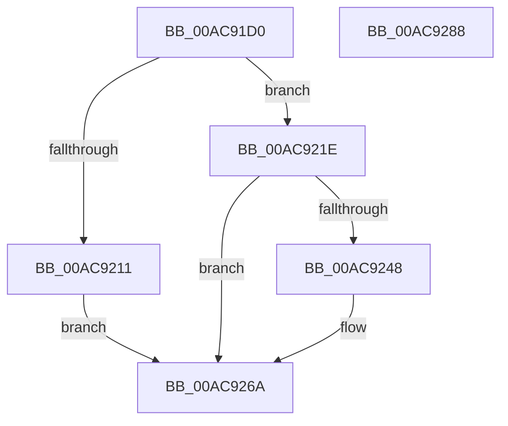

# MiLoadUserSymbols

- RVA: `0x00AC91D0`–`0x00AC9289` (길이 `185` bytes)
- VA: `0x0000000140AC91D0`
- 실행 섹션: `PAGE`
- PDB 이름 있음: `예`; PDB Function 태그: `아니요`
- unwind 정보 RVA: `0x000AC264`
- 디코드: `57`개 명령, `185/185` bytes 표시
- 미해석 바이트: `0` (있으면 어셈블리에 `.byte`로 보존)

> 이 문서는 커널 이미지의 기계어와 PDB 기호를 분석해 생성했습니다. 4번과 5번은 함수 원형과 자료형을 바이너리 사용 방식에서 추정한 C 해석이며 원본 소스 복구 결과는 아닙니다.

## 1. Dependencies

- 직접 호출 지점: **6**; 고유 호출 대상: **5**
- 직접 호출자로 확인된 함수: **1**
- RIP 상대 이미지 참조: **0**

### Outgoing calls
- `0x00AC91FC` → [MiReferenceControlAreaFile](../../text/43/MiReferenceControlAreaFile_function_00431554.md) (function, `0x00431554`)
- `0x00AC9217` → [MiDereferenceControlAreaFile](../../text/43/MiDereferenceControlAreaFile_function_004345E0.md) (function, `0x004345E0`)
- `0x00AC9232` → [DbgUnicodeStringToAnsiString](../../text/4A/DbgUnicodeStringToAnsiString_function_004AE190.md) (function, `0x004AE190`)
- `0x00AC923F` → [MiDereferenceControlAreaFile](../../text/43/MiDereferenceControlAreaFile_function_004345E0.md) (function, `0x004345E0`)
- `0x00AC925B` → [DbgLoadUserImageSymbols](../../text/5E/DbgLoadUserImageSymbols_function_005E57EC.md) (function, `0x005E57EC`)
- `0x00AC9265` → [RtlFreeAnsiString](../9C/RtlFreeAnsiString_function_009C0800.md) (function, `0x009C0800`)

### Direct callers
- [sub_00B2A146](../B2/Unknown_function_00B2A146.md) at `0x00B2A3BD`

### Static image references
- 디코드된 RIP-relative 메모리 참조가 없습니다.

## 2. Other-region calls and transfers

- 다른 실행 섹션으로 향하는 call: **5**
  - `0x00AC91FC` → [MiReferenceControlAreaFile](../../text/43/MiReferenceControlAreaFile_function_00431554.md) (`PAGE` → `.text`)
  - `0x00AC9217` → [MiDereferenceControlAreaFile](../../text/43/MiDereferenceControlAreaFile_function_004345E0.md) (`PAGE` → `.text`)
  - `0x00AC9232` → [DbgUnicodeStringToAnsiString](../../text/4A/DbgUnicodeStringToAnsiString_function_004AE190.md) (`PAGE` → `.text`)
  - `0x00AC923F` → [MiDereferenceControlAreaFile](../../text/43/MiDereferenceControlAreaFile_function_004345E0.md) (`PAGE` → `.text`)
  - `0x00AC925B` → [DbgLoadUserImageSymbols](../../text/5E/DbgLoadUserImageSymbols_function_005E57EC.md) (`PAGE` → `.text`)
- 별도 외부 분기/꼬리 이동을 확인하지 못했습니다.

## 3. Assembly (complete function range)

```asm
00AC91D0  48 8B C4                        mov rax, rsp
00AC91D3  48 89 58 08                     mov qword ptr [rax + 8], rbx
00AC91D7  48 89 68 10                     mov qword ptr [rax + 0x10], rbp
00AC91DB  48 89 70 18                     mov qword ptr [rax + 0x18], rsi
00AC91DF  57                              push rdi
00AC91E0  41 54                           push r12
00AC91E2  41 55                           push r13
00AC91E4  41 56                           push r14
00AC91E6  41 57                           push r15
00AC91E8  48 83 EC 40                     sub rsp, 0x40
00AC91EC  0F 57 C0                        xorps xmm0, xmm0
00AC91EF  49 8B E8                        mov rbp, r8
00AC91F2  0F 11 40 C8                     movups xmmword ptr [rax - 0x38], xmm0
00AC91F6  4C 8B F2                        mov r14, rdx
00AC91F9  48 8B F9                        mov rdi, rcx
00AC91FC  E8 53 83 96 FF                  call 0x140431554
00AC9201  45 33 ED                        xor r13d, r13d
00AC9204  48 8B F0                        mov rsi, rax
00AC9207  48 8D 50 58                     lea rdx, [rax + 0x58]
00AC920B  66 44 39 2A                     cmp word ptr [rdx], r13w
00AC920F  75 0D                           jne 0x140ac921e
00AC9211  48 8B D0                        mov rdx, rax
00AC9214  48 8B CF                        mov rcx, rdi
00AC9217  E8 C4 B3 96 FF                  call 0x1404345e0
00AC921C  EB 4C                           jmp 0x140ac926a
00AC921E  48 8B 07                        mov rax, qword ptr [rdi]
00AC9221  48 8B 48 38                     mov rcx, qword ptr [rax + 0x38]
00AC9225  44 8B 79 44                     mov r15d, dword ptr [rcx + 0x44]
00AC9229  44 8B 61 3C                     mov r12d, dword ptr [rcx + 0x3c]
00AC922D  48 8D 4C 24 30                  lea rcx, [rsp + 0x30]
00AC9232  E8 59 4F 9E FF                  call 0x1404ae190
00AC9237  48 8B D6                        mov rdx, rsi
00AC923A  48 8B CF                        mov rcx, rdi
00AC923D  8B D8                           mov ebx, eax
00AC923F  E8 9C B3 96 FF                  call 0x1404345e0
00AC9244  85 DB                           test ebx, ebx
00AC9246  74 22                           je 0x140ac926a
00AC9248  45 8B CF                        mov r9d, r15d
00AC924B  44 89 64 24 20                  mov dword ptr [rsp + 0x20], r12d
00AC9250  4C 8B C5                        mov r8, rbp
00AC9253  48 8D 4C 24 30                  lea rcx, [rsp + 0x30]
00AC9258  49 8B D6                        mov rdx, r14
00AC925B  E8 8C C5 B1 FF                  call 0x1405e57ec
00AC9260  48 8D 4C 24 30                  lea rcx, [rsp + 0x30]
00AC9265  E8 96 75 EF FF                  call 0x1409c0800
00AC926A  4C 8D 5C 24 40                  lea r11, [rsp + 0x40]
00AC926F  49 8B 5B 30                     mov rbx, qword ptr [r11 + 0x30]
00AC9273  49 8B 6B 38                     mov rbp, qword ptr [r11 + 0x38]
00AC9277  49 8B 73 40                     mov rsi, qword ptr [r11 + 0x40]
00AC927B  49 8B E3                        mov rsp, r11
00AC927E  41 5F                           pop r15
00AC9280  41 5E                           pop r14
00AC9282  41 5D                           pop r13
00AC9284  41 5C                           pop r12
00AC9286  5F                              pop rdi
00AC9287  C3                              ret
00AC9288  CC                              int3
```

## 4. C-style interpretation (structured pseudocode)

```c
__int64 __fastcall MiLoadUserSymbols(__int64 a1, __int64 a2, __int64 a3)
{
    __int64 result;
    __int64 v_r13;
    __int64 v_rsp;
    unsigned __int64 v_stack_m28;
    unsigned __int64 v_stack_m38;
    unsigned int v_stack_m48;

    *(unsigned __int64 *)(v_rsp + 8) = v_rbx;
    *(unsigned __int64 *)(v_rsp + 16) = v_rbp;
    *(unsigned __int64 *)(v_rsp + 24) = v_rsi;
    v_rsp = (v_rsp) - (64);
    *(unsigned __int64 *)(v_rsp - 56) = v_xmm0;
    result = MiReferenceControlAreaFile(a1, a2, a3, a4);
    v_r13 = 0;
    if ((*(unsigned __int16 *)(result + 88)) != 0) goto loc_00AC921E;
    result = MiDereferenceControlAreaFile(a1, result, a3, a4);
    goto loc_00AC926A;
loc_00AC921E:
    result = DbgUnicodeStringToAnsiString(v_stack_m38, result, a3, a4);
    result = MiDereferenceControlAreaFile(a1, result, a3, a4);
    if ((unsigned int)((unsigned int)((unsigned int)(result))) != 0) {
        a4 = (unsigned int)((unsigned int)(*(unsigned int *)(*(unsigned __int64 *)(*(unsigned __int64 *)(a1) + 56) + 68)));
        v_stack_m48 = (unsigned int)((unsigned int)(*(unsigned int *)(*(unsigned __int64 *)(*(unsigned __int64 *)(a1) + 56) + 60)));
        a3 = a3;
        a1 = v_stack_m38;
        a2 = a2;
        result = DbgLoadUserImageSymbols(a1, a2, a3, a4);
        a1 = v_stack_m38;
        result = RtlFreeAnsiString(a1, a2, a3, a4);
    }
    return result;
}
```

## 5. (Beta) C Style

```c
int64_t MiLoadUserSymbols(void *Arg1, int64_t Arg2, int64_t Arg3)
{
    uint8_t *arg1 = (uint8_t *)Arg1;

    int64_t result;
    int64_t local_r13;
    int64_t local_rsp;
    uint64_t v_stack_m28;
    uint64_t v_stack_m38;
    uint32_t v_stack_m48;

    *(uint64_t *)(local_rsp + 0x8) = local_rbx;
    *(uint64_t *)(local_rsp + 0x10) = local_rbp;
    *(uint64_t *)(local_rsp + 0x18) = local_rsi;
    local_rsp = (local_rsp) - (64);
    *(uint64_t *)(local_rsp - 0x38) = v_xmm0;
    result = MiReferenceControlAreaFile(Arg1, Arg2, Arg3, a4);
    local_r13 = 0;
    if ((*(uint16_t *)(result + 0x58)) != 0) goto loc_00AC921E;
    result = MiDereferenceControlAreaFile(Arg1, result, Arg3, a4);
    goto loc_00AC926A;
loc_00AC921E:
    result = DbgUnicodeStringToAnsiString(v_stack_m38, result, Arg3, a4);
    result = MiDereferenceControlAreaFile(Arg1, result, Arg3, a4);
    if ((uint32_t)((uint32_t)((uint32_t)(result))) != 0) {
        a4 = (uint32_t)((uint32_t)(*(uint32_t *)(*(uint64_t *)(*(uint64_t *)(arg1) + 0x38) + 0x44)));
        v_stack_m48 = (uint32_t)((uint32_t)(*(uint32_t *)(*(uint64_t *)(*(uint64_t *)(arg1) + 0x38) + 0x3C)));
        Arg3 = Arg3;
        Arg1 = v_stack_m38;
        Arg2 = Arg2;
        result = DbgLoadUserImageSymbols(Arg1, Arg2, Arg3, a4);
        Arg1 = v_stack_m38;
        result = RtlFreeAnsiString(Arg1, Arg2, Arg3, a4);
    }
    return result;
}
```

### 관측된 메모리 오프셋

구조체 형식이 확인되지 않은 접근은 인자 기준의 오프셋으로만 기록했습니다.

| 기준 인자 | 오프셋 표현 | 폭 (bit) | 접근 |
|---|---:|---:|---|
| `Arg1` | `+ 0x0` | `64` | `R` |

## 6. Execution-region graph

[열기: 2D/3D 그래프와 함수 탐색 컨트롤 패널](../../../control-panel.html?section=page&rva=0x00AC91D0&view=graph)

- 2D 그래프는 위에서 아래로 흐르고, 3D 그래프는 빈 공간을 드래그해 회전합니다. Shift+드래그는 이동, 휠은 확대·축소, 함수 노드 선택은 대상 보고서 이동입니다.

### Static fallback


