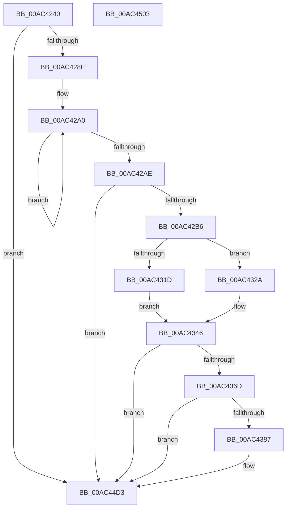

# MiLogCommitRequestFailed

- RVA: `0x00AC4240`–`0x00AC4504` (길이 `708` bytes)
- VA: `0x0000000140AC4240`
- 실행 섹션: `PAGE`
- PDB 이름 있음: `예`; PDB Function 태그: `아니요`
- unwind 정보 RVA: `0x00070670`
- 디코드: `143`개 명령, `708/708` bytes 표시
- 미해석 바이트: `0` (있으면 어셈블리에 `.byte`로 보존)

> 이 문서는 커널 이미지의 기계어와 PDB 기호를 분석해 생성했습니다. 4번과 5번은 함수 원형과 자료형을 바이너리 사용 방식에서 추정한 C 해석이며 원본 소스 복구 결과는 아닙니다.

## 1. Dependencies

- 직접 호출 지점: **5**; 고유 호출 대상: **5**
- 직접 호출자로 확인된 함수: **1**
- RIP 상대 이미지 참조: **3**

### Outgoing calls
- `0x00AC42C2` → [PsGetProcessSessionId](../../text/22/PsGetProcessSessionId_function_002233A0.md) (function, `0x002233A0`)
- `0x00AC4349` → [MiGetProcessPartition](../../text/44/MiGetProcessPartition_function_00443B10.md) (function, `0x00443B10`)
- `0x00AC437A` → [tlgKeywordOn](../../text/42/tlgKeywordOn_function_0042EAA0.md) (function, `0x0042EAA0`)
- `0x00AC44CE` → [tlgWriteEx_EtwWriteEx](../../text/4A/tlgWriteEx_EtwWriteEx_function_004AA348.md) (function, `0x004AA348`)
- `0x00AC44DD` → [_security_check_cookie](../../text/6A/_security_check_cookie_function_006AC640.md) (function, `0x006AC640`)

### Direct callers
- [MiCommitRequestFailed](MiCommitRequestFailed_function_00AC41E0.md) at `0x00AC41FC`

### Static image references
- `0x00AC4266` → RVA `0x00E0A740` (`.data`; read)
- `0x00AC4277` → RVA `0x00E37618` (`.data`; read)
- `0x00AC4393` → RVA `0x0005965F` (`.rdata`; read)

## 2. Other-region calls and transfers

- 다른 실행 섹션으로 향하는 call: **5**
  - `0x00AC42C2` → [PsGetProcessSessionId](../../text/22/PsGetProcessSessionId_function_002233A0.md) (`PAGE` → `.text`)
  - `0x00AC4349` → [MiGetProcessPartition](../../text/44/MiGetProcessPartition_function_00443B10.md) (`PAGE` → `.text`)
  - `0x00AC437A` → [tlgKeywordOn](../../text/42/tlgKeywordOn_function_0042EAA0.md) (`PAGE` → `.text`)
  - `0x00AC44CE` → [tlgWriteEx_EtwWriteEx](../../text/4A/tlgWriteEx_EtwWriteEx_function_004AA348.md) (`PAGE` → `.text`)
  - `0x00AC44DD` → [_security_check_cookie](../../text/6A/_security_check_cookie_function_006AC640.md) (`PAGE` → `.text`)
- 별도 외부 분기/꼬리 이동을 확인하지 못했습니다.

## 3. Assembly (complete function range)

```asm
00AC4240  48 8B C4                        mov rax, rsp
00AC4243  48 89 58 10                     mov qword ptr [rax + 0x10], rbx
00AC4247  48 89 70 18                     mov qword ptr [rax + 0x18], rsi
00AC424B  48 89 78 20                     mov qword ptr [rax + 0x20], rdi
00AC424F  55                              push rbp
00AC4250  41 54                           push r12
00AC4252  41 55                           push r13
00AC4254  41 56                           push r14
00AC4256  41 57                           push r15
00AC4258  48 8D A8 28 FF FF FF            lea rbp, [rax - 0xd8]
00AC425F  48 81 EC B0 01 00 00            sub rsp, 0x1b0
00AC4266  48 8B 05 D3 64 34 00            mov rax, qword ptr [rip + 0x3464d3]
00AC426D  48 33 C4                        xor rax, rsp
00AC4270  48 89 85 A0 00 00 00            mov qword ptr [rbp + 0xa0], rax
00AC4277  48 83 3D 99 33 37 00 00         cmp qword ptr [rip + 0x373399], 0
00AC427F  45 8B F0                        mov r14d, r8d
00AC4282  4C 8B FA                        mov r15, rdx
00AC4285  48 8B D9                        mov rbx, rcx
00AC4288  0F 84 45 02 00 00               je 0x140ac44d3
00AC428E  0F 0D 89 FC 05 00 00            prefetchw byte ptr [rcx + 0x5fc]
00AC4295  8B 81 FC 05 00 00               mov eax, dword ptr [rcx + 0x5fc]
00AC429B  BA 00 04 00 00                  mov edx, 0x400
00AC42A0  8B C8                           mov ecx, eax
00AC42A2  0B CA                           or ecx, edx
00AC42A4  F0 0F B1 8B FC 05 00 00         lock cmpxchg dword ptr [rbx + 0x5fc], ecx
00AC42AC  75 F2                           jne 0x140ac42a0
00AC42AE  85 C2                           test edx, eax
00AC42B0  0F 85 1D 02 00 00               jne 0x140ac44d3
00AC42B6  8B 83 D0 01 00 00               mov eax, dword ptr [rbx + 0x1d0]
00AC42BC  48 8B CB                        mov rcx, rbx
00AC42BF  89 45 A0                        mov dword ptr [rbp - 0x60], eax
00AC42C2  E8 D9 F0 75 FF                  call 0x1402233a0
00AC42C7  66 89 45 A4                     mov word ptr [rbp - 0x5c], ax
00AC42CB  66 A1 C4 02 00 00 80 F7 FF FF   movabs ax, word ptr [0xfffff780000002c4]
00AC42D5  66 89 45 A6                     mov word ptr [rbp - 0x5a], ax
00AC42D9  48 8B 83 F8 01 00 00            mov rax, qword ptr [rbx + 0x1f8]
00AC42E0  48 89 45 A8                     mov qword ptr [rbp - 0x58], rax
00AC42E4  48 8B 83 F8 02 00 00            mov rax, qword ptr [rbx + 0x2f8]
00AC42EB  4C 8B A0 40 01 00 00            mov r12, qword ptr [rax + 0x140]
00AC42F2  4C 8B A8 00 01 00 00            mov r13, qword ptr [rax + 0x100]
00AC42F9  48 8B 83 D0 03 00 00            mov rax, qword ptr [rbx + 0x3d0]
00AC4300  48 89 44 24 48                  mov qword ptr [rsp + 0x48], rax
00AC4305  48 8B 83 D8 03 00 00            mov rax, qword ptr [rbx + 0x3d8]
00AC430C  48 89 44 24 50                  mov qword ptr [rsp + 0x50], rax
00AC4311  48 8B 83 A0 02 00 00            mov rax, qword ptr [rbx + 0x2a0]
00AC4318  48 85 C0                        test rax, rax
00AC431B  75 0D                           jne 0x140ac432a
00AC431D  45 33 C9                        xor r9d, r9d
00AC4320  45 33 D2                        xor r10d, r10d
00AC4323  45 33 DB                        xor r11d, r11d
00AC4326  33 FF                           xor edi, edi
00AC4328  EB 1C                           jmp 0x140ac4346
00AC432A  4C 8B 88 20 06 00 00            mov r9, qword ptr [rax + 0x620]
00AC4331  4C 8B 90 B8 04 00 00            mov r10, qword ptr [rax + 0x4b8]
00AC4338  4C 8B 98 B8 02 00 00            mov r11, qword ptr [rax + 0x2b8]
00AC433F  48 8B B8 C0 02 00 00            mov rdi, qword ptr [rax + 0x2c0]
00AC4346  48 8B CB                        mov rcx, rbx
00AC4349  E8 C2 F7 97 FF                  call 0x140443b10
00AC434E  48 8B 98 98 4C 00 00            mov rbx, qword ptr [rax + 0x4c98]
00AC4355  48 8B B0 40 4B 00 00            mov rsi, qword ptr [rax + 0x4b40]
00AC435C  4C 8B 05 B5 32 37 00            mov r8, qword ptr [rip + 0x3732b5]
00AC4363  41 83 38 02                     cmp dword ptr [r8], 2
00AC4367  0F 86 66 01 00 00               jbe 0x140ac44d3
00AC436D  48 BA 00 10 00 00 00 40 00 00   movabs rdx, 0x400000001000
00AC4377  49 8B C8                        mov rcx, r8
00AC437A  E8 21 A7 96 FF                  call 0x14042eaa0
00AC437F  84 C0                           test al, al
00AC4381  0F 84 4C 01 00 00               je 0x140ac44d3
00AC4387  48 8D 45 A0                     lea rax, [rbp - 0x60]
00AC438B  4C 89 4D 88                     mov qword ptr [rbp - 0x78], r9
00AC438F  48 89 45 D0                     mov qword ptr [rbp - 0x30], rax
00AC4393  48 8D 15 C5 52 59 FF            lea rdx, [rip - 0xa6ad3b]
00AC439A  48 8D 44 24 58                  lea rax, [rsp + 0x58]
00AC439F  48 C7 45 D8 10 00 00 00         mov qword ptr [rbp - 0x28], 0x10
00AC43A7  48 89 45 E0                     mov qword ptr [rbp - 0x20], rax
00AC43AB  41 B9 01 00 00 00               mov r9d, 1
00AC43B1  48 8D 44 24 40                  lea rax, [rsp + 0x40]
00AC43B6  4C 89 7C 24 58                  mov qword ptr [rsp + 0x58], r15
00AC43BB  48 89 45 F0                     mov qword ptr [rbp - 0x10], rax
00AC43BF  49 8B C8                        mov rcx, r8
00AC43C2  48 8D 44 24 60                  lea rax, [rsp + 0x60]
00AC43C7  48 C7 45 E8 08 00 00 00         mov qword ptr [rbp - 0x18], 8
00AC43CF  48 89 45 00                     mov qword ptr [rbp], rax
00AC43D3  48 8D 44 24 68                  lea rax, [rsp + 0x68]
00AC43D8  48 89 45 10                     mov qword ptr [rbp + 0x10], rax
00AC43DC  48 8B 44 24 48                  mov rax, qword ptr [rsp + 0x48]
00AC43E1  48 89 44 24 48                  mov qword ptr [rsp + 0x48], rax
00AC43E6  48 8D 44 24 48                  lea rax, [rsp + 0x48]
00AC43EB  48 89 45 20                     mov qword ptr [rbp + 0x20], rax
00AC43EF  48 8B 44 24 50                  mov rax, qword ptr [rsp + 0x50]
00AC43F4  48 89 44 24 50                  mov qword ptr [rsp + 0x50], rax
00AC43F9  48 8D 44 24 50                  lea rax, [rsp + 0x50]
00AC43FE  48 89 45 30                     mov qword ptr [rbp + 0x30], rax
00AC4402  48 8D 44 24 70                  lea rax, [rsp + 0x70]
00AC4407  48 89 45 40                     mov qword ptr [rbp + 0x40], rax
00AC440B  48 8D 44 24 78                  lea rax, [rsp + 0x78]
00AC4410  48 89 45 50                     mov qword ptr [rbp + 0x50], rax
00AC4414  48 8D 45 80                     lea rax, [rbp - 0x80]
00AC4418  48 89 45 60                     mov qword ptr [rbp + 0x60], rax
00AC441C  48 8D 45 88                     lea rax, [rbp - 0x78]
00AC4420  48 89 45 70                     mov qword ptr [rbp + 0x70], rax
00AC4424  48 8D 45 90                     lea rax, [rbp - 0x70]
00AC4428  48 89 85 80 00 00 00            mov qword ptr [rbp + 0x80], rax
00AC442F  48 8D 45 98                     lea rax, [rbp - 0x68]
00AC4433  48 89 85 90 00 00 00            mov qword ptr [rbp + 0x90], rax
00AC443A  48 8D 45 B0                     lea rax, [rbp - 0x50]
00AC443E  48 89 44 24 38                  mov qword ptr [rsp + 0x38], rax
00AC4443  C7 44 24 30 0F 00 00 00         mov dword ptr [rsp + 0x30], 0xf
00AC444B  44 89 74 24 40                  mov dword ptr [rsp + 0x40], r14d
00AC4450  48 C7 45 F8 04 00 00 00         mov qword ptr [rbp - 8], 4
00AC4458  4C 89 64 24 60                  mov qword ptr [rsp + 0x60], r12
00AC445D  48 C7 45 08 08 00 00 00         mov qword ptr [rbp + 8], 8
00AC4465  4C 89 6C 24 68                  mov qword ptr [rsp + 0x68], r13
00AC446A  48 C7 45 18 08 00 00 00         mov qword ptr [rbp + 0x18], 8
00AC4472  48 C7 45 28 08 00 00 00         mov qword ptr [rbp + 0x28], 8
00AC447A  48 C7 45 38 08 00 00 00         mov qword ptr [rbp + 0x38], 8
00AC4482  4C 89 5C 24 70                  mov qword ptr [rsp + 0x70], r11
00AC4487  48 C7 45 48 08 00 00 00         mov qword ptr [rbp + 0x48], 8
00AC448F  48 89 7C 24 78                  mov qword ptr [rsp + 0x78], rdi
00AC4494  48 C7 45 58 08 00 00 00         mov qword ptr [rbp + 0x58], 8
00AC449C  4C 89 55 80                     mov qword ptr [rbp - 0x80], r10
00AC44A0  48 C7 45 68 08 00 00 00         mov qword ptr [rbp + 0x68], 8
00AC44A8  48 C7 45 78 08 00 00 00         mov qword ptr [rbp + 0x78], 8
00AC44B0  48 89 5D 90                     mov qword ptr [rbp - 0x70], rbx
00AC44B4  48 C7 85 88 00 00 00 08 00 00 00  mov qword ptr [rbp + 0x88], 8
00AC44BF  48 89 75 98                     mov qword ptr [rbp - 0x68], rsi
00AC44C3  48 C7 85 98 00 00 00 08 00 00 00  mov qword ptr [rbp + 0x98], 8
00AC44CE  E8 75 5E 9E FF                  call 0x1404aa348
00AC44D3  48 8B 8D A0 00 00 00            mov rcx, qword ptr [rbp + 0xa0]
00AC44DA  48 33 CC                        xor rcx, rsp
00AC44DD  E8 5E 81 BE FF                  call 0x1406ac640
00AC44E2  4C 8D 9C 24 B0 01 00 00         lea r11, [rsp + 0x1b0]
00AC44EA  49 8B 5B 38                     mov rbx, qword ptr [r11 + 0x38]
00AC44EE  49 8B 73 40                     mov rsi, qword ptr [r11 + 0x40]
00AC44F2  49 8B 7B 48                     mov rdi, qword ptr [r11 + 0x48]
00AC44F6  49 8B E3                        mov rsp, r11
00AC44F9  41 5F                           pop r15
00AC44FB  41 5E                           pop r14
00AC44FD  41 5D                           pop r13
00AC44FF  41 5C                           pop r12
00AC4501  5D                              pop rbp
00AC4502  C3                              ret
00AC4503  CC                              int3
```

## 4. C-style interpretation (structured pseudocode)

```c
__int64 __fastcall MiLogCommitRequestFailed(__int64 a1, __int64 a2, int a3, int a4)
{
    __int64 result;
    __int64 v_r10;
    __int64 v_r11;
    __int64 v_rdi;
    __int64 v_rsp;
    unsigned __int64 v_stack_m160;
    unsigned __int64 v_stack_m168;
    unsigned __int64 v_stack_m170;
    unsigned __int64 v_stack_m178;
    unsigned __int64 v_stack_m180;
    unsigned __int64 v_stack_m188;
    unsigned __int64 v_stack_m190;
    unsigned __int64 v_stack_m198;
    unsigned __int64 v_stack_m1A0;
    unsigned int v_stack_m1A8;
    unsigned __int64 v_stack_m28;

    *(unsigned __int64 *)(v_rsp + 16) = v_rbx;
    *(unsigned __int64 *)(v_rsp + 24) = v_rsi;
    *(unsigned __int64 *)(v_rsp + 32) = v_rdi;
    v_rsp = (v_rsp) - (432);
    result = (*(unsigned __int64 *)(v_rip + 3433683)) ^ (v_rsp);
    *(unsigned __int64 *)(v_rsp - 216 + 160) = result;
    if ((*(unsigned __int64 *)(v_rip + 3617689)) == 0) goto loc_00AC44D3;
loc_00AC42A0:
    a1 = (unsigned int)(((unsigned int)((unsigned int)((unsigned int)(*(unsigned int *)(a1 + 1532))))) | ((unsigned int)((unsigned int)(0x400ULL))));
    if (condition_is_not_equal) goto loc_00AC42A0;
    if ((((unsigned int)((unsigned int)(0x400ULL))) & ((unsigned int)((unsigned int)(*(unsigned int *)(a1 + 1532))))) != 0) goto loc_00AC44D3;
    *(unsigned int *)(v_rsp - 216 - 96) = (unsigned int)((unsigned int)(*(unsigned int *)(a1 + 464)));
    result = PsGetProcessSessionId(a1, (unsigned int)(0x400ULL), a3, a4);
    *(unsigned __int16 *)(v_rsp - 216 - 92) = (unsigned __int16)(result);
    *(unsigned __int16 *)(v_rsp - 216 - 90) = (unsigned __int16)(result);
    *(unsigned __int64 *)(v_rsp - 216 - 88) = *(unsigned __int64 *)(a1 + 504);
    v_stack_m190 = *(unsigned __int64 *)(a1 + 976);
    v_stack_m188 = *(unsigned __int64 *)(a1 + 984);
    if (*(unsigned __int64 *)(a1 + 672) != 0) goto loc_00AC432A;
    a4 = 0;
    v_r10 = 0;
    v_r11 = 0;
    v_rdi = 0;
    goto loc_00AC4346;
loc_00AC432A:
loc_00AC4346:
    result = MiGetProcessPartition(a1, (unsigned int)(0x400ULL), a3, *(unsigned __int64 *)(*(unsigned __int64 *)(a1 + 672) + 1568));
    if ((*(unsigned int *)(*(unsigned __int64 *)(v_rip + 3617461))) <= 2) goto loc_00AC44D3;
    result = tlgKeywordOn(*(unsigned __int64 *)(v_rip + 3617461), (unsigned int)(0x400ULL), *(unsigned __int64 *)(v_rip + 3617461), *(unsigned __int64 *)(*(unsigned __int64 *)(a1 + 672) + 1568));
    if ((unsigned __int8)(result) != 0) {
        result = v_rsp - 216 - 96;
        *(unsigned __int64 *)(v_rsp - 216 - 120) = *(unsigned __int64 *)(*(unsigned __int64 *)(a1 + 672) + 1568);
        *(unsigned __int64 *)(v_rsp - 216 - 48) = result;
        a2 = v_rip - 10923323;
        result = v_stack_m180;
        *(unsigned __int64 *)(v_rsp - 216 - 40) = 16;
        *(unsigned __int64 *)(v_rsp - 216 - 32) = result;
        a4 = 1;
        result = v_stack_m198;
        v_stack_m180 = a2;
        *(unsigned __int64 *)(v_rsp - 216 - 16) = result;
        a1 = *(unsigned __int64 *)(v_rip + 3617461);
        result = v_stack_m178;
        *(unsigned __int64 *)(v_rsp - 216 - 24) = 8;
        *(unsigned __int64 *)(v_rsp - 216) = result;
        result = v_stack_m170;
        *(unsigned __int64 *)(v_rsp - 216 + 16) = result;
        result = v_stack_m190;
        v_stack_m190 = result;
        result = v_stack_m190;
        *(unsigned __int64 *)(v_rsp - 216 + 32) = result;
        result = v_stack_m188;
        v_stack_m188 = result;
        result = v_stack_m188;
        *(unsigned __int64 *)(v_rsp - 216 + 48) = result;
        result = v_stack_m168;
        *(unsigned __int64 *)(v_rsp - 216 + 64) = result;
        result = v_stack_m160;
        *(unsigned __int64 *)(v_rsp - 216 + 80) = result;
        result = v_rsp - 216 - 128;
        *(unsigned __int64 *)(v_rsp - 216 + 96) = result;
        result = v_rsp - 216 - 120;
        *(unsigned __int64 *)(v_rsp - 216 + 112) = result;
        result = v_rsp - 216 - 112;
        *(unsigned __int64 *)(v_rsp - 216 + 128) = result;
        result = v_rsp - 216 - 104;
        *(unsigned __int64 *)(v_rsp - 216 + 144) = result;
        result = v_rsp - 216 - 80;
        v_stack_m1A0 = result;
        v_stack_m1A8 = 15;
        v_stack_m198 = (unsigned int)((unsigned int)(a3));
        *(unsigned __int64 *)(v_rsp - 216 - 8) = 4;
        v_stack_m178 = *(unsigned __int64 *)(*(unsigned __int64 *)(a1 + 760) + 320);
        *(unsigned __int64 *)(v_rsp - 216 + 8) = 8;
        v_stack_m170 = *(unsigned __int64 *)(*(unsigned __int64 *)(a1 + 760) + 256);
        *(unsigned __int64 *)(v_rsp - 216 + 24) = 8;
        *(unsigned __int64 *)(v_rsp - 216 + 40) = 8;
        *(unsigned __int64 *)(v_rsp - 216 + 56) = 8;
        v_stack_m168 = *(unsigned __int64 *)(*(unsigned __int64 *)(a1 + 672) + 696);
        *(unsigned __int64 *)(v_rsp - 216 + 72) = 8;
        v_stack_m160 = *(unsigned __int64 *)(*(unsigned __int64 *)(a1 + 672) + 704);
        *(unsigned __int64 *)(v_rsp - 216 + 88) = 8;
        *(unsigned __int64 *)(v_rsp - 216 - 128) = *(unsigned __int64 *)(*(unsigned __int64 *)(a1 + 672) + 1208);
        *(unsigned __int64 *)(v_rsp - 216 + 104) = 8;
        *(unsigned __int64 *)(v_rsp - 216 + 120) = 8;
        *(unsigned __int64 *)(v_rsp - 216 - 112) = *(unsigned __int64 *)(result + 19608);
        *(unsigned __int64 *)(v_rsp - 216 + 136) = 8;
        *(unsigned __int64 *)(v_rsp - 216 - 104) = *(unsigned __int64 *)(result + 19264);
        *(unsigned __int64 *)(v_rsp - 216 + 152) = 8;
        result = tlgWriteEx_EtwWriteEx(a1, a2, *(unsigned __int64 *)(v_rip + 3617461), a4);
    }
    a1 = (*(unsigned __int64 *)(v_rsp - 216 + 160)) ^ (v_rsp);
    result = _security_check_cookie(a1, a2, *(unsigned __int64 *)(v_rip + 3617461), a4);
    return result;
}
```

## 5. (Beta) C Style

```c
int64_t MiLogCommitRequestFailed(void *Arg1, int64_t Arg2, int32_t Arg3, int32_t Arg4)
{
    uint8_t *arg1 = (uint8_t *)Arg1;

    int64_t result;
    int64_t local_r10;
    int64_t local_r11;
    int64_t local_rdi;
    int64_t local_rsp;
    uint64_t v_stack_m160;
    uint64_t v_stack_m168;
    uint64_t v_stack_m170;
    uint64_t v_stack_m178;
    uint64_t v_stack_m180;
    uint64_t v_stack_m188;
    uint64_t v_stack_m190;
    uint64_t v_stack_m198;
    uint64_t v_stack_m1A0;
    uint32_t v_stack_m1A8;
    uint64_t v_stack_m28;

    *(uint64_t *)(local_rsp + 0x10) = local_rbx;
    *(uint64_t *)(local_rsp + 0x18) = local_rsi;
    *(uint64_t *)(local_rsp + 0x20) = local_rdi;
    local_rsp = (local_rsp) - (432);
    result = (*(uint64_t *)(v_rip + 0x3464D3)) ^ (local_rsp);
    *(uint64_t *)(local_rsp - 0xD8 + 0xA0) = result;
    if ((*(uint64_t *)(v_rip + 0x373399)) == 0) goto loc_00AC44D3;
loc_00AC42A0:
    Arg1 = (uint32_t)(((uint32_t)((uint32_t)((uint32_t)(*(uint32_t *)(arg1 + 0x5FC))))) | ((uint32_t)((uint32_t)(0x400ULL))));
    if (condition_is_not_equal) goto loc_00AC42A0;
    if ((((uint32_t)((uint32_t)(0x400ULL))) & ((uint32_t)((uint32_t)(*(uint32_t *)(arg1 + 0x5FC))))) != 0) goto loc_00AC44D3;
    *(uint32_t *)(local_rsp - 0xD8 - 0x60) = (uint32_t)((uint32_t)(*(uint32_t *)(arg1 + 0x1D0)));
    result = PsGetProcessSessionId(Arg1, (uint32_t)(0x400ULL), Arg3, Arg4);
    *(uint16_t *)(local_rsp - 0xD8 - 0x5C) = (uint16_t)(result);
    *(uint16_t *)(local_rsp - 0xD8 - 0x5A) = (uint16_t)(result);
    *(uint64_t *)(local_rsp - 0xD8 - 0x58) = *(uint64_t *)(arg1 + 0x1F8);
    v_stack_m190 = *(uint64_t *)(arg1 + 0x3D0);
    v_stack_m188 = *(uint64_t *)(arg1 + 0x3D8);
    if (*(uint64_t *)(arg1 + 0x2A0) != 0) goto loc_00AC432A;
    Arg4 = 0;
    local_r10 = 0;
    local_r11 = 0;
    local_rdi = 0;
    goto loc_00AC4346;
loc_00AC432A:
loc_00AC4346:
    result = MiGetProcessPartition(Arg1, (uint32_t)(0x400ULL), Arg3, *(uint64_t *)(*(uint64_t *)(arg1 + 0x2A0) + 0x620));
    if ((*(uint32_t *)(*(uint64_t *)(v_rip + 0x3732B5))) <= 2) goto loc_00AC44D3;
    result = tlgKeywordOn(*(uint64_t *)(v_rip + 0x3732B5), (uint32_t)(0x400ULL), *(uint64_t *)(v_rip + 0x3732B5), *(uint64_t *)(*(uint64_t *)(arg1 + 0x2A0) + 0x620));
    if ((uint8_t)(result) != 0) {
        result = local_rsp - 216 - 96;
        *(uint64_t *)(local_rsp - 0xD8 - 0x78) = *(uint64_t *)(*(uint64_t *)(arg1 + 0x2A0) + 0x620);
        *(uint64_t *)(local_rsp - 0xD8 - 0x30) = result;
        Arg2 = v_rip - 10923323;
        result = v_stack_m180;
        *(uint64_t *)(local_rsp - 0xD8 - 0x28) = 16;
        *(uint64_t *)(local_rsp - 0xD8 - 0x20) = result;
        Arg4 = 1;
        result = v_stack_m198;
        v_stack_m180 = Arg2;
        *(uint64_t *)(local_rsp - 0xD8 - 0x10) = result;
        Arg1 = *(uint64_t *)(v_rip + 0x3732B5);
        result = v_stack_m178;
        *(uint64_t *)(local_rsp - 0xD8 - 0x18) = 8;
        *(uint64_t *)(local_rsp - 0xD8) = result;
        result = v_stack_m170;
        *(uint64_t *)(local_rsp - 0xD8 + 0x10) = result;
        result = v_stack_m190;
        v_stack_m190 = result;
        result = v_stack_m190;
        *(uint64_t *)(local_rsp - 0xD8 + 0x20) = result;
        result = v_stack_m188;
        v_stack_m188 = result;
        result = v_stack_m188;
        *(uint64_t *)(local_rsp - 0xD8 + 0x30) = result;
        result = v_stack_m168;
        *(uint64_t *)(local_rsp - 0xD8 + 0x40) = result;
        result = v_stack_m160;
        *(uint64_t *)(local_rsp - 0xD8 + 0x50) = result;
        result = local_rsp - 216 - 128;
        *(uint64_t *)(local_rsp - 0xD8 + 0x60) = result;
        result = local_rsp - 216 - 120;
        *(uint64_t *)(local_rsp - 0xD8 + 0x70) = result;
        result = local_rsp - 216 - 112;
        *(uint64_t *)(local_rsp - 0xD8 + 0x80) = result;
        result = local_rsp - 216 - 104;
        *(uint64_t *)(local_rsp - 0xD8 + 0x90) = result;
        result = local_rsp - 216 - 80;
        v_stack_m1A0 = result;
        v_stack_m1A8 = 15;
        v_stack_m198 = (uint32_t)((uint32_t)(Arg3));
        *(uint64_t *)(local_rsp - 0xD8 - 0x8) = 4;
        v_stack_m178 = *(uint64_t *)(*(uint64_t *)(arg1 + 0x2F8) + 0x140);
        *(uint64_t *)(local_rsp - 0xD8 + 0x8) = 8;
        v_stack_m170 = *(uint64_t *)(*(uint64_t *)(arg1 + 0x2F8) + 0x100);
        *(uint64_t *)(local_rsp - 0xD8 + 0x18) = 8;
        *(uint64_t *)(local_rsp - 0xD8 + 0x28) = 8;
        *(uint64_t *)(local_rsp - 0xD8 + 0x38) = 8;
        v_stack_m168 = *(uint64_t *)(*(uint64_t *)(arg1 + 0x2A0) + 0x2B8);
        *(uint64_t *)(local_rsp - 0xD8 + 0x48) = 8;
        v_stack_m160 = *(uint64_t *)(*(uint64_t *)(arg1 + 0x2A0) + 0x2C0);
        *(uint64_t *)(local_rsp - 0xD8 + 0x58) = 8;
        *(uint64_t *)(local_rsp - 0xD8 - 0x80) = *(uint64_t *)(*(uint64_t *)(arg1 + 0x2A0) + 0x4B8);
        *(uint64_t *)(local_rsp - 0xD8 + 0x68) = 8;
        *(uint64_t *)(local_rsp - 0xD8 + 0x78) = 8;
        *(uint64_t *)(local_rsp - 0xD8 - 0x70) = *(uint64_t *)(result + 0x4C98);
        *(uint64_t *)(local_rsp - 0xD8 + 0x88) = 8;
        *(uint64_t *)(local_rsp - 0xD8 - 0x68) = *(uint64_t *)(result + 0x4B40);
        *(uint64_t *)(local_rsp - 0xD8 + 0x98) = 8;
        result = tlgWriteEx_EtwWriteEx(Arg1, Arg2, *(uint64_t *)(v_rip + 0x3732B5), Arg4);
    }
    Arg1 = (*(uint64_t *)(local_rsp - 0xD8 + 0xA0)) ^ (local_rsp);
    result = _security_check_cookie(Arg1, Arg2, *(uint64_t *)(v_rip + 0x3732B5), Arg4);
    return result;
}
```

### 관측된 메모리 오프셋

구조체 형식이 확인되지 않은 접근은 인자 기준의 오프셋으로만 기록했습니다.

| 기준 인자 | 오프셋 표현 | 폭 (bit) | 접근 |
|---|---:|---:|---|
| `Arg1` | `+ 0x1D0` | `32` | `R` |
| `Arg1` | `+ 0x1F8` | `64` | `R` |
| `Arg1` | `+ 0x2A0` | `64` | `R` |
| `Arg1` | `+ 0x2F8` | `64` | `R` |
| `Arg1` | `+ 0x3D0` | `64` | `R` |
| `Arg1` | `+ 0x3D8` | `64` | `R` |
| `Arg1` | `+ 0x5FC` | `8` | `R` |
| `Arg1` | `+ 0x5FC` | `32` | `R` |

## 6. Execution-region graph

[열기: 2D/3D 그래프와 함수 탐색 컨트롤 패널](../../../control-panel.html?section=page&rva=0x00AC4240&view=graph)

- 2D 그래프는 위에서 아래로 흐르고, 3D 그래프는 빈 공간을 드래그해 회전합니다. Shift+드래그는 이동, 휠은 확대·축소, 함수 노드 선택은 대상 보고서 이동입니다.

### Static fallback


