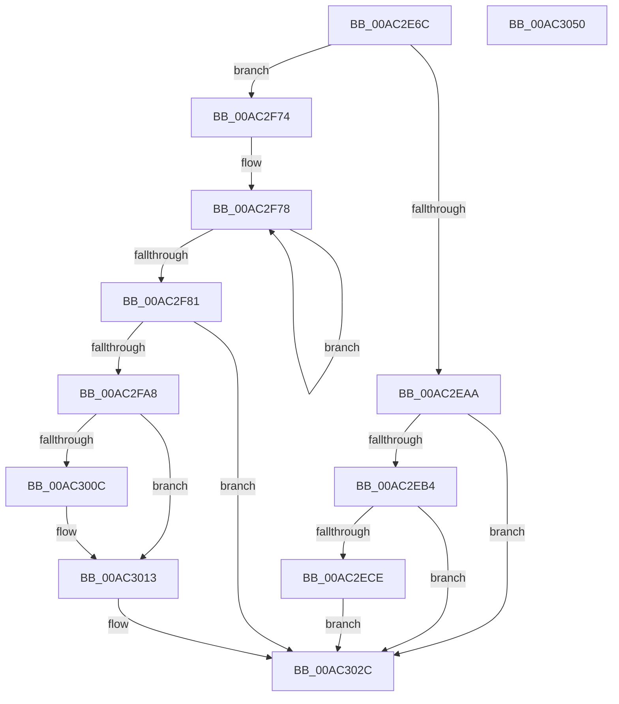

# MiLogStrongCodeDriverLoadFailure

- RVA: `0x00AC2E6C`–`0x00AC3051` (길이 `485` bytes)
- VA: `0x0000000140AC2E6C`
- 실행 섹션: `PAGE`
- PDB 이름 있음: `예`; PDB Function 태그: `아니요`
- unwind 정보 RVA: `0x000BDCE8`
- 디코드: `119`개 명령, `485/485` bytes 표시
- 미해석 바이트: `0` (있으면 어셈블리에 `.byte`로 보존)

> 이 문서는 커널 이미지의 기계어와 PDB 기호를 분석해 생성했습니다. 4번과 5번은 함수 원형과 자료형을 바이너리 사용 방식에서 추정한 C 해석이며 원본 소스 복구 결과는 아닙니다.

## 1. Dependencies

- 직접 호출 지점: **9**; 고유 호출 대상: **8**
- 직접 호출자로 확인된 함수: **3**
- RIP 상대 이미지 참조: **6**

### Outgoing calls
- `0x00AC2EC1` → [tlgKeywordOn](../../text/42/tlgKeywordOn_function_0042EAA0.md) (function, `0x0042EAA0`)
- `0x00AC2ED5` → [tlgCreate1Sz_char](../../text/42/tlgCreate1Sz_char_function_00427304.md) (function, `0x00427304`)
- `0x00AC2F6A` → [tlgWriteEx_EtwWriteEx](../../text/4A/tlgWriteEx_EtwWriteEx_function_004AA348.md) (function, `0x004AA348`)
- `0x00AC2F97` → [MiAllocatePool](../../text/35/MiAllocatePool_function_0035B540.md) (function, `0x0035B540`)
- `0x00AC2FB7` → [memcpy](../../text/6C/memcpy_function_006C6840.md) (function, `0x006C6840`)
- `0x00AC2FD0` → [memcpy](../../text/6C/memcpy_function_006C6840.md) (function, `0x006C6840`)
- `0x00AC2FF4` → [MmAcquireLoadLock](../../text/4D/MmAcquireLoadLock_function_004DC2A0.md) (function, `0x004DC2A0`)
- `0x00AC3027` → [MmReleaseLoadLock](../../text/4D/MmReleaseLoadLock_function_004D36D0.md) (function, `0x004D36D0`)
- `0x00AC3033` → [_security_check_cookie](../../text/6A/_security_check_cookie_function_006AC640.md) (function, `0x006AC640`)

### Direct callers
- [MmLoadSystemImageEx](../99/MmLoadSystemImageEx_function_00999B8C.md) at `0x00999EC7`
- [MiProcessKernelCfgImageLoadConfig](../A7/MiProcessKernelCfgImageLoadConfig_function_00A7FE40.md) at `0x00A7FEDE`
- [MiProcessKernelCfgImageLoadConfig](../A7/MiProcessKernelCfgImageLoadConfig_function_00A7FE40.md) at `0x00A7FF6C`
- [MiSetImportTableProtection](MiSetImportTableProtection_function_00AC2D2C.md) at `0x00AC2DA2`
- [MiSetImportTableProtection](MiSetImportTableProtection_function_00AC2D2C.md) at `0x00AC2E4F`

### Static image references
- `0x00AC2E86` → RVA `0x00E0A740` (`.data`; read)
- `0x00AC2E94` → RVA `0x00E37618` (`.data`; read)
- `0x00AC2EE6` → RVA `0x00057CF6` (`.rdata`; read)
- `0x00AC2FF9` → RVA `0x00E2D938` (`.data`; read)
- `0x00AC3000` → RVA `0x00E2D930` (`.data`; read)
- `0x00AC3020` → RVA `0x00E2D938` (`.data`; write)

## 2. Other-region calls and transfers

- 다른 실행 섹션으로 향하는 call: **9**
  - `0x00AC2EC1` → [tlgKeywordOn](../../text/42/tlgKeywordOn_function_0042EAA0.md) (`PAGE` → `.text`)
  - `0x00AC2ED5` → [tlgCreate1Sz_char](../../text/42/tlgCreate1Sz_char_function_00427304.md) (`PAGE` → `.text`)
  - `0x00AC2F6A` → [tlgWriteEx_EtwWriteEx](../../text/4A/tlgWriteEx_EtwWriteEx_function_004AA348.md) (`PAGE` → `.text`)
  - `0x00AC2F97` → [MiAllocatePool](../../text/35/MiAllocatePool_function_0035B540.md) (`PAGE` → `.text`)
  - `0x00AC2FB7` → [memcpy](../../text/6C/memcpy_function_006C6840.md) (`PAGE` → `.text`)
  - `0x00AC2FD0` → [memcpy](../../text/6C/memcpy_function_006C6840.md) (`PAGE` → `.text`)
  - `0x00AC2FF4` → [MmAcquireLoadLock](../../text/4D/MmAcquireLoadLock_function_004DC2A0.md) (`PAGE` → `.text`)
  - `0x00AC3027` → [MmReleaseLoadLock](../../text/4D/MmReleaseLoadLock_function_004D36D0.md) (`PAGE` → `.text`)
  - `0x00AC3033` → [_security_check_cookie](../../text/6A/_security_check_cookie_function_006AC640.md) (`PAGE` → `.text`)
- 별도 외부 분기/꼬리 이동을 확인하지 못했습니다.

## 3. Assembly (complete function range)

```asm
00AC2E6C  48 89 5C 24 18                  mov qword ptr [rsp + 0x18], rbx
00AC2E71  48 89 74 24 20                  mov qword ptr [rsp + 0x20], rsi
00AC2E76  55                              push rbp
00AC2E77  57                              push rdi
00AC2E78  41 56                           push r14
00AC2E7A  48 8D 6C 24 B9                  lea rbp, [rsp - 0x47]
00AC2E7F  48 81 EC E0 00 00 00            sub rsp, 0xe0
00AC2E86  48 8B 05 B3 78 34 00            mov rax, qword ptr [rip + 0x3478b3]
00AC2E8D  48 33 C4                        xor rax, rsp
00AC2E90  48 89 45 37                     mov qword ptr [rbp + 0x37], rax
00AC2E94  4C 8B 05 7D 47 37 00            mov r8, qword ptr [rip + 0x37477d]
00AC2E9B  48 8B F2                        mov rsi, rdx
00AC2E9E  4C 8B F1                        mov r14, rcx
00AC2EA1  4D 85 C0                        test r8, r8
00AC2EA4  0F 84 CA 00 00 00               je 0x140ac2f74
00AC2EAA  41 83 38 02                     cmp dword ptr [r8], 2
00AC2EAE  0F 86 78 01 00 00               jbe 0x140ac302c
00AC2EB4  48 BA 00 40 00 00 00 40 00 00   movabs rdx, 0x400000004000
00AC2EBE  49 8B C8                        mov rcx, r8
00AC2EC1  E8 DA BB 96 FF                  call 0x14042eaa0
00AC2EC6  84 C0                           test al, al
00AC2EC8  0F 84 5E 01 00 00               je 0x140ac302c
00AC2ECE  49 8B D6                        mov rdx, r14
00AC2ED1  48 8D 4D D7                     lea rcx, [rbp - 0x29]
00AC2ED5  E8 2A 44 96 FF                  call 0x140427304
00AC2EDA  83 65 F3 00                     and dword ptr [rbp - 0xd], 0
00AC2EDE  48 8D 45 FF                     lea rax, [rbp - 1]
00AC2EE2  83 65 03 00                     and dword ptr [rbp + 3], 0
00AC2EE6  48 8D 15 09 4E 59 FF            lea rdx, [rip - 0xa6b1f7]
00AC2EED  83 65 13 00                     and dword ptr [rbp + 0x13], 0
00AC2EF1  B9 04 00 00 00                  mov ecx, 4
00AC2EF6  83 65 23 00                     and dword ptr [rbp + 0x23], 0
00AC2EFA  83 65 33 00                     and dword ptr [rbp + 0x33], 0
00AC2EFE  48 89 45 E7                     mov qword ptr [rbp - 0x19], rax
00AC2F02  48 8B 46 60                     mov rax, qword ptr [rsi + 0x60]
00AC2F06  48 89 45 F7                     mov qword ptr [rbp - 9], rax
00AC2F0A  0F B7 46 58                     movzx eax, word ptr [rsi + 0x58]
00AC2F0E  89 45 FF                        mov dword ptr [rbp - 1], eax
00AC2F11  8B 46 78                        mov eax, dword ptr [rsi + 0x78]
00AC2F14  89 45 A7                        mov dword ptr [rbp - 0x59], eax
00AC2F17  48 8D 45 A7                     lea rax, [rbp - 0x59]
00AC2F1B  48 89 45 07                     mov qword ptr [rbp + 7], rax
00AC2F1F  8B 86 9C 00 00 00               mov eax, dword ptr [rsi + 0x9c]
00AC2F25  89 45 AB                        mov dword ptr [rbp - 0x55], eax
00AC2F28  48 8D 45 AB                     lea rax, [rbp - 0x55]
00AC2F2C  48 89 45 17                     mov qword ptr [rbp + 0x17], rax
00AC2F30  B8 00 00 00 81                  mov eax, 0x81000000
00AC2F35  48 89 45 AF                     mov qword ptr [rbp - 0x51], rax
00AC2F39  48 8D 45 AF                     lea rax, [rbp - 0x51]
00AC2F3D  89 4D 0F                        mov dword ptr [rbp + 0xf], ecx
00AC2F40  89 4D 1F                        mov dword ptr [rbp + 0x1f], ecx
00AC2F43  B9 08 00 00 00                  mov ecx, 8
00AC2F48  48 89 45 27                     mov qword ptr [rbp + 0x27], rax
00AC2F4C  48 8D 45 B7                     lea rax, [rbp - 0x49]
00AC2F50  48 89 44 24 38                  mov qword ptr [rsp + 0x38], rax
00AC2F55  89 4C 24 30                     mov dword ptr [rsp + 0x30], ecx
00AC2F59  89 4D 2F                        mov dword ptr [rbp + 0x2f], ecx
00AC2F5C  44 8D 49 F9                     lea r9d, [rcx - 7]
00AC2F60  49 8B C8                        mov rcx, r8
00AC2F63  C7 45 EF 02 00 00 00            mov dword ptr [rbp - 0x11], 2
00AC2F6A  E8 D9 73 9E FF                  call 0x1404aa348
00AC2F6F  E9 B8 00 00 00                  jmp 0x140ac302c
00AC2F74  48 83 CF FF                     or rdi, 0xffffffffffffffff
00AC2F78  48 FF C7                        inc rdi
00AC2F7B  80 3C 39 00                     cmp byte ptr [rcx + rdi], 0
00AC2F7F  75 F7                           jne 0x140ac2f78
00AC2F81  0F B7 52 58                     movzx edx, word ptr [rdx + 0x58]
00AC2F85  B9 00 01 00 00                  mov ecx, 0x100
00AC2F8A  48 83 C2 31                     add rdx, 0x31
00AC2F8E  41 B8 4D 6D 44 46               mov r8d, 0x46446d4d
00AC2F94  48 03 D7                        add rdx, rdi
00AC2F97  E8 A4 85 89 FF                  call 0x14035b540
00AC2F9C  48 8B D8                        mov rbx, rax
00AC2F9F  48 85 C0                        test rax, rax
00AC2FA2  0F 84 84 00 00 00               je 0x140ac302c
00AC2FA8  48 8D 48 30                     lea rcx, [rax + 0x30]
00AC2FAC  49 8B D6                        mov rdx, r14
00AC2FAF  4C 8D 47 01                     lea r8, [rdi + 1]
00AC2FB3  48 89 48 10                     mov qword ptr [rax + 0x10], rcx
00AC2FB7  E8 84 38 C0 FF                  call 0x1406c6840
00AC2FBC  48 8D 4F 31                     lea rcx, [rdi + 0x31]
00AC2FC0  48 03 CB                        add rcx, rbx
00AC2FC3  48 89 4B 20                     mov qword ptr [rbx + 0x20], rcx
00AC2FC7  44 0F B7 46 58                  movzx r8d, word ptr [rsi + 0x58]
00AC2FCC  48 8B 56 60                     mov rdx, qword ptr [rsi + 0x60]
00AC2FD0  E8 6B 38 C0 FF                  call 0x1406c6840
00AC2FD5  0F B7 46 58                     movzx eax, word ptr [rsi + 0x58]
00AC2FD9  66 89 43 18                     mov word ptr [rbx + 0x18], ax
00AC2FDD  0F B7 46 58                     movzx eax, word ptr [rsi + 0x58]
00AC2FE1  66 89 43 1A                     mov word ptr [rbx + 0x1a], ax
00AC2FE5  8B 46 78                        mov eax, dword ptr [rsi + 0x78]
00AC2FE8  89 43 28                        mov dword ptr [rbx + 0x28], eax
00AC2FEB  8B 86 9C 00 00 00               mov eax, dword ptr [rsi + 0x9c]
00AC2FF1  89 43 2C                        mov dword ptr [rbx + 0x2c], eax
00AC2FF4  E8 A7 92 A1 FF                  call 0x1404dc2a0
00AC2FF9  48 8B 0D 38 A9 36 00            mov rcx, qword ptr [rip + 0x36a938]
00AC3000  48 8D 15 29 A9 36 00            lea rdx, [rip + 0x36a929]
00AC3007  48 39 11                        cmp qword ptr [rcx], rdx
00AC300A  74 07                           je 0x140ac3013
00AC300C  B9 03 00 00 00                  mov ecx, 3
00AC3011  CD 29                           int 0x29
00AC3013  48 89 4B 08                     mov qword ptr [rbx + 8], rcx
00AC3017  48 89 13                        mov qword ptr [rbx], rdx
00AC301A  48 89 19                        mov qword ptr [rcx], rbx
00AC301D  48 8B C8                        mov rcx, rax
00AC3020  48 89 1D 11 A9 36 00            mov qword ptr [rip + 0x36a911], rbx
00AC3027  E8 A4 06 A1 FF                  call 0x1404d36d0
00AC302C  48 8B 4D 37                     mov rcx, qword ptr [rbp + 0x37]
00AC3030  48 33 CC                        xor rcx, rsp
00AC3033  E8 08 96 BE FF                  call 0x1406ac640
00AC3038  4C 8D 9C 24 E0 00 00 00         lea r11, [rsp + 0xe0]
00AC3040  49 8B 5B 30                     mov rbx, qword ptr [r11 + 0x30]
00AC3044  49 8B 73 38                     mov rsi, qword ptr [r11 + 0x38]
00AC3048  49 8B E3                        mov rsp, r11
00AC304B  41 5E                           pop r14
00AC304D  5F                              pop rdi
00AC304E  5D                              pop rbp
00AC304F  C3                              ret
00AC3050  CC                              int3
```

## 4. C-style interpretation (structured pseudocode)

```c
__int64 __fastcall MiLogStrongCodeDriverLoadFailure(__int64 a1, __int64 a2)
{
    __int64 result;
    __int64 v_rdi;
    __int64 v_rsp;
    unsigned __int64 v_stack_m18;
    unsigned __int64 v_stack_m28;
    unsigned int v_stack_m2C;
    unsigned int v_stack_m30;
    unsigned __int64 v_stack_m38;
    unsigned int v_stack_m3C;
    unsigned int v_stack_m40;
    unsigned __int64 v_stack_m48;
    unsigned int v_stack_m4C;
    unsigned int v_stack_m50;
    unsigned __int64 v_stack_m58;
    unsigned int v_stack_m5C;
    unsigned __int64 v_stack_m5F;
    unsigned __int64 v_stack_m60;
    unsigned __int64 v_stack_m68;
    unsigned int v_stack_m6C;
    unsigned int v_stack_m70;
    unsigned __int64 v_stack_m78;
    unsigned __int64 v_stack_m88;
    unsigned __int64 v_stack_mA8;
    unsigned __int64 v_stack_mB0;
    unsigned int v_stack_mB4;
    unsigned int v_stack_mB8;
    unsigned __int64 v_stack_mC0;
    unsigned int v_stack_mC8;
    unsigned __int64 v_stack_p18;
    unsigned __int64 v_stack_p20;

    v_stack_p18 = v_rbx;
    v_stack_p20 = v_rsi;
    v_rsp = (v_rsp) - (224);
    result = (*(unsigned __int64 *)(v_rip + 3438771)) ^ (v_rsp);
    v_stack_m28 = result;
    if (*(unsigned __int64 *)(v_rip + 3622781) == 0) goto loc_00AC2F74;
    if ((*(unsigned int *)(*(unsigned __int64 *)(v_rip + 3622781))) <= 2) goto loc_00AC302C;
    result = tlgKeywordOn(*(unsigned __int64 *)(v_rip + 3622781), a2, *(unsigned __int64 *)(v_rip + 3622781), a4);
    if ((unsigned __int8)(result) == 0) goto loc_00AC302C;
    result = tlgCreate1Sz_char(v_stack_m88, a1, *(unsigned __int64 *)(v_rip + 3622781), a4);
    v_stack_m78 = v_stack_m60;
    v_stack_m68 = *(unsigned __int64 *)(a2 + 96);
    v_stack_m60 = (unsigned int)(*(unsigned __int16 *)(a2 + 88));
    v_stack_mB8 = (unsigned int)((unsigned int)(*(unsigned int *)(a2 + 120)));
    v_stack_m58 = v_stack_mB8;
    v_stack_mB4 = (unsigned int)((unsigned int)(*(unsigned int *)(a2 + 156)));
    v_stack_m48 = v_stack_mB4;
    v_stack_mB0 = (unsigned int)(0x81000000ULL);
    v_stack_m50 = 4;
    v_stack_m40 = 4;
    v_stack_m38 = v_stack_mB0;
    v_stack_mC0 = v_stack_mA8;
    v_stack_mC8 = 8;
    v_stack_m30 = 8;
    v_stack_m70 = 2;
    result = tlgWriteEx_EtwWriteEx(*(unsigned __int64 *)(v_rip + 3622781), v_rip - 10924535, *(unsigned __int64 *)(v_rip + 3622781), 8 - 7);
    goto loc_00AC302C;
loc_00AC2F74:
    v_rdi = (v_rdi) | (-1);
loc_00AC2F78:
    v_rdi = (v_rdi) + 1;
    if ((*(unsigned __int8 *)(*(unsigned __int64 *)(v_rip + 3622781) + v_rdi * 1)) != 0) goto loc_00AC2F78;
    a2 = (*(unsigned __int16 *)(v_rip - 10924535 + 88)) + (49);
    a2 = (a2) + (v_rdi);
    result = MiAllocatePool(256, a2, (unsigned int)(0x46446D4DULL), 8 - 7);
    if (result == 0) goto loc_00AC302C;
    *(unsigned __int64 *)(result + 16) = result + 48;
    result = memcpy(result + 48, a1, v_rdi + 1, 8 - 7);
    a1 = (v_rdi + 49) + (result);
    *(unsigned __int64 *)(result + 32) = a1;
    result = memcpy(a1, *(unsigned __int64 *)(a2 + 96), *(unsigned __int16 *)(a2 + 88), 8 - 7);
    *(unsigned __int16 *)(result + 24) = (unsigned __int16)(*(unsigned __int16 *)(a2 + 88));
    *(unsigned __int16 *)(result + 26) = (unsigned __int16)(*(unsigned __int16 *)(a2 + 88));
    *(unsigned int *)(result + 40) = (unsigned int)((unsigned int)(*(unsigned int *)(a2 + 120)));
    *(unsigned int *)(result + 44) = (unsigned int)((unsigned int)(*(unsigned int *)(a2 + 156)));
    result = MmAcquireLoadLock(a1, *(unsigned __int64 *)(a2 + 96), *(unsigned __int16 *)(a2 + 88), 8 - 7);
    if ((*(unsigned __int64 *)(*(unsigned __int64 *)(v_rip + 3582264))) != (v_rip + 3582249)) {
        a1 = 3;
    }
    *(unsigned __int64 *)(result + 8) = a1;
    *(unsigned __int64 *)(result) = v_rip + 3582249;
    *(unsigned __int64 *)(a1) = result;
    *(unsigned __int64 *)(v_rip + 3582225) = result;
    result = MmReleaseLoadLock(result, v_rip + 3582249, *(unsigned __int16 *)(a2 + 88), 8 - 7);
loc_00AC302C:
    a1 = (v_stack_m28) ^ (v_rsp);
    result = _security_check_cookie(a1, v_rip + 3582249, *(unsigned __int16 *)(a2 + 88), 8 - 7);
    return result;
}
```

## 5. (Beta) C Style

```c
int64_t MiLogStrongCodeDriverLoadFailure(void *Arg1, void *Arg2)
{
    uint8_t *arg1 = (uint8_t *)Arg1;
    uint8_t *arg2 = (uint8_t *)Arg2;

    int64_t result;
    int64_t local_rdi;
    int64_t local_rsp;
    uint64_t v_stack_m18;
    uint64_t v_stack_m28;
    uint32_t v_stack_m2C;
    uint32_t v_stack_m30;
    uint64_t v_stack_m38;
    uint32_t v_stack_m3C;
    uint32_t v_stack_m40;
    uint64_t v_stack_m48;
    uint32_t v_stack_m4C;
    uint32_t v_stack_m50;
    uint64_t v_stack_m58;
    uint32_t v_stack_m5C;
    uint64_t v_stack_m5F;
    uint64_t v_stack_m60;
    uint64_t v_stack_m68;
    uint32_t v_stack_m6C;
    uint32_t v_stack_m70;
    uint64_t v_stack_m78;
    uint64_t v_stack_m88;
    uint64_t v_stack_mA8;
    uint64_t v_stack_mB0;
    uint32_t v_stack_mB4;
    uint32_t v_stack_mB8;
    uint64_t v_stack_mC0;
    uint32_t v_stack_mC8;
    uint64_t v_stack_p18;
    uint64_t v_stack_p20;

    v_stack_p18 = local_rbx;
    v_stack_p20 = local_rsi;
    local_rsp = (local_rsp) - (224);
    result = (*(uint64_t *)(v_rip + 0x3478B3)) ^ (local_rsp);
    v_stack_m28 = result;
    if (*(uint64_t *)(v_rip + 0x37477D) == 0) goto loc_00AC2F74;
    if ((*(uint32_t *)(*(uint64_t *)(v_rip + 0x37477D))) <= 2) goto loc_00AC302C;
    result = tlgKeywordOn(*(uint64_t *)(v_rip + 0x37477D), Arg2, *(uint64_t *)(v_rip + 0x37477D), a4);
    if ((uint8_t)(result) == 0) goto loc_00AC302C;
    result = tlgCreate1Sz_char(v_stack_m88, Arg1, *(uint64_t *)(v_rip + 0x37477D), a4);
    v_stack_m78 = v_stack_m60;
    v_stack_m68 = *(uint64_t *)(arg2 + 0x60);
    v_stack_m60 = (uint32_t)(*(uint16_t *)(arg2 + 0x58));
    v_stack_mB8 = (uint32_t)((uint32_t)(*(uint32_t *)(arg2 + 0x78)));
    v_stack_m58 = v_stack_mB8;
    v_stack_mB4 = (uint32_t)((uint32_t)(*(uint32_t *)(arg2 + 0x9C)));
    v_stack_m48 = v_stack_mB4;
    v_stack_mB0 = (uint32_t)(0x81000000ULL);
    v_stack_m50 = 4;
    v_stack_m40 = 4;
    v_stack_m38 = v_stack_mB0;
    v_stack_mC0 = v_stack_mA8;
    v_stack_mC8 = 8;
    v_stack_m30 = 8;
    v_stack_m70 = 2;
    result = tlgWriteEx_EtwWriteEx(*(uint64_t *)(v_rip + 0x37477D), v_rip - 10924535, *(uint64_t *)(v_rip + 0x37477D), 8 - 7);
    goto loc_00AC302C;
loc_00AC2F74:
    local_rdi = (local_rdi) | (-1);
loc_00AC2F78:
    local_rdi = (local_rdi) + 1;
    if ((*(uint8_t *)(*(uint64_t *)(v_rip + 0x37477D) + local_rdi * 1)) != 0) goto loc_00AC2F78;
    Arg2 = (*(uint16_t *)(v_rip - 0xA6B1F7 + 0x58)) + (49);
    Arg2 = (Arg2) + (local_rdi);
    result = MiAllocatePool(256, Arg2, (uint32_t)(0x46446D4DULL), 8 - 7);
    if (result == 0) goto loc_00AC302C;
    *(uint64_t *)(result + 0x10) = result + 48;
    result = memcpy(result + 48, Arg1, local_rdi + 1, 8 - 7);
    Arg1 = (local_rdi + 49) + (result);
    *(void **)(result + 0x20) = Arg1;
    result = memcpy(Arg1, *(uint64_t *)(arg2 + 0x60), *(uint16_t *)(arg2 + 0x58), 8 - 7);
    *(uint16_t *)(result + 0x18) = (uint16_t)(*(uint16_t *)(arg2 + 0x58));
    *(uint16_t *)(result + 0x1A) = (uint16_t)(*(uint16_t *)(arg2 + 0x58));
    *(uint32_t *)(result + 0x28) = (uint32_t)((uint32_t)(*(uint32_t *)(arg2 + 0x78)));
    *(uint32_t *)(result + 0x2C) = (uint32_t)((uint32_t)(*(uint32_t *)(arg2 + 0x9C)));
    result = MmAcquireLoadLock(Arg1, *(uint64_t *)(arg2 + 0x60), *(uint16_t *)(arg2 + 0x58), 8 - 7);
    if ((*(uint64_t *)(*(uint64_t *)(v_rip + 0x36A938))) != (v_rip + 3582249)) {
        Arg1 = 3;
    }
    *(void **)(result + 0x8) = Arg1;
    *(uint64_t *)(result) = v_rip + 3582249;
    *(uint64_t *)(arg1) = result;
    *(uint64_t *)(v_rip + 0x36A911) = result;
    result = MmReleaseLoadLock(result, v_rip + 3582249, *(uint16_t *)(arg2 + 0x58), 8 - 7);
loc_00AC302C:
    Arg1 = (v_stack_m28) ^ (local_rsp);
    result = _security_check_cookie(Arg1, v_rip + 3582249, *(uint16_t *)(arg2 + 0x58), 8 - 7);
    return result;
}
```

### 관측된 메모리 오프셋

구조체 형식이 확인되지 않은 접근은 인자 기준의 오프셋으로만 기록했습니다.

| 기준 인자 | 오프셋 표현 | 폭 (bit) | 접근 |
|---|---:|---:|---|
| `Arg1` | `+ 0x0 + rdi*1` | `8` | `R` |
| `Arg2` | `+ 0x58` | `16` | `R` |
| `Arg2` | `+ 0x60` | `64` | `R` |
| `Arg2` | `+ 0x78` | `32` | `R` |
| `Arg2` | `+ 0x9C` | `32` | `R` |

## 6. Execution-region graph

[열기: 2D/3D 그래프와 함수 탐색 컨트롤 패널](../../../control-panel.html?section=page&rva=0x00AC2E6C&view=graph)

- 2D 그래프는 위에서 아래로 흐르고, 3D 그래프는 빈 공간을 드래그해 회전합니다. Shift+드래그는 이동, 휠은 확대·축소, 함수 노드 선택은 대상 보고서 이동입니다.

### Static fallback


