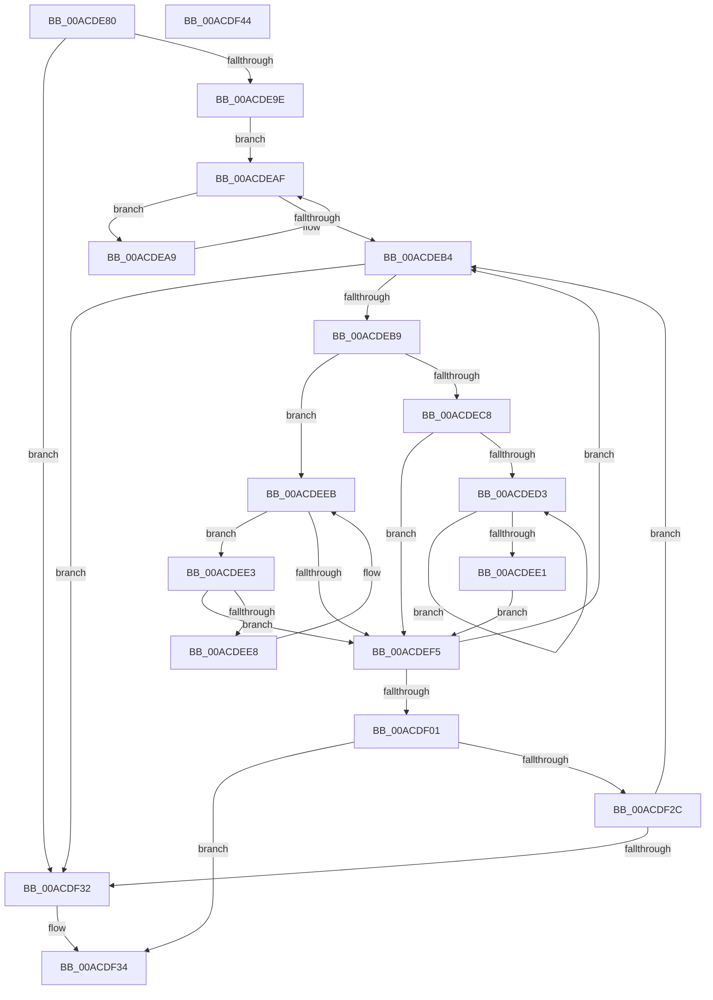

# MiMapChildLargePageVads

- RVA: `0x00ACDE80`–`0x00ACDF45` (길이 `197` bytes)
- VA: `0x0000000140ACDE80`
- 실행 섹션: `PAGE`
- PDB 이름 있음: `예`; PDB Function 태그: `아니요`
- unwind 정보 RVA: `0x00060BC4`
- 디코드: `63`개 명령, `197/197` bytes 표시
- 미해석 바이트: `0` (있으면 어셈블리에 `.byte`로 보존)

> 이 문서는 커널 이미지의 기계어와 PDB 기호를 분석해 생성했습니다. 4번과 5번은 함수 원형과 자료형을 바이너리 사용 방식에서 추정한 C 해석이며 원본 소스 복구 결과는 아닙니다.

## 1. Dependencies

- 직접 호출 지점: **3**; 고유 호출 대상: **3**
- 직접 호출자로 확인된 함수: **1**
- RIP 상대 이미지 참조: **0**

### Outgoing calls
- `0x00ACDEF8` → [MiIsVadLargePrivate](../../text/32/MiIsVadLargePrivate_function_0032F720.md) (function, `0x0032F720`)
- `0x00ACDF15` → [MiLocateAddress](../../text/31/MiLocateAddress_function_003168D0.md) (function, `0x003168D0`)
- `0x00ACDF23` → [MiCopyLargeVad](../81/MiCopyLargeVad_function_008118A4.md) (function, `0x008118A4`)

### Direct callers
- [MiCloneProcessAddressSpace](../AD/MiCloneProcessAddressSpace_function_00AD6F7C.md) at `0x00AD71CF`

### Static image references
- 디코드된 RIP-relative 메모리 참조가 없습니다.

## 2. Other-region calls and transfers

- 다른 실행 섹션으로 향하는 call: **2**
  - `0x00ACDEF8` → [MiIsVadLargePrivate](../../text/32/MiIsVadLargePrivate_function_0032F720.md) (`PAGE` → `.text`)
  - `0x00ACDF15` → [MiLocateAddress](../../text/31/MiLocateAddress_function_003168D0.md) (`PAGE` → `.text`)
- 별도 외부 분기/꼬리 이동을 확인하지 못했습니다.

## 3. Assembly (complete function range)

```asm
00ACDE80  48 89 5C 24 08                  mov qword ptr [rsp + 8], rbx
00ACDE85  48 89 74 24 10                  mov qword ptr [rsp + 0x10], rsi
00ACDE8A  57                              push rdi
00ACDE8B  48 83 EC 20                     sub rsp, 0x20
00ACDE8F  48 8B FA                        mov rdi, rdx
00ACDE92  48 8B F1                        mov rsi, rcx
00ACDE95  48 85 D2                        test rdx, rdx
00ACDE98  0F 84 94 00 00 00               je 0x140acdf32
00ACDE9E  48 8B 81 58 05 00 00            mov rax, qword ptr [rcx + 0x558]
00ACDEA5  33 DB                           xor ebx, ebx
00ACDEA7  EB 06                           jmp 0x140acdeaf
00ACDEA9  48 8B D8                        mov rbx, rax
00ACDEAC  48 8B 00                        mov rax, qword ptr [rax]
00ACDEAF  48 85 C0                        test rax, rax
00ACDEB2  75 F5                           jne 0x140acdea9
00ACDEB4  48 85 DB                        test rbx, rbx
00ACDEB7  74 79                           je 0x140acdf32
00ACDEB9  48 8B 43 08                     mov rax, qword ptr [rbx + 8]
00ACDEBD  4C 8B DB                        mov r11, rbx
00ACDEC0  48 8B CB                        mov rcx, rbx
00ACDEC3  48 85 C0                        test rax, rax
00ACDEC6  74 23                           je 0x140acdeeb
00ACDEC8  48 8B 08                        mov rcx, qword ptr [rax]
00ACDECB  48 8B D8                        mov rbx, rax
00ACDECE  48 85 C9                        test rcx, rcx
00ACDED1  74 22                           je 0x140acdef5
00ACDED3  48 8B 01                        mov rax, qword ptr [rcx]
00ACDED6  48 8B D9                        mov rbx, rcx
00ACDED9  48 8B C8                        mov rcx, rax
00ACDEDC  48 85 C0                        test rax, rax
00ACDEDF  75 F2                           jne 0x140acded3
00ACDEE1  EB 12                           jmp 0x140acdef5
00ACDEE3  48 39 0B                        cmp qword ptr [rbx], rcx
00ACDEE6  74 0D                           je 0x140acdef5
00ACDEE8  48 8B CB                        mov rcx, rbx
00ACDEEB  48 8B 5B 10                     mov rbx, qword ptr [rbx + 0x10]
00ACDEEF  48 83 E3 FC                     and rbx, 0xfffffffffffffffc
00ACDEF3  75 EE                           jne 0x140acdee3
00ACDEF5  49 8B CB                        mov rcx, r11
00ACDEF8  E8 23 18 86 FF                  call 0x14032f720
00ACDEFD  85 C0                           test eax, eax
00ACDEFF  74 B3                           je 0x140acdeb4
00ACDF01  41 0F B6 4B 20                  movzx ecx, byte ptr [r11 + 0x20]
00ACDF06  41 8B 43 18                     mov eax, dword ptr [r11 + 0x18]
00ACDF0A  48 C1 E1 20                     shl rcx, 0x20
00ACDF0E  48 0B C8                        or rcx, rax
00ACDF11  48 C1 E1 0C                     shl rcx, 0xc
00ACDF15  E8 B6 89 84 FF                  call 0x1403168d0
00ACDF1A  4D 8B C3                        mov r8, r11
00ACDF1D  48 8B D0                        mov rdx, rax
00ACDF20  48 8B CE                        mov rcx, rsi
00ACDF23  E8 7C 39 D4 FF                  call 0x1408118a4
00ACDF28  85 C0                           test eax, eax
00ACDF2A  78 08                           js 0x140acdf34
00ACDF2C  48 83 EF 01                     sub rdi, 1
00ACDF30  75 82                           jne 0x140acdeb4
00ACDF32  33 C0                           xor eax, eax
00ACDF34  48 8B 5C 24 30                  mov rbx, qword ptr [rsp + 0x30]
00ACDF39  48 8B 74 24 38                  mov rsi, qword ptr [rsp + 0x38]
00ACDF3E  48 83 C4 20                     add rsp, 0x20
00ACDF42  5F                              pop rdi
00ACDF43  C3                              ret
00ACDF44  CC                              int3
```

## 4. C-style interpretation (structured pseudocode)

```c
__int64 __fastcall MiMapChildLargePageVads(__int64 a1, __int64 a2)
{
    __int64 result;
    __int64 v_rbx;
    __int64 v_rdi;
    __int64 v_rsp;
    unsigned __int64 v_stack_p10;
    unsigned __int64 v_stack_p8;

    v_stack_p8 = v_rbx;
    v_stack_p10 = v_rsi;
    v_rsp = (v_rsp) - (32);
    if (a2 == 0) goto loc_00ACDF32;
    v_rbx = 0;
    goto loc_00ACDEAF;
loc_00ACDEA9:
loc_00ACDEAF:
    if (*(unsigned __int64 *)(*(unsigned __int64 *)(a1 + 1368)) != 0) goto loc_00ACDEA9;
loc_00ACDEB4:
    if (*(unsigned __int64 *)(a1 + 1368) == 0) goto loc_00ACDF32;
    if (*(unsigned __int64 *)(*(unsigned __int64 *)(a1 + 1368) + 8) == 0) goto loc_00ACDEEB;
    if (*(unsigned __int64 *)(*(unsigned __int64 *)(*(unsigned __int64 *)(a1 + 1368) + 8)) == 0) goto loc_00ACDEF5;
loc_00ACDED3:
    if (*(unsigned __int64 *)(*(unsigned __int64 *)(*(unsigned __int64 *)(*(unsigned __int64 *)(a1 + 1368) + 8))) != 0) goto loc_00ACDED3;
    goto loc_00ACDEF5;
loc_00ACDEE3:
    if ((*(unsigned __int64 *)(*(unsigned __int64 *)(*(unsigned __int64 *)(*(unsigned __int64 *)(a1 + 1368) + 8)))) == (*(unsigned __int64 *)(*(unsigned __int64 *)(*(unsigned __int64 *)(*(unsigned __int64 *)(a1 + 1368) + 8))))) goto loc_00ACDEF5;
loc_00ACDEEB:
    v_rbx = (*(unsigned __int64 *)(*(unsigned __int64 *)(*(unsigned __int64 *)(*(unsigned __int64 *)(a1 + 1368) + 8)) + 16)) & (-4);
    if (condition_is_not_equal) goto loc_00ACDEE3;
loc_00ACDEF5:
    result = MiIsVadLargePrivate(*(unsigned __int64 *)(a1 + 1368), a2, a3, a4);
    if ((unsigned int)(result) == 0) goto loc_00ACDEB4;
    a1 = (*(unsigned __int8 *)(*(unsigned __int64 *)(a1 + 1368) + 32)) << (32);
    a1 = (a1) | ((unsigned int)(*(unsigned int *)(*(unsigned __int64 *)(a1 + 1368) + 24)));
    a1 = (a1) << (12);
    result = MiLocateAddress(a1, a2, a3, a4);
    result = MiCopyLargeVad(a1, result, *(unsigned __int64 *)(a1 + 1368), a4);
    if (sign_flag) goto loc_00ACDF34;
    v_rdi = (a2) - (1);
    if (condition_is_not_equal) goto loc_00ACDEB4;
loc_00ACDF32:
    result = 0;
loc_00ACDF34:
    v_rsp = (v_rsp) + (32);
    return result;
}
```

## 5. (Beta) C Style

```c
int64_t MiMapChildLargePageVads(void *Arg1, int64_t Arg2)
{
    uint8_t *arg1 = (uint8_t *)Arg1;

    int64_t result;
    int64_t local_rbx;
    int64_t local_rdi;
    int64_t local_rsp;
    uint64_t v_stack_p10;
    uint64_t v_stack_p8;

    v_stack_p8 = local_rbx;
    v_stack_p10 = local_rsi;
    local_rsp = (local_rsp) - (32);
    if (Arg2 == 0) goto loc_00ACDF32;
    local_rbx = 0;
    goto loc_00ACDEAF;
loc_00ACDEA9:
loc_00ACDEAF:
    if (*(uint64_t *)(*(uint64_t *)(arg1 + 0x558)) != 0) goto loc_00ACDEA9;
loc_00ACDEB4:
    if (*(uint64_t *)(arg1 + 0x558) == 0) goto loc_00ACDF32;
    if (*(uint64_t *)(*(uint64_t *)(arg1 + 0x558) + 0x8) == 0) goto loc_00ACDEEB;
    if (*(uint64_t *)(*(uint64_t *)(*(uint64_t *)(arg1 + 0x558) + 0x8)) == 0) goto loc_00ACDEF5;
loc_00ACDED3:
    if (*(uint64_t *)(*(uint64_t *)(*(uint64_t *)(*(uint64_t *)(arg1 + 0x558) + 0x8))) != 0) goto loc_00ACDED3;
    goto loc_00ACDEF5;
loc_00ACDEE3:
    if ((*(uint64_t *)(*(uint64_t *)(*(uint64_t *)(*(uint64_t *)(arg1 + 0x558) + 0x8)))) == (*(uint64_t *)(*(uint64_t *)(*(uint64_t *)(*(uint64_t *)(arg1 + 0x558) + 0x8))))) goto loc_00ACDEF5;
loc_00ACDEEB:
    local_rbx = (*(uint64_t *)(*(uint64_t *)(*(uint64_t *)(*(uint64_t *)(arg1 + 0x558) + 0x8)) + 0x10)) & (-4);
    if (condition_is_not_equal) goto loc_00ACDEE3;
loc_00ACDEF5:
    result = MiIsVadLargePrivate(*(uint64_t *)(arg1 + 0x558), Arg2, a3, a4);
    if ((uint32_t)(result) == 0) goto loc_00ACDEB4;
    Arg1 = (*(uint8_t *)(*(uint64_t *)(arg1 + 0x558) + 0x20)) << (32);
    Arg1 = (Arg1) | ((uint32_t)(*(uint32_t *)(*(uint64_t *)(arg1 + 0x558) + 0x18)));
    Arg1 = (Arg1) << (12);
    result = MiLocateAddress(Arg1, Arg2, a3, a4);
    result = MiCopyLargeVad(Arg1, result, *(uint64_t *)(arg1 + 0x558), a4);
    if (sign_flag) goto loc_00ACDF34;
    local_rdi = (Arg2) - (1);
    if (condition_is_not_equal) goto loc_00ACDEB4;
loc_00ACDF32:
    result = 0;
loc_00ACDF34:
    local_rsp = (local_rsp) + (32);
    return result;
}
```

### 관측된 메모리 오프셋

구조체 형식이 확인되지 않은 접근은 인자 기준의 오프셋으로만 기록했습니다.

| 기준 인자 | 오프셋 표현 | 폭 (bit) | 접근 |
|---|---:|---:|---|
| `Arg1` | `+ 0x558` | `64` | `R` |

## 6. Execution-region graph

[열기: 2D/3D 그래프와 함수 탐색 컨트롤 패널](../../../control-panel.html?section=page&rva=0x00ACDE80&view=graph)

- 2D 그래프는 위에서 아래로 흐르고, 3D 그래프는 빈 공간을 드래그해 회전합니다. Shift+드래그는 이동, 휠은 확대·축소, 함수 노드 선택은 대상 보고서 이동입니다.

### Static fallback


