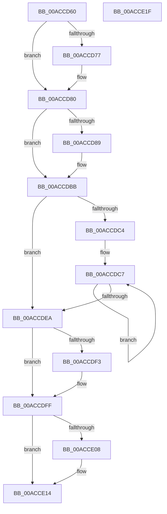

# MiReleaseHotPatchResources

- RVA: `0x00ACCD60`–`0x00ACCE20` (길이 `192` bytes)
- VA: `0x0000000140ACCD60`
- 실행 섹션: `PAGE`
- PDB 이름 있음: `예`; PDB Function 태그: `아니요`
- unwind 정보 RVA: `0x0005CAAC`
- 디코드: `54`개 명령, `192/192` bytes 표시
- 미해석 바이트: `0` (있으면 어셈블리에 `.byte`로 보존)

> 이 문서는 커널 이미지의 기계어와 PDB 기호를 분석해 생성했습니다. 4번과 5번은 함수 원형과 자료형을 바이너리 사용 방식에서 추정한 C 해석이며 원본 소스 복구 결과는 아닙니다.

## 1. Dependencies

- 직접 호출 지점: **8**; 고유 호출 대상: **6**
- 직접 호출자로 확인된 함수: **2**
- RIP 상대 이미지 참조: **1**

### Outgoing calls
- `0x00ACCD7B` → [MiFinishHoldingDirtyFaults](../../text/68/MiFinishHoldingDirtyFaults_function_006835F8.md) (function, `0x006835F8`)
- `0x00ACCD95` → [MiGetPteAddress](../../text/43/MiGetPteAddress_function_0043E130.md) (function, `0x0043E130`)
- `0x00ACCDA4` → [MiReleasePtes](../../text/24/MiReleasePtes_function_00247240.md) (function, `0x00247240`)
- `0x00ACCDB6` → [IoFreeMdl](../../text/29/IoFreeMdl_function_0029EA80.md) (function, `0x0029EA80`)
- `0x00ACCDD1` → [MmUnlockPages](../../text/29/MmUnlockPages_function_0029EEE0.md) (function, `0x0029EEE0`)
- `0x00ACCDD9` → [IoFreeMdl](../../text/29/IoFreeMdl_function_0029EA80.md) (function, `0x0029EA80`)
- `0x00ACCDF5` → [ExFreePoolWithTag](../../poolcode/B8/ExFreePoolWithTag_function_00B82870.md) (function, `0x00B82870`)
- `0x00ACCE0A` → [ExFreePoolWithTag](../../poolcode/B8/ExFreePoolWithTag_function_00B82870.md) (function, `0x00B82870`)

### Direct callers
- [MiApplyImageHotPatchRequest](../80/MiApplyImageHotPatchRequest_function_008025AC.md) at `0x00802A8D`
- [MiApplyImageHotPatchRequest](../80/MiApplyImageHotPatchRequest_function_008025AC.md) at `0x00802A96`
- [MmPrepareImagePagesForHotPatch](../80/MmPrepareImagePagesForHotPatch_function_008074E8.md) at `0x008075E3`

### Static image references
- `0x00ACCD9D` → RVA `0x00E37668` (`.data`; read)

## 2. Other-region calls and transfers

- 다른 실행 섹션으로 향하는 call: **8**
  - `0x00ACCD7B` → [MiFinishHoldingDirtyFaults](../../text/68/MiFinishHoldingDirtyFaults_function_006835F8.md) (`PAGE` → `.text`)
  - `0x00ACCD95` → [MiGetPteAddress](../../text/43/MiGetPteAddress_function_0043E130.md) (`PAGE` → `.text`)
  - `0x00ACCDA4` → [MiReleasePtes](../../text/24/MiReleasePtes_function_00247240.md) (`PAGE` → `.text`)
  - `0x00ACCDB6` → [IoFreeMdl](../../text/29/IoFreeMdl_function_0029EA80.md) (`PAGE` → `.text`)
  - `0x00ACCDD1` → [MmUnlockPages](../../text/29/MmUnlockPages_function_0029EEE0.md) (`PAGE` → `.text`)
  - `0x00ACCDD9` → [IoFreeMdl](../../text/29/IoFreeMdl_function_0029EA80.md) (`PAGE` → `.text`)
  - `0x00ACCDF5` → [ExFreePoolWithTag](../../poolcode/B8/ExFreePoolWithTag_function_00B82870.md) (`PAGE` → `POOLCODE`)
  - `0x00ACCE0A` → [ExFreePoolWithTag](../../poolcode/B8/ExFreePoolWithTag_function_00B82870.md) (`PAGE` → `POOLCODE`)
- 별도 외부 분기/꼬리 이동을 확인하지 못했습니다.

## 3. Assembly (complete function range)

```asm
00ACCD60  48 89 5C 24 08                  mov qword ptr [rsp + 8], rbx
00ACCD65  57                              push rdi
00ACCD66  48 83 EC 20                     sub rsp, 0x20
00ACCD6A  8B 81 9C 00 00 00               mov eax, dword ptr [rcx + 0x9c]
00ACCD70  48 8B D9                        mov rbx, rcx
00ACCD73  A8 02                           test al, 2
00ACCD75  74 09                           je 0x140accd80
00ACCD77  48 83 C1 58                     add rcx, 0x58
00ACCD7B  E8 78 68 BB FF                  call 0x1406835f8
00ACCD80  48 8B 4B 40                     mov rcx, qword ptr [rbx + 0x40]
00ACCD84  48 85 C9                        test rcx, rcx
00ACCD87  74 32                           je 0x140accdbb
00ACCD89  44 8B 41 28                     mov r8d, dword ptr [rcx + 0x28]
00ACCD8D  48 8B 49 18                     mov rcx, qword ptr [rcx + 0x18]
00ACCD91  41 C1 E8 0C                     shr r8d, 0xc
00ACCD95  E8 96 13 97 FF                  call 0x14043e130
00ACCD9A  48 8B D0                        mov rdx, rax
00ACCD9D  48 8D 0D C4 A8 36 00            lea rcx, [rip + 0x36a8c4]
00ACCDA4  E8 97 A4 77 FF                  call 0x140247240
00ACCDA9  48 8B 43 40                     mov rax, qword ptr [rbx + 0x40]
00ACCDAD  66 83 60 0A FE                  and word ptr [rax + 0xa], 0xfffe
00ACCDB2  48 8B 4B 40                     mov rcx, qword ptr [rbx + 0x40]
00ACCDB6  E8 C5 1C 7D FF                  call 0x14029ea80
00ACCDBB  48 8B 7B 38                     mov rdi, qword ptr [rbx + 0x38]
00ACCDBF  48 85 FF                        test rdi, rdi
00ACCDC2  74 26                           je 0x140accdea
00ACCDC4  48 8B C7                        mov rax, rdi
00ACCDC7  48 8B 00                        mov rax, qword ptr [rax]
00ACCDCA  48 8B CF                        mov rcx, rdi
00ACCDCD  48 89 43 38                     mov qword ptr [rbx + 0x38], rax
00ACCDD1  E8 0A 21 7D FF                  call 0x14029eee0
00ACCDD6  48 8B CF                        mov rcx, rdi
00ACCDD9  E8 A2 1C 7D FF                  call 0x14029ea80
00ACCDDE  48 8B 7B 38                     mov rdi, qword ptr [rbx + 0x38]
00ACCDE2  48 8B C7                        mov rax, rdi
00ACCDE5  48 85 FF                        test rdi, rdi
00ACCDE8  75 DD                           jne 0x140accdc7
00ACCDEA  48 8B 4B 28                     mov rcx, qword ptr [rbx + 0x28]
00ACCDEE  48 85 C9                        test rcx, rcx
00ACCDF1  74 0C                           je 0x140accdff
00ACCDF3  33 D2                           xor edx, edx
00ACCDF5  E8 76 5A 0B 00                  call 0x140b82870
00ACCDFA  48 83 63 28 00                  and qword ptr [rbx + 0x28], 0
00ACCDFF  48 8B 4B 30                     mov rcx, qword ptr [rbx + 0x30]
00ACCE03  48 85 C9                        test rcx, rcx
00ACCE06  74 0C                           je 0x140acce14
00ACCE08  33 D2                           xor edx, edx
00ACCE0A  E8 61 5A 0B 00                  call 0x140b82870
00ACCE0F  48 83 63 30 00                  and qword ptr [rbx + 0x30], 0
00ACCE14  48 8B 5C 24 30                  mov rbx, qword ptr [rsp + 0x30]
00ACCE19  48 83 C4 20                     add rsp, 0x20
00ACCE1D  5F                              pop rdi
00ACCE1E  C3                              ret
00ACCE1F  CC                              int3
```

## 4. C-style interpretation (structured pseudocode)

```c
__int64 __fastcall MiReleaseHotPatchResources(__int64 a1)
{
    __int64 result;
    __int64 v_rsp;
    unsigned __int64 v_stack_p8;

    v_stack_p8 = v_rbx;
    v_rsp = (v_rsp) - (32);
    result = (unsigned int)(*(unsigned int *)(a1 + 156));
    if ((((unsigned __int8)((unsigned int)(*(unsigned int *)(a1 + 156)))) & (2)) != 0) {
        a1 = (a1) + (88);
        result = MiFinishHoldingDirtyFaults(a1, a2, a3, a4);
    }
    if (*(unsigned __int64 *)(a1 + 64) != 0) {
        a3 = *(unsigned int *)(*(unsigned __int64 *)(a1 + 64) + 40);
        a1 = *(unsigned __int64 *)(*(unsigned __int64 *)(a1 + 64) + 24);
        a3 = (unsigned int)((a3) >> (12));
        result = MiGetPteAddress(a1, a2, a3, a4);
        a2 = result;
        a1 = v_rip + 3582148;
        result = MiReleasePtes(a1, a2, a3, a4);
        result = *(unsigned __int64 *)(a1 + 64);
        a1 = *(unsigned __int64 *)(a1 + 64);
        result = IoFreeMdl(a1, a2, a3, a4);
    }
    if (*(unsigned __int64 *)(a1 + 56) == 0) goto loc_00ACCDEA;
loc_00ACCDC7:
    *(unsigned __int64 *)(a1 + 56) = *(unsigned __int64 *)(*(unsigned __int64 *)(a1 + 56));
    result = MmUnlockPages(*(unsigned __int64 *)(a1 + 56), a2, a3, a4);
    result = IoFreeMdl(*(unsigned __int64 *)(a1 + 56), a2, a3, a4);
    if (*(unsigned __int64 *)(a1 + 56) != 0) goto loc_00ACCDC7;
loc_00ACCDEA:
    result = *(unsigned __int64 *)(a1 + 56);
    if (*(unsigned __int64 *)(a1 + 40) != 0) {
        a2 = 0;
        result = ExFreePoolWithTag(*(unsigned __int64 *)(a1 + 40), a2, a3, a4);
    }
    if (*(unsigned __int64 *)(a1 + 48) != 0) {
        a2 = 0;
        result = ExFreePoolWithTag(*(unsigned __int64 *)(a1 + 48), a2, a3, a4);
    }
    v_rsp = (v_rsp) + (32);
    return result;
}
```

## 5. (Beta) C Style

```c
int64_t MiReleaseHotPatchResources(void *Arg1)
{
    uint8_t *arg1 = (uint8_t *)Arg1;

    int64_t result;
    int64_t local_rsp;
    uint64_t v_stack_p8;

    v_stack_p8 = local_rbx;
    local_rsp = (local_rsp) - (32);
    result = (uint32_t)(*(uint32_t *)(arg1 + 0x9C));
    if ((((uint8_t)((uint32_t)(*(uint32_t *)(arg1 + 0x9C)))) & (2)) != 0) {
        Arg1 = (Arg1) + (88);
        result = MiFinishHoldingDirtyFaults(Arg1, a2, a3, a4);
    }
    if (*(uint64_t *)(arg1 + 0x40) != 0) {
        a3 = *(uint32_t *)(*(uint64_t *)(arg1 + 0x40) + 0x28);
        Arg1 = *(uint64_t *)(*(uint64_t *)(arg1 + 0x40) + 0x18);
        a3 = (uint32_t)((a3) >> (12));
        result = MiGetPteAddress(Arg1, a2, a3, a4);
        a2 = result;
        Arg1 = v_rip + 3582148;
        result = MiReleasePtes(Arg1, a2, a3, a4);
        result = *(uint64_t *)(arg1 + 0x40);
        Arg1 = *(uint64_t *)(arg1 + 0x40);
        result = IoFreeMdl(Arg1, a2, a3, a4);
    }
    if (*(uint64_t *)(arg1 + 0x38) == 0) goto loc_00ACCDEA;
loc_00ACCDC7:
    *(uint64_t *)(arg1 + 0x38) = *(uint64_t *)(*(uint64_t *)(arg1 + 0x38));
    result = MmUnlockPages(*(uint64_t *)(arg1 + 0x38), a2, a3, a4);
    result = IoFreeMdl(*(uint64_t *)(arg1 + 0x38), a2, a3, a4);
    if (*(uint64_t *)(arg1 + 0x38) != 0) goto loc_00ACCDC7;
loc_00ACCDEA:
    result = *(uint64_t *)(arg1 + 0x38);
    if (*(uint64_t *)(arg1 + 0x28) != 0) {
        a2 = 0;
        result = ExFreePoolWithTag(*(uint64_t *)(arg1 + 0x28), a2, a3, a4);
    }
    if (*(uint64_t *)(arg1 + 0x30) != 0) {
        a2 = 0;
        result = ExFreePoolWithTag(*(uint64_t *)(arg1 + 0x30), a2, a3, a4);
    }
    local_rsp = (local_rsp) + (32);
    return result;
}
```

### 관측된 메모리 오프셋

구조체 형식이 확인되지 않은 접근은 인자 기준의 오프셋으로만 기록했습니다.

| 기준 인자 | 오프셋 표현 | 폭 (bit) | 접근 |
|---|---:|---:|---|
| `Arg1` | `+ 0x28` | `64` | `R` |
| `Arg1` | `+ 0x28` | `64` | `R/W` |
| `Arg1` | `+ 0x30` | `64` | `R` |
| `Arg1` | `+ 0x30` | `64` | `R/W` |
| `Arg1` | `+ 0x38` | `64` | `R` |
| `Arg1` | `+ 0x38` | `64` | `W` |
| `Arg1` | `+ 0x40` | `64` | `R` |
| `Arg1` | `+ 0x9C` | `32` | `R` |

## 6. Execution-region graph

[열기: 2D/3D 그래프와 함수 탐색 컨트롤 패널](../../../control-panel.html?section=page&rva=0x00ACCD60&view=graph)

- 2D 그래프는 위에서 아래로 흐르고, 3D 그래프는 빈 공간을 드래그해 회전합니다. Shift+드래그는 이동, 휠은 확대·축소, 함수 노드 선택은 대상 보고서 이동입니다.

### Static fallback


