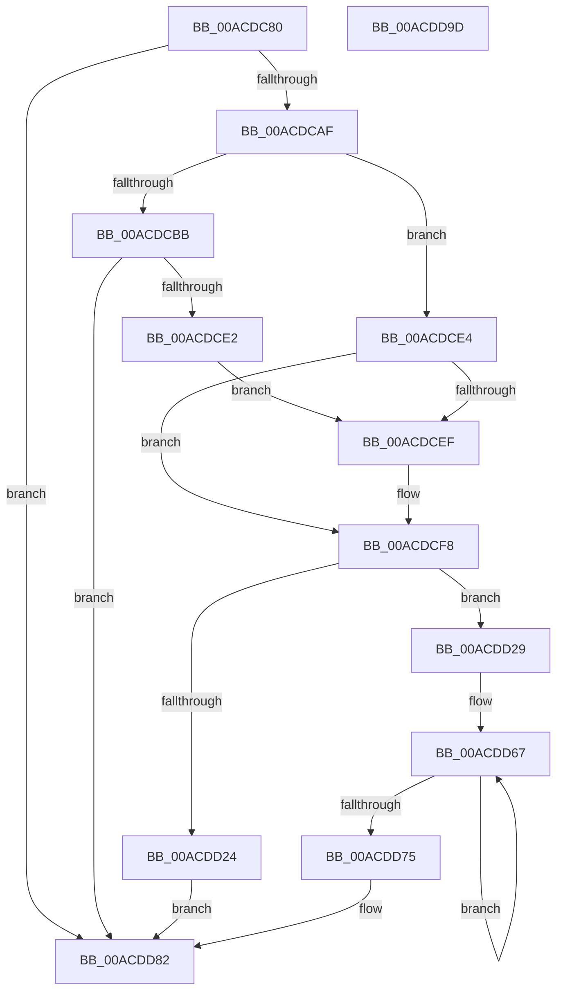

# MiRememberUnloadedDriver

- RVA: `0x00ACDC80`–`0x00ACDD9E` (길이 `286` bytes)
- VA: `0x0000000140ACDC80`
- 실행 섹션: `PAGE`
- PDB 이름 있음: `예`; PDB Function 태그: `아니요`
- unwind 정보 RVA: `0x0005E6B4`
- 디코드: `72`개 명령, `286/286` bytes 표시
- 미해석 바이트: `0` (있으면 어셈블리에 `.byte`로 보존)

> 이 문서는 커널 이미지의 기계어와 PDB 기호를 분석해 생성했습니다. 4번과 5번은 함수 원형과 자료형을 바이너리 사용 방식에서 추정한 C 해석이며 원본 소스 복구 결과는 아닙니다.

## 1. Dependencies

- 직접 호출 지점: **4**; 고유 호출 대상: **3**
- 직접 호출자로 확인된 함수: **1**
- RIP 상대 이미지 참조: **5**

### Outgoing calls
- `0x00ACDCCA` → [MiAllocatePool](../../text/35/MiAllocatePool_function_0035B540.md) (function, `0x0035B540`)
- `0x00ACDD03` → [RtlFreeAnsiString](../9C/RtlFreeAnsiString_function_009C0800.md) (function, `0x009C0800`)
- `0x00ACDD16` → [MiAllocatePool](../../text/35/MiAllocatePool_function_0035B540.md) (function, `0x0035B540`)
- `0x00ACDD34` → [memcpy](../../text/6C/memcpy_function_006C6840.md) (function, `0x006C6840`)

### Direct callers
- [MiUnloadSystemImage](../AA/MiUnloadSystemImage_function_00AA2FD4.md) at `0x00AA3246`

### Static image references
- `0x00ACDCAF` → RVA `0x00EF54B0` (`.data`; read)
- `0x00ACDCCF` → RVA `0x00EF54B0` (`.data`; write)
- `0x00ACDCE4` → RVA `0x00EF54A8` (`.data`; read)
- `0x00ACDCF2` → RVA `0x00EF54A8` (`.data`; write)
- `0x00ACDD7C` → RVA `0x00EF54A8` (`.data`; read/write)

## 2. Other-region calls and transfers

- 다른 실행 섹션으로 향하는 call: **3**
  - `0x00ACDCCA` → [MiAllocatePool](../../text/35/MiAllocatePool_function_0035B540.md) (`PAGE` → `.text`)
  - `0x00ACDD16` → [MiAllocatePool](../../text/35/MiAllocatePool_function_0035B540.md) (`PAGE` → `.text`)
  - `0x00ACDD34` → [memcpy](../../text/6C/memcpy_function_006C6840.md) (`PAGE` → `.text`)
- 별도 외부 분기/꼬리 이동을 확인하지 못했습니다.

## 3. Assembly (complete function range)

```asm
00ACDC80  48 8B C4                        mov rax, rsp
00ACDC83  48 89 58 08                     mov qword ptr [rax + 8], rbx
00ACDC87  48 89 68 10                     mov qword ptr [rax + 0x10], rbp
00ACDC8B  48 89 70 18                     mov qword ptr [rax + 0x18], rsi
00ACDC8F  48 89 78 20                     mov qword ptr [rax + 0x20], rdi
00ACDC93  41 56                           push r14
00ACDC95  48 83 EC 20                     sub rsp, 0x20
00ACDC99  45 33 F6                        xor r14d, r14d
00ACDC9C  41 8B E8                        mov ebp, r8d
00ACDC9F  48 8B F2                        mov rsi, rdx
00ACDCA2  48 8B F9                        mov rdi, rcx
00ACDCA5  66 44 39 31                     cmp word ptr [rcx], r14w
00ACDCA9  0F 84 D3 00 00 00               je 0x140acdd82
00ACDCAF  4C 8B 0D FA 77 42 00            mov r9, qword ptr [rip + 0x4277fa]
00ACDCB6  4D 85 C9                        test r9, r9
00ACDCB9  75 29                           jne 0x140acdce4
00ACDCBB  BA D0 07 00 00                  mov edx, 0x7d0
00ACDCC0  41 8D 4E 40                     lea ecx, [r14 + 0x40]
00ACDCC4  41 B8 4D 6D 44 54               mov r8d, 0x54446d4d
00ACDCCA  E8 71 D8 88 FF                  call 0x14035b540
00ACDCCF  48 89 05 DA 77 42 00            mov qword ptr [rip + 0x4277da], rax
00ACDCD6  4C 8B C8                        mov r9, rax
00ACDCD9  48 85 C0                        test rax, rax
00ACDCDC  0F 84 A0 00 00 00               je 0x140acdd82
00ACDCE2  EB 0B                           jmp 0x140acdcef
00ACDCE4  8B 05 BE 77 42 00               mov eax, dword ptr [rip + 0x4277be]
00ACDCEA  83 F8 32                        cmp eax, 0x32
00ACDCED  72 09                           jb 0x140acdcf8
00ACDCEF  41 8B C6                        mov eax, r14d
00ACDCF2  89 05 B0 77 42 00               mov dword ptr [rip + 0x4277b0], eax
00ACDCF8  48 8D 14 80                     lea rdx, [rax + rax*4]
00ACDCFC  49 8D 1C D1                     lea rbx, [r9 + rdx*8]
00ACDD00  48 8B CB                        mov rcx, rbx
00ACDD03  E8 F8 2A EF FF                  call 0x1409c0800
00ACDD08  0F B7 17                        movzx edx, word ptr [rdi]
00ACDD0B  B9 40 00 00 00                  mov ecx, 0x40
00ACDD10  41 B8 4D 6D 44 54               mov r8d, 0x54446d4d
00ACDD16  E8 25 D8 88 FF                  call 0x14035b540
00ACDD1B  48 89 43 08                     mov qword ptr [rbx + 8], rax
00ACDD1F  48 85 C0                        test rax, rax
00ACDD22  75 05                           jne 0x140acdd29
00ACDD24  44 89 33                        mov dword ptr [rbx], r14d
00ACDD27  EB 59                           jmp 0x140acdd82
00ACDD29  44 0F B7 07                     movzx r8d, word ptr [rdi]
00ACDD2D  48 8B C8                        mov rcx, rax
00ACDD30  48 8B 57 08                     mov rdx, qword ptr [rdi + 8]
00ACDD34  E8 07 8B BF FF                  call 0x1406c6840
00ACDD39  0F B7 07                        movzx eax, word ptr [rdi]
00ACDD3C  49 B8 B0 03 00 00 80 F7 FF FF   movabs r8, 0xfffff780000003b0
00ACDD46  66 89 03                        mov word ptr [rbx], ax
00ACDD49  49 B9 08 00 00 00 80 F7 FF FF   movabs r9, 0xfffff78000000008
00ACDD53  0F B7 47 02                     movzx eax, word ptr [rdi + 2]
00ACDD57  66 89 43 02                     mov word ptr [rbx + 2], ax
00ACDD5B  48 8D 04 2E                     lea rax, [rsi + rbp]
00ACDD5F  48 89 43 18                     mov qword ptr [rbx + 0x18], rax
00ACDD63  48 89 73 10                     mov qword ptr [rbx + 0x10], rsi
00ACDD67  49 8B 10                        mov rdx, qword ptr [r8]
00ACDD6A  49 8B 09                        mov rcx, qword ptr [r9]
00ACDD6D  49 8B 00                        mov rax, qword ptr [r8]
00ACDD70  48 3B D0                        cmp rdx, rax
00ACDD73  75 F2                           jne 0x140acdd67
00ACDD75  48 2B CA                        sub rcx, rdx
00ACDD78  48 89 4B 20                     mov qword ptr [rbx + 0x20], rcx
00ACDD7C  FF 05 26 77 42 00               inc dword ptr [rip + 0x427726]
00ACDD82  48 8B 5C 24 30                  mov rbx, qword ptr [rsp + 0x30]
00ACDD87  48 8B 6C 24 38                  mov rbp, qword ptr [rsp + 0x38]
00ACDD8C  48 8B 74 24 40                  mov rsi, qword ptr [rsp + 0x40]
00ACDD91  48 8B 7C 24 48                  mov rdi, qword ptr [rsp + 0x48]
00ACDD96  48 83 C4 20                     add rsp, 0x20
00ACDD9A  41 5E                           pop r14
00ACDD9C  C3                              ret
00ACDD9D  CC                              int3
```

## 4. C-style interpretation (structured pseudocode)

```c
__int64 __fastcall MiRememberUnloadedDriver(__int64 a1, __int64 a2, int a3)
{
    __int64 result;
    __int64 v_r14;
    __int64 v_rsp;
    unsigned __int64 v_stack_p10;
    unsigned __int64 v_stack_p18;
    unsigned __int64 v_stack_p20;
    unsigned __int64 v_stack_p8;

    *(unsigned __int64 *)(v_rsp + 8) = v_rbx;
    *(unsigned __int64 *)(v_rsp + 16) = v_rbp;
    *(unsigned __int64 *)(v_rsp + 24) = v_rsi;
    *(unsigned __int64 *)(v_rsp + 32) = v_rdi;
    v_rsp = (v_rsp) - (32);
    v_r14 = 0;
    if ((*(unsigned __int16 *)(a1)) == 0) goto loc_00ACDD82;
    if (*(unsigned __int64 *)(v_rip + 4356090) != 0) goto loc_00ACDCE4;
    result = MiAllocatePool(v_r14 + 64, (unsigned int)(0x7D0ULL), (unsigned int)(0x54446D4DULL), *(unsigned __int64 *)(v_rip + 4356090));
    *(unsigned __int64 *)(v_rip + 4356058) = result;
    if (result == 0) goto loc_00ACDD82;
    goto loc_00ACDCEF;
loc_00ACDCE4:
    result = (unsigned int)(*(unsigned int *)(v_rip + 4356030));
    if (((unsigned int)((unsigned int)(*(unsigned int *)(v_rip + 4356030)))) >= 50) {
        result = 0;
        *(unsigned int *)(v_rip + 4356016) = (unsigned int)(result);
    }
    result = RtlFreeAnsiString(result + result + result * 4 * 8, result + result * 4, (unsigned int)(0x54446D4DULL), result);
    result = MiAllocatePool(64, *(unsigned __int16 *)(a1), (unsigned int)(0x54446D4DULL), result);
    *(unsigned __int64 *)(result + result + result * 4 * 8 + 8) = result;
    if (result != 0) goto loc_00ACDD29;
    *(unsigned int *)(result + result + result * 4 * 8) = 0;
    goto loc_00ACDD82;
loc_00ACDD29:
    result = memcpy(result, *(unsigned __int64 *)(a1 + 8), *(unsigned __int16 *)(a1), result);
    *(unsigned __int16 *)(result + result + result * 4 * 8) = (unsigned __int16)(*(unsigned __int16 *)(a1));
    *(unsigned __int16 *)(result + result + result * 4 * 8 + 2) = (unsigned __int16)(*(unsigned __int16 *)(a1 + 2));
    *(unsigned __int64 *)(result + result + result * 4 * 8 + 24) = a2 + (unsigned int)(a3) * 1;
    *(unsigned __int64 *)(result + result + result * 4 * 8 + 16) = a2;
loc_00ACDD67:
    if ((*(unsigned __int64 *)(*(unsigned __int16 *)(a1))) != (*(unsigned __int64 *)(*(unsigned __int16 *)(a1)))) goto loc_00ACDD67;
    a1 = (*(unsigned __int64 *)(result)) - (*(unsigned __int64 *)(*(unsigned __int16 *)(a1)));
    *(unsigned __int64 *)(result + result + result * 4 * 8 + 32) = a1;
loc_00ACDD82:
    v_rsp = (v_rsp) + (32);
    return *(unsigned __int64 *)(*(unsigned __int16 *)(a1));
}
```

## 5. (Beta) C Style

```c
int64_t MiRememberUnloadedDriver(void *Arg1, void *Arg2, int32_t Arg3)
{
    uint8_t *arg1 = (uint8_t *)Arg1;
    uint8_t *arg2 = (uint8_t *)Arg2;

    int64_t result;
    int64_t local_r14;
    int64_t local_rsp;
    uint64_t v_stack_p10;
    uint64_t v_stack_p18;
    uint64_t v_stack_p20;
    uint64_t v_stack_p8;

    *(uint64_t *)(local_rsp + 0x8) = local_rbx;
    *(uint64_t *)(local_rsp + 0x10) = local_rbp;
    *(uint64_t *)(local_rsp + 0x18) = local_rsi;
    *(uint64_t *)(local_rsp + 0x20) = local_rdi;
    local_rsp = (local_rsp) - (32);
    local_r14 = 0;
    if ((*(uint16_t *)(arg1)) == 0) goto loc_00ACDD82;
    if (*(uint64_t *)(v_rip + 0x4277FA) != 0) goto loc_00ACDCE4;
    result = MiAllocatePool(local_r14 + 64, (uint32_t)(0x7D0ULL), (uint32_t)(0x54446D4DULL), *(uint64_t *)(v_rip + 0x4277FA));
    *(uint64_t *)(v_rip + 0x4277DA) = result;
    if (result == 0) goto loc_00ACDD82;
    goto loc_00ACDCEF;
loc_00ACDCE4:
    result = (uint32_t)(*(uint32_t *)(v_rip + 0x4277BE));
    if (((uint32_t)((uint32_t)(*(uint32_t *)(v_rip + 0x4277BE)))) >= 50) {
        result = 0;
        *(uint32_t *)(v_rip + 0x4277B0) = (uint32_t)(result);
    }
    result = RtlFreeAnsiString(result + result + result * 4 * 8, result + result * 4, (uint32_t)(0x54446D4DULL), result);
    result = MiAllocatePool(64, *(uint16_t *)(arg1), (uint32_t)(0x54446D4DULL), result);
    *(uint64_t *)(result + result + result * 4 * 8 + 0x8) = result;
    if (result != 0) goto loc_00ACDD29;
    *(uint32_t *)(result + result + result * 4 * 8) = 0;
    goto loc_00ACDD82;
loc_00ACDD29:
    result = memcpy(result, *(uint64_t *)(arg1 + 0x8), *(uint16_t *)(arg1), result);
    *(uint16_t *)(result + result + result * 4 * 8) = (uint16_t)(*(uint16_t *)(arg1));
    *(uint16_t *)(result + result + result * 4 * 8 + 0x2) = (uint16_t)(*(uint16_t *)(arg1 + 0x2));
    *(void **)(result + result + result * 4 * 8 + 0x18) = Arg2 + (uint32_t)(Arg3) * 1;
    *(void **)(result + result + result * 4 * 8 + 0x10) = Arg2;
loc_00ACDD67:
    if ((*(uint64_t *)(*(uint16_t *)(arg1))) != (*(uint64_t *)(*(uint16_t *)(arg1)))) goto loc_00ACDD67;
    Arg1 = (*(uint64_t *)(result)) - (*(uint64_t *)(*(uint16_t *)(arg1)));
    *(void **)(result + result + result * 4 * 8 + 0x20) = Arg1;
loc_00ACDD82:
    local_rsp = (local_rsp) + (32);
    return *(uint64_t *)(*(uint16_t *)(arg1));
}
```

### 관측된 메모리 오프셋

구조체 형식이 확인되지 않은 접근은 인자 기준의 오프셋으로만 기록했습니다.

| 기준 인자 | 오프셋 표현 | 폭 (bit) | 접근 |
|---|---:|---:|---|
| `Arg1` | `+ 0x0` | `16` | `R` |
| `Arg1` | `+ 0x2` | `16` | `R` |
| `Arg1` | `+ 0x8` | `64` | `R` |
| `Arg2` | `+ 0x0 + rbp*1` | `64` | `R` |

## 6. Execution-region graph

[열기: 2D/3D 그래프와 함수 탐색 컨트롤 패널](../../../control-panel.html?section=page&rva=0x00ACDC80&view=graph)

- 2D 그래프는 위에서 아래로 흐르고, 3D 그래프는 빈 공간을 드래그해 회전합니다. Shift+드래그는 이동, 휠은 확대·축소, 함수 노드 선택은 대상 보고서 이동입니다.

### Static fallback


