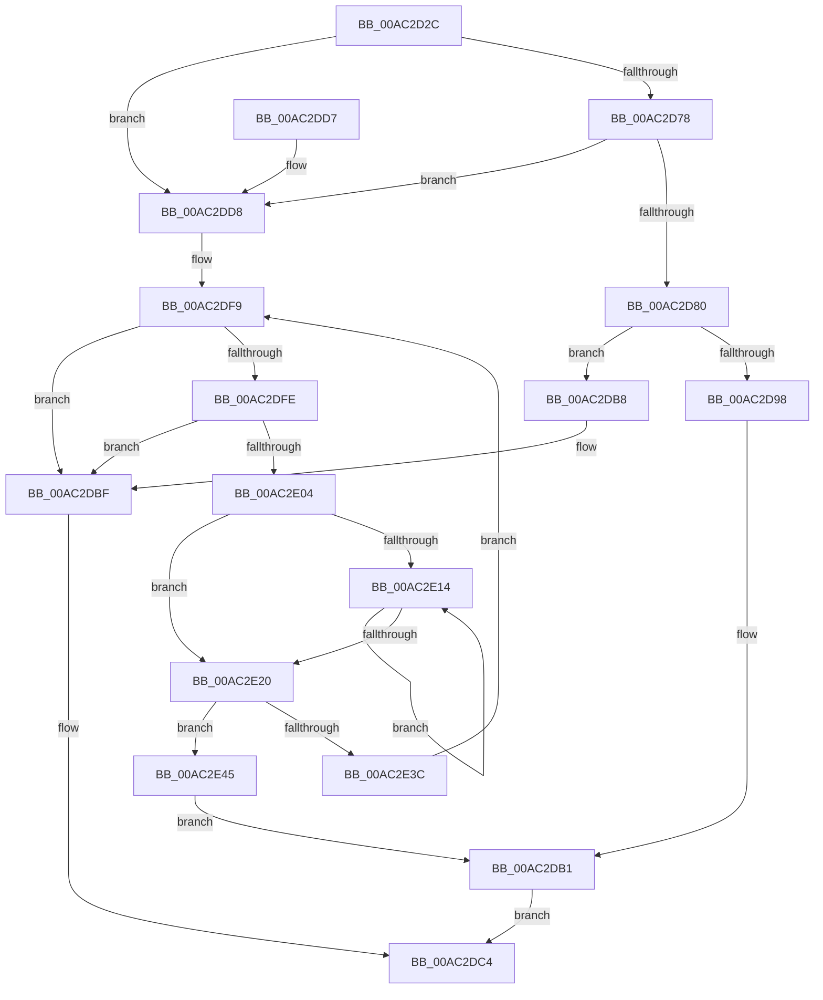

# MiSetImportTableProtection

- RVA: `0x00AC2D2C`–`0x00AC2E63` (길이 `311` bytes)
- VA: `0x0000000140AC2D2C`
- 실행 섹션: `PAGE`
- PDB 이름 있음: `예`; PDB Function 태그: `아니요`
- unwind 정보 RVA: `0x000BDCD0`
- 디코드: `91`개 명령, `311/311` bytes 표시
- 미해석 바이트: `0` (있으면 어셈블리에 `.byte`로 보존)

> 이 문서는 커널 이미지의 기계어와 PDB 기호를 분석해 생성했습니다. 4번과 5번은 함수 원형과 자료형을 바이너리 사용 방식에서 추정한 C 해석이며 원본 소스 복구 결과는 아닙니다.

## 1. Dependencies

- 직접 호출 지점: **6**; 고유 호출 대상: **3**
- 직접 호출자로 확인된 함수: **1**
- RIP 상대 이미지 참조: **3**

### Outgoing calls
- `0x00AC2D6B` → [RtlImageDirectoryEntryToData](../../text/43/RtlImageDirectoryEntryToData_function_004328D0.md) (function, `0x004328D0`)
- `0x00AC2D8F` → [MiSetImageProtection](../../text/38/MiSetImageProtection_function_003843D0.md) (function, `0x003843D0`)
- `0x00AC2DA2` → [MiLogStrongCodeDriverLoadFailure](MiLogStrongCodeDriverLoadFailure_function_00AC2E6C.md) (function, `0x00AC2E6C`)
- `0x00AC2DED` → [RtlImageDirectoryEntryToData](../../text/43/RtlImageDirectoryEntryToData_function_004328D0.md) (function, `0x004328D0`)
- `0x00AC2E33` → [MiSetImageProtection](../../text/38/MiSetImageProtection_function_003843D0.md) (function, `0x003843D0`)
- `0x00AC2E4F` → [MiLogStrongCodeDriverLoadFailure](MiLogStrongCodeDriverLoadFailure_function_00AC2E6C.md) (function, `0x00AC2E6C`)

### Direct callers
- [MiResolveImageImports](../7F/MiResolveImageImports_function_007F8144.md) at `0x007F8185`

### Static image references
- `0x00AC2D9B` → RVA `0x00B09D30` (` ?? ::NNGAKEGL::`string'`; read)
- `0x00AC2DA7` → RVA `0x00E2D7F8` (`.data`; write)
- `0x00AC2E48` → RVA `0x00B09D10` (` ?? ::NNGAKEGL::`string'`; read)

## 2. Other-region calls and transfers

- 다른 실행 섹션으로 향하는 call: **4**
  - `0x00AC2D6B` → [RtlImageDirectoryEntryToData](../../text/43/RtlImageDirectoryEntryToData_function_004328D0.md) (`PAGE` → `.text`)
  - `0x00AC2D8F` → [MiSetImageProtection](../../text/38/MiSetImageProtection_function_003843D0.md) (`PAGE` → `.text`)
  - `0x00AC2DED` → [RtlImageDirectoryEntryToData](../../text/43/RtlImageDirectoryEntryToData_function_004328D0.md) (`PAGE` → `.text`)
  - `0x00AC2E33` → [MiSetImageProtection](../../text/38/MiSetImageProtection_function_003843D0.md) (`PAGE` → `.text`)
- 별도 외부 분기/꼬리 이동을 확인하지 못했습니다.

## 3. Assembly (complete function range)

```asm
00AC2D2C  48 8B C4                        mov rax, rsp
00AC2D2F  48 89 58 18                     mov qword ptr [rax + 0x18], rbx
00AC2D33  48 89 68 20                     mov qword ptr [rax + 0x20], rbp
00AC2D37  56                              push rsi
00AC2D38  57                              push rdi
00AC2D39  41 56                           push r14
00AC2D3B  48 83 EC 20                     sub rsp, 0x20
00AC2D3F  83 60 08 00                     and dword ptr [rax + 8], 0
00AC2D43  4C 8D 4C 24 40                  lea r9, [rsp + 0x40]
00AC2D48  83 60 10 00                     and dword ptr [rax + 0x10], 0
00AC2D4C  0F 57 C0                        xorps xmm0, xmm0
00AC2D4F  4C 8B 71 30                     mov r14, qword ptr [rcx + 0x30]
00AC2D53  33 C0                           xor eax, eax
00AC2D55  0F 11 02                        movups xmmword ptr [rdx], xmm0
00AC2D58  48 8B DA                        mov rbx, rdx
00AC2D5B  48 89 42 10                     mov qword ptr [rdx + 0x10], rax
00AC2D5F  48 8B E9                        mov rbp, rcx
00AC2D62  B2 01                           mov dl, 1
00AC2D64  44 8D 40 0C                     lea r8d, [rax + 0xc]
00AC2D68  49 8B CE                        mov rcx, r14
00AC2D6B  E8 60 FB 96 FF                  call 0x1404328d0
00AC2D70  48 89 03                        mov qword ptr [rbx], rax
00AC2D73  48 85 C0                        test rax, rax
00AC2D76  74 60                           je 0x140ac2dd8
00AC2D78  8B 7C 24 40                     mov edi, dword ptr [rsp + 0x40]
00AC2D7C  85 FF                           test edi, edi
00AC2D7E  74 58                           je 0x140ac2dd8
00AC2D80  41 B9 04 00 00 00               mov r9d, 4
00AC2D86  44 8B C7                        mov r8d, edi
00AC2D89  48 8B D0                        mov rdx, rax
00AC2D8C  48 8B CD                        mov rcx, rbp
00AC2D8F  E8 3C 16 8C FF                  call 0x1403843d0
00AC2D94  85 C0                           test eax, eax
00AC2D96  75 20                           jne 0x140ac2db8
00AC2D98  48 8B D5                        mov rdx, rbp
00AC2D9B  48 8D 0D 8E 6F 04 00            lea rcx, [rip + 0x46f8e]
00AC2DA2  E8 C5 00 00 00                  call 0x140ac2e6c
00AC2DA7  C7 05 47 AA 36 00 C0 00 00 00   mov dword ptr [rip + 0x36aa47], 0xc0
00AC2DB1  B8 7B 00 00 C0                  mov eax, 0xc000007b
00AC2DB6  EB 0C                           jmp 0x140ac2dc4
00AC2DB8  C7 43 10 01 00 00 00            mov dword ptr [rbx + 0x10], 1
00AC2DBF  89 7B 14                        mov dword ptr [rbx + 0x14], edi
00AC2DC2  33 C0                           xor eax, eax
00AC2DC4  48 8B 5C 24 50                  mov rbx, qword ptr [rsp + 0x50]
00AC2DC9  48 8B 6C 24 58                  mov rbp, qword ptr [rsp + 0x58]
00AC2DCE  48 83 C4 20                     add rsp, 0x20
00AC2DD2  41 5E                           pop r14
00AC2DD4  5F                              pop rdi
00AC2DD5  5E                              pop rsi
00AC2DD6  C3                              ret
00AC2DD7  CC                              int3
00AC2DD8  48 83 23 00                     and qword ptr [rbx], 0
00AC2DDC  4C 8D 4C 24 48                  lea r9, [rsp + 0x48]
00AC2DE1  33 FF                           xor edi, edi
00AC2DE3  49 8B CE                        mov rcx, r14
00AC2DE6  44 8D 47 01                     lea r8d, [rdi + 1]
00AC2DEA  41 8A D0                        mov dl, r8b
00AC2DED  E8 DE FA 96 FF                  call 0x1404328d0
00AC2DF2  48 8B F0                        mov rsi, rax
00AC2DF5  48 89 43 08                     mov qword ptr [rbx + 8], rax
00AC2DF9  48 85 F6                        test rsi, rsi
00AC2DFC  74 C1                           je 0x140ac2dbf
00AC2DFE  8B 06                           mov eax, dword ptr [rsi]
00AC2E00  85 C0                           test eax, eax
00AC2E02  74 BB                           je 0x140ac2dbf
00AC2E04  8B 56 10                        mov edx, dword ptr [rsi + 0x10]
00AC2E07  49 03 C6                        add rax, r14
00AC2E0A  49 03 D6                        add rdx, r14
00AC2E0D  33 FF                           xor edi, edi
00AC2E0F  48 39 38                        cmp qword ptr [rax], rdi
00AC2E12  74 0C                           je 0x140ac2e20
00AC2E14  48 8D 40 08                     lea rax, [rax + 8]
00AC2E18  FF C7                           inc edi
00AC2E1A  48 83 38 00                     cmp qword ptr [rax], 0
00AC2E1E  75 F4                           jne 0x140ac2e14
00AC2E20  C1 E7 03                        shl edi, 3
00AC2E23  41 B9 04 00 00 00               mov r9d, 4
00AC2E29  44 8B C7                        mov r8d, edi
00AC2E2C  89 7C 24 40                     mov dword ptr [rsp + 0x40], edi
00AC2E30  48 8B CD                        mov rcx, rbp
00AC2E33  E8 98 15 8C FF                  call 0x1403843d0
00AC2E38  85 C0                           test eax, eax
00AC2E3A  74 09                           je 0x140ac2e45
00AC2E3C  FF 43 10                        inc dword ptr [rbx + 0x10]
00AC2E3F  48 83 C6 14                     add rsi, 0x14
00AC2E43  EB B4                           jmp 0x140ac2df9
00AC2E45  48 8B D5                        mov rdx, rbp
00AC2E48  48 8D 0D C1 6E 04 00            lea rcx, [rip + 0x46ec1]
00AC2E4F  E8 18 00 00 00                  call 0x140ac2e6c
00AC2E54  C7 05 9A A9 36 00 C1 00 00 00   mov dword ptr [rip + 0x36a99a], 0xc1
00AC2E5E  E9 4E FF FF FF                  jmp 0x140ac2db1
```

## 4. C-style interpretation (structured pseudocode)

```c
__int64 __fastcall MiSetImportTableProtection(__int64 a1, __int64 a2)
{
    __int64 result;
    __int64 v_rdi;
    __int64 v_rsi;
    __int64 v_rsp;
    unsigned __int64 v_stack_p18;
    unsigned __int64 v_stack_p20;
    unsigned int v_stack_p40;
    unsigned __int64 v_stack_p48;
    unsigned __int64 v_stack_p8;

    *(unsigned __int64 *)(v_rsp + 24) = v_rbx;
    *(unsigned __int64 *)(v_rsp + 32) = v_rbp;
    v_rsp = (v_rsp) - (32);
    result = 0;
    *(unsigned __int64 *)(a2) = v_xmm0;
    *(unsigned __int64 *)(a2 + 16) = 0;
    result = RtlImageDirectoryEntryToData(*(unsigned __int64 *)(a1 + 48), 1, result + 12, v_stack_p8);
    *(unsigned __int64 *)(a2) = result;
    if (result == 0) goto loc_00AC2DD8;
    if ((unsigned int)((unsigned int)(v_stack_p8)) == 0) goto loc_00AC2DD8;
    result = MiSetImageProtection(a1, result, (unsigned int)((unsigned int)((unsigned int)(v_stack_p8))), 4);
    if ((unsigned int)(result) != 0) goto loc_00AC2DB8;
    result = MiLogStrongCodeDriverLoadFailure(v_rip + 290702, a1, (unsigned int)((unsigned int)((unsigned int)(v_stack_p8))), 4);
    *(unsigned int *)(v_rip + 3582535) = 192;
loc_00AC2DB1:
    goto loc_00AC2DC4;
loc_00AC2DB8:
    *(unsigned int *)(a2 + 16) = 1;
loc_00AC2DBF:
    *(unsigned int *)(a2 + 20) = (unsigned int)((unsigned int)(v_stack_p8));
    result = 0;
loc_00AC2DC4:
    v_rsp = (v_rsp) + (32);
    return result;
loc_00AC2DD8:
    v_rdi = 0;
    result = RtlImageDirectoryEntryToData(*(unsigned __int64 *)(a1 + 48), (unsigned __int8)(v_rdi + 1), v_rdi + 1, v_stack_p48);
    *(unsigned __int64 *)(v_stack_p18 + 8) = result;
loc_00AC2DF9:
    if (result == 0) goto loc_00AC2DBF;
    if ((unsigned int)((unsigned int)(*(unsigned int *)(result))) == 0) goto loc_00AC2DBF;
    result = ((unsigned int)(*(unsigned int *)(result))) + (*(unsigned __int64 *)(a1 + 48));
    a2 = ((unsigned int)(*(unsigned int *)(result + 16))) + (*(unsigned __int64 *)(a1 + 48));
    v_rdi = 0;
    if ((*(unsigned __int64 *)(result)) == 0) goto loc_00AC2E20;
loc_00AC2E14:
    v_rdi = (unsigned int)((v_rdi) + 1);
    if ((*(unsigned __int64 *)(result + 8)) != 0) goto loc_00AC2E14;
loc_00AC2E20:
    v_rdi = (unsigned int)((v_rdi) << (3));
    v_stack_p40 = (unsigned int)(v_rdi);
    result = MiSetImageProtection(v_stack_p20, a2, (unsigned int)((unsigned int)(v_rdi)), 4);
    if ((unsigned int)(result) == 0) goto loc_00AC2E45;
    v_rsi = (result) + (20);
    goto loc_00AC2DF9;
loc_00AC2E45:
    result = MiLogStrongCodeDriverLoadFailure(v_rip + 290497, v_stack_p20, (unsigned int)((unsigned int)(v_rdi)), 4);
    *(unsigned int *)(v_rip + 3582362) = 193;
    goto loc_00AC2DB1;
}
```

## 5. (Beta) C Style

```c
int64_t MiSetImportTableProtection(void *Arg1, void *Arg2)
{
    uint8_t *arg1 = (uint8_t *)Arg1;
    uint8_t *arg2 = (uint8_t *)Arg2;

    int64_t result;
    int64_t local_rdi;
    int64_t local_rsi;
    int64_t local_rsp;
    uint64_t v_stack_p18;
    uint64_t v_stack_p20;
    uint32_t v_stack_p40;
    uint64_t v_stack_p48;
    uint64_t v_stack_p8;

    *(uint64_t *)(local_rsp + 0x18) = local_rbx;
    *(uint64_t *)(local_rsp + 0x20) = local_rbp;
    local_rsp = (local_rsp) - (32);
    result = 0;
    *(uint64_t *)(arg2) = v_xmm0;
    *(uint64_t *)(arg2 + 0x10) = 0;
    result = RtlImageDirectoryEntryToData(*(uint64_t *)(arg1 + 0x30), 1, result + 12, v_stack_p8);
    *(uint64_t *)(arg2) = result;
    if (result == 0) goto loc_00AC2DD8;
    if ((uint32_t)((uint32_t)(v_stack_p8)) == 0) goto loc_00AC2DD8;
    result = MiSetImageProtection(Arg1, result, (uint32_t)((uint32_t)((uint32_t)(v_stack_p8))), 4);
    if ((uint32_t)(result) != 0) goto loc_00AC2DB8;
    result = MiLogStrongCodeDriverLoadFailure(v_rip + 290702, Arg1, (uint32_t)((uint32_t)((uint32_t)(v_stack_p8))), 4);
    *(uint32_t *)(v_rip + 0x36AA47) = 192;
loc_00AC2DB1:
    goto loc_00AC2DC4;
loc_00AC2DB8:
    *(uint32_t *)(arg2 + 0x10) = 1;
loc_00AC2DBF:
    *(uint32_t *)(arg2 + 0x14) = (uint32_t)((uint32_t)(v_stack_p8));
    result = 0;
loc_00AC2DC4:
    local_rsp = (local_rsp) + (32);
    return result;
loc_00AC2DD8:
    local_rdi = 0;
    result = RtlImageDirectoryEntryToData(*(uint64_t *)(arg1 + 0x30), (uint8_t)(local_rdi + 1), local_rdi + 1, v_stack_p48);
    *(uint64_t *)(v_stack_p18 + 0x8) = result;
loc_00AC2DF9:
    if (result == 0) goto loc_00AC2DBF;
    if ((uint32_t)((uint32_t)(*(uint32_t *)(result))) == 0) goto loc_00AC2DBF;
    result = ((uint32_t)(*(uint32_t *)(result))) + (*(uint64_t *)(arg1 + 0x30));
    Arg2 = ((uint32_t)(*(uint32_t *)(result + 0x10))) + (*(uint64_t *)(arg1 + 0x30));
    local_rdi = 0;
    if ((*(uint64_t *)(result)) == 0) goto loc_00AC2E20;
loc_00AC2E14:
    local_rdi = (uint32_t)((local_rdi) + 1);
    if ((*(uint64_t *)(result + 0x8)) != 0) goto loc_00AC2E14;
loc_00AC2E20:
    local_rdi = (uint32_t)((local_rdi) << (3));
    v_stack_p40 = (uint32_t)(local_rdi);
    result = MiSetImageProtection(v_stack_p20, Arg2, (uint32_t)((uint32_t)(local_rdi)), 4);
    if ((uint32_t)(result) == 0) goto loc_00AC2E45;
    local_rsi = (result) + (20);
    goto loc_00AC2DF9;
loc_00AC2E45:
    result = MiLogStrongCodeDriverLoadFailure(v_rip + 290497, v_stack_p20, (uint32_t)((uint32_t)(local_rdi)), 4);
    *(uint32_t *)(v_rip + 0x36A99A) = 193;
    goto loc_00AC2DB1;
}
```

### 관측된 메모리 오프셋

구조체 형식이 확인되지 않은 접근은 인자 기준의 오프셋으로만 기록했습니다.

| 기준 인자 | 오프셋 표현 | 폭 (bit) | 접근 |
|---|---:|---:|---|
| `Arg1` | `+ 0x30` | `64` | `R` |
| `Arg2` | `+ 0x0` | `64` | `R/W` |
| `Arg2` | `+ 0x0` | `64` | `W` |
| `Arg2` | `+ 0x0` | `128` | `R` |
| `Arg2` | `+ 0x8` | `64` | `W` |
| `Arg2` | `+ 0x10` | `32` | `R/W` |
| `Arg2` | `+ 0x10` | `32` | `W` |
| `Arg2` | `+ 0x10` | `64` | `W` |
| `Arg2` | `+ 0x14` | `32` | `W` |

## 6. Execution-region graph

[열기: 2D/3D 그래프와 함수 탐색 컨트롤 패널](../../../control-panel.html?section=page&rva=0x00AC2D2C&view=graph)

- 2D 그래프는 위에서 아래로 흐르고, 3D 그래프는 빈 공간을 드래그해 회전합니다. Shift+드래그는 이동, 휠은 확대·축소, 함수 노드 선택은 대상 보고서 이동입니다.

### Static fallback


