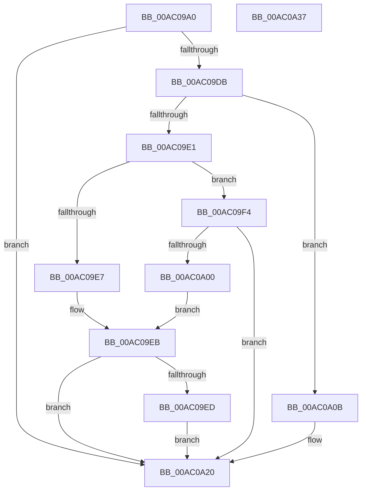

# MiValidateUserCallTarget

- RVA: `0x00AC09A0`–`0x00AC0A38` (길이 `152` bytes)
- VA: `0x0000000140AC09A0`
- 실행 섹션: `PAGE`
- PDB 이름 있음: `예`; PDB Function 태그: `아니요`
- unwind 정보 RVA: `0x0005C954`
- 디코드: `46`개 명령, `152/152` bytes 표시
- 미해석 바이트: `0` (있으면 어셈블리에 `.byte`로 보존)

> 이 문서는 커널 이미지의 기계어와 PDB 기호를 분석해 생성했습니다. 4번과 5번은 함수 원형과 자료형을 바이너리 사용 방식에서 추정한 C 해석이며 원본 소스 복구 결과는 아닙니다.

## 1. Dependencies

- 직접 호출 지점: **2**; 고유 호출 대상: **2**
- 직접 호출자로 확인된 함수: **2**
- RIP 상대 이미지 참조: **0**

### Outgoing calls
- `0x00AC09CF` → [CfgAddressToBitState](../../text/4B/CfgAddressToBitState_function_004B9550.md) (function, `0x004B9550`)
- `0x00AC09F7` → [MiIsProcessCfgExportSuppressionEnabled](../A8/MiIsProcessCfgExportSuppressionEnabled_function_00A8F6DC.md) (function, `0x00A8F6DC`)

### Direct callers
- [MmValidateUserCallTarget](MmValidateUserCallTarget_function_00AC0950.md) at `0x00AC098D`
- [sub_00B314C0](../B3/Unknown_function_00B314C0.md) at `0x00B314CA`

### Static image references
- 디코드된 RIP-relative 메모리 참조가 없습니다.

## 2. Other-region calls and transfers

- 다른 실행 섹션으로 향하는 call: **1**
  - `0x00AC09CF` → [CfgAddressToBitState](../../text/4B/CfgAddressToBitState_function_004B9550.md) (`PAGE` → `.text`)
- 별도 외부 분기/꼬리 이동을 확인하지 못했습니다.

## 3. Assembly (complete function range)

```asm
00AC09A0  48 89 5C 24 08                  mov qword ptr [rsp + 8], rbx
00AC09A5  48 89 6C 24 10                  mov qword ptr [rsp + 0x10], rbp
00AC09AA  48 89 74 24 18                  mov qword ptr [rsp + 0x18], rsi
00AC09AF  57                              push rdi
00AC09B0  48 83 EC 20                     sub rsp, 0x20
00AC09B4  65 48 8B 04 25 88 01 00 00      mov rax, qword ptr gs:[0x188]
00AC09BD  48 8B F2                        mov rsi, rdx
00AC09C0  48 8B 12                        mov rdx, qword ptr [rdx]
00AC09C3  48 8B F9                        mov rdi, rcx
00AC09C6  33 DB                           xor ebx, ebx
00AC09C8  48 8B A8 B8 00 00 00            mov rbp, qword ptr [rax + 0xb8]
00AC09CF  E8 7C 8B 9F FF                  call 0x1404b9550
00AC09D4  44 8B C0                        mov r8d, eax
00AC09D7  85 C0                           test eax, eax
00AC09D9  74 45                           je 0x140ac0a20
00AC09DB  41 83 E8 01                     sub r8d, 1
00AC09DF  74 2A                           je 0x140ac0a0b
00AC09E1  41 83 E8 01                     sub r8d, 1
00AC09E5  74 0D                           je 0x140ac09f4
00AC09E7  41 83 F8 01                     cmp r8d, 1
00AC09EB  75 33                           jne 0x140ac0a20
00AC09ED  BB 01 00 00 00                  mov ebx, 1
00AC09F2  EB 2C                           jmp 0x140ac0a20
00AC09F4  48 8B CD                        mov rcx, rbp
00AC09F7  E8 E0 EC FC FF                  call 0x140a8f6dc
00AC09FC  85 C0                           test eax, eax
00AC09FE  75 20                           jne 0x140ac0a20
00AC0A00  8B 46 18                        mov eax, dword ptr [rsi + 0x18]
00AC0A03  83 E7 0F                        and edi, 0xf
00AC0A06  48 3B F8                        cmp rdi, rax
00AC0A09  EB E0                           jmp 0x140ac09eb
00AC0A0B  8B 4E 18                        mov ecx, dword ptr [rsi + 0x18]
00AC0A0E  8B D3                           mov edx, ebx
00AC0A10  BB 01 00 00 00                  mov ebx, 1
00AC0A15  83 E7 0F                        and edi, 0xf
00AC0A18  48 3B F9                        cmp rdi, rcx
00AC0A1B  0F 44 D3                        cmove edx, ebx
00AC0A1E  8B DA                           mov ebx, edx
00AC0A20  48 8B 6C 24 38                  mov rbp, qword ptr [rsp + 0x38]
00AC0A25  8B C3                           mov eax, ebx
00AC0A27  48 8B 5C 24 30                  mov rbx, qword ptr [rsp + 0x30]
00AC0A2C  48 8B 74 24 40                  mov rsi, qword ptr [rsp + 0x40]
00AC0A31  48 83 C4 20                     add rsp, 0x20
00AC0A35  5F                              pop rdi
00AC0A36  C3                              ret
00AC0A37  CC                              int3
```

## 4. C-style interpretation (structured pseudocode)

```c
__int64 __fastcall MiValidateUserCallTarget(__int64 a1, __int64 a2)
{
    __int64 result;
    __int64 v_rbx;
    __int64 v_rdi;
    __int64 v_rsp;
    unsigned __int64 v_stack_p10;
    unsigned __int64 v_stack_p18;
    unsigned __int64 v_stack_p8;

    v_stack_p8 = v_rbx;
    v_stack_p10 = v_rbp;
    v_stack_p18 = v_rsi;
    v_rsp = (v_rsp) - (32);
    v_rbx = 0;
    result = CfgAddressToBitState(a1, *(unsigned __int64 *)(a2), a3, a4);
    if ((unsigned int)(result) == 0) goto loc_00AC0A20;
    a3 = (unsigned int)(((unsigned int)((unsigned int)(result))) - (1));
    if (condition_is_equal) goto loc_00AC0A0B;
    a3 = (unsigned int)((a3) - (1));
    if (condition_is_equal) goto loc_00AC09F4;
loc_00AC09EB:
    if (((unsigned int)(a3)) != 1) goto loc_00AC0A20;
    goto loc_00AC0A20;
loc_00AC09F4:
    result = MiIsProcessCfgExportSuppressionEnabled(*(unsigned __int64 *)(*(unsigned __int64 *)(gs_base + (0 + 392)) + 184), *(unsigned __int64 *)(a2), a3, a4);
    if ((unsigned int)(result) != 0) goto loc_00AC0A20;
    v_rdi = (unsigned int)((a1) & (15));
    goto loc_00AC09EB;
loc_00AC0A0B:
    v_rdi = (unsigned int)((v_rdi) & (15));
    a2 = 1;
    if (v_rdi == ((unsigned int)(*(unsigned int *)(a2 + 24)))) { a2 = 1; }
loc_00AC0A20:
    v_rsp = (v_rsp) + (32);
    return (unsigned int)((unsigned int)((unsigned int)((unsigned int)(a2))));
}
```

## 5. (Beta) C Style

```c
int64_t MiValidateUserCallTarget(int64_t Arg1, void *Arg2)
{
    uint8_t *arg2 = (uint8_t *)Arg2;

    int64_t result;
    int64_t local_rbx;
    int64_t local_rdi;
    int64_t local_rsp;
    uint64_t v_stack_p10;
    uint64_t v_stack_p18;
    uint64_t v_stack_p8;

    v_stack_p8 = local_rbx;
    v_stack_p10 = local_rbp;
    v_stack_p18 = local_rsi;
    local_rsp = (local_rsp) - (32);
    local_rbx = 0;
    result = CfgAddressToBitState(Arg1, *(uint64_t *)(arg2), a3, a4);
    if ((uint32_t)(result) == 0) goto loc_00AC0A20;
    a3 = (uint32_t)(((uint32_t)((uint32_t)(result))) - (1));
    if (condition_is_equal) goto loc_00AC0A0B;
    a3 = (uint32_t)((a3) - (1));
    if (condition_is_equal) goto loc_00AC09F4;
loc_00AC09EB:
    if (((uint32_t)(a3)) != 1) goto loc_00AC0A20;
    goto loc_00AC0A20;
loc_00AC09F4:
    result = MiIsProcessCfgExportSuppressionEnabled(*(uint64_t *)(*(uint64_t *)(gs_base + (0 + 0x188)) + 0xB8), *(uint64_t *)(arg2), a3, a4);
    if ((uint32_t)(result) != 0) goto loc_00AC0A20;
    local_rdi = (uint32_t)((Arg1) & (15));
    goto loc_00AC09EB;
loc_00AC0A0B:
    local_rdi = (uint32_t)((local_rdi) & (15));
    Arg2 = 1;
    if (local_rdi == ((uint32_t)(*(uint32_t *)(arg2 + 0x18)))) { Arg2 = 1; }
loc_00AC0A20:
    local_rsp = (local_rsp) + (32);
    return (uint32_t)((uint32_t)((uint32_t)((uint32_t)(Arg2))));
}
```

### 관측된 메모리 오프셋

구조체 형식이 확인되지 않은 접근은 인자 기준의 오프셋으로만 기록했습니다.

| 기준 인자 | 오프셋 표현 | 폭 (bit) | 접근 |
|---|---:|---:|---|
| `Arg2` | `+ 0x0` | `64` | `R` |
| `Arg2` | `+ 0x18` | `32` | `R` |

## 6. Execution-region graph

[열기: 2D/3D 그래프와 함수 탐색 컨트롤 패널](../../../control-panel.html?section=page&rva=0x00AC09A0&view=graph)

- 2D 그래프는 위에서 아래로 흐르고, 3D 그래프는 빈 공간을 드래그해 회전합니다. Shift+드래그는 이동, 휠은 확대·축소, 함수 노드 선택은 대상 보고서 이동입니다.

### Static fallback


