# MmDeleteProcessAddressSpace

- RVA: `0x00AC804C`–`0x00AC825E` (길이 `530` bytes)
- VA: `0x0000000140AC804C`
- 실행 섹션: `PAGE`
- PDB 이름 있음: `예`; PDB Function 태그: `아니요`
- unwind 정보 RVA: `0x000847EC`
- 디코드: `154`개 명령, `530/530` bytes 표시
- 미해석 바이트: `0` (있으면 어셈블리에 `.byte`로 보존)

> 이 문서는 커널 이미지의 기계어와 PDB 기호를 분석해 생성했습니다. 4번과 5번은 함수 원형과 자료형을 바이너리 사용 방식에서 추정한 C 해석이며 원본 소스 복구 결과는 아닙니다.

## 1. Dependencies

- 직접 호출 지점: **23**; 고유 호출 대상: **19**
- 직접 호출자로 확인된 함수: **1**
- RIP 상대 이미지 참조: **0**

### Outgoing calls
- `0x00AC8076` → [MiUnlinkWorkingSet](../../text/2C/MiUnlinkWorkingSet_function_002C8B50.md) (function, `0x002C8B50`)
- `0x00AC8085` → [MiReadProcessNumberOfLockedPages](../../text/49/MiReadProcessNumberOfLockedPages_function_00494968.md) (function, `0x00494968`)
- `0x00AC80DD` → [KeBugCheckEx](../../text/4F/KeBugCheckEx_function_004FD660.md) (function, `0x004FD660`)
- `0x00AC80F0` → [KeBugCheckEx](../../text/4F/KeBugCheckEx_function_004FD660.md) (function, `0x004FD660`)
- `0x00AC8118` → [ExFreePoolWithTag](../../poolcode/B8/ExFreePoolWithTag_function_00B82870.md) (function, `0x00B82870`)
- `0x00AC812F` → [ExFreePoolWithTag](../../poolcode/B8/ExFreePoolWithTag_function_00B82870.md) (function, `0x00B82870`)
- `0x00AC8137` → [MiGetSharedVm](../../text/41/MiGetSharedVm_function_00414A20.md) (function, `0x00414A20`)
- `0x00AC8142` → [MiDeleteFinalPageTables](../../text/46/MiDeleteFinalPageTables_function_004659AC.md) (function, `0x004659AC`)
- `0x00AC8156` → [PsReturnProcessQuota](../../text/47/PsReturnProcessQuota_function_0047DE8C.md) (function, `0x0047DE8C`)
- `0x00AC815E` → [MiGetProcessPartition](../../text/44/MiGetProcessPartition_function_00443B10.md) (function, `0x00443B10`)
- `0x00AC816C` → [MiReturnResident](../../text/28/MiReturnResident_function_00286890.md) (function, `0x00286890`)
- `0x00AC818C` → [MiDeleteAweInfo](../80/MiDeleteAweInfo_function_0080A9F8.md) (function, `0x0080A9F8`)
- `0x00AC8198` → [ExCleanupAutoExpandPushLock](../../text/43/ExCleanupAutoExpandPushLock_function_0043FAA0.md) (function, `0x0043FAA0`)
- `0x00AC81A9` → [MiGetVmAccessLoggingPartition](../../text/38/MiGetVmAccessLoggingPartition_function_003815A0.md) (function, `0x003815A0`)
- `0x00AC81B4` → [MiEmptyPageAccessLog](../../text/34/MiEmptyPageAccessLog_function_00348700.md) (function, `0x00348700`)
- `0x00AC81C9` → [ExFreePoolWithTag](../../poolcode/B8/ExFreePoolWithTag_function_00B82870.md) (function, `0x00B82870`)
- `0x00AC81EA` → [PspChangeJobMemoryUsageByProcess](../87/PspChangeJobMemoryUsageByProcess_function_0087F030.md) (function, `0x0087F030`)
- `0x00AC81FB` → [MiReturnCommit](../../text/24/MiReturnCommit_function_00248410.md) (function, `0x00248410`)
- `0x00AC8203` → [MiDeletePxeSharedLocks](../../text/4A/MiDeletePxeSharedLocks_function_004A0740.md) (function, `0x004A0740`)
- `0x00AC820B` → [MiDeleteWorkingSetList](../../text/48/MiDeleteWorkingSetList_function_0048C7E8.md) (function, `0x0048C7E8`)
- `0x00AC821E` → [ExFreePoolWithTag](../../poolcode/B8/ExFreePoolWithTag_function_00B82870.md) (function, `0x00B82870`)
- `0x00AC8226` → [MiContractPagingFiles](../../text/48/MiContractPagingFiles_function_0048177C.md) (function, `0x0048177C`)
- `0x00AC8239` → [MiDereferenceSlabIdentity](../../text/68/MiDereferenceSlabIdentity_function_0068E000.md) (function, `0x0068E000`)

### Direct callers
- [PspProcessDelete](../90/PspProcessDelete_function_00907B90.md) at `0x00907D0E`

### Static image references
- 디코드된 RIP-relative 메모리 참조가 없습니다.

## 2. Other-region calls and transfers

- 다른 실행 섹션으로 향하는 call: **21**
  - `0x00AC8076` → [MiUnlinkWorkingSet](../../text/2C/MiUnlinkWorkingSet_function_002C8B50.md) (`PAGE` → `.text`)
  - `0x00AC8085` → [MiReadProcessNumberOfLockedPages](../../text/49/MiReadProcessNumberOfLockedPages_function_00494968.md) (`PAGE` → `.text`)
  - `0x00AC80DD` → [KeBugCheckEx](../../text/4F/KeBugCheckEx_function_004FD660.md) (`PAGE` → `.text`)
  - `0x00AC80F0` → [KeBugCheckEx](../../text/4F/KeBugCheckEx_function_004FD660.md) (`PAGE` → `.text`)
  - `0x00AC8118` → [ExFreePoolWithTag](../../poolcode/B8/ExFreePoolWithTag_function_00B82870.md) (`PAGE` → `POOLCODE`)
  - `0x00AC812F` → [ExFreePoolWithTag](../../poolcode/B8/ExFreePoolWithTag_function_00B82870.md) (`PAGE` → `POOLCODE`)
  - `0x00AC8137` → [MiGetSharedVm](../../text/41/MiGetSharedVm_function_00414A20.md) (`PAGE` → `.text`)
  - `0x00AC8142` → [MiDeleteFinalPageTables](../../text/46/MiDeleteFinalPageTables_function_004659AC.md) (`PAGE` → `.text`)
  - `0x00AC8156` → [PsReturnProcessQuota](../../text/47/PsReturnProcessQuota_function_0047DE8C.md) (`PAGE` → `.text`)
  - `0x00AC815E` → [MiGetProcessPartition](../../text/44/MiGetProcessPartition_function_00443B10.md) (`PAGE` → `.text`)
  - `0x00AC816C` → [MiReturnResident](../../text/28/MiReturnResident_function_00286890.md) (`PAGE` → `.text`)
  - `0x00AC8198` → [ExCleanupAutoExpandPushLock](../../text/43/ExCleanupAutoExpandPushLock_function_0043FAA0.md) (`PAGE` → `.text`)
  - `0x00AC81A9` → [MiGetVmAccessLoggingPartition](../../text/38/MiGetVmAccessLoggingPartition_function_003815A0.md) (`PAGE` → `.text`)
  - `0x00AC81B4` → [MiEmptyPageAccessLog](../../text/34/MiEmptyPageAccessLog_function_00348700.md) (`PAGE` → `.text`)
  - `0x00AC81C9` → [ExFreePoolWithTag](../../poolcode/B8/ExFreePoolWithTag_function_00B82870.md) (`PAGE` → `POOLCODE`)
  - `0x00AC81FB` → [MiReturnCommit](../../text/24/MiReturnCommit_function_00248410.md) (`PAGE` → `.text`)
  - `0x00AC8203` → [MiDeletePxeSharedLocks](../../text/4A/MiDeletePxeSharedLocks_function_004A0740.md) (`PAGE` → `.text`)
  - `0x00AC820B` → [MiDeleteWorkingSetList](../../text/48/MiDeleteWorkingSetList_function_0048C7E8.md) (`PAGE` → `.text`)
  - `0x00AC821E` → [ExFreePoolWithTag](../../poolcode/B8/ExFreePoolWithTag_function_00B82870.md) (`PAGE` → `POOLCODE`)
  - `0x00AC8226` → [MiContractPagingFiles](../../text/48/MiContractPagingFiles_function_0048177C.md) (`PAGE` → `.text`)
  - `0x00AC8239` → [MiDereferenceSlabIdentity](../../text/68/MiDereferenceSlabIdentity_function_0068E000.md) (`PAGE` → `.text`)
- 별도 외부 분기/꼬리 이동을 확인하지 못했습니다.

## 3. Assembly (complete function range)

```asm
00AC804C  48 8B C4                        mov rax, rsp
00AC804F  48 89 58 08                     mov qword ptr [rax + 8], rbx
00AC8053  48 89 68 10                     mov qword ptr [rax + 0x10], rbp
00AC8057  48 89 70 18                     mov qword ptr [rax + 0x18], rsi
00AC805B  48 89 78 20                     mov qword ptr [rax + 0x20], rdi
00AC805F  41 54                           push r12
00AC8061  41 56                           push r14
00AC8063  41 57                           push r15
00AC8065  48 83 EC 30                     sub rsp, 0x30
00AC8069  48 8D A9 00 04 00 00            lea rbp, [rcx + 0x400]
00AC8070  48 8B F9                        mov rdi, rcx
00AC8073  48 8B CD                        mov rcx, rbp
00AC8076  E8 D5 0A 80 FF                  call 0x1402c8b50
00AC807B  48 8B 9F 98 03 00 00            mov rbx, qword ptr [rdi + 0x398]
00AC8082  48 8B CF                        mov rcx, rdi
00AC8085  E8 DE C8 9C FF                  call 0x140494968
00AC808A  4C 8B C8                        mov r9, rax
00AC808D  48 85 C0                        test rax, rax
00AC8090  74 64                           je 0x140ac80f6
00AC8092  48 85 DB                        test rbx, rbx
00AC8095  74 4C                           je 0x140ac80e3
00AC8097  48 83 7B 10 00                  cmp qword ptr [rbx + 0x10], 0
00AC809C  74 45                           je 0x140ac80e3
00AC809E  83 7B 1C 00                     cmp dword ptr [rbx + 0x1c], 0
00AC80A2  74 3F                           je 0x140ac80e3
00AC80A4  48 8B 03                        mov rax, qword ptr [rbx]
00AC80A7  33 D2                           xor edx, edx
00AC80A9  EB 06                           jmp 0x140ac80b1
00AC80AB  48 8B D0                        mov rdx, rax
00AC80AE  48 8B 00                        mov rax, qword ptr [rax]
00AC80B1  48 85 C0                        test rax, rax
00AC80B4  75 F5                           jne 0x140ac80ab
00AC80B6  48 85 D2                        test rdx, rdx
00AC80B9  75 11                           jne 0x140ac80cc
00AC80BB  48 8B 43 08                     mov rax, qword ptr [rbx + 8]
00AC80BF  EB 06                           jmp 0x140ac80c7
00AC80C1  48 8B D0                        mov rdx, rax
00AC80C4  48 8B 00                        mov rax, qword ptr [rax]
00AC80C7  48 85 C0                        test rax, rax
00AC80CA  75 F5                           jne 0x140ac80c1
00AC80CC  4C 89 4C 24 20                  mov qword ptr [rsp + 0x20], r9
00AC80D1  45 33 C0                        xor r8d, r8d
00AC80D4  4C 8B 4A 18                     mov r9, qword ptr [rdx + 0x18]
00AC80D8  B9 CB 00 00 00                  mov ecx, 0xcb
00AC80DD  E8 7E 55 A3 FF                  call 0x1404fd660
00AC80E2  CC                              int3
00AC80E3  33 D2                           xor edx, edx
00AC80E5  48 89 5C 24 20                  mov qword ptr [rsp + 0x20], rbx
00AC80EA  4C 8B C7                        mov r8, rdi
00AC80ED  8D 4A 76                        lea ecx, [rdx + 0x76]
00AC80F0  E8 6B 55 A3 FF                  call 0x1404fd660
00AC80F5  CC                              int3
00AC80F6  48 85 DB                        test rbx, rbx
00AC80F9  74 39                           je 0x140ac8134
00AC80FB  48 8B F3                        mov rsi, rbx
00AC80FE  48 8B 06                        mov rax, qword ptr [rsi]
00AC8101  48 85 C0                        test rax, rax
00AC8104  74 19                           je 0x140ac811f
00AC8106  48 8B C8                        mov rcx, rax
00AC8109  48 8B 00                        mov rax, qword ptr [rax]
00AC810C  48 85 C0                        test rax, rax
00AC810F  75 F5                           jne 0x140ac8106
00AC8111  48 85 C9                        test rcx, rcx
00AC8114  74 09                           je 0x140ac811f
00AC8116  33 D2                           xor edx, edx
00AC8118  E8 53 A7 0B 00                  call 0x140b82870
00AC811D  EB DF                           jmp 0x140ac80fe
00AC811F  48 3B F3                        cmp rsi, rbx
00AC8122  75 06                           jne 0x140ac812a
00AC8124  48 8D 73 08                     lea rsi, [rbx + 8]
00AC8128  EB D4                           jmp 0x140ac80fe
00AC812A  33 D2                           xor edx, edx
00AC812C  48 8B CB                        mov rcx, rbx
00AC812F  E8 3C A7 0B 00                  call 0x140b82870
00AC8134  48 8B CD                        mov rcx, rbp
00AC8137  E8 E4 C8 94 FF                  call 0x140414a20
00AC813C  48 8B CF                        mov rcx, rdi
00AC813F  48 8B D8                        mov rbx, rax
00AC8142  E8 65 D8 99 FF                  call 0x1404659ac
00AC8147  41 BF 04 00 00 00               mov r15d, 4
00AC814D  48 8B CF                        mov rcx, rdi
00AC8150  45 8B C7                        mov r8d, r15d
00AC8153  4C 8B E0                        mov r12, rax
00AC8156  E8 31 5D 9B FF                  call 0x14047de8c
00AC815B  48 8B CF                        mov rcx, rdi
00AC815E  E8 AD B9 97 FF                  call 0x140443b10
00AC8163  41 8B D7                        mov edx, r15d
00AC8166  48 8B C8                        mov rcx, rax
00AC8169  48 8B F0                        mov rsi, rax
00AC816C  E8 1F E7 7B FF                  call 0x140286890
00AC8171  4C 8B B7 10 04 00 00            mov r14, qword ptr [rdi + 0x410]
00AC8178  4D 85 F6                        test r14, r14
00AC817B  74 20                           je 0x140ac819d
00AC817D  49 8B 96 48 04 00 00            mov rdx, qword ptr [r14 + 0x448]
00AC8184  48 85 D2                        test rdx, rdx
00AC8187  74 08                           je 0x140ac8191
00AC8189  48 8B CF                        mov rcx, rdi
00AC818C  E8 67 28 D4 FF                  call 0x14080a9f8
00AC8191  49 8D 8E 58 04 00 00            lea rcx, [r14 + 0x458]
00AC8198  E8 03 79 97 FF                  call 0x14043faa0
00AC819D  4C 8B 43 28                     mov r8, qword ptr [rbx + 0x28]
00AC81A1  4D 85 C0                        test r8, r8
00AC81A4  74 18                           je 0x140ac81be
00AC81A6  48 8B CD                        mov rcx, rbp
00AC81A9  E8 F2 93 8B FF                  call 0x1403815a0
00AC81AE  48 8B C8                        mov rcx, rax
00AC81B1  49 8B D0                        mov rdx, r8
00AC81B4  E8 47 05 88 FF                  call 0x140348700
00AC81B9  48 83 63 28 00                  and qword ptr [rbx + 0x28], 0
00AC81BE  48 8B 4B 20                     mov rcx, qword ptr [rbx + 0x20]
00AC81C2  48 85 C9                        test rcx, rcx
00AC81C5  74 0C                           je 0x140ac81d3
00AC81C7  33 D2                           xor edx, edx
00AC81C9  E8 A2 A6 0B 00                  call 0x140b82870
00AC81CE  48 83 63 20 00                  and qword ptr [rbx + 0x20], 0
00AC81D3  8B 87 F0 01 00 00               mov eax, dword ptr [rdi + 0x1f0]
00AC81D9  A8 10                           test al, 0x10
00AC81DB  74 12                           je 0x140ac81ef
00AC81DD  45 33 C9                        xor r9d, r9d
00AC81E0  4C 8B C7                        mov r8, rdi
00AC81E3  49 8D 51 FC                     lea rdx, [r9 - 4]
00AC81E7  8D 4A 06                        lea ecx, [rdx + 6]
00AC81EA  E8 41 6E DB FF                  call 0x14087f030
00AC81EF  4D 2B FC                        sub r15, r12
00AC81F2  45 33 C0                        xor r8d, r8d
00AC81F5  49 8B D7                        mov rdx, r15
00AC81F8  48 8B CE                        mov rcx, rsi
00AC81FB  E8 10 02 78 FF                  call 0x140248410
00AC8200  48 8B CD                        mov rcx, rbp
00AC8203  E8 38 85 9D FF                  call 0x1404a0740
00AC8208  48 8B CD                        mov rcx, rbp
00AC820B  E8 D8 45 9C FF                  call 0x14048c7e8
00AC8210  48 8B 8F 78 07 00 00            mov rcx, qword ptr [rdi + 0x778]
00AC8217  48 85 C9                        test rcx, rcx
00AC821A  74 07                           je 0x140ac8223
00AC821C  33 D2                           xor edx, edx
00AC821E  E8 4D A6 0B 00                  call 0x140b82870
00AC8223  48 8B CE                        mov rcx, rsi
00AC8226  E8 51 95 9B FF                  call 0x14048177c
00AC822B  8A 97 EE 06 00 00               mov dl, byte ptr [rdi + 0x6ee]
00AC8231  80 FA FF                        cmp dl, 0xff
00AC8234  74 08                           je 0x140ac823e
00AC8236  48 8B CE                        mov rcx, rsi
00AC8239  E8 C2 5D BC FF                  call 0x14068e000
00AC823E  48 8B 5C 24 50                  mov rbx, qword ptr [rsp + 0x50]
00AC8243  48 8B 6C 24 58                  mov rbp, qword ptr [rsp + 0x58]
00AC8248  48 8B 74 24 60                  mov rsi, qword ptr [rsp + 0x60]
00AC824D  48 8B 7C 24 68                  mov rdi, qword ptr [rsp + 0x68]
00AC8252  48 83 C4 30                     add rsp, 0x30
00AC8256  41 5F                           pop r15
00AC8258  41 5E                           pop r14
00AC825A  41 5C                           pop r12
00AC825C  C3                              ret
00AC825D  CC                              int3
```

## 4. C-style interpretation (structured pseudocode)

```c
__int64 __fastcall MmDeleteProcessAddressSpace(__int64 a1, int a2, int a3)
{
    __int64 result;
    __int64 v_r15;
    __int64 v_rsp;
    unsigned __int64 v_stack_m28;
    unsigned __int64 v_stack_p10;
    unsigned __int64 v_stack_p18;
    unsigned __int64 v_stack_p20;
    unsigned __int64 v_stack_p8;

    *(unsigned __int64 *)(v_rsp + 8) = v_rbx;
    *(unsigned __int64 *)(v_rsp + 16) = v_rbp;
    *(unsigned __int64 *)(v_rsp + 24) = v_rsi;
    *(unsigned __int64 *)(v_rsp + 32) = v_rdi;
    v_rsp = (v_rsp) - (48);
    result = MiUnlinkWorkingSet(a1 + 1024, a2, a3, a4);
    result = MiReadProcessNumberOfLockedPages(a1, a2, a3, a4);
    if (result == 0) goto loc_00AC80F6;
    if (*(unsigned __int64 *)(a1 + 920) == 0) goto loc_00AC80E3;
    if ((*(unsigned __int64 *)(*(unsigned __int64 *)(a1 + 920) + 16)) == 0) goto loc_00AC80E3;
    if ((*(unsigned int *)(*(unsigned __int64 *)(a1 + 920) + 28)) == 0) goto loc_00AC80E3;
    a2 = 0;
    goto loc_00AC80B1;
loc_00AC80AB:
loc_00AC80B1:
    if (*(unsigned __int64 *)(*(unsigned __int64 *)(*(unsigned __int64 *)(a1 + 920))) != 0) goto loc_00AC80AB;
    if (*(unsigned __int64 *)(*(unsigned __int64 *)(a1 + 920)) != 0) goto loc_00AC80CC;
    goto loc_00AC80C7;
loc_00AC80C1:
loc_00AC80C7:
    if (*(unsigned __int64 *)(*(unsigned __int64 *)(*(unsigned __int64 *)(a1 + 920) + 8)) != 0) goto loc_00AC80C1;
loc_00AC80CC:
    v_stack_m28 = result;
    a3 = 0;
    result = KeBugCheckEx(203, *(unsigned __int64 *)(*(unsigned __int64 *)(a1 + 920) + 8), a3, *(unsigned __int64 *)(*(unsigned __int64 *)(*(unsigned __int64 *)(a1 + 920) + 8) + 24));
loc_00AC80E3:
    a2 = 0;
    v_stack_m28 = *(unsigned __int64 *)(a1 + 920);
    result = KeBugCheckEx(a2 + 118, a2, a1, *(unsigned __int64 *)(*(unsigned __int64 *)(*(unsigned __int64 *)(a1 + 920) + 8) + 24));
loc_00AC80F6:
    if (*(unsigned __int64 *)(a1 + 920) == 0) goto loc_00AC8134;
loc_00AC80FE:
    if (*(unsigned __int64 *)(*(unsigned __int64 *)(a1 + 920)) == 0) goto loc_00AC811F;
loc_00AC8106:
    if (*(unsigned __int64 *)(*(unsigned __int64 *)(*(unsigned __int64 *)(a1 + 920))) != 0) goto loc_00AC8106;
    if (*(unsigned __int64 *)(*(unsigned __int64 *)(a1 + 920)) == 0) goto loc_00AC811F;
    a2 = 0;
    result = ExFreePoolWithTag(*(unsigned __int64 *)(*(unsigned __int64 *)(a1 + 920)), a2, a1, *(unsigned __int64 *)(*(unsigned __int64 *)(*(unsigned __int64 *)(a1 + 920) + 8) + 24));
    goto loc_00AC80FE;
loc_00AC811F:
    if ((*(unsigned __int64 *)(a1 + 920)) != (*(unsigned __int64 *)(a1 + 920))) goto loc_00AC812A;
    goto loc_00AC80FE;
loc_00AC812A:
    a2 = 0;
    result = ExFreePoolWithTag(*(unsigned __int64 *)(a1 + 920), a2, a1, *(unsigned __int64 *)(*(unsigned __int64 *)(*(unsigned __int64 *)(a1 + 920) + 8) + 24));
loc_00AC8134:
    result = MiGetSharedVm(a1 + 1024, a2, a1, *(unsigned __int64 *)(*(unsigned __int64 *)(*(unsigned __int64 *)(a1 + 920) + 8) + 24));
    result = MiDeleteFinalPageTables(a1, a2, a1, *(unsigned __int64 *)(*(unsigned __int64 *)(*(unsigned __int64 *)(a1 + 920) + 8) + 24));
    result = PsReturnProcessQuota(a1, a2, 4, *(unsigned __int64 *)(*(unsigned __int64 *)(*(unsigned __int64 *)(a1 + 920) + 8) + 24));
    result = MiGetProcessPartition(a1, a2, 4, *(unsigned __int64 *)(*(unsigned __int64 *)(*(unsigned __int64 *)(a1 + 920) + 8) + 24));
    result = MiReturnResident(result, 4, 4, *(unsigned __int64 *)(*(unsigned __int64 *)(*(unsigned __int64 *)(a1 + 920) + 8) + 24));
    if (*(unsigned __int64 *)(a1 + 1040) == 0) goto loc_00AC819D;
    if (*(unsigned __int64 *)(*(unsigned __int64 *)(a1 + 1040) + 1096) != 0) {
        a1 = a1;
        result = MiDeleteAweInfo(a1, *(unsigned __int64 *)(*(unsigned __int64 *)(a1 + 1040) + 1096), 4, *(unsigned __int64 *)(*(unsigned __int64 *)(*(unsigned __int64 *)(a1 + 920) + 8) + 24));
    }
    result = ExCleanupAutoExpandPushLock(*(unsigned __int64 *)(a1 + 1040) + 1112, *(unsigned __int64 *)(*(unsigned __int64 *)(a1 + 1040) + 1096), 4, *(unsigned __int64 *)(*(unsigned __int64 *)(*(unsigned __int64 *)(a1 + 920) + 8) + 24));
loc_00AC819D:
    if (*(unsigned __int64 *)(result + 40) != 0) {
        a1 = a1 + 1024;
        result = MiGetVmAccessLoggingPartition(a1, *(unsigned __int64 *)(*(unsigned __int64 *)(a1 + 1040) + 1096), *(unsigned __int64 *)(result + 40), *(unsigned __int64 *)(*(unsigned __int64 *)(*(unsigned __int64 *)(a1 + 920) + 8) + 24));
        a1 = result;
        a2 = *(unsigned __int64 *)(result + 40);
        result = MiEmptyPageAccessLog(a1, a2, *(unsigned __int64 *)(result + 40), *(unsigned __int64 *)(*(unsigned __int64 *)(*(unsigned __int64 *)(a1 + 920) + 8) + 24));
    }
    if (*(unsigned __int64 *)(result + 32) != 0) {
        a2 = 0;
        result = ExFreePoolWithTag(*(unsigned __int64 *)(result + 32), a2, *(unsigned __int64 *)(result + 40), *(unsigned __int64 *)(*(unsigned __int64 *)(*(unsigned __int64 *)(a1 + 920) + 8) + 24));
    }
    result = (unsigned int)(*(unsigned int *)(a1 + 496));
    if ((((unsigned __int8)((unsigned int)(*(unsigned int *)(a1 + 496)))) & (16)) != 0) {
        a4 = 0;
        a3 = a1;
        a2 = a4 - 4;
        a1 = a2 + 6;
        result = PspChangeJobMemoryUsageByProcess(a1, a2, a3, a4);
    }
    v_r15 = (4) - (result);
    a3 = 0;
    result = MiReturnCommit(result, v_r15, a3, a4);
    result = MiDeletePxeSharedLocks(a1 + 1024, v_r15, a3, a4);
    result = MiDeleteWorkingSetList(a1 + 1024, v_r15, a3, a4);
    if (*(unsigned __int64 *)(a1 + 1912) != 0) {
        a2 = 0;
        result = ExFreePoolWithTag(*(unsigned __int64 *)(a1 + 1912), a2, a3, a4);
    }
    result = MiContractPagingFiles(result, a2, a3, a4);
    if (((unsigned __int8)(*(unsigned __int8 *)(a1 + 1774))) != 255) {
        a1 = result;
        result = MiDereferenceSlabIdentity(a1, *(unsigned __int8 *)(a1 + 1774), a3, a4);
    }
    v_rsp = (v_rsp) + (48);
    return result;
}
```

## 5. (Beta) C Style

```c
int64_t MmDeleteProcessAddressSpace(void *Arg1, int32_t Arg2, int32_t Arg3)
{
    uint8_t *arg1 = (uint8_t *)Arg1;

    int64_t result;
    int64_t local_r15;
    int64_t local_rsp;
    uint64_t v_stack_m28;
    uint64_t v_stack_p10;
    uint64_t v_stack_p18;
    uint64_t v_stack_p20;
    uint64_t v_stack_p8;

    *(uint64_t *)(local_rsp + 0x8) = local_rbx;
    *(uint64_t *)(local_rsp + 0x10) = local_rbp;
    *(uint64_t *)(local_rsp + 0x18) = local_rsi;
    *(uint64_t *)(local_rsp + 0x20) = local_rdi;
    local_rsp = (local_rsp) - (48);
    result = MiUnlinkWorkingSet(Arg1 + 1024, Arg2, Arg3, a4);
    result = MiReadProcessNumberOfLockedPages(Arg1, Arg2, Arg3, a4);
    if (result == 0) goto loc_00AC80F6;
    if (*(uint64_t *)(arg1 + 0x398) == 0) goto loc_00AC80E3;
    if ((*(uint64_t *)(*(uint64_t *)(arg1 + 0x398) + 0x10)) == 0) goto loc_00AC80E3;
    if ((*(uint32_t *)(*(uint64_t *)(arg1 + 0x398) + 0x1C)) == 0) goto loc_00AC80E3;
    Arg2 = 0;
    goto loc_00AC80B1;
loc_00AC80AB:
loc_00AC80B1:
    if (*(uint64_t *)(*(uint64_t *)(*(uint64_t *)(arg1 + 0x398))) != 0) goto loc_00AC80AB;
    if (*(uint64_t *)(*(uint64_t *)(arg1 + 0x398)) != 0) goto loc_00AC80CC;
    goto loc_00AC80C7;
loc_00AC80C1:
loc_00AC80C7:
    if (*(uint64_t *)(*(uint64_t *)(*(uint64_t *)(arg1 + 0x398) + 0x8)) != 0) goto loc_00AC80C1;
loc_00AC80CC:
    v_stack_m28 = result;
    Arg3 = 0;
    result = KeBugCheckEx(203, *(uint64_t *)(*(uint64_t *)(arg1 + 0x398) + 0x8), Arg3, *(uint64_t *)(*(uint64_t *)(*(uint64_t *)(arg1 + 0x398) + 0x8) + 0x18));
loc_00AC80E3:
    Arg2 = 0;
    v_stack_m28 = *(uint64_t *)(arg1 + 0x398);
    result = KeBugCheckEx(Arg2 + 118, Arg2, Arg1, *(uint64_t *)(*(uint64_t *)(*(uint64_t *)(arg1 + 0x398) + 0x8) + 0x18));
loc_00AC80F6:
    if (*(uint64_t *)(arg1 + 0x398) == 0) goto loc_00AC8134;
loc_00AC80FE:
    if (*(uint64_t *)(*(uint64_t *)(arg1 + 0x398)) == 0) goto loc_00AC811F;
loc_00AC8106:
    if (*(uint64_t *)(*(uint64_t *)(*(uint64_t *)(arg1 + 0x398))) != 0) goto loc_00AC8106;
    if (*(uint64_t *)(*(uint64_t *)(arg1 + 0x398)) == 0) goto loc_00AC811F;
    Arg2 = 0;
    result = ExFreePoolWithTag(*(uint64_t *)(*(uint64_t *)(arg1 + 0x398)), Arg2, Arg1, *(uint64_t *)(*(uint64_t *)(*(uint64_t *)(arg1 + 0x398) + 0x8) + 0x18));
    goto loc_00AC80FE;
loc_00AC811F:
    if ((*(uint64_t *)(arg1 + 0x398)) != (*(uint64_t *)(arg1 + 0x398))) goto loc_00AC812A;
    goto loc_00AC80FE;
loc_00AC812A:
    Arg2 = 0;
    result = ExFreePoolWithTag(*(uint64_t *)(arg1 + 0x398), Arg2, Arg1, *(uint64_t *)(*(uint64_t *)(*(uint64_t *)(arg1 + 0x398) + 0x8) + 0x18));
loc_00AC8134:
    result = MiGetSharedVm(Arg1 + 1024, Arg2, Arg1, *(uint64_t *)(*(uint64_t *)(*(uint64_t *)(arg1 + 0x398) + 0x8) + 0x18));
    result = MiDeleteFinalPageTables(Arg1, Arg2, Arg1, *(uint64_t *)(*(uint64_t *)(*(uint64_t *)(arg1 + 0x398) + 0x8) + 0x18));
    result = PsReturnProcessQuota(Arg1, Arg2, 4, *(uint64_t *)(*(uint64_t *)(*(uint64_t *)(arg1 + 0x398) + 0x8) + 0x18));
    result = MiGetProcessPartition(Arg1, Arg2, 4, *(uint64_t *)(*(uint64_t *)(*(uint64_t *)(arg1 + 0x398) + 0x8) + 0x18));
    result = MiReturnResident(result, 4, 4, *(uint64_t *)(*(uint64_t *)(*(uint64_t *)(arg1 + 0x398) + 0x8) + 0x18));
    if (*(uint64_t *)(arg1 + 0x410) == 0) goto loc_00AC819D;
    if (*(uint64_t *)(*(uint64_t *)(arg1 + 0x410) + 0x448) != 0) {
        Arg1 = Arg1;
        result = MiDeleteAweInfo(Arg1, *(uint64_t *)(*(uint64_t *)(arg1 + 0x410) + 0x448), 4, *(uint64_t *)(*(uint64_t *)(*(uint64_t *)(arg1 + 0x398) + 0x8) + 0x18));
    }
    result = ExCleanupAutoExpandPushLock(*(uint64_t *)(arg1 + 0x410) + 1112, *(uint64_t *)(*(uint64_t *)(arg1 + 0x410) + 0x448), 4, *(uint64_t *)(*(uint64_t *)(*(uint64_t *)(arg1 + 0x398) + 0x8) + 0x18));
loc_00AC819D:
    if (*(uint64_t *)(result + 0x28) != 0) {
        Arg1 = Arg1 + 1024;
        result = MiGetVmAccessLoggingPartition(Arg1, *(uint64_t *)(*(uint64_t *)(arg1 + 0x410) + 0x448), *(uint64_t *)(result + 0x28), *(uint64_t *)(*(uint64_t *)(*(uint64_t *)(arg1 + 0x398) + 0x8) + 0x18));
        Arg1 = result;
        Arg2 = *(uint64_t *)(result + 0x28);
        result = MiEmptyPageAccessLog(Arg1, Arg2, *(uint64_t *)(result + 0x28), *(uint64_t *)(*(uint64_t *)(*(uint64_t *)(arg1 + 0x398) + 0x8) + 0x18));
    }
    if (*(uint64_t *)(result + 0x20) != 0) {
        Arg2 = 0;
        result = ExFreePoolWithTag(*(uint64_t *)(result + 0x20), Arg2, *(uint64_t *)(result + 0x28), *(uint64_t *)(*(uint64_t *)(*(uint64_t *)(arg1 + 0x398) + 0x8) + 0x18));
    }
    result = (uint32_t)(*(uint32_t *)(arg1 + 0x1F0));
    if ((((uint8_t)((uint32_t)(*(uint32_t *)(arg1 + 0x1F0)))) & (16)) != 0) {
        a4 = 0;
        Arg3 = Arg1;
        Arg2 = a4 - 4;
        Arg1 = Arg2 + 6;
        result = PspChangeJobMemoryUsageByProcess(Arg1, Arg2, Arg3, a4);
    }
    local_r15 = (4) - (result);
    Arg3 = 0;
    result = MiReturnCommit(result, local_r15, Arg3, a4);
    result = MiDeletePxeSharedLocks(Arg1 + 1024, local_r15, Arg3, a4);
    result = MiDeleteWorkingSetList(Arg1 + 1024, local_r15, Arg3, a4);
    if (*(uint64_t *)(arg1 + 0x778) != 0) {
        Arg2 = 0;
        result = ExFreePoolWithTag(*(uint64_t *)(arg1 + 0x778), Arg2, Arg3, a4);
    }
    result = MiContractPagingFiles(result, Arg2, Arg3, a4);
    if (((uint8_t)(*(uint8_t *)(arg1 + 0x6EE))) != 255) {
        Arg1 = result;
        result = MiDereferenceSlabIdentity(Arg1, *(uint8_t *)(arg1 + 0x6EE), Arg3, a4);
    }
    local_rsp = (local_rsp) + (48);
    return result;
}
```

### 관측된 메모리 오프셋

구조체 형식이 확인되지 않은 접근은 인자 기준의 오프셋으로만 기록했습니다.

| 기준 인자 | 오프셋 표현 | 폭 (bit) | 접근 |
|---|---:|---:|---|
| `Arg1` | `+ 0x1F0` | `32` | `R` |
| `Arg1` | `+ 0x398` | `64` | `R` |
| `Arg1` | `+ 0x400` | `64` | `R` |
| `Arg1` | `+ 0x410` | `64` | `R` |
| `Arg1` | `+ 0x6EE` | `8` | `R` |
| `Arg1` | `+ 0x778` | `64` | `R` |

## 6. Execution-region graph

[열기: 2D/3D 그래프와 함수 탐색 컨트롤 패널](../../../control-panel.html?section=page&rva=0x00AC804C&view=graph)

- 2D 그래프는 위에서 아래로 흐르고, 3D 그래프는 빈 공간을 드래그해 회전합니다. Shift+드래그는 이동, 휠은 확대·축소, 함수 노드 선택은 대상 보고서 이동입니다.

### Static fallback

```mermaid
flowchart TD
  bb_00AC804C[BB_00AC804C]
  bb_00AC8092[BB_00AC8092]
  bb_00AC8097[BB_00AC8097]
  bb_00AC809E[BB_00AC809E]
  bb_00AC80A4[BB_00AC80A4]
  bb_00AC80AB[BB_00AC80AB]
  bb_00AC80B1[BB_00AC80B1]
  bb_00AC80B6[BB_00AC80B6]
  bb_00AC80BB[BB_00AC80BB]
  bb_00AC80C1[BB_00AC80C1]
  bb_00AC80C7[BB_00AC80C7]
  bb_00AC80CC[BB_00AC80CC]
  bb_00AC80E3[BB_00AC80E3]
  bb_00AC80F6[BB_00AC80F6]
  bb_00AC80FB[BB_00AC80FB]
  bb_00AC80FE[BB_00AC80FE]
  bb_00AC8106[BB_00AC8106]
  bb_00AC8111[BB_00AC8111]
  bb_00AC8116[BB_00AC8116]
  bb_00AC811F[BB_00AC811F]
  bb_00AC8124[BB_00AC8124]
  bb_00AC812A[BB_00AC812A]
  bb_00AC8134[BB_00AC8134]
  bb_00AC817D[BB_00AC817D]
  bb_00AC8189[BB_00AC8189]
  bb_00AC8191[BB_00AC8191]
  bb_00AC819D[BB_00AC819D]
  bb_00AC81A6[BB_00AC81A6]
  bb_00AC81BE[BB_00AC81BE]
  bb_00AC81C7[BB_00AC81C7]
  bb_00AC81D3[BB_00AC81D3]
  bb_00AC81DD[BB_00AC81DD]
  bb_00AC81EF[BB_00AC81EF]
  bb_00AC821C[BB_00AC821C]
  bb_00AC8223[BB_00AC8223]
  bb_00AC8236[BB_00AC8236]
  bb_00AC823E[BB_00AC823E]
  bb_00AC825D[BB_00AC825D]
  bb_00AC804C -->|branch| bb_00AC80F6
  bb_00AC804C -->|fallthrough| bb_00AC8092
  bb_00AC8092 -->|branch| bb_00AC80E3
  bb_00AC8092 -->|fallthrough| bb_00AC8097
  bb_00AC8097 -->|branch| bb_00AC80E3
  bb_00AC8097 -->|fallthrough| bb_00AC809E
  bb_00AC809E -->|branch| bb_00AC80E3
  bb_00AC809E -->|fallthrough| bb_00AC80A4
  bb_00AC80A4 -->|branch| bb_00AC80B1
  bb_00AC80AB -->|flow| bb_00AC80B1
  bb_00AC80B1 -->|branch| bb_00AC80AB
  bb_00AC80B1 -->|fallthrough| bb_00AC80B6
  bb_00AC80B6 -->|branch| bb_00AC80CC
  bb_00AC80B6 -->|fallthrough| bb_00AC80BB
  bb_00AC80BB -->|branch| bb_00AC80C7
  bb_00AC80C1 -->|flow| bb_00AC80C7
  bb_00AC80C7 -->|branch| bb_00AC80C1
  bb_00AC80C7 -->|fallthrough| bb_00AC80CC
  bb_00AC80CC -->|flow| bb_00AC80E3
  bb_00AC80E3 -->|flow| bb_00AC80F6
  bb_00AC80F6 -->|branch| bb_00AC8134
  bb_00AC80F6 -->|fallthrough| bb_00AC80FB
  bb_00AC80FB -->|flow| bb_00AC80FE
  bb_00AC80FE -->|branch| bb_00AC811F
  bb_00AC80FE -->|fallthrough| bb_00AC8106
  bb_00AC8106 -->|branch| bb_00AC8106
  bb_00AC8106 -->|fallthrough| bb_00AC8111
  bb_00AC8111 -->|branch| bb_00AC811F
  bb_00AC8111 -->|fallthrough| bb_00AC8116
  bb_00AC8116 -->|branch| bb_00AC80FE
  bb_00AC811F -->|branch| bb_00AC812A
  bb_00AC811F -->|fallthrough| bb_00AC8124
  bb_00AC8124 -->|branch| bb_00AC80FE
  bb_00AC812A -->|flow| bb_00AC8134
  bb_00AC8134 -->|branch| bb_00AC819D
  bb_00AC8134 -->|fallthrough| bb_00AC817D
  bb_00AC817D -->|branch| bb_00AC8191
  bb_00AC817D -->|fallthrough| bb_00AC8189
  bb_00AC8189 -->|flow| bb_00AC8191
  bb_00AC8191 -->|flow| bb_00AC819D
  bb_00AC819D -->|branch| bb_00AC81BE
  bb_00AC819D -->|fallthrough| bb_00AC81A6
  bb_00AC81A6 -->|flow| bb_00AC81BE
  bb_00AC81BE -->|branch| bb_00AC81D3
  bb_00AC81BE -->|fallthrough| bb_00AC81C7
  bb_00AC81C7 -->|flow| bb_00AC81D3
  bb_00AC81D3 -->|branch| bb_00AC81EF
  bb_00AC81D3 -->|fallthrough| bb_00AC81DD
  bb_00AC81DD -->|flow| bb_00AC81EF
  bb_00AC81EF -->|branch| bb_00AC8223
  bb_00AC81EF -->|fallthrough| bb_00AC821C
  bb_00AC821C -->|flow| bb_00AC8223
  bb_00AC8223 -->|branch| bb_00AC823E
  bb_00AC8223 -->|fallthrough| bb_00AC8236
  bb_00AC8236 -->|flow| bb_00AC823E
```


