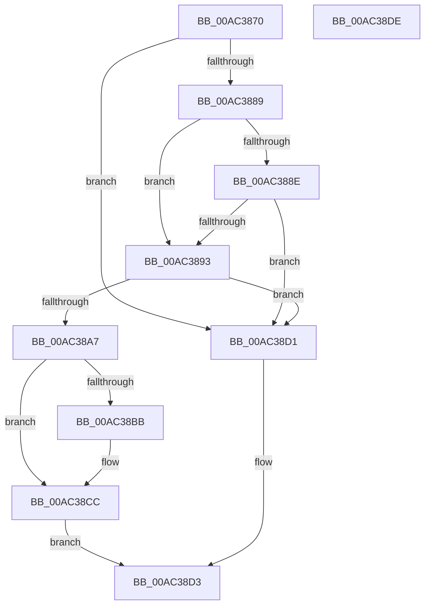

# MmGetPhysicalMemoryRangesEx2

- RVA: `0x00AC3870`–`0x00AC38DF` (길이 `111` bytes)
- VA: `0x0000000140AC3870`
- 실행 섹션: `PAGE`
- PDB 이름 있음: `예`; PDB Function 태그: `아니요`
- unwind 정보 RVA: `0x0005CAAC`
- 디코드: `34`개 명령, `111/111` bytes 표시
- 미해석 바이트: `0` (있으면 어셈블리에 `.byte`로 보존)

> 이 문서는 커널 이미지의 기계어와 PDB 기호를 분석해 생성했습니다. 4번과 5번은 함수 원형과 자료형을 바이너리 사용 방식에서 추정한 C 해석이며 원본 소스 복구 결과는 아닙니다.

## 1. Dependencies

- 직접 호출 지점: **3**; 고유 호출 대상: **3**
- 직접 호출자로 확인된 함수: **3**
- RIP 상대 이미지 참조: **0**

### Outgoing calls
- `0x00AC389A` → [MiPartitionObjectToPartition](../../text/3E/MiPartitionObjectToPartition_function_003EAB0C.md) (function, `0x003EAB0C`)
- `0x00AC38AC` → [MiGetPhysicalMemoryRanges](MiGetPhysicalMemoryRanges_function_00ACAE08.md) (function, `0x00ACAE08`)
- `0x00AC38C7` → [PsDereferencePartition](../../text/34/PsDereferencePartition_function_00342E70.md) (function, `0x00342E70`)

### Direct callers
- [PfpMemoryRangesQuery](../../text/4D/PfpMemoryRangesQuery_function_004D1D54.md) at `0x004D1DCB`
- [MmGetPhysicalMemoryRanges](../7F/MmGetPhysicalMemoryRanges_function_007FB520.md) at `0x007FB528`
- [MmGetPhysicalMemoryRangesEx](../7F/MmGetPhysicalMemoryRangesEx_function_007FB540.md) at `0x007FB546`

### Static image references
- 디코드된 RIP-relative 메모리 참조가 없습니다.

## 2. Other-region calls and transfers

- 다른 실행 섹션으로 향하는 call: **2**
  - `0x00AC389A` → [MiPartitionObjectToPartition](../../text/3E/MiPartitionObjectToPartition_function_003EAB0C.md) (`PAGE` → `.text`)
  - `0x00AC38C7` → [PsDereferencePartition](../../text/34/PsDereferencePartition_function_00342E70.md) (`PAGE` → `.text`)
- 별도 외부 분기/꼬리 이동을 확인하지 못했습니다.

## 3. Assembly (complete function range)

```asm
00AC3870  48 89 5C 24 08                  mov qword ptr [rsp + 8], rbx
00AC3875  57                              push rdi
00AC3876  48 83 EC 20                     sub rsp, 0x20
00AC387A  C6 44 24 38 00                  mov byte ptr [rsp + 0x38], 0
00AC387F  8B DA                           mov ebx, edx
00AC3881  F7 C2 FC FF FF FF               test edx, 0xfffffffc
00AC3887  75 48                           jne 0x140ac38d1
00AC3889  F6 C3 02                        test bl, 2
00AC388C  74 05                           je 0x140ac3893
00AC388E  48 85 C9                        test rcx, rcx
00AC3891  75 3E                           jne 0x140ac38d1
00AC3893  4C 8D 44 24 38                  lea r8, [rsp + 0x38]
00AC3898  33 D2                           xor edx, edx
00AC389A  E8 6D 72 92 FF                  call 0x1403eab0c
00AC389F  48 8B F8                        mov rdi, rax
00AC38A2  48 85 C0                        test rax, rax
00AC38A5  74 2A                           je 0x140ac38d1
00AC38A7  8B D3                           mov edx, ebx
00AC38A9  48 8B C8                        mov rcx, rax
00AC38AC  E8 57 75 00 00                  call 0x140acae08
00AC38B1  80 7C 24 38 00                  cmp byte ptr [rsp + 0x38], 0
00AC38B6  48 8B D8                        mov rbx, rax
00AC38B9  74 11                           je 0x140ac38cc
00AC38BB  48 8B 8F B8 00 00 00            mov rcx, qword ptr [rdi + 0xb8]
00AC38C2  BA 4D 6D 50 6F                  mov edx, 0x6f506d4d
00AC38C7  E8 A4 F5 87 FF                  call 0x140342e70
00AC38CC  48 8B C3                        mov rax, rbx
00AC38CF  EB 02                           jmp 0x140ac38d3
00AC38D1  33 C0                           xor eax, eax
00AC38D3  48 8B 5C 24 30                  mov rbx, qword ptr [rsp + 0x30]
00AC38D8  48 83 C4 20                     add rsp, 0x20
00AC38DC  5F                              pop rdi
00AC38DD  C3                              ret
00AC38DE  CC                              int3
```

## 4. C-style interpretation (structured pseudocode)

```c
__int64 __fastcall MmGetPhysicalMemoryRangesEx2(__int64 a1, int a2)
{
    __int64 result;
    __int64 v_rsp;
    unsigned __int8 v_stack_p10;
    unsigned __int64 v_stack_p8;

    v_stack_p8 = v_rbx;
    v_rsp = (v_rsp) - (32);
    v_stack_p10 = 0;
    if (((a2) & (0xFFFFFFFCULL)) != 0) goto loc_00AC38D1;
    if ((((unsigned __int8)((unsigned int)(a2))) & (2)) == 0) goto loc_00AC3893;
    if (a1 != 0) goto loc_00AC38D1;
loc_00AC3893:
    a2 = 0;
    result = MiPartitionObjectToPartition(a1, a2, v_stack_p10, a4);
    if (result == 0) goto loc_00AC38D1;
    result = MiGetPhysicalMemoryRanges(result, (unsigned int)((unsigned int)((unsigned int)(a2))), v_stack_p10, a4);
    if (v_stack_p10 != 0) {
        a1 = *(unsigned __int64 *)(result + 184);
        a2 = 0x6F506D4DULL;
        result = PsDereferencePartition(a1, a2, v_stack_p10, a4);
    }
    goto loc_00AC38D3;
loc_00AC38D1:
    result = 0;
loc_00AC38D3:
    v_rsp = (v_rsp) + (32);
    return result;
}
```

## 5. (Beta) C Style

```c
int64_t MmGetPhysicalMemoryRangesEx2(int64_t Arg1, int32_t Arg2)
{
    int64_t result;
    int64_t local_rsp;
    uint8_t v_stack_p10;
    uint64_t v_stack_p8;

    v_stack_p8 = local_rbx;
    local_rsp = (local_rsp) - (32);
    v_stack_p10 = 0;
    if (((Arg2) & (0xFFFFFFFCULL)) != 0) goto loc_00AC38D1;
    if ((((uint8_t)((uint32_t)(Arg2))) & (2)) == 0) goto loc_00AC3893;
    if (Arg1 != 0) goto loc_00AC38D1;
loc_00AC3893:
    Arg2 = 0;
    result = MiPartitionObjectToPartition(Arg1, Arg2, v_stack_p10, a4);
    if (result == 0) goto loc_00AC38D1;
    result = MiGetPhysicalMemoryRanges(result, (uint32_t)((uint32_t)((uint32_t)(Arg2))), v_stack_p10, a4);
    if (v_stack_p10 != 0) {
        Arg1 = *(uint64_t *)(result + 0xB8);
        Arg2 = 0x6F506D4DULL;
        result = PsDereferencePartition(Arg1, Arg2, v_stack_p10, a4);
    }
    goto loc_00AC38D3;
loc_00AC38D1:
    result = 0;
loc_00AC38D3:
    local_rsp = (local_rsp) + (32);
    return result;
}
```

## 6. Execution-region graph

[열기: 2D/3D 그래프와 함수 탐색 컨트롤 패널](../../../control-panel.html?section=page&rva=0x00AC3870&view=graph)

- 2D 그래프는 위에서 아래로 흐르고, 3D 그래프는 빈 공간을 드래그해 회전합니다. Shift+드래그는 이동, 휠은 확대·축소, 함수 노드 선택은 대상 보고서 이동입니다.

### Static fallback


