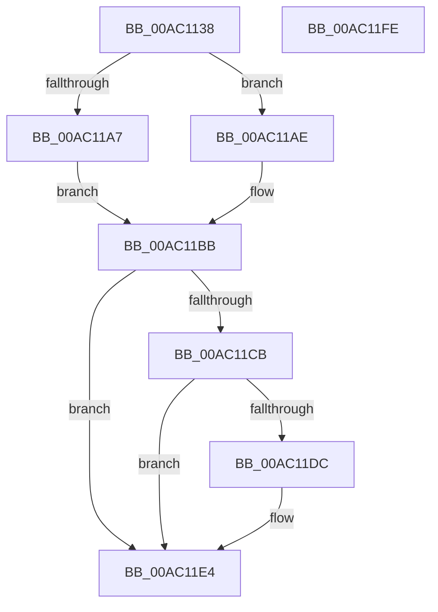

# MmInitializeHandBuiltProcess2

- RVA: `0x00AC1138`–`0x00AC11FF` (길이 `199` bytes)
- VA: `0x0000000140AC1138`
- 실행 섹션: `PAGE`
- PDB 이름 있음: `예`; PDB Function 태그: `아니요`
- unwind 정보 RVA: `0x0005DD4C`
- 디코드: `51`개 명령, `199/199` bytes 표시
- 미해석 바이트: `0` (있으면 어셈블리에 `.byte`로 보존)

> 이 문서는 커널 이미지의 기계어와 PDB 기호를 분석해 생성했습니다. 4번과 5번은 함수 원형과 자료형을 바이너리 사용 방식에서 추정한 C 해석이며 원본 소스 복구 결과는 아닙니다.

## 1. Dependencies

- 직접 호출 지점: **7**; 고유 호출 대상: **7**
- 직접 호출자로 확인된 함수: **1**
- RIP 상대 이미지 참조: **2**

### Outgoing calls
- `0x00AC1166` → [MiGetWsAndMakePageTablesNx](../../text/49/MiGetWsAndMakePageTablesNx_function_00494240.md) (function, `0x00494240`)
- `0x00AC1193` → [KiStackAttachProcess](../../text/21/KiStackAttachProcess_function_00216820.md) (function, `0x00216820`)
- `0x00AC119D` → [MiAllocateProcessVads](../8C/MiAllocateProcessVads_function_008CFEF8.md) (function, `0x008CFEF8`)
- `0x00AC11B4` → [MiInsertProcessVads](../8C/MiInsertProcessVads_function_008CFD08.md) (function, `0x008CFD08`)
- `0x00AC11C2` → [KiUnstackDetachProcess](../../text/21/KiUnstackDetachProcess_function_00217D30.md) (function, `0x00217D30`)
- `0x00AC11DF` → [MiInitializeLockedPagesTracking](../7F/MiInitializeLockedPagesTracking_function_007F83A4.md) (function, `0x007F83A4`)
- `0x00AC11EE` → [_security_check_cookie](../../text/6A/_security_check_cookie_function_006AC640.md) (function, `0x006AC640`)

### Direct callers
- [PspAllocateProcess](../A1/PspAllocateProcess_function_00A13B3C.md) at `0x00A154F3`

### Static image references
- `0x00AC1142` → RVA `0x00E0A740` (`.data`; read)
- `0x00AC11CB` → RVA `0x00FC6BBC` (`ALMOSTRO`; read)

## 2. Other-region calls and transfers

- 다른 실행 섹션으로 향하는 call: **4**
  - `0x00AC1166` → [MiGetWsAndMakePageTablesNx](../../text/49/MiGetWsAndMakePageTablesNx_function_00494240.md) (`PAGE` → `.text`)
  - `0x00AC1193` → [KiStackAttachProcess](../../text/21/KiStackAttachProcess_function_00216820.md) (`PAGE` → `.text`)
  - `0x00AC11C2` → [KiUnstackDetachProcess](../../text/21/KiUnstackDetachProcess_function_00217D30.md) (`PAGE` → `.text`)
  - `0x00AC11EE` → [_security_check_cookie](../../text/6A/_security_check_cookie_function_006AC640.md) (`PAGE` → `.text`)
- 별도 외부 분기/꼬리 이동을 확인하지 못했습니다.

## 3. Assembly (complete function range)

```asm
00AC1138  48 89 5C 24 10                  mov qword ptr [rsp + 0x10], rbx
00AC113D  57                              push rdi
00AC113E  48 83 EC 60                     sub rsp, 0x60
00AC1142  48 8B 05 F7 95 34 00            mov rax, qword ptr [rip + 0x3495f7]
00AC1149  48 33 C4                        xor rax, rsp
00AC114C  48 89 44 24 50                  mov qword ptr [rsp + 0x50], rax
00AC1151  0F 57 C0                        xorps xmm0, xmm0
00AC1154  48 8B F9                        mov rdi, rcx
00AC1157  0F 11 44 24 20                  movups xmmword ptr [rsp + 0x20], xmm0
00AC115C  0F 11 44 24 30                  movups xmmword ptr [rsp + 0x30], xmm0
00AC1161  0F 11 44 24 40                  movups xmmword ptr [rsp + 0x40], xmm0
00AC1166  E8 D5 30 9D FF                  call 0x140494240
00AC116B  65 48 8B 04 25 88 01 00 00      mov rax, qword ptr gs:[0x188]
00AC1174  4C 8D 44 24 20                  lea r8, [rsp + 0x20]
00AC1179  33 D2                           xor edx, edx
00AC117B  48 8B 88 B8 00 00 00            mov rcx, qword ptr [rax + 0xb8]
00AC1182  48 8B 81 10 04 00 00            mov rax, qword ptr [rcx + 0x410]
00AC1189  48 8B CF                        mov rcx, rdi
00AC118C  48 89 87 10 04 00 00            mov qword ptr [rdi + 0x410], rax
00AC1193  E8 88 56 75 FF                  call 0x140216820
00AC1198  33 D2                           xor edx, edx
00AC119A  48 8B CF                        mov rcx, rdi
00AC119D  E8 56 ED E0 FF                  call 0x1408cfef8
00AC11A2  48 85 C0                        test rax, rax
00AC11A5  75 07                           jne 0x140ac11ae
00AC11A7  BB 17 00 00 C0                  mov ebx, 0xc0000017
00AC11AC  EB 0D                           jmp 0x140ac11bb
00AC11AE  48 8B D0                        mov rdx, rax
00AC11B1  48 8B CF                        mov rcx, rdi
00AC11B4  E8 4F EB E0 FF                  call 0x1408cfd08
00AC11B9  8B D8                           mov ebx, eax
00AC11BB  33 D2                           xor edx, edx
00AC11BD  48 8D 4C 24 20                  lea rcx, [rsp + 0x20]
00AC11C2  E8 69 6B 75 FF                  call 0x140217d30
00AC11C7  85 DB                           test ebx, ebx
00AC11C9  78 19                           js 0x140ac11e4
00AC11CB  8B 15 EB 59 50 00               mov edx, dword ptr [rip + 0x5059eb]
00AC11D1  81 E2 01 00 00 10               and edx, 0x10000001
00AC11D7  83 FA 01                        cmp edx, 1
00AC11DA  75 08                           jne 0x140ac11e4
00AC11DC  48 8B CF                        mov rcx, rdi
00AC11DF  E8 C0 71 D3 FF                  call 0x1407f83a4
00AC11E4  8B C3                           mov eax, ebx
00AC11E6  48 8B 4C 24 50                  mov rcx, qword ptr [rsp + 0x50]
00AC11EB  48 33 CC                        xor rcx, rsp
00AC11EE  E8 4D B4 BE FF                  call 0x1406ac640
00AC11F3  48 8B 5C 24 78                  mov rbx, qword ptr [rsp + 0x78]
00AC11F8  48 83 C4 60                     add rsp, 0x60
00AC11FC  5F                              pop rdi
00AC11FD  C3                              ret
00AC11FE  CC                              int3
```

## 4. C-style interpretation (structured pseudocode)

```c
__int64 __fastcall MmInitializeHandBuiltProcess2(__int64 a1, int a2)
{
    __int64 result;
    __int64 v_rsp;
    unsigned __int64 v_stack_m18;
    unsigned __int64 v_stack_m28;
    unsigned __int64 v_stack_m38;
    unsigned __int64 v_stack_m48;
    unsigned __int64 v_stack_p10;

    v_stack_p10 = v_rbx;
    v_rsp = (v_rsp) - (96);
    result = (*(unsigned __int64 *)(v_rip + 3446263)) ^ (v_rsp);
    v_stack_m18 = result;
    v_stack_m48 = v_xmm0;
    v_stack_m38 = v_xmm0;
    v_stack_m28 = v_xmm0;
    result = MiGetWsAndMakePageTablesNx(a1, a2, a3, a4);
    a2 = 0;
    *(unsigned __int64 *)(a1 + 1040) = *(unsigned __int64 *)(*(unsigned __int64 *)(*(unsigned __int64 *)(gs_base + (0 + 392)) + 184) + 1040);
    result = KiStackAttachProcess(a1, a2, v_stack_m48, a4);
    a2 = 0;
    result = MiAllocateProcessVads(a1, a2, v_stack_m48, a4);
    if (result != 0) goto loc_00AC11AE;
    goto loc_00AC11BB;
loc_00AC11AE:
    result = MiInsertProcessVads(a1, result, v_stack_m48, a4);
loc_00AC11BB:
    a2 = 0;
    result = KiUnstackDetachProcess(v_stack_m48, a2, v_stack_m48, a4);
    if (sign_flag) goto loc_00AC11E4;
    a2 = (unsigned int)(((unsigned int)(*(unsigned int *)(v_rip + 5265899))) & (0x10000001ULL));
    if (a2 == 1) {
        a1 = a1;
        result = MiInitializeLockedPagesTracking(a1, a2, v_stack_m48, a4);
    }
    a1 = (v_stack_m18) ^ (v_rsp);
    result = _security_check_cookie(a1, a2, v_stack_m48, a4);
    v_rsp = (v_rsp) + (96);
    return result;
}
```

## 5. (Beta) C Style

```c
int64_t MmInitializeHandBuiltProcess2(void *Arg1, int32_t Arg2)
{
    uint8_t *arg1 = (uint8_t *)Arg1;

    int64_t result;
    int64_t local_rsp;
    uint64_t v_stack_m18;
    uint64_t v_stack_m28;
    uint64_t v_stack_m38;
    uint64_t v_stack_m48;
    uint64_t v_stack_p10;

    v_stack_p10 = local_rbx;
    local_rsp = (local_rsp) - (96);
    result = (*(uint64_t *)(v_rip + 0x3495F7)) ^ (local_rsp);
    v_stack_m18 = result;
    v_stack_m48 = v_xmm0;
    v_stack_m38 = v_xmm0;
    v_stack_m28 = v_xmm0;
    result = MiGetWsAndMakePageTablesNx(Arg1, Arg2, a3, a4);
    Arg2 = 0;
    *(uint64_t *)(arg1 + 0x410) = *(uint64_t *)(*(uint64_t *)(*(uint64_t *)(gs_base + (0 + 0x188)) + 0xB8) + 0x410);
    result = KiStackAttachProcess(Arg1, Arg2, v_stack_m48, a4);
    Arg2 = 0;
    result = MiAllocateProcessVads(Arg1, Arg2, v_stack_m48, a4);
    if (result != 0) goto loc_00AC11AE;
    goto loc_00AC11BB;
loc_00AC11AE:
    result = MiInsertProcessVads(Arg1, result, v_stack_m48, a4);
loc_00AC11BB:
    Arg2 = 0;
    result = KiUnstackDetachProcess(v_stack_m48, Arg2, v_stack_m48, a4);
    if (sign_flag) goto loc_00AC11E4;
    Arg2 = (uint32_t)(((uint32_t)(*(uint32_t *)(v_rip + 0x5059EB))) & (0x10000001ULL));
    if (Arg2 == 1) {
        Arg1 = Arg1;
        result = MiInitializeLockedPagesTracking(Arg1, Arg2, v_stack_m48, a4);
    }
    Arg1 = (v_stack_m18) ^ (local_rsp);
    result = _security_check_cookie(Arg1, Arg2, v_stack_m48, a4);
    local_rsp = (local_rsp) + (96);
    return result;
}
```

### 관측된 메모리 오프셋

구조체 형식이 확인되지 않은 접근은 인자 기준의 오프셋으로만 기록했습니다.

| 기준 인자 | 오프셋 표현 | 폭 (bit) | 접근 |
|---|---:|---:|---|
| `Arg1` | `+ 0x410` | `64` | `W` |

## 6. Execution-region graph

[열기: 2D/3D 그래프와 함수 탐색 컨트롤 패널](../../../control-panel.html?section=page&rva=0x00AC1138&view=graph)

- 2D 그래프는 위에서 아래로 흐르고, 3D 그래프는 빈 공간을 드래그해 회전합니다. Shift+드래그는 이동, 휠은 확대·축소, 함수 노드 선택은 대상 보고서 이동입니다.

### Static fallback


