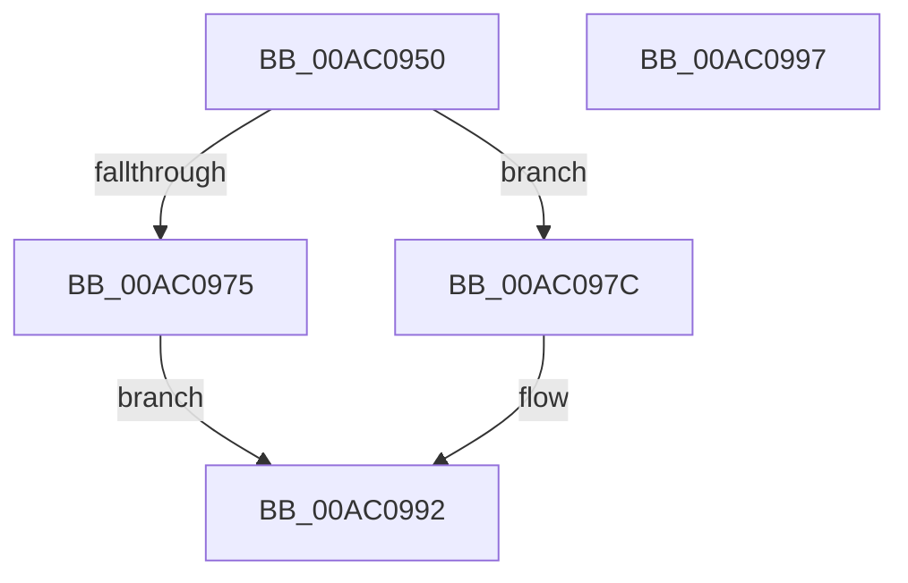

# MmValidateUserCallTarget

- RVA: `0x00AC0950`–`0x00AC0998` (길이 `72` bytes)
- VA: `0x0000000140AC0950`
- 실행 섹션: `PAGE`
- PDB 이름 있음: `예`; PDB Function 태그: `아니요`
- unwind 정보 RVA: `0x0005C788`
- 디코드: `17`개 명령, `72/72` bytes 표시
- 미해석 바이트: `0` (있으면 어셈블리에 `.byte`로 보존)

> 이 문서는 커널 이미지의 기계어와 PDB 기호를 분석해 생성했습니다. 4번과 5번은 함수 원형과 자료형을 바이너리 사용 방식에서 추정한 C 해석이며 원본 소스 복구 결과는 아닙니다.

## 1. Dependencies

- 직접 호출 지점: **1**; 고유 호출 대상: **1**
- 직접 호출자로 확인된 함수: **2**
- RIP 상대 이미지 참조: **0**

### Outgoing calls
- `0x00AC098D` → [MiValidateUserCallTarget](MiValidateUserCallTarget_function_00AC09A0.md) (function, `0x00AC09A0`)

### Direct callers
- [MmCheckForSafeExecution](../80/MmCheckForSafeExecution_function_008076B0.md) at `0x00807758`
- [NtSetInformationProcess](../AE/NtSetInformationProcess_function_00AE5370.md) at `0x00AE74EC`
- [NtSetInformationProcess](../AE/NtSetInformationProcess_function_00AE5370.md) at `0x00AE75F1`

### Static image references
- 디코드된 RIP-relative 메모리 참조가 없습니다.

## 2. Other-region calls and transfers

- 다른 실행 섹션으로 향하는 call: **0**
- 별도 외부 분기/꼬리 이동을 확인하지 못했습니다.

## 3. Assembly (complete function range)

```asm
00AC0950  48 83 EC 28                     sub rsp, 0x28
00AC0954  65 48 8B 04 25 88 01 00 00      mov rax, qword ptr gs:[0x188]
00AC095D  4C 8B 80 B8 00 00 00            mov r8, qword ptr [rax + 0xb8]
00AC0964  49 8B 80 10 04 00 00            mov rax, qword ptr [r8 + 0x410]
00AC096B  48 83 B8 A8 04 00 00 00         cmp qword ptr [rax + 0x4a8], 0
00AC0973  75 07                           jne 0x140ac097c
00AC0975  B8 01 00 00 00                  mov eax, 1
00AC097A  EB 16                           jmp 0x140ac0992
00AC097C  F7 DA                           neg edx
00AC097E  48 1B D2                        sbb rdx, rdx
00AC0981  48 05 A0 04 00 00               add rax, 0x4a0
00AC0987  83 E2 20                        and edx, 0x20
00AC098A  48 03 D0                        add rdx, rax
00AC098D  E8 0E 00 00 00                  call 0x140ac09a0
00AC0992  48 83 C4 28                     add rsp, 0x28
00AC0996  C3                              ret
00AC0997  CC                              int3
```

## 4. C-style interpretation (structured pseudocode)

```c
__int64 __fastcall MmValidateUserCallTarget(__int64 a1, int a2)
{
    __int64 result;
    __int64 v_rsp;

    v_rsp = (v_rsp) - (40);
    if ((*(unsigned __int64 *)(*(unsigned __int64 *)(*(unsigned __int64 *)(*(unsigned __int64 *)(gs_base + (0 + 392)) + 184) + 1040) + 1192)) != 0) goto loc_00AC097C;
    goto loc_00AC0992;
loc_00AC097C:
    a2 = (unsigned int)(-(a2));
    result = (1) + (0x4A0ULL);
    a2 = (unsigned int)((a2) & (32));
    a2 = (a2) + (result);
    result = MiValidateUserCallTarget(a1, a2, *(unsigned __int64 *)(*(unsigned __int64 *)(gs_base + (0 + 392)) + 184), a4);
loc_00AC0992:
    v_rsp = (v_rsp) + (40);
    return result;
}
```

## 5. (Beta) C Style

```c
int64_t MmValidateUserCallTarget(int64_t Arg1, int32_t Arg2)
{
    int64_t result;
    int64_t local_rsp;

    local_rsp = (local_rsp) - (40);
    if ((*(uint64_t *)(*(uint64_t *)(*(uint64_t *)(*(uint64_t *)(gs_base + (0 + 0x188)) + 0xB8) + 0x410) + 0x4A8)) != 0) goto loc_00AC097C;
    goto loc_00AC0992;
loc_00AC097C:
    Arg2 = (uint32_t)(-(Arg2));
    result = (1) + (0x4A0ULL);
    Arg2 = (uint32_t)((Arg2) & (32));
    Arg2 = (Arg2) + (result);
    result = MiValidateUserCallTarget(Arg1, Arg2, *(uint64_t *)(*(uint64_t *)(gs_base + (0 + 0x188)) + 0xB8), a4);
loc_00AC0992:
    local_rsp = (local_rsp) + (40);
    return result;
}
```

## 6. Execution-region graph

[열기: 2D/3D 그래프와 함수 탐색 컨트롤 패널](../../../control-panel.html?section=page&rva=0x00AC0950&view=graph)

- 2D 그래프는 위에서 아래로 흐르고, 3D 그래프는 빈 공간을 드래그해 회전합니다. Shift+드래그는 이동, 휠은 확대·축소, 함수 노드 선택은 대상 보고서 이동입니다.

### Static fallback


