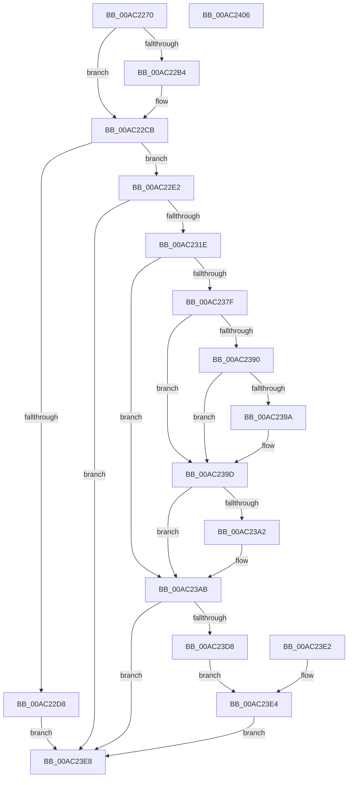

# NtCreateDebugObject

- RVA: `0x00AC2270`–`0x00AC2407` (길이 `407` bytes)
- VA: `0x0000000140AC2270`
- 실행 섹션: `PAGE`
- PDB 이름 있음: `예`; PDB Function 태그: `아니요`
- unwind 정보 RVA: `0x000BDC0C`
- 디코드: `101`개 명령, `407/407` bytes 표시
- 미해석 바이트: `0` (있으면 어셈블리에 `.byte`로 보존)

> 이 문서는 커널 이미지의 기계어와 PDB 기호를 분석해 생성했습니다. 4번과 5번은 함수 원형과 자료형을 바이너리 사용 방식에서 추정한 C 해석이며 원본 소스 복구 결과는 아닙니다.

## 1. Dependencies

- 직접 호출 지점: **4**; 고유 호출 대상: **3**
- 직접 호출자로 확인된 함수: **0**
- RIP 상대 이미지 참조: **1**

### Outgoing calls
- `0x00AC2311` → [ObCreateObjectEx](../89/ObCreateObjectEx_function_0089B1E0.md) (function, `0x0089B1E0`)
- `0x00AC233D` → [KeInitializeEvent](../../text/40/KeInitializeEvent_function_0040DD10.md) (function, `0x0040DD10`)
- `0x00AC2355` → [KeInitializeEvent](../../text/40/KeInitializeEvent_function_0040DD10.md) (function, `0x0040DD10`)
- `0x00AC23CD` → [ObInsertObjectEx](../8B/ObInsertObjectEx_function_008B97A0.md) (function, `0x008B97A0`)

### Direct callers
- 이 함수 시작 RVA로 연결되는 직접 call은 확인되지 않았습니다. 간접 호출은 완전히 역산할 수 없습니다.

### Static image references
- `0x00AC22E2` → RVA `0x00FC5140` (`ALMOSTRO`; read)

## 2. Other-region calls and transfers

- 다른 실행 섹션으로 향하는 call: **2**
  - `0x00AC233D` → [KeInitializeEvent](../../text/40/KeInitializeEvent_function_0040DD10.md) (`PAGE` → `.text`)
  - `0x00AC2355` → [KeInitializeEvent](../../text/40/KeInitializeEvent_function_0040DD10.md) (`PAGE` → `.text`)
- 별도 외부 분기/꼬리 이동을 확인하지 못했습니다.

## 3. Assembly (complete function range)

```asm
00AC2270  48 8B C4                        mov rax, rsp
00AC2273  48 89 58 08                     mov qword ptr [rax + 8], rbx
00AC2277  48 89 70 10                     mov qword ptr [rax + 0x10], rsi
00AC227B  48 89 78 18                     mov qword ptr [rax + 0x18], rdi
00AC227F  4C 89 70 20                     mov qword ptr [rax + 0x20], r14
00AC2283  41 57                           push r15
00AC2285  48 81 EC 80 00 00 00            sub rsp, 0x80
00AC228C  45 8B F1                        mov r14d, r9d
00AC228F  44 8B FA                        mov r15d, edx
00AC2292  48 8B F1                        mov rsi, rcx
00AC2295  48 83 60 D8 00                  and qword ptr [rax - 0x28], 0
00AC229A  48 83 60 D0 00                  and qword ptr [rax - 0x30], 0
00AC229F  65 48 8B 04 25 88 01 00 00      mov rax, qword ptr gs:[0x188]
00AC22A8  44 8A 90 32 02 00 00            mov r10b, byte ptr [rax + 0x232]
00AC22AF  45 84 D2                        test r10b, r10b
00AC22B2  74 17                           je 0x140ac22cb
00AC22B4  48 B9 00 00 FF FF FF 7F 00 00   movabs rcx, 0x7fffffff0000
00AC22BE  48 3B F1                        cmp rsi, rcx
00AC22C1  48 0F 42 CE                     cmovb rcx, rsi
00AC22C5  48 8B 01                        mov rax, qword ptr [rcx]
00AC22C8  48 89 01                        mov qword ptr [rcx], rax
00AC22CB  48 83 26 00                     and qword ptr [rsi], 0
00AC22CF  41 F7 C6 FE FF FF FF            test r14d, 0xfffffffe
00AC22D6  74 0A                           je 0x140ac22e2
00AC22D8  B8 0D 00 00 C0                  mov eax, 0xc000000d
00AC22DD  E9 06 01 00 00                  jmp 0x140ac23e8
00AC22E2  48 8B 15 57 2E 50 00            mov rdx, qword ptr [rip + 0x502e57]
00AC22E9  48 83 64 24 48 00               and qword ptr [rsp + 0x48], 0
00AC22EF  48 8D 44 24 58                  lea rax, [rsp + 0x58]
00AC22F4  48 89 44 24 40                  mov qword ptr [rsp + 0x40], rax
00AC22F9  83 64 24 38 00                  and dword ptr [rsp + 0x38], 0
00AC22FE  83 64 24 30 00                  and dword ptr [rsp + 0x30], 0
00AC2303  C7 44 24 28 68 00 00 00         mov dword ptr [rsp + 0x28], 0x68
00AC230B  45 8A CA                        mov r9b, r10b
00AC230E  41 8A CA                        mov cl, r10b
00AC2311  E8 CA 8E DD FF                  call 0x14089b1e0
00AC2316  85 C0                           test eax, eax
00AC2318  0F 88 CA 00 00 00               js 0x140ac23e8
00AC231E  48 8B 5C 24 58                  mov rbx, qword ptr [rsp + 0x58]
00AC2323  BF 01 00 00 00                  mov edi, 1
00AC2328  89 7B 18                        mov dword ptr [rbx + 0x18], edi
00AC232B  48 83 63 20 00                  and qword ptr [rbx + 0x20], 0
00AC2330  83 63 28 00                     and dword ptr [rbx + 0x28], 0
00AC2334  48 8D 4B 30                     lea rcx, [rbx + 0x30]
00AC2338  45 33 C0                        xor r8d, r8d
00AC233B  8B D7                           mov edx, edi
00AC233D  E8 CE B9 94 FF                  call 0x14040dd10
00AC2342  48 8D 43 50                     lea rax, [rbx + 0x50]
00AC2346  48 89 40 08                     mov qword ptr [rax + 8], rax
00AC234A  48 89 00                        mov qword ptr [rax], rax
00AC234D  45 33 C0                        xor r8d, r8d
00AC2350  33 D2                           xor edx, edx
00AC2352  48 8B CB                        mov rcx, rbx
00AC2355  E8 B6 B9 94 FF                  call 0x14040dd10
00AC235A  41 0F B6 C6                     movzx eax, r14b
00AC235E  23 C7                           and eax, edi
00AC2360  03 C0                           add eax, eax
00AC2362  89 43 60                        mov dword ptr [rbx + 0x60], eax
00AC2365  65 48 8B 04 25 88 01 00 00      mov rax, qword ptr gs:[0x188]
00AC236E  48 8B 80 B8 00 00 00            mov rax, qword ptr [rax + 0xb8]
00AC2375  48 83 B8 10 03 00 00 00         cmp qword ptr [rax + 0x310], 0
00AC237D  74 2C                           je 0x140ac23ab
00AC237F  0F B7 80 EC 06 00 00            movzx eax, word ptr [rax + 0x6ec]
00AC2386  B9 4C 01 00 00                  mov ecx, 0x14c
00AC238B  66 3B C1                        cmp ax, cx
00AC238E  74 0D                           je 0x140ac239d
00AC2390  B9 C4 01 00 00                  mov ecx, 0x1c4
00AC2395  66 3B C1                        cmp ax, cx
00AC2398  74 03                           je 0x140ac239d
00AC239A  40 32 FF                        xor dil, dil
00AC239D  40 84 FF                        test dil, dil
00AC23A0  74 09                           je 0x140ac23ab
00AC23A2  48 8B 44 24 58                  mov rax, qword ptr [rsp + 0x58]
00AC23A7  83 48 60 04                     or dword ptr [rax + 0x60], 4
00AC23AB  48 8D 44 24 60                  lea rax, [rsp + 0x60]
00AC23B0  48 89 44 24 30                  mov qword ptr [rsp + 0x30], rax
00AC23B5  48 83 64 24 28 00               and qword ptr [rsp + 0x28], 0
00AC23BB  83 64 24 20 00                  and dword ptr [rsp + 0x20], 0
00AC23C0  45 33 C9                        xor r9d, r9d
00AC23C3  45 8B C7                        mov r8d, r15d
00AC23C6  33 D2                           xor edx, edx
00AC23C8  48 8B 4C 24 58                  mov rcx, qword ptr [rsp + 0x58]
00AC23CD  E8 CE 73 DF FF                  call 0x1408b97a0
00AC23D2  8B C8                           mov ecx, eax
00AC23D4  85 C0                           test eax, eax
00AC23D6  78 10                           js 0x140ac23e8
00AC23D8  48 8B 44 24 60                  mov rax, qword ptr [rsp + 0x60]
00AC23DD  48 89 06                        mov qword ptr [rsi], rax
00AC23E0  EB 02                           jmp 0x140ac23e4
00AC23E2  8B C8                           mov ecx, eax
00AC23E4  8B C1                           mov eax, ecx
00AC23E6  EB 00                           jmp 0x140ac23e8
00AC23E8  4C 8D 9C 24 80 00 00 00         lea r11, [rsp + 0x80]
00AC23F0  49 8B 5B 10                     mov rbx, qword ptr [r11 + 0x10]
00AC23F4  49 8B 73 18                     mov rsi, qword ptr [r11 + 0x18]
00AC23F8  49 8B 7B 20                     mov rdi, qword ptr [r11 + 0x20]
00AC23FC  4D 8B 73 28                     mov r14, qword ptr [r11 + 0x28]
00AC2400  49 8B E3                        mov rsp, r11
00AC2403  41 5F                           pop r15
00AC2405  C3                              ret
00AC2406  CC                              int3
```

## 4. C-style interpretation (structured pseudocode)

```c
__int64 __fastcall NtCreateDebugObject(__int64 a1, int a2, int a3, int a4)
{
    __int64 result;
    __int64 v_rdi;
    __int64 v_rsp;
    unsigned __int64 v_stack_m28;
    unsigned __int64 v_stack_m30;
    unsigned __int64 v_stack_m40;
    unsigned __int64 v_stack_m48;
    unsigned int v_stack_m50;
    unsigned int v_stack_m58;
    unsigned int v_stack_m60;
    unsigned int v_stack_m68;
    unsigned __int64 v_stack_m8;

    *(unsigned __int64 *)(v_rsp + 8) = v_rbx;
    *(unsigned __int64 *)(v_rsp + 16) = v_rsi;
    *(unsigned __int64 *)(v_rsp + 24) = v_rdi;
    *(unsigned __int64 *)(v_rsp + 32) = v_r14;
    v_rsp = (v_rsp) - (128);
    result = *(unsigned __int64 *)(gs_base + (0 + 392));
    if ((unsigned __int8)(*(unsigned __int8 *)(*(unsigned __int64 *)(gs_base + (0 + 392)) + 562)) != 0) {
        if (a1 < a1) { a1 = a1; }
        result = *(unsigned __int64 *)(a1);
        *(unsigned __int64 *)(a1) = result;
    }
    if ((((unsigned int)((unsigned int)(a4))) & (0xFFFFFFFEULL)) == 0) goto loc_00AC22E2;
    goto loc_00AC23E8;
loc_00AC22E2:
    v_stack_m48 = v_stack_m30;
    v_stack_m60 = 104;
    result = ObCreateObjectEx((unsigned __int8)(*(unsigned __int8 *)(*(unsigned __int64 *)(gs_base + (0 + 392)) + 562)), *(unsigned __int64 *)(v_rip + 5254743), a3, (unsigned __int8)(*(unsigned __int8 *)(*(unsigned __int64 *)(gs_base + (0 + 392)) + 562)));
    if (sign_flag) goto loc_00AC23E8;
    *(unsigned int *)(v_stack_m30 + 24) = 1;
    a3 = 0;
    result = KeInitializeEvent(v_stack_m30 + 48, 1, a3, (unsigned __int8)(*(unsigned __int8 *)(*(unsigned __int64 *)(gs_base + (0 + 392)) + 562)));
    *(unsigned __int64 *)(v_stack_m30 + 80 + 8) = v_stack_m30 + 80;
    *(unsigned __int64 *)(v_stack_m30 + 80) = v_stack_m30 + 80;
    a3 = 0;
    a2 = 0;
    result = KeInitializeEvent(v_stack_m30, a2, a3, (unsigned __int8)(*(unsigned __int8 *)(*(unsigned __int64 *)(gs_base + (0 + 392)) + 562)));
    result = (unsigned int)(((unsigned __int8)((unsigned int)(a4))) & (1));
    result = (unsigned int)((result) + ((unsigned int)(result)));
    *(unsigned int *)(v_stack_m30 + 96) = (unsigned int)(result);
    if ((*(unsigned __int64 *)(*(unsigned __int64 *)(*(unsigned __int64 *)(gs_base + (0 + 392)) + 184) + 784)) == 0) goto loc_00AC23AB;
    if (((unsigned __int16)(*(unsigned __int16 *)(*(unsigned __int64 *)(*(unsigned __int64 *)(gs_base + (0 + 392)) + 184) + 1772))) == 332) goto loc_00AC239D;
    v_rdi = 1;
    if (((unsigned __int16)(*(unsigned __int16 *)(*(unsigned __int64 *)(*(unsigned __int64 *)(gs_base + (0 + 392)) + 184) + 1772))) != 452) {
        v_rdi = 0;
    }
    result = *(unsigned __int16 *)(*(unsigned __int64 *)(*(unsigned __int64 *)(gs_base + (0 + 392)) + 184) + 1772);
    if (0 != 0) {
        result = v_stack_m30;
    }
    v_stack_m58 = v_stack_m28;
    a4 = 0;
    a2 = 0;
    result = ObInsertObjectEx(v_stack_m30, a2, (unsigned int)((unsigned int)((unsigned int)(a2))), a4);
    if (sign_flag) goto loc_00AC23E8;
    *(unsigned __int64 *)(a1) = v_stack_m28;
    goto loc_00AC23E4;
loc_00AC23E4:
    goto loc_00AC23E8;
loc_00AC23E8:
    return (unsigned int)((unsigned int)((unsigned int)((unsigned int)(result))));
}
```

## 5. (Beta) C Style

```c
int64_t NtCreateDebugObject(int64_t Arg1, int32_t Arg2, int32_t Arg3, int32_t Arg4)
{
    int64_t result;
    int64_t local_rdi;
    int64_t local_rsp;
    uint64_t v_stack_m28;
    uint64_t v_stack_m30;
    uint64_t v_stack_m40;
    uint64_t v_stack_m48;
    uint32_t v_stack_m50;
    uint32_t v_stack_m58;
    uint32_t v_stack_m60;
    uint32_t v_stack_m68;
    uint64_t v_stack_m8;

    *(uint64_t *)(local_rsp + 0x8) = local_rbx;
    *(uint64_t *)(local_rsp + 0x10) = local_rsi;
    *(uint64_t *)(local_rsp + 0x18) = local_rdi;
    *(uint64_t *)(local_rsp + 0x20) = local_r14;
    local_rsp = (local_rsp) - (128);
    result = *(uint64_t *)(gs_base + (0 + 0x188));
    if ((uint8_t)(*(uint8_t *)(*(uint64_t *)(gs_base + (0 + 0x188)) + 0x232)) != 0) {
        if (Arg1 < Arg1) { Arg1 = Arg1; }
        result = *(uint64_t *)(Arg1);
        *(uint64_t *)(Arg1) = result;
    }
    if ((((uint32_t)((uint32_t)(Arg4))) & (0xFFFFFFFEULL)) == 0) goto loc_00AC22E2;
    goto loc_00AC23E8;
loc_00AC22E2:
    v_stack_m48 = v_stack_m30;
    v_stack_m60 = 104;
    result = ObCreateObjectEx((uint8_t)(*(uint8_t *)(*(uint64_t *)(gs_base + (0 + 0x188)) + 0x232)), *(uint64_t *)(v_rip + 0x502E57), Arg3, (uint8_t)(*(uint8_t *)(*(uint64_t *)(gs_base + (0 + 0x188)) + 0x232)));
    if (sign_flag) goto loc_00AC23E8;
    *(uint32_t *)(v_stack_m30 + 0x18) = 1;
    Arg3 = 0;
    result = KeInitializeEvent(v_stack_m30 + 48, 1, Arg3, (uint8_t)(*(uint8_t *)(*(uint64_t *)(gs_base + (0 + 0x188)) + 0x232)));
    *(uint64_t *)(v_stack_m30 + 0x50 + 0x8) = v_stack_m30 + 80;
    *(uint64_t *)(v_stack_m30 + 0x50) = v_stack_m30 + 80;
    Arg3 = 0;
    Arg2 = 0;
    result = KeInitializeEvent(v_stack_m30, Arg2, Arg3, (uint8_t)(*(uint8_t *)(*(uint64_t *)(gs_base + (0 + 0x188)) + 0x232)));
    result = (uint32_t)(((uint8_t)((uint32_t)(Arg4))) & (1));
    result = (uint32_t)((result) + ((uint32_t)(result)));
    *(uint32_t *)(v_stack_m30 + 0x60) = (uint32_t)(result);
    if ((*(uint64_t *)(*(uint64_t *)(*(uint64_t *)(gs_base + (0 + 0x188)) + 0xB8) + 0x310)) == 0) goto loc_00AC23AB;
    if (((uint16_t)(*(uint16_t *)(*(uint64_t *)(*(uint64_t *)(gs_base + (0 + 0x188)) + 0xB8) + 0x6EC))) == 332) goto loc_00AC239D;
    local_rdi = 1;
    if (((uint16_t)(*(uint16_t *)(*(uint64_t *)(*(uint64_t *)(gs_base + (0 + 0x188)) + 0xB8) + 0x6EC))) != 452) {
        local_rdi = 0;
    }
    result = *(uint16_t *)(*(uint64_t *)(*(uint64_t *)(gs_base + (0 + 0x188)) + 0xB8) + 0x6EC);
    if (0 != 0) {
        result = v_stack_m30;
    }
    v_stack_m58 = v_stack_m28;
    Arg4 = 0;
    Arg2 = 0;
    result = ObInsertObjectEx(v_stack_m30, Arg2, (uint32_t)((uint32_t)((uint32_t)(Arg2))), Arg4);
    if (sign_flag) goto loc_00AC23E8;
    *(uint64_t *)(Arg1) = v_stack_m28;
    goto loc_00AC23E4;
loc_00AC23E4:
    goto loc_00AC23E8;
loc_00AC23E8:
    return (uint32_t)((uint32_t)((uint32_t)((uint32_t)(result))));
}
```

## 6. Execution-region graph

[열기: 2D/3D 그래프와 함수 탐색 컨트롤 패널](../../../control-panel.html?section=page&rva=0x00AC2270&view=graph)

- 2D 그래프는 위에서 아래로 흐르고, 3D 그래프는 빈 공간을 드래그해 회전합니다. Shift+드래그는 이동, 휠은 확대·축소, 함수 노드 선택은 대상 보고서 이동입니다.

### Static fallback


