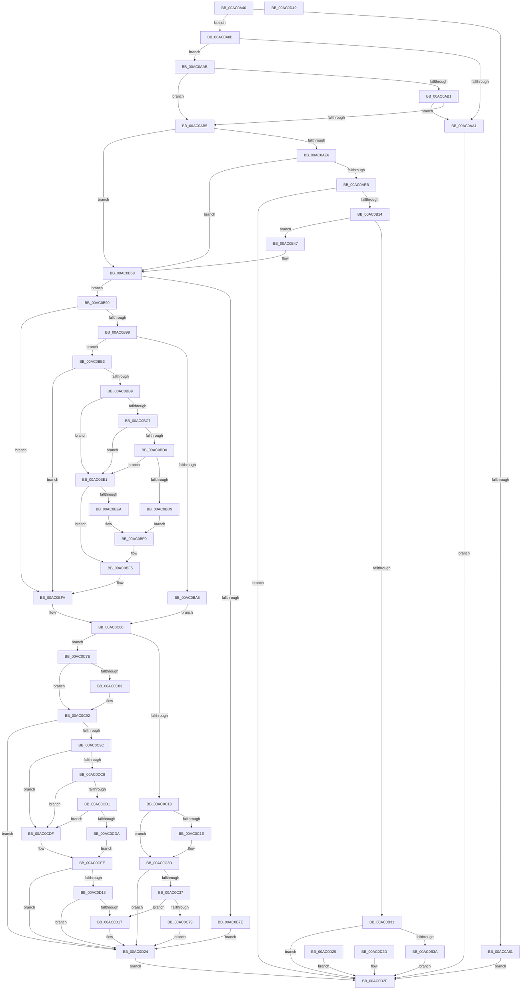

# NtSetThreadExecutionState

- RVA: `0x00AC0A40`–`0x00AC0D4A` (길이 `778` bytes)
- VA: `0x0000000140AC0A40`
- 실행 섹션: `PAGE`
- PDB 이름 있음: `예`; PDB Function 태그: `아니요`
- unwind 정보 RVA: `0x000BD8B8`
- 디코드: `201`개 명령, `778/778` bytes 표시
- 미해석 바이트: `0` (있으면 어셈블리에 `.byte`로 보존)

> 이 문서는 커널 이미지의 기계어와 PDB 기호를 분석해 생성했습니다. 4번과 5번은 함수 원형과 자료형을 바이너리 사용 방식에서 추정한 C 해석이며 원본 소스 복구 결과는 아닙니다.

## 1. Dependencies

- 직접 호출 지점: **30**; 고유 호출 대상: **17**
- 직접 호출자로 확인된 함수: **0**
- RIP 상대 이미지 참조: **2**

### Outgoing calls
- `0x00AC0B05` → [PoCaptureReasonContext](../../text/23/PoCaptureReasonContext_function_00230A38.md) (function, `0x00230A38`)
- `0x00AC0B26` → [PopPowerRequestCreateCommon](../../text/23/PopPowerRequestCreateCommon_function_00230150.md) (function, `0x00230150`)
- `0x00AC0B3D` → [PoDestroyReasonContext](../../text/23/PoDestroyReasonContext_function_00230944.md) (function, `0x00230944`)
- `0x00AC0B65` → [PopGetLegacyPowerRequestFlags](../../text/48/PopGetLegacyPowerRequestFlags_function_00486DD8.md) (function, `0x00486DD8`)
- `0x00AC0B86` → [PopApplyLegacyPowerRequestFlags](../../text/47/PopApplyLegacyPowerRequestFlags_function_00477364.md) (function, `0x00477364`)
- `0x00AC0B90` → [Feature_ExpandSTEIgnoreReasons__private_IsEnabledDeviceUsageNoInline](../../text/4F/Feature_ExpandSTEIgnoreReasons__private_IsEnabledDeviceUsageNoInline_function_004F7AE8.md) (function, `0x004F7AE8`)
- `0x00AC0B9B` → [PopGetCurrentPdcPhase](../../text/5D/PopGetCurrentPdcPhase_function_005D9FB4.md) (function, `0x005D9FB4`)
- `0x00AC0BB9` → [PopAcquirePolicyLock](../../pagelk/B7/PopAcquirePolicyLock_function_00B783C0.md) (function, `0x00B783C0`)
- `0x00AC0BBE` → [PopIsPlatformAoAcCapable](../../text/49/PopIsPlatformAoAcCapable_function_0049BF40.md) (function, `0x0049BF40`)
- `0x00AC0BE1` → [PopAdaptiveGetBootIsSystemInitiated](../91/PopAdaptiveGetBootIsSystemInitiated_function_0091375C.md) (function, `0x0091375C`)
- `0x00AC0BF5` → [PopReleasePolicyLock](../../pagelk/B7/PopReleasePolicyLock_function_00B78410.md) (function, `0x00B78410`)
- `0x00AC0C0B` → [PopDiagTraceSetThreadExecutionState](PopDiagTraceSetThreadExecutionState_function_00ACC418.md) (function, `0x00ACC418`)
- `0x00AC0C10` → [Feature_ExpandSTEIgnoreReasons__private_IsEnabledDeviceUsageNoInline](../../text/4F/Feature_ExpandSTEIgnoreReasons__private_IsEnabledDeviceUsageNoInline_function_004F7AE8.md) (function, `0x004F7AE8`)
- `0x00AC0C1E` → [PopAcquirePolicyLock](../../pagelk/B7/PopAcquirePolicyLock_function_00B783C0.md) (function, `0x00B783C0`)
- `0x00AC0C23` → [PopSystemRequiredSet](../../text/4B/PopSystemRequiredSet_function_004BEB10.md) (function, `0x004BEB10`)
- `0x00AC0C28` → [PopReleasePolicyLock](../../pagelk/B7/PopReleasePolicyLock_function_00B78410.md) (function, `0x00B78410`)
- `0x00AC0C50` → [PoEnergyContextUpdateComponentPower](../98/PoEnergyContextUpdateComponentPower_function_0098CA08.md) (function, `0x0098CA08`)
- `0x00AC0C65` → [PsGetProcessSessionIdEx](../../text/22/PsGetProcessSessionIdEx_function_0022F8F0.md) (function, `0x0022F8F0`)
- `0x00AC0C6C` → [SessionIsInteractive](../../text/22/SessionIsInteractive_function_0022F768.md) (function, `0x0022F768`)
- `0x00AC0C83` → [PopAcquirePolicyLock](../../pagelk/B7/PopAcquirePolicyLock_function_00B783C0.md) (function, `0x00B783C0`)
- `0x00AC0C88` → [PopSystemRequiredSet](../../text/4B/PopSystemRequiredSet_function_004BEB10.md) (function, `0x004BEB10`)
- `0x00AC0C8D` → [PopReleasePolicyLock](../../pagelk/B7/PopReleasePolicyLock_function_00B78410.md) (function, `0x00B78410`)
- `0x00AC0CB5` → [PoEnergyContextUpdateComponentPower](../98/PoEnergyContextUpdateComponentPower_function_0098CA08.md) (function, `0x0098CA08`)
- `0x00AC0CBA` → [PopAcquirePolicyLock](../../pagelk/B7/PopAcquirePolicyLock_function_00B783C0.md) (function, `0x00B783C0`)
- `0x00AC0CBF` → [PopIsPlatformAoAcCapable](../../text/49/PopIsPlatformAoAcCapable_function_0049BF40.md) (function, `0x0049BF40`)
- `0x00AC0CDF` → [PopAdaptiveGetBootIsSystemInitiated](../91/PopAdaptiveGetBootIsSystemInitiated_function_0091375C.md) (function, `0x0091375C`)
- `0x00AC0CEE` → [PopReleasePolicyLock](../../pagelk/B7/PopReleasePolicyLock_function_00B78410.md) (function, `0x00B78410`)
- `0x00AC0D03` → [PsGetProcessSessionIdEx](../../text/22/PsGetProcessSessionIdEx_function_0022F8F0.md) (function, `0x0022F8F0`)
- `0x00AC0D0A` → [SessionIsInteractive](../../text/22/SessionIsInteractive_function_0022F768.md) (function, `0x0022F768`)
- `0x00AC0D1F` → [PopNotifyConsoleUserPresent](../91/PopNotifyConsoleUserPresent_function_00913C50.md) (function, `0x00913C50`)

### Direct callers
- 이 함수 시작 RVA로 연결되는 직접 call은 확인되지 않았습니다. 간접 호출은 완전히 역산할 수 없습니다.

### Static image references
- `0x00AC0BC7` → RVA `0x00E0B579` (`.data`; read)
- `0x00AC0BD0` → RVA `0x00E67A54` (`.data`; read)

## 2. Other-region calls and transfers

- 다른 실행 섹션으로 향하는 call: **24**
  - `0x00AC0B05` → [PoCaptureReasonContext](../../text/23/PoCaptureReasonContext_function_00230A38.md) (`PAGE` → `.text`)
  - `0x00AC0B26` → [PopPowerRequestCreateCommon](../../text/23/PopPowerRequestCreateCommon_function_00230150.md) (`PAGE` → `.text`)
  - `0x00AC0B3D` → [PoDestroyReasonContext](../../text/23/PoDestroyReasonContext_function_00230944.md) (`PAGE` → `.text`)
  - `0x00AC0B65` → [PopGetLegacyPowerRequestFlags](../../text/48/PopGetLegacyPowerRequestFlags_function_00486DD8.md) (`PAGE` → `.text`)
  - `0x00AC0B86` → [PopApplyLegacyPowerRequestFlags](../../text/47/PopApplyLegacyPowerRequestFlags_function_00477364.md) (`PAGE` → `.text`)
  - `0x00AC0B90` → [Feature_ExpandSTEIgnoreReasons__private_IsEnabledDeviceUsageNoInline](../../text/4F/Feature_ExpandSTEIgnoreReasons__private_IsEnabledDeviceUsageNoInline_function_004F7AE8.md) (`PAGE` → `.text`)
  - `0x00AC0B9B` → [PopGetCurrentPdcPhase](../../text/5D/PopGetCurrentPdcPhase_function_005D9FB4.md) (`PAGE` → `.text`)
  - `0x00AC0BB9` → [PopAcquirePolicyLock](../../pagelk/B7/PopAcquirePolicyLock_function_00B783C0.md) (`PAGE` → `PAGELK`)
  - `0x00AC0BBE` → [PopIsPlatformAoAcCapable](../../text/49/PopIsPlatformAoAcCapable_function_0049BF40.md) (`PAGE` → `.text`)
  - `0x00AC0BF5` → [PopReleasePolicyLock](../../pagelk/B7/PopReleasePolicyLock_function_00B78410.md) (`PAGE` → `PAGELK`)
  - `0x00AC0C10` → [Feature_ExpandSTEIgnoreReasons__private_IsEnabledDeviceUsageNoInline](../../text/4F/Feature_ExpandSTEIgnoreReasons__private_IsEnabledDeviceUsageNoInline_function_004F7AE8.md) (`PAGE` → `.text`)
  - `0x00AC0C1E` → [PopAcquirePolicyLock](../../pagelk/B7/PopAcquirePolicyLock_function_00B783C0.md) (`PAGE` → `PAGELK`)
  - `0x00AC0C23` → [PopSystemRequiredSet](../../text/4B/PopSystemRequiredSet_function_004BEB10.md) (`PAGE` → `.text`)
  - `0x00AC0C28` → [PopReleasePolicyLock](../../pagelk/B7/PopReleasePolicyLock_function_00B78410.md) (`PAGE` → `PAGELK`)
  - `0x00AC0C65` → [PsGetProcessSessionIdEx](../../text/22/PsGetProcessSessionIdEx_function_0022F8F0.md) (`PAGE` → `.text`)
  - `0x00AC0C6C` → [SessionIsInteractive](../../text/22/SessionIsInteractive_function_0022F768.md) (`PAGE` → `.text`)
  - `0x00AC0C83` → [PopAcquirePolicyLock](../../pagelk/B7/PopAcquirePolicyLock_function_00B783C0.md) (`PAGE` → `PAGELK`)
  - `0x00AC0C88` → [PopSystemRequiredSet](../../text/4B/PopSystemRequiredSet_function_004BEB10.md) (`PAGE` → `.text`)
  - `0x00AC0C8D` → [PopReleasePolicyLock](../../pagelk/B7/PopReleasePolicyLock_function_00B78410.md) (`PAGE` → `PAGELK`)
  - `0x00AC0CBA` → [PopAcquirePolicyLock](../../pagelk/B7/PopAcquirePolicyLock_function_00B783C0.md) (`PAGE` → `PAGELK`)
  - `0x00AC0CBF` → [PopIsPlatformAoAcCapable](../../text/49/PopIsPlatformAoAcCapable_function_0049BF40.md) (`PAGE` → `.text`)
  - `0x00AC0CEE` → [PopReleasePolicyLock](../../pagelk/B7/PopReleasePolicyLock_function_00B78410.md) (`PAGE` → `PAGELK`)
  - `0x00AC0D03` → [PsGetProcessSessionIdEx](../../text/22/PsGetProcessSessionIdEx_function_0022F8F0.md) (`PAGE` → `.text`)
  - `0x00AC0D0A` → [SessionIsInteractive](../../text/22/SessionIsInteractive_function_0022F768.md) (`PAGE` → `.text`)
- 별도 외부 분기/꼬리 이동을 확인하지 못했습니다.

## 3. Assembly (complete function range)

```asm
00AC0A40  48 8B C4                        mov rax, rsp
00AC0A43  48 89 58 08                     mov qword ptr [rax + 8], rbx
00AC0A47  48 89 70 10                     mov qword ptr [rax + 0x10], rsi
00AC0A4B  57                              push rdi
00AC0A4C  41 54                           push r12
00AC0A4E  41 55                           push r13
00AC0A50  41 56                           push r14
00AC0A52  41 57                           push r15
00AC0A54  48 83 EC 40                     sub rsp, 0x40
00AC0A58  4C 8B E2                        mov r12, rdx
00AC0A5B  8B F9                           mov edi, ecx
00AC0A5D  45 33 C0                        xor r8d, r8d
00AC0A60  44 89 40 18                     mov dword ptr [rax + 0x18], r8d
00AC0A64  4C 89 40 20                     mov qword ptr [rax + 0x20], r8
00AC0A68  65 48 8B 04 25 88 01 00 00      mov rax, qword ptr gs:[0x188]
00AC0A71  8A 90 32 02 00 00               mov dl, byte ptr [rax + 0x232]
00AC0A77  41 8B F0                        mov esi, r8d
00AC0A7A  45 8B E8                        mov r13d, r8d
00AC0A7D  84 D2                           test dl, dl
00AC0A7F  75 0A                           jne 0x140ac0a8b
00AC0A81  BB BB 00 00 C0                  mov ebx, 0xc00000bb
00AC0A86  E9 A4 02 00 00                  jmp 0x140ac0d2f
00AC0A8B  65 4C 8B 34 25 88 01 00 00      mov r14, qword ptr gs:[0x188]
00AC0A94  4C 89 74 24 38                  mov qword ptr [rsp + 0x38], r14
00AC0A99  F7 C7 BC FF FF 7F               test edi, 0x7fffffbc
00AC0A9F  74 0A                           je 0x140ac0aab
00AC0AA1  BB 0D 00 00 C0                  mov ebx, 0xc000000d
00AC0AA6  E9 84 02 00 00                  jmp 0x140ac0d2f
00AC0AAB  40 F6 C7 40                     test dil, 0x40
00AC0AAF  74 04                           je 0x140ac0ab5
00AC0AB1  85 FF                           test edi, edi
00AC0AB3  79 EC                           jns 0x140ac0aa1
00AC0AB5  48 B9 00 00 FF FF FF 7F 00 00   movabs rcx, 0x7fffffff0000
00AC0ABF  4C 3B E1                        cmp r12, rcx
00AC0AC2  49 0F 42 CC                     cmovb rcx, r12
00AC0AC6  8B 01                           mov eax, dword ptr [rcx]
00AC0AC8  89 01                           mov dword ptr [rcx], eax
00AC0ACA  44 8B FF                        mov r15d, edi
00AC0ACD  41 C1 EF 1F                     shr r15d, 0x1f
00AC0AD1  41 80 F7 01                     xor r15b, 1
00AC0AD5  49 8B 9E 70 05 00 00            mov rbx, qword ptr [r14 + 0x570]
00AC0ADC  48 89 5C 24 30                  mov qword ptr [rsp + 0x30], rbx
00AC0AE1  48 85 DB                        test rbx, rbx
00AC0AE4  75 72                           jne 0x140ac0b58
00AC0AE6  45 84 FF                        test r15b, r15b
00AC0AE9  75 6D                           jne 0x140ac0b58
00AC0AEB  48 8D 84 24 88 00 00 00         lea rax, [rsp + 0x88]
00AC0AF3  48 89 44 24 28                  mov qword ptr [rsp + 0x28], rax
00AC0AF8  4C 89 44 24 20                  mov qword ptr [rsp + 0x20], r8
00AC0AFD  41 B1 01                        mov r9b, 1
00AC0B00  45 33 C0                        xor r8d, r8d
00AC0B03  33 C9                           xor ecx, ecx
00AC0B05  E8 2E FF 76 FF                  call 0x140230a38
00AC0B0A  8B D8                           mov ebx, eax
00AC0B0C  85 C0                           test eax, eax
00AC0B0E  0F 88 1B 02 00 00               js 0x140ac0d2f
00AC0B14  4C 8D 44 24 30                  lea r8, [rsp + 0x30]
00AC0B19  33 D2                           xor edx, edx
00AC0B1B  4C 8B B4 24 88 00 00 00         mov r14, qword ptr [rsp + 0x88]
00AC0B23  49 8B CE                        mov rcx, r14
00AC0B26  E8 25 F6 76 FF                  call 0x140230150
00AC0B2B  8B D8                           mov ebx, eax
00AC0B2D  85 C0                           test eax, eax
00AC0B2F  79 16                           jns 0x140ac0b47
00AC0B31  4D 85 F6                        test r14, r14
00AC0B34  0F 84 F5 01 00 00               je 0x140ac0d2f
00AC0B3A  49 8B CE                        mov rcx, r14
00AC0B3D  E8 02 FE 76 FF                  call 0x140230944
00AC0B42  E9 E8 01 00 00                  jmp 0x140ac0d2f
00AC0B47  48 8B 5C 24 30                  mov rbx, qword ptr [rsp + 0x30]
00AC0B4C  4C 8B 74 24 38                  mov r14, qword ptr [rsp + 0x38]
00AC0B51  49 89 9E 70 05 00 00            mov qword ptr [r14 + 0x570], rbx
00AC0B58  4C 8D 84 24 80 00 00 00         lea r8, [rsp + 0x80]
00AC0B60  8B D7                           mov edx, edi
00AC0B62  48 8B CB                        mov rcx, rbx
00AC0B65  E8 6E 62 9C FF                  call 0x140486dd8
00AC0B6A  90                              nop
00AC0B6B  8B 8C 24 80 00 00 00            mov ecx, dword ptr [rsp + 0x80]
00AC0B72  41 89 0C 24                     mov dword ptr [r12], ecx
00AC0B76  45 33 E4                        xor r12d, r12d
00AC0B79  45 84 FF                        test r15b, r15b
00AC0B7C  75 12                           jne 0x140ac0b90
00AC0B7E  44 8B C0                        mov r8d, eax
00AC0B81  8B D7                           mov edx, edi
00AC0B83  48 8B CB                        mov rcx, rbx
00AC0B86  E8 D9 67 9B FF                  call 0x140477364
00AC0B8B  E9 94 01 00 00                  jmp 0x140ac0d24
00AC0B90  E8 53 6F A3 FF                  call 0x1404f7ae8
00AC0B95  85 C0                           test eax, eax
00AC0B97  74 61                           je 0x140ac0bfa
00AC0B99  8B F7                           mov esi, edi
00AC0B9B  E8 14 94 B1 FF                  call 0x1405d9fb4
00AC0BA0  83 F8 02                        cmp eax, 2
00AC0BA3  7C 0E                           jl 0x140ac0bb3
00AC0BA5  41 BF 01 00 00 00               mov r15d, 1
00AC0BAB  45 8B EF                        mov r13d, r15d
00AC0BAE  83 E6 FC                        and esi, 0xfffffffc
00AC0BB1  EB 4D                           jmp 0x140ac0c00
00AC0BB3  40 F6 C7 02                     test dil, 2
00AC0BB7  74 41                           je 0x140ac0bfa
00AC0BB9  E8 02 78 0B 00                  call 0x140b783c0
00AC0BBE  E8 7D B3 9D FF                  call 0x14049bf40
00AC0BC3  84 C0                           test al, al
00AC0BC5  74 1A                           je 0x140ac0be1
00AC0BC7  44 38 25 AB A9 34 00            cmp byte ptr [rip + 0x34a9ab], r12b
00AC0BCE  75 11                           jne 0x140ac0be1
00AC0BD0  44 38 25 7D 6E 3A 00            cmp byte ptr [rip + 0x3a6e7d], r12b
00AC0BD7  75 08                           jne 0x140ac0be1
00AC0BD9  41 BD 02 00 00 00               mov r13d, 2
00AC0BDF  EB 0F                           jmp 0x140ac0bf0
00AC0BE1  E8 76 2B E5 FF                  call 0x14091375c
00AC0BE6  84 C0                           test al, al
00AC0BE8  74 0B                           je 0x140ac0bf5
00AC0BEA  41 BD 03 00 00 00               mov r13d, 3
00AC0BF0  8B F7                           mov esi, edi
00AC0BF2  83 E6 FD                        and esi, 0xfffffffd
00AC0BF5  E8 16 78 0B 00                  call 0x140b78410
00AC0BFA  41 BF 01 00 00 00               mov r15d, 1
00AC0C00  45 8B CD                        mov r9d, r13d
00AC0C03  44 8B C6                        mov r8d, esi
00AC0C06  8B D7                           mov edx, edi
00AC0C08  49 8B CE                        mov rcx, r14
00AC0C0B  E8 08 B8 00 00                  call 0x140acc418
00AC0C10  E8 D3 6E A3 FF                  call 0x1404f7ae8
00AC0C15  85 C0                           test eax, eax
00AC0C17  74 65                           je 0x140ac0c7e
00AC0C19  41 84 F7                        test r15b, sil
00AC0C1C  74 0F                           je 0x140ac0c2d
00AC0C1E  E8 9D 77 0B 00                  call 0x140b783c0
00AC0C23  E8 E8 DE 9F FF                  call 0x1404beb10
00AC0C28  E8 E3 77 0B 00                  call 0x140b78410
00AC0C2D  40 F6 C6 02                     test sil, 2
00AC0C31  0F 84 ED 00 00 00               je 0x140ac0d24
00AC0C37  65 48 8B 0C 25 88 01 00 00      mov rcx, qword ptr gs:[0x188]
00AC0C40  BA 0C 00 00 00                  mov edx, 0xc
00AC0C45  44 8D 42 F7                     lea r8d, [rdx - 9]
00AC0C49  48 8B 89 B8 00 00 00            mov rcx, qword ptr [rcx + 0xb8]
00AC0C50  E8 B3 BD EC FF                  call 0x14098ca08
00AC0C55  65 48 8B 0C 25 88 01 00 00      mov rcx, qword ptr gs:[0x188]
00AC0C5E  48 8B 89 B8 00 00 00            mov rcx, qword ptr [rcx + 0xb8]
00AC0C65  E8 86 EC 76 FF                  call 0x14022f8f0
00AC0C6A  8B C8                           mov ecx, eax
00AC0C6C  E8 F7 EA 76 FF                  call 0x14022f768
00AC0C71  84 C0                           test al, al
00AC0C73  0F 85 9E 00 00 00               jne 0x140ac0d17
00AC0C79  E9 A6 00 00 00                  jmp 0x140ac0d24
00AC0C7E  41 84 FF                        test r15b, dil
00AC0C81  74 0F                           je 0x140ac0c92
00AC0C83  E8 38 77 0B 00                  call 0x140b783c0
00AC0C88  E8 83 DE 9F FF                  call 0x1404beb10
00AC0C8D  E8 7E 77 0B 00                  call 0x140b78410
00AC0C92  40 F6 C7 02                     test dil, 2
00AC0C96  0F 84 88 00 00 00               je 0x140ac0d24
00AC0C9C  65 48 8B 0C 25 88 01 00 00      mov rcx, qword ptr gs:[0x188]
00AC0CA5  BA 0C 00 00 00                  mov edx, 0xc
00AC0CAA  44 8D 42 F7                     lea r8d, [rdx - 9]
00AC0CAE  48 8B 89 B8 00 00 00            mov rcx, qword ptr [rcx + 0xb8]
00AC0CB5  E8 4E BD EC FF                  call 0x14098ca08
00AC0CBA  E8 01 77 0B 00                  call 0x140b783c0
00AC0CBF  E8 7C B2 9D FF                  call 0x14049bf40
00AC0CC4  84 C0                           test al, al
00AC0CC6  74 17                           je 0x140ac0cdf
00AC0CC8  44 38 25 AA A8 34 00            cmp byte ptr [rip + 0x34a8aa], r12b
00AC0CCF  75 0E                           jne 0x140ac0cdf
00AC0CD1  44 38 25 7C 6D 3A 00            cmp byte ptr [rip + 0x3a6d7c], r12b
00AC0CD8  75 05                           jne 0x140ac0cdf
00AC0CDA  41 8A DF                        mov bl, r15b
00AC0CDD  EB 0F                           jmp 0x140ac0cee
00AC0CDF  E8 78 2A E5 FF                  call 0x14091375c
00AC0CE4  41 0F B6 DC                     movzx ebx, r12b
00AC0CE8  84 C0                           test al, al
00AC0CEA  41 0F 45 DF                     cmovne ebx, r15d
00AC0CEE  E8 1D 77 0B 00                  call 0x140b78410
00AC0CF3  65 48 8B 0C 25 88 01 00 00      mov rcx, qword ptr gs:[0x188]
00AC0CFC  48 8B 89 B8 00 00 00            mov rcx, qword ptr [rcx + 0xb8]
00AC0D03  E8 E8 EB 76 FF                  call 0x14022f8f0
00AC0D08  8B C8                           mov ecx, eax
00AC0D0A  E8 59 EA 76 FF                  call 0x14022f768
00AC0D0F  84 C0                           test al, al
00AC0D11  74 11                           je 0x140ac0d24
00AC0D13  84 DB                           test bl, bl
00AC0D15  75 0D                           jne 0x140ac0d24
00AC0D17  BA 08 00 00 00                  mov edx, 8
00AC0D1C  41 8A CF                        mov cl, r15b
00AC0D1F  E8 2C 2F E5 FF                  call 0x140913c50
00AC0D24  41 8B DC                        mov ebx, r12d
00AC0D27  EB 06                           jmp 0x140ac0d2f
00AC0D29  8B D8                           mov ebx, eax
00AC0D2B  EB 02                           jmp 0x140ac0d2f
00AC0D2D  8B D8                           mov ebx, eax
00AC0D2F  8B C3                           mov eax, ebx
00AC0D31  48 8B 5C 24 70                  mov rbx, qword ptr [rsp + 0x70]
00AC0D36  48 8B 74 24 78                  mov rsi, qword ptr [rsp + 0x78]
00AC0D3B  48 83 C4 40                     add rsp, 0x40
00AC0D3F  41 5F                           pop r15
00AC0D41  41 5E                           pop r14
00AC0D43  41 5D                           pop r13
00AC0D45  41 5C                           pop r12
00AC0D47  5F                              pop rdi
00AC0D48  C3                              ret
00AC0D49  CC                              int3
```

## 4. C-style interpretation (structured pseudocode)

```c
__int64 __fastcall NtSetThreadExecutionState(int a1, __int64 a2, int a3)
{
    __int64 result;
    __int64 v_r12;
    __int64 v_r15;
    __int64 v_rbx;
    __int64 v_rsi;
    __int64 v_rsp;
    unsigned __int64 v_stack_m30;
    unsigned __int64 v_stack_m38;
    unsigned __int64 v_stack_m40;
    unsigned __int64 v_stack_m48;
    unsigned __int64 v_stack_p10;
    unsigned __int64 v_stack_p18;
    unsigned __int64 v_stack_p20;
    unsigned __int64 v_stack_p8;

    *(unsigned __int64 *)(v_rsp + 8) = v_rbx;
    *(unsigned __int64 *)(v_rsp + 16) = v_rsi;
    v_rsp = (v_rsp) - (64);
    a3 = 0;
    *(unsigned int *)(v_rsp + 24) = 0;
    *(unsigned __int64 *)(v_rsp + 32) = 0;
    if ((unsigned __int8)(*(unsigned __int8 *)(*(unsigned __int64 *)(gs_base + (0 + 392)) + 562)) != 0) goto loc_00AC0A8B;
    goto loc_00AC0D2F;
loc_00AC0A8B:
    v_stack_m30 = *(unsigned __int64 *)(gs_base + (0 + 392));
    if ((((unsigned int)((unsigned int)(a1))) & (0x7FFFFFBCULL)) == 0) goto loc_00AC0AAB;
loc_00AC0AA1:
    goto loc_00AC0D2F;
loc_00AC0AAB:
    if ((((unsigned __int8)((unsigned int)(a1))) & (64)) == 0) goto loc_00AC0AB5;
    if (!sign_flag) goto loc_00AC0AA1;
loc_00AC0AB5:
    if (a2 < a1) { a1 = a2; }
    *(unsigned int *)(a1) = (unsigned int)((unsigned int)(*(unsigned int *)(a1)));
    v_r15 = (unsigned int)(((unsigned int)((unsigned int)((unsigned int)(a1)))) >> (31));
    v_r15 = (unsigned __int8)((v_r15) ^ (1));
    v_stack_m38 = *(unsigned __int64 *)(*(unsigned __int64 *)(gs_base + (0 + 392)) + 1392);
    if (*(unsigned __int64 *)(*(unsigned __int64 *)(gs_base + (0 + 392)) + 1392) != 0) goto loc_00AC0B58;
    if ((unsigned __int8)(v_r15) != 0) goto loc_00AC0B58;
    v_stack_m40 = v_stack_p20;
    v_stack_m48 = 0;
    a3 = 0;
    a1 = 0;
    result = PoCaptureReasonContext(a1, *(unsigned __int8 *)(*(unsigned __int64 *)(gs_base + (0 + 392)) + 562), a3, 1);
    if (sign_flag) goto loc_00AC0D2F;
    a2 = 0;
    result = PopPowerRequestCreateCommon(v_stack_p20, a2, v_stack_m38, 1);
    if (!sign_flag) goto loc_00AC0B47;
    if (v_stack_p20 == 0) goto loc_00AC0D2F;
    result = PoDestroyReasonContext(v_stack_p20, a2, v_stack_m38, 1);
    goto loc_00AC0D2F;
loc_00AC0B47:
    *(unsigned __int64 *)(v_stack_m30 + 1392) = v_stack_m38;
loc_00AC0B58:
    result = PopGetLegacyPowerRequestFlags(v_stack_m38, (unsigned int)((unsigned int)((unsigned int)(a1))), v_stack_p18, 1);
    *(unsigned int *)(a2) = (unsigned int)((unsigned int)(v_stack_p18));
    v_r12 = 0;
    if ((unsigned __int8)(v_r15) != 0) goto loc_00AC0B90;
    result = PopApplyLegacyPowerRequestFlags(v_stack_m38, (unsigned int)((unsigned int)((unsigned int)(a1))), (unsigned int)((unsigned int)(result)), 1);
    goto loc_00AC0D24;
loc_00AC0B90:
    result = Feature_ExpandSTEIgnoreReasons__private_IsEnabledDeviceUsageNoInline(v_stack_m38, (unsigned int)((unsigned int)((unsigned int)(a1))), (unsigned int)((unsigned int)(result)), 1);
    if ((unsigned int)(result) == 0) goto loc_00AC0BFA;
    result = PopGetCurrentPdcPhase(v_stack_m38, (unsigned int)((unsigned int)((unsigned int)(a1))), (unsigned int)((unsigned int)(result)), 1);
    if (((unsigned int)(result)) < 2) goto loc_00AC0BB3;
    v_rsi = (unsigned int)(((unsigned int)((unsigned int)((unsigned int)(a1)))) & (0xFFFFFFFCULL));
    goto loc_00AC0C00;
loc_00AC0BB3:
    if ((((unsigned __int8)((unsigned int)(a1))) & (2)) == 0) goto loc_00AC0BFA;
    result = PopAcquirePolicyLock(v_stack_m38, (unsigned int)((unsigned int)((unsigned int)(a1))), (unsigned int)((unsigned int)(result)), 1);
    result = PopIsPlatformAoAcCapable(v_stack_m38, (unsigned int)((unsigned int)((unsigned int)(a1))), (unsigned int)((unsigned int)(result)), 1);
    if ((unsigned __int8)(result) == 0) goto loc_00AC0BE1;
    if ((*(unsigned __int8 *)(v_rip + 3451307)) != 0) goto loc_00AC0BE1;
    if ((*(unsigned __int8 *)(v_rip + 3829373)) != 0) goto loc_00AC0BE1;
    goto loc_00AC0BF0;
loc_00AC0BE1:
    result = PopAdaptiveGetBootIsSystemInitiated(v_stack_m38, (unsigned int)((unsigned int)((unsigned int)(a1))), (unsigned int)((unsigned int)(result)), 1);
    if ((unsigned __int8)(result) == 0) goto loc_00AC0BF5;
loc_00AC0BF0:
    v_rsi = (unsigned int)(((unsigned int)((unsigned int)((unsigned int)(a1)))) & (0xFFFFFFFDULL));
loc_00AC0BF5:
    result = PopReleasePolicyLock(v_stack_m38, (unsigned int)((unsigned int)((unsigned int)(a1))), (unsigned int)((unsigned int)(result)), 1);
loc_00AC0BFA:
loc_00AC0C00:
    result = PopDiagTraceSetThreadExecutionState(v_stack_m30, (unsigned int)((unsigned int)((unsigned int)(a1))), (unsigned int)((unsigned int)(v_rsi)), 3);
    result = Feature_ExpandSTEIgnoreReasons__private_IsEnabledDeviceUsageNoInline(v_stack_m30, (unsigned int)((unsigned int)((unsigned int)(a1))), (unsigned int)((unsigned int)(v_rsi)), 3);
    if ((unsigned int)(result) == 0) goto loc_00AC0C7E;
    if (((1) & ((unsigned __int8)(v_rsi))) != 0) {
        result = PopAcquirePolicyLock(v_stack_m30, (unsigned int)((unsigned int)((unsigned int)(a1))), (unsigned int)((unsigned int)(v_rsi)), 3);
        result = PopSystemRequiredSet(v_stack_m30, (unsigned int)((unsigned int)((unsigned int)(a1))), (unsigned int)((unsigned int)(v_rsi)), 3);
        result = PopReleasePolicyLock(v_stack_m30, (unsigned int)((unsigned int)((unsigned int)(a1))), (unsigned int)((unsigned int)(v_rsi)), 3);
    }
    if ((((unsigned __int8)(v_rsi)) & (2)) == 0) goto loc_00AC0D24;
    result = PoEnergyContextUpdateComponentPower(*(unsigned __int64 *)(*(unsigned __int64 *)(gs_base + (0 + 392)) + 184), 12, 12 - 9, 3);
    result = PsGetProcessSessionIdEx(*(unsigned __int64 *)(*(unsigned __int64 *)(gs_base + (0 + 392)) + 184), 12, 12 - 9, 3);
    result = SessionIsInteractive((unsigned int)((unsigned int)(result)), 12, 12 - 9, 3);
    if ((unsigned __int8)(result) != 0) goto loc_00AC0D17;
    goto loc_00AC0D24;
loc_00AC0C7E:
    if (((1) & ((unsigned __int8)((unsigned int)(a1)))) != 0) {
        result = PopAcquirePolicyLock((unsigned int)((unsigned int)(result)), 12, 12 - 9, 3);
        result = PopSystemRequiredSet((unsigned int)((unsigned int)(result)), 12, 12 - 9, 3);
        result = PopReleasePolicyLock((unsigned int)((unsigned int)(result)), 12, 12 - 9, 3);
    }
    if ((((unsigned __int8)((unsigned int)(a1))) & (2)) == 0) goto loc_00AC0D24;
    result = PoEnergyContextUpdateComponentPower(*(unsigned __int64 *)(*(unsigned __int64 *)(gs_base + (0 + 392)) + 184), 12, 12 - 9, 3);
    result = PopAcquirePolicyLock(*(unsigned __int64 *)(*(unsigned __int64 *)(gs_base + (0 + 392)) + 184), 12, 12 - 9, 3);
    result = PopIsPlatformAoAcCapable(*(unsigned __int64 *)(*(unsigned __int64 *)(gs_base + (0 + 392)) + 184), 12, 12 - 9, 3);
    if ((unsigned __int8)(result) == 0) goto loc_00AC0CDF;
    if ((*(unsigned __int8 *)(v_rip + 3451050)) != 0) goto loc_00AC0CDF;
    if ((*(unsigned __int8 *)(v_rip + 3829116)) != 0) goto loc_00AC0CDF;
    goto loc_00AC0CEE;
loc_00AC0CDF:
    result = PopAdaptiveGetBootIsSystemInitiated(*(unsigned __int64 *)(*(unsigned __int64 *)(gs_base + (0 + 392)) + 184), 12, 12 - 9, 3);
    v_rbx = 0;
    if ((unsigned __int8)(result) != 0) { v_rbx = 1; }
loc_00AC0CEE:
    result = PopReleasePolicyLock(*(unsigned __int64 *)(*(unsigned __int64 *)(gs_base + (0 + 392)) + 184), 12, 12 - 9, 3);
    result = PsGetProcessSessionIdEx(*(unsigned __int64 *)(*(unsigned __int64 *)(gs_base + (0 + 392)) + 184), 12, 12 - 9, 3);
    result = SessionIsInteractive((unsigned int)((unsigned int)(result)), 12, 12 - 9, 3);
    if ((unsigned __int8)(result) == 0) goto loc_00AC0D24;
    if ((unsigned __int8)(v_rbx) == 0) {
        a2 = 8;
        a1 = 1;
        result = PopNotifyConsoleUserPresent(a1, a2, 12 - 9, 3);
    }
    goto loc_00AC0D2F;
loc_00AC0D2F:
    v_rsp = (v_rsp) + (64);
    return 0;
}
```

## 5. (Beta) C Style

```c
int64_t NtSetThreadExecutionState(int32_t Arg1, int64_t Arg2, int32_t Arg3)
{
    int64_t result;
    int64_t local_r12;
    int64_t local_r15;
    int64_t local_rbx;
    int64_t local_rsi;
    int64_t local_rsp;
    uint64_t v_stack_m30;
    uint64_t v_stack_m38;
    uint64_t v_stack_m40;
    uint64_t v_stack_m48;
    uint64_t v_stack_p10;
    uint64_t v_stack_p18;
    uint64_t v_stack_p20;
    uint64_t v_stack_p8;

    *(uint64_t *)(local_rsp + 0x8) = local_rbx;
    *(uint64_t *)(local_rsp + 0x10) = local_rsi;
    local_rsp = (local_rsp) - (64);
    Arg3 = 0;
    *(uint32_t *)(local_rsp + 0x18) = 0;
    *(uint64_t *)(local_rsp + 0x20) = 0;
    if ((uint8_t)(*(uint8_t *)(*(uint64_t *)(gs_base + (0 + 0x188)) + 0x232)) != 0) goto loc_00AC0A8B;
    goto loc_00AC0D2F;
loc_00AC0A8B:
    v_stack_m30 = *(uint64_t *)(gs_base + (0 + 0x188));
    if ((((uint32_t)((uint32_t)(Arg1))) & (0x7FFFFFBCULL)) == 0) goto loc_00AC0AAB;
loc_00AC0AA1:
    goto loc_00AC0D2F;
loc_00AC0AAB:
    if ((((uint8_t)((uint32_t)(Arg1))) & (64)) == 0) goto loc_00AC0AB5;
    if (!sign_flag) goto loc_00AC0AA1;
loc_00AC0AB5:
    if (Arg2 < Arg1) { Arg1 = Arg2; }
    *(uint32_t *)(Arg1) = (uint32_t)((uint32_t)(*(uint32_t *)(Arg1)));
    local_r15 = (uint32_t)(((uint32_t)((uint32_t)((uint32_t)(Arg1)))) >> (31));
    local_r15 = (uint8_t)((local_r15) ^ (1));
    v_stack_m38 = *(uint64_t *)(*(uint64_t *)(gs_base + (0 + 0x188)) + 0x570);
    if (*(uint64_t *)(*(uint64_t *)(gs_base + (0 + 0x188)) + 0x570) != 0) goto loc_00AC0B58;
    if ((uint8_t)(local_r15) != 0) goto loc_00AC0B58;
    v_stack_m40 = v_stack_p20;
    v_stack_m48 = 0;
    Arg3 = 0;
    Arg1 = 0;
    result = PoCaptureReasonContext(Arg1, *(uint8_t *)(*(uint64_t *)(gs_base + (0 + 0x188)) + 0x232), Arg3, 1);
    if (sign_flag) goto loc_00AC0D2F;
    Arg2 = 0;
    result = PopPowerRequestCreateCommon(v_stack_p20, Arg2, v_stack_m38, 1);
    if (!sign_flag) goto loc_00AC0B47;
    if (v_stack_p20 == 0) goto loc_00AC0D2F;
    result = PoDestroyReasonContext(v_stack_p20, Arg2, v_stack_m38, 1);
    goto loc_00AC0D2F;
loc_00AC0B47:
    *(uint64_t *)(v_stack_m30 + 0x570) = v_stack_m38;
loc_00AC0B58:
    result = PopGetLegacyPowerRequestFlags(v_stack_m38, (uint32_t)((uint32_t)((uint32_t)(Arg1))), v_stack_p18, 1);
    *(uint32_t *)(Arg2) = (uint32_t)((uint32_t)(v_stack_p18));
    local_r12 = 0;
    if ((uint8_t)(local_r15) != 0) goto loc_00AC0B90;
    result = PopApplyLegacyPowerRequestFlags(v_stack_m38, (uint32_t)((uint32_t)((uint32_t)(Arg1))), (uint32_t)((uint32_t)(result)), 1);
    goto loc_00AC0D24;
loc_00AC0B90:
    result = Feature_ExpandSTEIgnoreReasons__private_IsEnabledDeviceUsageNoInline(v_stack_m38, (uint32_t)((uint32_t)((uint32_t)(Arg1))), (uint32_t)((uint32_t)(result)), 1);
    if ((uint32_t)(result) == 0) goto loc_00AC0BFA;
    result = PopGetCurrentPdcPhase(v_stack_m38, (uint32_t)((uint32_t)((uint32_t)(Arg1))), (uint32_t)((uint32_t)(result)), 1);
    if (((uint32_t)(result)) < 2) goto loc_00AC0BB3;
    local_rsi = (uint32_t)(((uint32_t)((uint32_t)((uint32_t)(Arg1)))) & (0xFFFFFFFCULL));
    goto loc_00AC0C00;
loc_00AC0BB3:
    if ((((uint8_t)((uint32_t)(Arg1))) & (2)) == 0) goto loc_00AC0BFA;
    result = PopAcquirePolicyLock(v_stack_m38, (uint32_t)((uint32_t)((uint32_t)(Arg1))), (uint32_t)((uint32_t)(result)), 1);
    result = PopIsPlatformAoAcCapable(v_stack_m38, (uint32_t)((uint32_t)((uint32_t)(Arg1))), (uint32_t)((uint32_t)(result)), 1);
    if ((uint8_t)(result) == 0) goto loc_00AC0BE1;
    if ((*(uint8_t *)(v_rip + 0x34A9AB)) != 0) goto loc_00AC0BE1;
    if ((*(uint8_t *)(v_rip + 0x3A6E7D)) != 0) goto loc_00AC0BE1;
    goto loc_00AC0BF0;
loc_00AC0BE1:
    result = PopAdaptiveGetBootIsSystemInitiated(v_stack_m38, (uint32_t)((uint32_t)((uint32_t)(Arg1))), (uint32_t)((uint32_t)(result)), 1);
    if ((uint8_t)(result) == 0) goto loc_00AC0BF5;
loc_00AC0BF0:
    local_rsi = (uint32_t)(((uint32_t)((uint32_t)((uint32_t)(Arg1)))) & (0xFFFFFFFDULL));
loc_00AC0BF5:
    result = PopReleasePolicyLock(v_stack_m38, (uint32_t)((uint32_t)((uint32_t)(Arg1))), (uint32_t)((uint32_t)(result)), 1);
loc_00AC0BFA:
loc_00AC0C00:
    result = PopDiagTraceSetThreadExecutionState(v_stack_m30, (uint32_t)((uint32_t)((uint32_t)(Arg1))), (uint32_t)((uint32_t)(local_rsi)), 3);
    result = Feature_ExpandSTEIgnoreReasons__private_IsEnabledDeviceUsageNoInline(v_stack_m30, (uint32_t)((uint32_t)((uint32_t)(Arg1))), (uint32_t)((uint32_t)(local_rsi)), 3);
    if ((uint32_t)(result) == 0) goto loc_00AC0C7E;
    if (((1) & ((uint8_t)(local_rsi))) != 0) {
        result = PopAcquirePolicyLock(v_stack_m30, (uint32_t)((uint32_t)((uint32_t)(Arg1))), (uint32_t)((uint32_t)(local_rsi)), 3);
        result = PopSystemRequiredSet(v_stack_m30, (uint32_t)((uint32_t)((uint32_t)(Arg1))), (uint32_t)((uint32_t)(local_rsi)), 3);
        result = PopReleasePolicyLock(v_stack_m30, (uint32_t)((uint32_t)((uint32_t)(Arg1))), (uint32_t)((uint32_t)(local_rsi)), 3);
    }
    if ((((uint8_t)(local_rsi)) & (2)) == 0) goto loc_00AC0D24;
    result = PoEnergyContextUpdateComponentPower(*(uint64_t *)(*(uint64_t *)(gs_base + (0 + 0x188)) + 0xB8), 12, 12 - 9, 3);
    result = PsGetProcessSessionIdEx(*(uint64_t *)(*(uint64_t *)(gs_base + (0 + 0x188)) + 0xB8), 12, 12 - 9, 3);
    result = SessionIsInteractive((uint32_t)((uint32_t)(result)), 12, 12 - 9, 3);
    if ((uint8_t)(result) != 0) goto loc_00AC0D17;
    goto loc_00AC0D24;
loc_00AC0C7E:
    if (((1) & ((uint8_t)((uint32_t)(Arg1)))) != 0) {
        result = PopAcquirePolicyLock((uint32_t)((uint32_t)(result)), 12, 12 - 9, 3);
        result = PopSystemRequiredSet((uint32_t)((uint32_t)(result)), 12, 12 - 9, 3);
        result = PopReleasePolicyLock((uint32_t)((uint32_t)(result)), 12, 12 - 9, 3);
    }
    if ((((uint8_t)((uint32_t)(Arg1))) & (2)) == 0) goto loc_00AC0D24;
    result = PoEnergyContextUpdateComponentPower(*(uint64_t *)(*(uint64_t *)(gs_base + (0 + 0x188)) + 0xB8), 12, 12 - 9, 3);
    result = PopAcquirePolicyLock(*(uint64_t *)(*(uint64_t *)(gs_base + (0 + 0x188)) + 0xB8), 12, 12 - 9, 3);
    result = PopIsPlatformAoAcCapable(*(uint64_t *)(*(uint64_t *)(gs_base + (0 + 0x188)) + 0xB8), 12, 12 - 9, 3);
    if ((uint8_t)(result) == 0) goto loc_00AC0CDF;
    if ((*(uint8_t *)(v_rip + 0x34A8AA)) != 0) goto loc_00AC0CDF;
    if ((*(uint8_t *)(v_rip + 0x3A6D7C)) != 0) goto loc_00AC0CDF;
    goto loc_00AC0CEE;
loc_00AC0CDF:
    result = PopAdaptiveGetBootIsSystemInitiated(*(uint64_t *)(*(uint64_t *)(gs_base + (0 + 0x188)) + 0xB8), 12, 12 - 9, 3);
    local_rbx = 0;
    if ((uint8_t)(result) != 0) { local_rbx = 1; }
loc_00AC0CEE:
    result = PopReleasePolicyLock(*(uint64_t *)(*(uint64_t *)(gs_base + (0 + 0x188)) + 0xB8), 12, 12 - 9, 3);
    result = PsGetProcessSessionIdEx(*(uint64_t *)(*(uint64_t *)(gs_base + (0 + 0x188)) + 0xB8), 12, 12 - 9, 3);
    result = SessionIsInteractive((uint32_t)((uint32_t)(result)), 12, 12 - 9, 3);
    if ((uint8_t)(result) == 0) goto loc_00AC0D24;
    if ((uint8_t)(local_rbx) == 0) {
        Arg2 = 8;
        Arg1 = 1;
        result = PopNotifyConsoleUserPresent(Arg1, Arg2, 12 - 9, 3);
    }
    goto loc_00AC0D2F;
loc_00AC0D2F:
    local_rsp = (local_rsp) + (64);
    return 0;
}
```

## 6. Execution-region graph

[열기: 2D/3D 그래프와 함수 탐색 컨트롤 패널](../../../control-panel.html?section=page&rva=0x00AC0A40&view=graph)

- 2D 그래프는 위에서 아래로 흐르고, 3D 그래프는 빈 공간을 드래그해 회전합니다. Shift+드래그는 이동, 휠은 확대·축소, 함수 노드 선택은 대상 보고서 이동입니다.

### Static fallback


