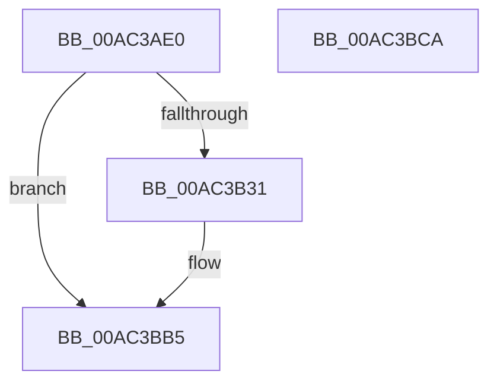

# NtWriteFileGather

- RVA: `0x00AC3AE0`–`0x00AC3BCB` (길이 `235` bytes)
- VA: `0x0000000140AC3AE0`
- 실행 섹션: `PAGE`
- PDB 이름 있음: `예`; PDB Function 태그: `아니요`
- unwind 정보 RVA: `0x000BDDA0`
- 디코드: `53`개 명령, `235/235` bytes 표시
- 미해석 바이트: `0` (있으면 어셈블리에 `.byte`로 보존)

> 이 문서는 커널 이미지의 기계어와 PDB 기호를 분석해 생성했습니다. 4번과 5번은 함수 원형과 자료형을 바이너리 사용 방식에서 추정한 C 해석이며 원본 소스 복구 결과는 아닙니다.

## 1. Dependencies

- 직접 호출 지점: **2**; 고유 호출 대상: **2**
- 직접 호출자로 확인된 함수: **0**
- RIP 상대 이미지 참조: **0**

### Outgoing calls
- `0x00AC3B24` → [IopReferenceFileObject](../../text/29/IopReferenceFileObject_function_0029D530.md) (function, `0x0029D530`)
- `0x00AC3BB0` → [IopWriteFileGather](../AA/IopWriteFileGather_function_00AAA95C.md) (function, `0x00AAA95C`)

### Direct callers
- 이 함수 시작 RVA로 연결되는 직접 call은 확인되지 않았습니다. 간접 호출은 완전히 역산할 수 없습니다.

### Static image references
- 디코드된 RIP-relative 메모리 참조가 없습니다.

## 2. Other-region calls and transfers

- 다른 실행 섹션으로 향하는 call: **1**
  - `0x00AC3B24` → [IopReferenceFileObject](../../text/29/IopReferenceFileObject_function_0029D530.md) (`PAGE` → `.text`)
- 별도 외부 분기/꼬리 이동을 확인하지 못했습니다.

## 3. Assembly (complete function range)

```asm
00AC3AE0  4C 8B DC                        mov r11, rsp
00AC3AE3  49 89 5B 08                     mov qword ptr [r11 + 8], rbx
00AC3AE7  49 89 73 10                     mov qword ptr [r11 + 0x10], rsi
00AC3AEB  57                              push rdi
00AC3AEC  48 81 EC 80 00 00 00            sub rsp, 0x80
00AC3AF3  65 48 8B 04 25 88 01 00 00      mov rax, qword ptr gs:[0x188]
00AC3AFC  49 8B F8                        mov rdi, r8
00AC3AFF  49 83 63 F0 00                  and qword ptr [r11 - 0x10], 0
00AC3B04  49 8B D9                        mov rbx, r9
00AC3B07  49 83 63 E8 00                  and qword ptr [r11 - 0x18], 0
00AC3B0C  4D 8D 4B F0                     lea r9, [r11 - 0x10]
00AC3B10  48 8B F2                        mov rsi, rdx
00AC3B13  33 D2                           xor edx, edx
00AC3B15  44 8A 80 32 02 00 00            mov r8b, byte ptr [rax + 0x232]
00AC3B1C  49 8D 43 E8                     lea rax, [r11 - 0x18]
00AC3B20  49 89 43 98                     mov qword ptr [r11 - 0x68], rax
00AC3B24  E8 07 9A 7D FF                  call 0x14029d530
00AC3B29  85 C0                           test eax, eax
00AC3B2B  0F 88 84 00 00 00               js 0x140ac3bb5
00AC3B31  8B 8C 24 C0 00 00 00            mov ecx, dword ptr [rsp + 0xc0]
00AC3B38  BA 00 00 00 00                  mov edx, 0
00AC3B3D  8B C1                           mov eax, ecx
00AC3B3F  F7 C1 FF 0F 00 00               test ecx, 0xfff
00AC3B45  4C 8B CB                        mov r9, rbx
00AC3B48  4C 8B C7                        mov r8, rdi
00AC3B4B  0F 95 C2                        setne dl
00AC3B4E  83 64 24 68 00                  and dword ptr [rsp + 0x68], 0
00AC3B53  48 83 64 24 60 00               and qword ptr [rsp + 0x60], 0
00AC3B59  48 83 64 24 58 00               and qword ptr [rsp + 0x58], 0
00AC3B5F  C1 E8 0C                        shr eax, 0xc
00AC3B62  03 D0                           add edx, eax
00AC3B64  8B 44 24 74                     mov eax, dword ptr [rsp + 0x74]
00AC3B68  89 44 24 50                     mov dword ptr [rsp + 0x50], eax
00AC3B6C  48 8B 84 24 D0 00 00 00         mov rax, qword ptr [rsp + 0xd0]
00AC3B74  48 89 44 24 48                  mov qword ptr [rsp + 0x48], rax
00AC3B79  48 8B 84 24 C8 00 00 00         mov rax, qword ptr [rsp + 0xc8]
00AC3B81  48 89 44 24 40                  mov qword ptr [rsp + 0x40], rax
00AC3B86  48 8B 84 24 B8 00 00 00         mov rax, qword ptr [rsp + 0xb8]
00AC3B8E  89 4C 24 38                     mov dword ptr [rsp + 0x38], ecx
00AC3B92  48 8B 4C 24 78                  mov rcx, qword ptr [rsp + 0x78]
00AC3B97  48 89 44 24 30                  mov qword ptr [rsp + 0x30], rax
00AC3B9C  48 8B 84 24 B0 00 00 00         mov rax, qword ptr [rsp + 0xb0]
00AC3BA4  89 54 24 28                     mov dword ptr [rsp + 0x28], edx
00AC3BA8  48 8B D6                        mov rdx, rsi
00AC3BAB  48 89 44 24 20                  mov qword ptr [rsp + 0x20], rax
00AC3BB0  E8 A7 6D FE FF                  call 0x140aaa95c
00AC3BB5  4C 8D 9C 24 80 00 00 00         lea r11, [rsp + 0x80]
00AC3BBD  49 8B 5B 10                     mov rbx, qword ptr [r11 + 0x10]
00AC3BC1  49 8B 73 18                     mov rsi, qword ptr [r11 + 0x18]
00AC3BC5  49 8B E3                        mov rsp, r11
00AC3BC8  5F                              pop rdi
00AC3BC9  C3                              ret
00AC3BCA  CC                              int3
```

## 4. C-style interpretation (structured pseudocode)

```c
__int64 __fastcall NtWriteFileGather(__int64 a1, __int64 a2, __int64 a3, __int64 a4, __int64 a5, __int64 a6, unsigned int a7, __int64 a8, __int64 a9)
{
    __int64 result;
    __int64 v_rsp;
    unsigned __int64 v_stack_m10;
    unsigned int v_stack_m14;
    unsigned int v_stack_m20;
    unsigned __int64 v_stack_m28;
    unsigned __int64 v_stack_m30;
    unsigned int v_stack_m38;
    unsigned __int64 v_stack_m40;
    unsigned __int64 v_stack_m48;
    unsigned int v_stack_m50;
    unsigned __int64 v_stack_m58;
    unsigned int v_stack_m60;
    unsigned __int64 v_stack_m68;
    unsigned __int64 v_stack_m8;

    *(unsigned __int64 *)(v_rsp + 8) = v_rbx;
    *(unsigned __int64 *)(v_rsp + 16) = v_rsi;
    v_rsp = (v_rsp) - (128);
    a2 = 0;
    *(unsigned __int64 *)(v_rsp - 104) = v_rsp - 24;
    result = IopReferenceFileObject(a1, a2, *(unsigned __int8 *)(*(unsigned __int64 *)(gs_base + (0 + 392)) + 562), v_rsp - 16);
    if (!(sign_flag)) {
        a1 = a7;
        a2 = 0;
        result = (unsigned int)(a1);
        a4 = a4;
        a3 = a3;
        a2 = ((((unsigned int)(a1)) & (0xFFFULL)) != 0) ? 1 : 0;
        result = (unsigned int)((result) >> (12));
        a2 = (unsigned int)((a2) + ((unsigned int)(result)));
        result = v_stack_m14;
        v_stack_m38 = (unsigned int)(result);
        result = a9;
        v_stack_m40 = result;
        result = a8;
        v_stack_m48 = result;
        result = a6;
        v_stack_m50 = (unsigned int)(a1);
        a1 = v_stack_m10;
        v_stack_m58 = result;
        result = a5;
        v_stack_m60 = (unsigned int)(a2);
        a2 = a2;
        v_stack_m68 = result;
        result = IopWriteFileGather(a1, a2, a3, a4);
    }
    return result;
}
```

## 5. (Beta) C Style

```c
int64_t NtWriteFileGather(int64_t Arg1, int64_t Arg2, int64_t Arg3, int64_t Arg4, int64_t Arg5, int64_t Arg6, uint32_t Arg7, int64_t Arg8, int64_t Arg9)
{
    int64_t result;
    int64_t local_rsp;
    uint64_t v_stack_m10;
    uint32_t v_stack_m14;
    uint32_t v_stack_m20;
    uint64_t v_stack_m28;
    uint64_t v_stack_m30;
    uint32_t v_stack_m38;
    uint64_t v_stack_m40;
    uint64_t v_stack_m48;
    uint32_t v_stack_m50;
    uint64_t v_stack_m58;
    uint32_t v_stack_m60;
    uint64_t v_stack_m68;
    uint64_t v_stack_m8;

    *(uint64_t *)(local_rsp + 0x8) = local_rbx;
    *(uint64_t *)(local_rsp + 0x10) = local_rsi;
    local_rsp = (local_rsp) - (128);
    Arg2 = 0;
    *(uint64_t *)(local_rsp - 0x68) = local_rsp - 24;
    result = IopReferenceFileObject(Arg1, Arg2, *(uint8_t *)(*(uint64_t *)(gs_base + (0 + 0x188)) + 0x232), local_rsp - 16);
    if (!(sign_flag)) {
        Arg1 = Arg7;
        Arg2 = 0;
        result = (uint32_t)(Arg1);
        Arg4 = Arg4;
        Arg3 = Arg3;
        Arg2 = ((((uint32_t)(Arg1)) & (0xFFFULL)) != 0) ? 1 : 0;
        result = (uint32_t)((result) >> (12));
        Arg2 = (uint32_t)((Arg2) + ((uint32_t)(result)));
        result = v_stack_m14;
        v_stack_m38 = (uint32_t)(result);
        result = Arg9;
        v_stack_m40 = result;
        result = Arg8;
        v_stack_m48 = result;
        result = Arg6;
        v_stack_m50 = (uint32_t)(Arg1);
        Arg1 = v_stack_m10;
        v_stack_m58 = result;
        result = Arg5;
        v_stack_m60 = (uint32_t)(Arg2);
        Arg2 = Arg2;
        v_stack_m68 = result;
        result = IopWriteFileGather(Arg1, Arg2, Arg3, Arg4);
    }
    return result;
}
```

## 6. Execution-region graph

[열기: 2D/3D 그래프와 함수 탐색 컨트롤 패널](../../../control-panel.html?section=page&rva=0x00AC3AE0&view=graph)

- 2D 그래프는 위에서 아래로 흐르고, 3D 그래프는 빈 공간을 드래그해 회전합니다. Shift+드래그는 이동, 휠은 확대·축소, 함수 노드 선택은 대상 보고서 이동입니다.

### Static fallback


