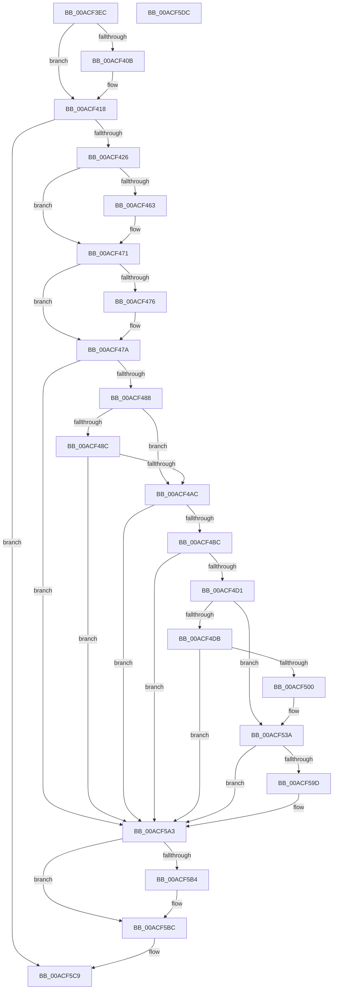

# ObpRegisterObject

- RVA: `0x00ACF3EC`–`0x00ACF5DD` (길이 `497` bytes)
- VA: `0x0000000140ACF3EC`
- 실행 섹션: `PAGE`
- PDB 이름 있음: `예`; PDB Function 태그: `아니요`
- unwind 정보 RVA: `0x00061768`
- 디코드: `121`개 명령, `497/497` bytes 표시
- 미해석 바이트: `0` (있으면 어셈블리에 `.byte`로 보존)

> 이 문서는 커널 이미지의 기계어와 PDB 기호를 분석해 생성했습니다. 4번과 5번은 함수 원형과 자료형을 바이너리 사용 방식에서 추정한 C 해석이며 원본 소스 복구 결과는 아닙니다.

## 1. Dependencies

- 직접 호출 지점: **11**; 고유 호출 대상: **11**
- 직접 호출자로 확인된 함수: **9**
- RIP 상대 이미지 참조: **6**

### Outgoing calls
- `0x00ACF413` → [EtwTraceObject](../7B/EtwTraceObject_function_007B81A4.md) (function, `0x007B81A4`)
- `0x00ACF452` → [KeAbPreAcquire](../../text/21/KeAbPreAcquire_function_00210230.md) (function, `0x00210230`)
- `0x00ACF46C` → [ExfAcquirePushLockExclusiveEx](../../text/20/ExfAcquirePushLockExclusiveEx_function_0020FC90.md) (function, `0x0020FC90`)
- `0x00ACF4AF` → [ObpIsObjectPoolTagTraced](../74/ObpIsObjectPoolTagTraced_function_0074FE5C.md) (function, `0x0074FE5C`)
- `0x00ACF4C4` → [ObpGetObjectRefInfo](../74/ObpGetObjectRefInfo_function_0074FA1C.md) (function, `0x0074FA1C`)
- `0x00ACF4EA` → [ExAllocatePool2](../../poolcode/B8/ExAllocatePool2_function_00B820F0.md) (function, `0x00B820F0`)
- `0x00ACF568` → [RtlStringCbCopyA](../../text/46/RtlStringCbCopyA_function_0046143C.md) (function, `0x0046143C`)
- `0x00ACF585` → [memset](../../text/6C/memset_function_006C6C40.md) (function, `0x006C6C40`)
- `0x00ACF5B7` → [ExfTryToWakePushLock](../../text/26/ExfTryToWakePushLock_function_00265DD0.md) (function, `0x00265DD0`)
- `0x00ACF5BF` → [KeAbPostRelease](../../text/2E/KeAbPostRelease_function_002E1600.md) (function, `0x002E1600`)
- `0x00ACF5C4` → [KeLeaveGuardedRegion](../../text/2E/KeLeaveGuardedRegion_function_002E2C40.md) (function, `0x002E2C40`)

### Direct callers
- [ObCreateObject](../87/ObCreateObject_function_00872CB0.md) at `0x0087319E`
- [IopAllocRealFileObject](../89/IopAllocRealFileObject_function_00899720.md) at `0x00899EA8`
- [ObCreateObjectEx](../89/ObCreateObjectEx_function_0089B1E0.md) at `0x0089B8FF`
- [NtCreateEvent](../8B/NtCreateEvent_function_008B9140.md) at `0x008B976A`
- [sub_008C2DC2](../8C/Unknown_function_008C2DC2.md) at `0x008C2E4A`
- [NtCreateSemaphore](../8C/NtCreateSemaphore_function_008C38D0.md) at `0x008C3BD0`
- [sub_008C405D](../8C/Unknown_function_008C405D.md) at `0x008C41F5`
- [NtCreateMutant](../8C/NtCreateMutant_function_008C43D0.md) at `0x008C46C5`
- [NtCreateWaitCompletionPacket](../8C/NtCreateWaitCompletionPacket_function_008C4700.md) at `0x008C49CA`

### Static image references
- `0x00ACF3FE` → RVA `0x00FC6B10` (`ALMOSTRO`; read)
- `0x00ACF418` → RVA `0x00FC5010` (`ALMOSTRO`; read)
- `0x00ACF42F` → RVA `0x00F0F580` (`.data`; read)
- `0x00ACF520` → RVA `0x00F0F548` (`.data`; read)
- `0x00ACF53A` → RVA `0x00F0F554` (`.data`; read/write)
- `0x00ACF5A3` → RVA `0x00F0F580` (`.data`; read/write)

## 2. Other-region calls and transfers

- 다른 실행 섹션으로 향하는 call: **8**
  - `0x00ACF452` → [KeAbPreAcquire](../../text/21/KeAbPreAcquire_function_00210230.md) (`PAGE` → `.text`)
  - `0x00ACF46C` → [ExfAcquirePushLockExclusiveEx](../../text/20/ExfAcquirePushLockExclusiveEx_function_0020FC90.md) (`PAGE` → `.text`)
  - `0x00ACF4EA` → [ExAllocatePool2](../../poolcode/B8/ExAllocatePool2_function_00B820F0.md) (`PAGE` → `POOLCODE`)
  - `0x00ACF568` → [RtlStringCbCopyA](../../text/46/RtlStringCbCopyA_function_0046143C.md) (`PAGE` → `.text`)
  - `0x00ACF585` → [memset](../../text/6C/memset_function_006C6C40.md) (`PAGE` → `.text`)
  - `0x00ACF5B7` → [ExfTryToWakePushLock](../../text/26/ExfTryToWakePushLock_function_00265DD0.md) (`PAGE` → `.text`)
  - `0x00ACF5BF` → [KeAbPostRelease](../../text/2E/KeAbPostRelease_function_002E1600.md) (`PAGE` → `.text`)
  - `0x00ACF5C4` → [KeLeaveGuardedRegion](../../text/2E/KeLeaveGuardedRegion_function_002E2C40.md) (`PAGE` → `.text`)
- 별도 외부 분기/꼬리 이동을 확인하지 못했습니다.

## 3. Assembly (complete function range)

```asm
00ACF3EC  48 89 5C 24 08                  mov qword ptr [rsp + 8], rbx
00ACF3F1  48 89 6C 24 18                  mov qword ptr [rsp + 0x18], rbp
00ACF3F6  56                              push rsi
00ACF3F7  57                              push rdi
00ACF3F8  41 56                           push r14
00ACF3FA  48 83 EC 20                     sub rsp, 0x20
00ACF3FE  8B 05 0C 77 4F 00               mov eax, dword ptr [rip + 0x4f770c]
00ACF404  48 8B F9                        mov rdi, rcx
00ACF407  84 C0                           test al, al
00ACF409  79 0D                           jns 0x140acf418
00ACF40B  B9 30 11 00 00                  mov ecx, 0x1130
00ACF410  48 8B D7                        mov rdx, rdi
00ACF413  E8 8C 8D CE FF                  call 0x1407b81a4
00ACF418  8B 05 F2 5B 4F 00               mov eax, dword ptr [rip + 0x4f5bf2]
00ACF41E  A8 73                           test al, 0x73
00ACF420  0F 84 A3 01 00 00               je 0x140acf5c9
00ACF426  65 48 8B 04 25 88 01 00 00      mov rax, qword ptr gs:[0x188]
00ACF42F  48 8D 2D 4A 01 44 00            lea rbp, [rip + 0x44014a]
00ACF436  48 83 CB FF                     or rbx, 0xffffffffffffffff
00ACF43A  45 33 F6                        xor r14d, r14d
00ACF43D  45 33 C0                        xor r8d, r8d
00ACF440  4C 89 74 24 48                  mov qword ptr [rsp + 0x48], r14
00ACF445  33 D2                           xor edx, edx
00ACF447  48 8B CD                        mov rcx, rbp
00ACF44A  66 01 98 E6 01 00 00            add word ptr [rax + 0x1e6], bx
00ACF451  90                              nop
00ACF452  E8 D9 0D 74 FF                  call 0x140210230
00ACF457  F0 48 0F BA 6D 00 00            lock bts qword ptr [rbp], 0
00ACF45E  48 8B F0                        mov rsi, rax
00ACF461  73 0E                           jae 0x140acf471
00ACF463  4C 8B C5                        mov r8, rbp
00ACF466  48 8B D0                        mov rdx, rax
00ACF469  48 8B CD                        mov rcx, rbp
00ACF46C  E8 1F 08 74 FF                  call 0x14020fc90
00ACF471  48 85 F6                        test rsi, rsi
00ACF474  74 04                           je 0x140acf47a
00ACF476  C6 46 0A 01                     mov byte ptr [rsi + 0xa], 1
00ACF47A  8B 05 90 5B 4F 00               mov eax, dword ptr [rip + 0x4f5b90]
00ACF480  A8 73                           test al, 0x73
00ACF482  0F 84 1B 01 00 00               je 0x140acf5a3
00ACF488  A8 20                           test al, 0x20
00ACF48A  74 20                           je 0x140acf4ac
00ACF48C  65 48 8B 04 25 88 01 00 00      mov rax, qword ptr gs:[0x188]
00ACF495  48 8B 88 B8 00 00 00            mov rcx, qword ptr [rax + 0xb8]
00ACF49C  F7 81 F0 01 00 00 00 02 00 00   test dword ptr [rcx + 0x1f0], 0x200
00ACF4A6  0F 84 F7 00 00 00               je 0x140acf5a3
00ACF4AC  48 8B CF                        mov rcx, rdi
00ACF4AF  E8 A8 09 C8 FF                  call 0x14074fe5c
00ACF4B4  84 C0                           test al, al
00ACF4B6  0F 84 E7 00 00 00               je 0x140acf5a3
00ACF4BC  48 8D 54 24 48                  lea rdx, [rsp + 0x48]
00ACF4C1  48 8B CF                        mov rcx, rdi
00ACF4C4  E8 53 05 C8 FF                  call 0x14074fa1c
00ACF4C9  85 C0                           test eax, eax
00ACF4CB  0F 88 D2 00 00 00               js 0x140acf5a3
00ACF4D1  4C 8B 44 24 48                  mov r8, qword ptr [rsp + 0x48]
00ACF4D6  4D 85 C0                        test r8, r8
00ACF4D9  75 5F                           jne 0x140acf53a
00ACF4DB  41 8D 48 40                     lea ecx, [r8 + 0x40]
00ACF4DF  BA F8 17 00 00                  mov edx, 0x17f8
00ACF4E4  41 B8 4F 62 52 74               mov r8d, 0x7452624f
00ACF4EA  E8 01 2C 0B 00                  call 0x140b820f0
00ACF4EF  48 89 44 24 48                  mov qword ptr [rsp + 0x48], rax
00ACF4F4  4C 8B C0                        mov r8, rax
00ACF4F7  48 85 C0                        test rax, rax
00ACF4FA  0F 84 A3 00 00 00               je 0x140acf5a3
00ACF500  8D 4F 30                        lea ecx, [rdi + 0x30]
00ACF503  B8 A3 71 6E A3                  mov eax, 0xa36e71a3
00ACF508  C1 E9 04                        shr ecx, 4
00ACF50B  81 E1 FF FF 0F 00               and ecx, 0xfffff
00ACF511  F7 E1                           mul ecx
00ACF513  C1 EA 08                        shr edx, 8
00ACF516  69 C2 91 01 00 00               imul eax, edx, 0x191
00ACF51C  2B C8                           sub ecx, eax
00ACF51E  8B D1                           mov edx, ecx
00ACF520  48 8B 0D 21 00 44 00            mov rcx, qword ptr [rip + 0x440021]
00ACF527  48 8B 04 D1                     mov rax, qword ptr [rcx + rdx*8]
00ACF52B  49 89 40 08                     mov qword ptr [r8 + 8], rax
00ACF52F  4C 89 04 D1                     mov qword ptr [rcx + rdx*8], r8
00ACF533  66 41 C7 40 22 FC 01            mov word ptr [r8 + 0x22], 0x1fc
00ACF53A  FF 05 14 00 44 00               inc dword ptr [rip + 0x440014]
00ACF540  BA 10 00 00 00                  mov edx, 0x10
00ACF545  49 89 38                        mov qword ptr [r8], rdi
00ACF548  65 48 8B 04 25 88 01 00 00      mov rax, qword ptr gs:[0x188]
00ACF551  4C 8B 54 24 48                  mov r10, qword ptr [rsp + 0x48]
00ACF556  4C 8B 80 B8 00 00 00            mov r8, qword ptr [rax + 0xb8]
00ACF55D  49 81 C0 38 03 00 00            add r8, 0x338
00ACF564  49 8D 4A 10                     lea rcx, [r10 + 0x10]
00ACF568  E8 CF 1E 99 FF                  call 0x14046143c
00ACF56D  66 45 89 72 20                  mov word ptr [r10 + 0x20], r14w
00ACF572  49 8D 4A 24                     lea rcx, [r10 + 0x24]
00ACF576  41 0F B7 42 22                  movzx eax, word ptr [r10 + 0x22]
00ACF57B  33 D2                           xor edx, edx
00ACF57D  4C 8D 04 40                     lea r8, [rax + rax*2]
00ACF581  49 C1 E0 02                     shl r8, 2
00ACF585  E8 B6 76 BF FF                  call 0x1406c6c40
00ACF58A  8A 4F 19                        mov cl, byte ptr [rdi + 0x19]
00ACF58D  8B 05 7D 5A 4F 00               mov eax, dword ptr [rip + 0x4f5a7d]
00ACF593  80 C9 01                        or cl, 1
00ACF596  88 4F 19                        mov byte ptr [rdi + 0x19], cl
00ACF599  A8 40                           test al, 0x40
00ACF59B  74 06                           je 0x140acf5a3
00ACF59D  80 C9 02                        or cl, 2
00ACF5A0  88 4F 19                        mov byte ptr [rdi + 0x19], cl
00ACF5A3  F0 48 0F C1 1D D4 FF 43 00      lock xadd qword ptr [rip + 0x43ffd4], rbx
00ACF5AC  80 E3 06                        and bl, 6
00ACF5AF  80 FB 02                        cmp bl, 2
00ACF5B2  75 08                           jne 0x140acf5bc
00ACF5B4  48 8B CD                        mov rcx, rbp
00ACF5B7  E8 14 68 79 FF                  call 0x140265dd0
00ACF5BC  48 8B CD                        mov rcx, rbp
00ACF5BF  E8 3C 20 81 FF                  call 0x1402e1600
00ACF5C4  E8 77 36 81 FF                  call 0x1402e2c40
00ACF5C9  48 8B 5C 24 40                  mov rbx, qword ptr [rsp + 0x40]
00ACF5CE  48 8B 6C 24 50                  mov rbp, qword ptr [rsp + 0x50]
00ACF5D3  48 83 C4 20                     add rsp, 0x20
00ACF5D7  41 5E                           pop r14
00ACF5D9  5F                              pop rdi
00ACF5DA  5E                              pop rsi
00ACF5DB  C3                              ret
00ACF5DC  CC                              int3
```

## 4. C-style interpretation (structured pseudocode)

```c
__int64 __fastcall ObpRegisterObject(__int64 a1, __int64 a2, int a3)
{
    __int64 result;
    __int64 v_r14;
    __int64 v_rbx;
    __int64 v_rsp;
    unsigned __int64 v_stack_p10;
    unsigned __int64 v_stack_p18;
    unsigned __int64 v_stack_p8;

    v_stack_p8 = v_rbx;
    v_stack_p18 = v_rbp;
    v_rsp = (v_rsp) - (32);
    result = (unsigned int)(*(unsigned int *)(v_rip + 5207820));
    if (sign_flag) {
        a1 = 0x1130ULL;
        a2 = a1;
        result = EtwTraceObject(a1, a2, a3, a4);
    }
    if ((((unsigned __int8)((unsigned int)(*(unsigned int *)(v_rip + 5200882)))) & (115)) == 0) goto loc_00ACF5C9;
    v_rbx = (v_rbx) | (-1);
    v_r14 = 0;
    a3 = 0;
    v_stack_p10 = 0;
    a2 = 0;
    result = KeAbPreAcquire(v_rip + 4456778, a2, a3, a4);
    if (!(condition_is_above_or_equal)) {
        a3 = v_rip + 4456778;
        a2 = result;
        a1 = v_rip + 4456778;
        result = ExfAcquirePushLockExclusiveEx(a1, a2, a3, a4);
    }
    if (result != 0) {
        *(unsigned __int8 *)(result + 10) = 1;
    }
    if ((((unsigned __int8)((unsigned int)(*(unsigned int *)(v_rip + 5200784)))) & (115)) == 0) goto loc_00ACF5A3;
    if ((((unsigned __int8)((unsigned int)(*(unsigned int *)(v_rip + 5200784)))) & (32)) == 0) goto loc_00ACF4AC;
    if (((*(unsigned int *)(*(unsigned __int64 *)(*(unsigned __int64 *)(gs_base + (0 + 392)) + 184) + 496)) & (512)) == 0) goto loc_00ACF5A3;
loc_00ACF4AC:
    result = ObpIsObjectPoolTagTraced(a1, a2, a3, a4);
    if ((unsigned __int8)(result) == 0) goto loc_00ACF5A3;
    result = ObpGetObjectRefInfo(a1, v_stack_p10, a3, a4);
    if (sign_flag) goto loc_00ACF5A3;
    if (v_stack_p10 != 0) goto loc_00ACF53A;
    result = ExAllocatePool2(v_stack_p10 + 64, (unsigned int)(0x17F8ULL), (unsigned int)(0x7452624FULL), a4);
    v_stack_p10 = result;
    if (result == 0) goto loc_00ACF5A3;
    a1 = (unsigned int)((a1 + 48) >> (4));
    a1 = (unsigned int)((a1) & (0xFFFFFULL));
    a2 = (unsigned int)(((unsigned int)(0x17F8ULL)) >> (8));
    result = (unsigned int)(((unsigned int)(0xA36E71A3ULL)) * ((unsigned int)(a2)));
    a1 = (unsigned int)((a1) - ((unsigned int)(result)));
    *(unsigned __int64 *)(result + 8) = *(unsigned __int64 *)(*(unsigned __int64 *)(v_rip + 4456481) + (unsigned int)((unsigned int)(a1)) * 8);
    *(unsigned __int64 *)(*(unsigned __int64 *)(v_rip + 4456481) + (unsigned int)((unsigned int)(a1)) * 8) = result;
    *(unsigned __int16 *)(result + 34) = 508;
loc_00ACF53A:
    *(unsigned __int64 *)(result) = a1;
    a3 = (*(unsigned __int64 *)(*(unsigned __int64 *)(gs_base + (0 + 392)) + 184)) + (824);
    result = RtlStringCbCopyA(v_stack_p10 + 16, 16, a3, a4);
    *(unsigned __int16 *)(v_stack_p10 + 32) = 0;
    a2 = 0;
    a3 = (*(unsigned __int16 *)(v_stack_p10 + 34) + *(unsigned __int16 *)(v_stack_p10 + 34) * 2) << (2);
    result = memset(v_stack_p10 + 36, a2, a3, a4);
    a1 = (unsigned __int8)((*(unsigned __int8 *)(a1 + 25)) | (1));
    *(unsigned __int8 *)(a1 + 25) = (unsigned __int8)(a1);
    if ((((unsigned __int8)((unsigned int)(*(unsigned int *)(v_rip + 5200509)))) & (64)) != 0) {
        a1 = (unsigned __int8)((a1) | (2));
        *(unsigned __int8 *)(a1 + 25) = (unsigned __int8)(a1);
    }
    v_rbx = (unsigned __int8)((v_rbx) & (6));
    result = (unsigned int)(*(unsigned int *)(v_rip + 5200509));
    if (((unsigned __int8)(v_rbx)) == 2) {
        a1 = v_rip + 4456778;
        result = ExfTryToWakePushLock(a1, a2, a3, a4);
    }
    result = KeAbPostRelease(v_rip + 4456778, a2, a3, a4);
    result = KeLeaveGuardedRegion(v_rip + 4456778, a2, a3, a4);
loc_00ACF5C9:
    v_rsp = (v_rsp) + (32);
    return result;
}
```

## 5. (Beta) C Style

```c
int64_t ObpRegisterObject(void *Arg1, int64_t Arg2, int32_t Arg3)
{
    uint8_t *arg1 = (uint8_t *)Arg1;

    int64_t result;
    int64_t local_r14;
    int64_t local_rbx;
    int64_t local_rsp;
    uint64_t v_stack_p10;
    uint64_t v_stack_p18;
    uint64_t v_stack_p8;

    v_stack_p8 = local_rbx;
    v_stack_p18 = local_rbp;
    local_rsp = (local_rsp) - (32);
    result = (uint32_t)(*(uint32_t *)(v_rip + 0x4F770C));
    if (sign_flag) {
        Arg1 = 0x1130ULL;
        Arg2 = Arg1;
        result = EtwTraceObject(Arg1, Arg2, Arg3, a4);
    }
    if ((((uint8_t)((uint32_t)(*(uint32_t *)(v_rip + 0x4F5BF2)))) & (115)) == 0) goto loc_00ACF5C9;
    local_rbx = (local_rbx) | (-1);
    local_r14 = 0;
    Arg3 = 0;
    v_stack_p10 = 0;
    Arg2 = 0;
    result = KeAbPreAcquire(v_rip + 4456778, Arg2, Arg3, a4);
    if (!(condition_is_above_or_equal)) {
        Arg3 = v_rip + 4456778;
        Arg2 = result;
        Arg1 = v_rip + 4456778;
        result = ExfAcquirePushLockExclusiveEx(Arg1, Arg2, Arg3, a4);
    }
    if (result != 0) {
        *(uint8_t *)(result + 0xA) = 1;
    }
    if ((((uint8_t)((uint32_t)(*(uint32_t *)(v_rip + 0x4F5B90)))) & (115)) == 0) goto loc_00ACF5A3;
    if ((((uint8_t)((uint32_t)(*(uint32_t *)(v_rip + 0x4F5B90)))) & (32)) == 0) goto loc_00ACF4AC;
    if (((*(uint32_t *)(*(uint64_t *)(*(uint64_t *)(gs_base + (0 + 0x188)) + 0xB8) + 0x1F0)) & (512)) == 0) goto loc_00ACF5A3;
loc_00ACF4AC:
    result = ObpIsObjectPoolTagTraced(Arg1, Arg2, Arg3, a4);
    if ((uint8_t)(result) == 0) goto loc_00ACF5A3;
    result = ObpGetObjectRefInfo(Arg1, v_stack_p10, Arg3, a4);
    if (sign_flag) goto loc_00ACF5A3;
    if (v_stack_p10 != 0) goto loc_00ACF53A;
    result = ExAllocatePool2(v_stack_p10 + 64, (uint32_t)(0x17F8ULL), (uint32_t)(0x7452624FULL), a4);
    v_stack_p10 = result;
    if (result == 0) goto loc_00ACF5A3;
    Arg1 = (uint32_t)((Arg1 + 48) >> (4));
    Arg1 = (uint32_t)((Arg1) & (0xFFFFFULL));
    Arg2 = (uint32_t)(((uint32_t)(0x17F8ULL)) >> (8));
    result = (uint32_t)(((uint32_t)(0xA36E71A3ULL)) * ((uint32_t)(Arg2)));
    Arg1 = (uint32_t)((Arg1) - ((uint32_t)(result)));
    *(uint64_t *)(result + 0x8) = *(uint64_t *)(*(uint64_t *)(v_rip + 0x440021) + (uint32_t)((uint32_t)(arg1)) * 8);
    *(uint64_t *)(*(uint64_t *)(v_rip + 0x440021) + (uint32_t)((uint32_t)(arg1)) * 8) = result;
    *(uint16_t *)(result + 0x22) = 508;
loc_00ACF53A:
    *(void **)(result) = Arg1;
    Arg3 = (*(uint64_t *)(*(uint64_t *)(gs_base + (0 + 0x188)) + 0xB8)) + (824);
    result = RtlStringCbCopyA(v_stack_p10 + 16, 16, Arg3, a4);
    *(uint16_t *)(v_stack_p10 + 0x20) = 0;
    Arg2 = 0;
    Arg3 = (*(uint16_t *)(v_stack_p10 + 0x22) + *(uint16_t *)(v_stack_p10 + 0x22) * 2) << (2);
    result = memset(v_stack_p10 + 36, Arg2, Arg3, a4);
    Arg1 = (uint8_t)((*(uint8_t *)(arg1 + 0x19)) | (1));
    *(uint8_t *)(arg1 + 0x19) = (uint8_t)(Arg1);
    if ((((uint8_t)((uint32_t)(*(uint32_t *)(v_rip + 0x4F5A7D)))) & (64)) != 0) {
        Arg1 = (uint8_t)((Arg1) | (2));
        *(uint8_t *)(arg1 + 0x19) = (uint8_t)(Arg1);
    }
    local_rbx = (uint8_t)((local_rbx) & (6));
    result = (uint32_t)(*(uint32_t *)(v_rip + 0x4F5A7D));
    if (((uint8_t)(local_rbx)) == 2) {
        Arg1 = v_rip + 4456778;
        result = ExfTryToWakePushLock(Arg1, Arg2, Arg3, a4);
    }
    result = KeAbPostRelease(v_rip + 4456778, Arg2, Arg3, a4);
    result = KeLeaveGuardedRegion(v_rip + 4456778, Arg2, Arg3, a4);
loc_00ACF5C9:
    local_rsp = (local_rsp) + (32);
    return result;
}
```

### 관측된 메모리 오프셋

구조체 형식이 확인되지 않은 접근은 인자 기준의 오프셋으로만 기록했습니다.

| 기준 인자 | 오프셋 표현 | 폭 (bit) | 접근 |
|---|---:|---:|---|
| `Arg1` | `+ 0x19` | `8` | `R` |
| `Arg1` | `+ 0x19` | `8` | `W` |
| `Arg1` | `+ 0x30` | `32` | `R` |

## 6. Execution-region graph

[열기: 2D/3D 그래프와 함수 탐색 컨트롤 패널](../../../control-panel.html?section=page&rva=0x00ACF3EC&view=graph)

- 2D 그래프는 위에서 아래로 흐르고, 3D 그래프는 빈 공간을 드래그해 회전합니다. Shift+드래그는 이동, 휠은 확대·축소, 함수 노드 선택은 대상 보고서 이동입니다.

### Static fallback


