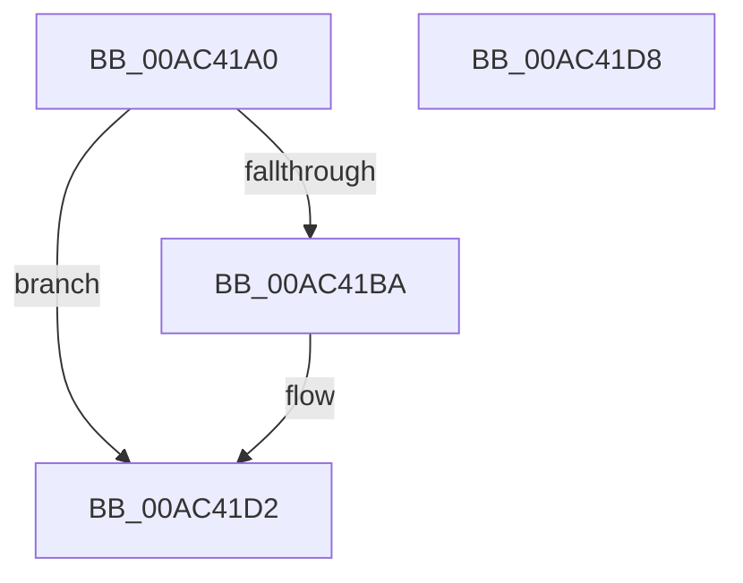

# PcwUnregister

- RVA: `0x00AC41A0`–`0x00AC41D9` (길이 `57` bytes)
- VA: `0x0000000140AC41A0`
- 실행 섹션: `PAGE`
- PDB 이름 있음: `예`; PDB Function 태그: `아니요`
- unwind 정보 RVA: `0x0005CF00`
- 디코드: `16`개 명령, `57/57` bytes 표시
- 미해석 바이트: `0` (있으면 어셈블리에 `.byte`로 보존)

> 이 문서는 커널 이미지의 기계어와 PDB 기호를 분석해 생성했습니다. 4번과 5번은 함수 원형과 자료형을 바이너리 사용 방식에서 추정한 C 해석이며 원본 소스 복구 결과는 아닙니다.

## 1. Dependencies

- 직접 호출 지점: **3**; 고유 호출 대상: **3**
- 직접 호출자로 확인된 함수: **1**
- RIP 상대 이미지 참조: **1**

### Outgoing calls
- `0x00AC41B0` → [ExGetExtensionTable](../../text/42/ExGetExtensionTable_function_00428814.md) (function, `0x00428814`)
- `0x00AC41C1` → [guard_dispatch_icall](../../text/6B/guard_dispatch_icall_function_006BAAD0.md) (function, `0x006BAAD0`)
- `0x00AC41CD` → [ExReleaseExtensionTable](../../text/45/ExReleaseExtensionTable_function_00456DC0.md) (function, `0x00456DC0`)

### Direct callers
- [ExpPcwHostCallback](../7D/ExpPcwHostCallback_function_007D1290.md) at `0x007D12C7`
- [ExpPcwHostCallback](../7D/ExpPcwHostCallback_function_007D1290.md) at `0x007D12DF`
- [ExpPcwHostCallback](../7D/ExpPcwHostCallback_function_007D1290.md) at `0x007D12F7`
- [ExpPcwHostCallback](../7D/ExpPcwHostCallback_function_007D1290.md) at `0x007D130F`
- [ExpPcwHostCallback](../7D/ExpPcwHostCallback_function_007D1290.md) at `0x007D1327`
- [ExpPcwHostCallback](../7D/ExpPcwHostCallback_function_007D1290.md) at `0x007D133F`
- [ExpPcwHostCallback](../7D/ExpPcwHostCallback_function_007D1290.md) at `0x007D1357`
- [ExpPcwHostCallback](../7D/ExpPcwHostCallback_function_007D1290.md) at `0x007D1373`

### Static image references
- `0x00AC41A9` → RVA `0x00FD8080` (`PAGEDATA`; read)

## 2. Other-region calls and transfers

- 다른 실행 섹션으로 향하는 call: **3**
  - `0x00AC41B0` → [ExGetExtensionTable](../../text/42/ExGetExtensionTable_function_00428814.md) (`PAGE` → `.text`)
  - `0x00AC41C1` → [guard_dispatch_icall](../../text/6B/guard_dispatch_icall_function_006BAAD0.md) (`PAGE` → `.text`)
  - `0x00AC41CD` → [ExReleaseExtensionTable](../../text/45/ExReleaseExtensionTable_function_00456DC0.md) (`PAGE` → `.text`)
- 별도 외부 분기/꼬리 이동을 확인하지 못했습니다.

## 3. Assembly (complete function range)

```asm
00AC41A0  40 53                           push rbx
00AC41A2  48 83 EC 20                     sub rsp, 0x20
00AC41A6  48 8B D9                        mov rbx, rcx
00AC41A9  48 8B 0D D0 3E 51 00            mov rcx, qword ptr [rip + 0x513ed0]
00AC41B0  E8 5F 46 96 FF                  call 0x140428814
00AC41B5  48 85 C0                        test rax, rax
00AC41B8  74 18                           je 0x140ac41d2
00AC41BA  48 8B 40 08                     mov rax, qword ptr [rax + 8]
00AC41BE  48 8B CB                        mov rcx, rbx
00AC41C1  E8 0A 69 BF FF                  call 0x1406baad0
00AC41C6  48 8B 0D B3 3E 51 00            mov rcx, qword ptr [rip + 0x513eb3]
00AC41CD  E8 EE 2B 99 FF                  call 0x140456dc0
00AC41D2  48 83 C4 20                     add rsp, 0x20
00AC41D6  5B                              pop rbx
00AC41D7  C3                              ret
00AC41D8  CC                              int3
```

## 4. C-style interpretation (structured pseudocode)

```c
__int64 __fastcall PcwUnregister(__int64 a1)
{
    __int64 result;
    __int64 v_rsp;

    v_rsp = (v_rsp) - (32);
    result = ExGetExtensionTable(*(unsigned __int64 *)(v_rip + 5324496), a2, a3, a4);
    if (result != 0) {
        result = *(unsigned __int64 *)(result + 8);
        a1 = a1;
        result = guard_dispatch_icall(a1, a2, a3, a4);
        a1 = *(unsigned __int64 *)(v_rip + 5324467);
        result = ExReleaseExtensionTable(a1, a2, a3, a4);
    }
    v_rsp = (v_rsp) + (32);
    return result;
}
```

## 5. (Beta) C Style

```c
int64_t PcwUnregister(int64_t Arg1)
{
    int64_t result;
    int64_t local_rsp;

    local_rsp = (local_rsp) - (32);
    result = ExGetExtensionTable(*(uint64_t *)(v_rip + 0x513ED0), a2, a3, a4);
    if (result != 0) {
        result = *(uint64_t *)(result + 0x8);
        Arg1 = Arg1;
        result = guard_dispatch_icall(Arg1, a2, a3, a4);
        Arg1 = *(uint64_t *)(v_rip + 0x513EB3);
        result = ExReleaseExtensionTable(Arg1, a2, a3, a4);
    }
    local_rsp = (local_rsp) + (32);
    return result;
}
```

## 6. Execution-region graph

[열기: 2D/3D 그래프와 함수 탐색 컨트롤 패널](../../../control-panel.html?section=page&rva=0x00AC41A0&view=graph)

- 2D 그래프는 위에서 아래로 흐르고, 3D 그래프는 빈 공간을 드래그해 회전합니다. Shift+드래그는 이동, 휠은 확대·축소, 함수 노드 선택은 대상 보고서 이동입니다.

### Static fallback


