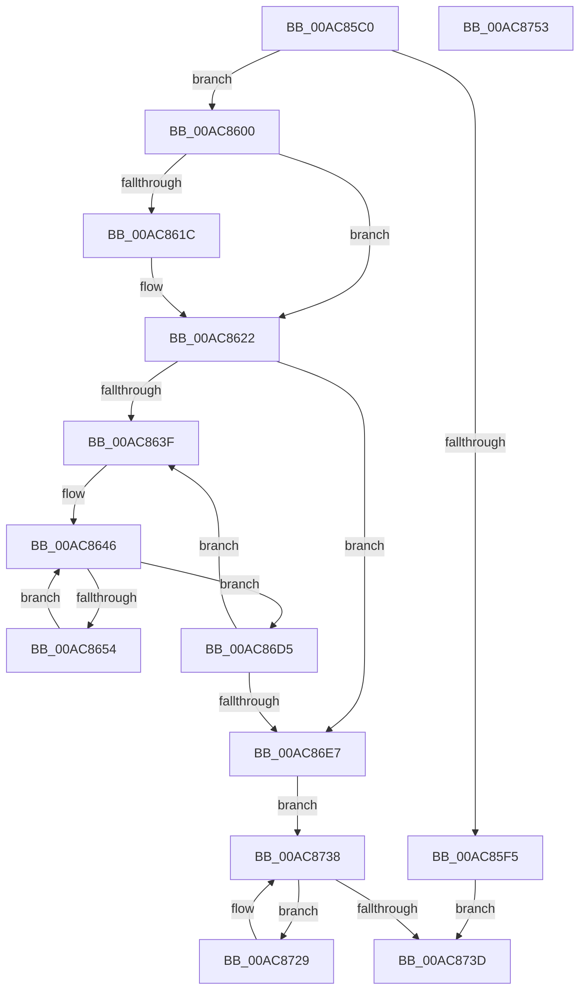

# PfSnPrefetchCacheCtxStart

- RVA: `0x00AC85C0`–`0x00AC8754` (길이 `404` bytes)
- VA: `0x0000000140AC85C0`
- 실행 섹션: `PAGE`
- PDB 이름 있음: `예`; PDB Function 태그: `아니요`
- unwind 정보 RVA: `0x00061768`
- 디코드: `109`개 명령, `404/404` bytes 표시
- 미해석 바이트: `0` (있으면 어셈블리에 `.byte`로 보존)

> 이 문서는 커널 이미지의 기계어와 PDB 기호를 분석해 생성했습니다. 4번과 5번은 함수 원형과 자료형을 바이너리 사용 방식에서 추정한 C 해석이며 원본 소스 복구 결과는 아닙니다.

## 1. Dependencies

- 직접 호출 지점: **1**; 고유 호출 대상: **1**
- 직접 호출자로 확인된 함수: **1**
- RIP 상대 이미지 참조: **0**

### Outgoing calls
- `0x00AC85E5` → [ExAllocatePool2](../../poolcode/B8/ExAllocatePool2_function_00B820F0.md) (function, `0x00B820F0`)

### Direct callers
- [PfSnPrefetchCacheEntryGet](../95/PfSnPrefetchCacheEntryGet_function_0095F890.md) at `0x0095FB23`

### Static image references
- 디코드된 RIP-relative 메모리 참조가 없습니다.

## 2. Other-region calls and transfers

- 다른 실행 섹션으로 향하는 call: **1**
  - `0x00AC85E5` → [ExAllocatePool2](../../poolcode/B8/ExAllocatePool2_function_00B820F0.md) (`PAGE` → `POOLCODE`)
- 별도 외부 분기/꼬리 이동을 확인하지 못했습니다.

## 3. Assembly (complete function range)

```asm
00AC85C0  48 89 5C 24 08                  mov qword ptr [rsp + 8], rbx
00AC85C5  48 89 6C 24 18                  mov qword ptr [rsp + 0x18], rbp
00AC85CA  56                              push rsi
00AC85CB  57                              push rdi
00AC85CC  41 56                           push r14
00AC85CE  48 83 EC 20                     sub rsp, 0x20
00AC85D2  48 8B D9                        mov rbx, rcx
00AC85D5  BA 00 10 00 00                  mov edx, 0x1000
00AC85DA  B9 40 00 00 00                  mov ecx, 0x40
00AC85DF  41 B8 43 63 50 66               mov r8d, 0x66506343
00AC85E5  E8 06 9B 0B 00                  call 0x140b820f0
00AC85EA  45 33 C9                        xor r9d, r9d
00AC85ED  4C 8B C0                        mov r8, rax
00AC85F0  48 85 C0                        test rax, rax
00AC85F3  75 0B                           jne 0x140ac8600
00AC85F5  41 B9 9A 00 00 C0               mov r9d, 0xc000009a
00AC85FB  E9 3D 01 00 00                  jmp 0x140ac873d
00AC8600  49 8D 88 00 01 00 00            lea rcx, [r8 + 0x100]
00AC8607  48 8B C3                        mov rax, rbx
00AC860A  48 83 C8 01                     or rax, 1
00AC860E  49 3B C8                        cmp rcx, r8
00AC8611  48 1B C9                        sbb rcx, rcx
00AC8614  48 F7 D1                        not rcx
00AC8617  83 E1 20                        and ecx, 0x20
00AC861A  76 06                           jbe 0x140ac8622
00AC861C  49 8B F8                        mov rdi, r8
00AC861F  F3 48 AB                        rep stosq qword ptr [rdi], rax
00AC8622  8B 43 04                        mov eax, dword ptr [rbx + 4]
00AC8625  49 83 CB FF                     or r11, 0xffffffffffffffff
00AC8629  8B C8                           mov ecx, eax
00AC862B  45 8B D1                        mov r10d, r9d
00AC862E  83 E1 1F                        and ecx, 0x1f
00AC8631  49 D3 E3                        shl r11, cl
00AC8634  A9 E0 FF FF FF                  test eax, 0xffffffe0
00AC8639  0F 86 A8 00 00 00               jbe 0x140ac86e7
00AC863F  4C 8B 73 08                     mov r14, qword ptr [rbx + 8]
00AC8643  41 8B EA                        mov ebp, r10d
00AC8646  49 8B 34 EE                     mov rsi, qword ptr [r14 + rbp*8]
00AC864A  40 F6 C6 01                     test sil, 1
00AC864E  0F 85 81 00 00 00               jne 0x140ac86d5
00AC8654  48 8B 06                        mov rax, qword ptr [rsi]
00AC8657  49 89 04 EE                     mov qword ptr [r14 + rbp*8], rax
00AC865B  48 8B 56 08                     mov rdx, qword ptr [rsi + 8]
00AC865F  49 23 D3                        and rdx, r11
00AC8662  48 89 54 24 48                  mov qword ptr [rsp + 0x48], rdx
00AC8667  0F B6 44 24 4B                  movzx eax, byte ptr [rsp + 0x4b]
00AC866C  48 8D 0C 40                     lea rcx, [rax + rax*2]
00AC8670  0F B6 44 24 4E                  movzx eax, byte ptr [rsp + 0x4e]
00AC8675  48 2B C1                        sub rax, rcx
00AC8678  48 83 C0 03                     add rax, 3
00AC867C  48 8D 3C 80                     lea rdi, [rax + rax*4]
00AC8680  0F B6 44 24 49                  movzx eax, byte ptr [rsp + 0x49]
00AC8685  48 8D 0C 40                     lea rcx, [rax + rax*2]
00AC8689  0F B6 44 24 4C                  movzx eax, byte ptr [rsp + 0x4c]
00AC868E  48 2B C8                        sub rcx, rax
00AC8691  48 8D 04 49                     lea rax, [rcx + rcx*2]
00AC8695  48 03 F8                        add rdi, rax
00AC8698  0F B6 44 24 4D                  movzx eax, byte ptr [rsp + 0x4d]
00AC869D  48 6B C8 07                     imul rcx, rax, 7
00AC86A1  0F B6 44 24 4A                  movzx eax, byte ptr [rsp + 0x4a]
00AC86A6  48 2B F9                        sub rdi, rcx
00AC86A9  48 6B C8 0B                     imul rcx, rax, 0xb
00AC86AD  0F B6 C2                        movzx eax, dl
00AC86B0  48 2B F9                        sub rdi, rcx
00AC86B3  48 6B C8 0D                     imul rcx, rax, 0xd
00AC86B7  0F B6 44 24 4F                  movzx eax, byte ptr [rsp + 0x4f]
00AC86BC  48 03 F9                        add rdi, rcx
00AC86BF  48 03 F8                        add rdi, rax
00AC86C2  83 E7 1F                        and edi, 0x1f
00AC86C5  49 8B 04 F8                     mov rax, qword ptr [r8 + rdi*8]
00AC86C9  48 89 06                        mov qword ptr [rsi], rax
00AC86CC  49 89 34 F8                     mov qword ptr [r8 + rdi*8], rsi
00AC86D0  E9 71 FF FF FF                  jmp 0x140ac8646
00AC86D5  8B 43 04                        mov eax, dword ptr [rbx + 4]
00AC86D8  41 FF C2                        inc r10d
00AC86DB  C1 E8 05                        shr eax, 5
00AC86DE  44 3B D0                        cmp r10d, eax
00AC86E1  0F 82 58 FF FF FF               jb 0x140ac863f
00AC86E7  8B 43 04                        mov eax, dword ptr [rbx + 4]
00AC86EA  49 8D B8 07 01 00 00            lea rdi, [r8 + 0x107]
00AC86F1  83 E0 1F                        and eax, 0x1f
00AC86F4  4C 89 43 08                     mov qword ptr [rbx + 8], r8
00AC86F8  0F BA E8 0A                     bts eax, 0xa
00AC86FC  48 83 E7 F8                     and rdi, 0xfffffffffffffff8
00AC8700  89 43 04                        mov dword ptr [rbx + 4], eax
00AC8703  4C 2B C7                        sub r8, rdi
00AC8706  48 B8 89 88 88 88 88 88 88 88   movabs rax, 0x8888888888888889
00AC8710  49 8D 88 00 10 00 00            lea rcx, [r8 + 0x1000]
00AC8717  8B C9                           mov ecx, ecx
00AC8719  48 F7 E1                        mul rcx
00AC871C  48 C1 EA 06                     shr rdx, 6
00AC8720  48 6B C2 78                     imul rax, rdx, 0x78
00AC8724  48 03 C7                        add rax, rdi
00AC8727  EB 0F                           jmp 0x140ac8738
00AC8729  48 8B 4B 20                     mov rcx, qword ptr [rbx + 0x20]
00AC872D  48 89 0F                        mov qword ptr [rdi], rcx
00AC8730  48 89 7B 20                     mov qword ptr [rbx + 0x20], rdi
00AC8734  48 83 C7 78                     add rdi, 0x78
00AC8738  48 3B F8                        cmp rdi, rax
00AC873B  72 EC                           jb 0x140ac8729
00AC873D  48 8B 5C 24 40                  mov rbx, qword ptr [rsp + 0x40]
00AC8742  41 8B C1                        mov eax, r9d
00AC8745  48 8B 6C 24 50                  mov rbp, qword ptr [rsp + 0x50]
00AC874A  48 83 C4 20                     add rsp, 0x20
00AC874E  41 5E                           pop r14
00AC8750  5F                              pop rdi
00AC8751  5E                              pop rsi
00AC8752  C3                              ret
00AC8753  CC                              int3
```

## 4. C-style interpretation (structured pseudocode)

```c
__int64 __fastcall PfSnPrefetchCacheCtxStart(__int64 a1, __int64 a2, __int64 a3, int a4)
{
    __int64 result;
    __int64 v_r10;
    __int64 v_r11;
    __int64 v_rdi;
    __int64 v_rsp;
    unsigned __int64 v_stack_p10;
    unsigned __int8 v_stack_p11;
    unsigned __int8 v_stack_p12;
    unsigned __int8 v_stack_p13;
    unsigned __int8 v_stack_p14;
    unsigned __int8 v_stack_p15;
    unsigned __int8 v_stack_p16;
    unsigned __int8 v_stack_p17;
    unsigned __int64 v_stack_p18;
    unsigned __int64 v_stack_p8;

    v_stack_p8 = v_rbx;
    v_stack_p18 = v_rbp;
    v_rsp = (v_rsp) - (32);
    result = ExAllocatePool2(64, (unsigned int)(0x1000ULL), (unsigned int)(0x66506343ULL), a4);
    a4 = 0;
    if (result != 0) goto loc_00AC8600;
    goto loc_00AC873D;
loc_00AC8600:
    result = (a1) | (1);
    a1 = ~(result + 256);
    a1 = (unsigned int)((a1) & (32));
    if (!(condition_is_below_or_equal)) {
        v_rdi = result;
    }
    v_r11 = (v_r11) | (-1);
    a1 = (unsigned int)(((unsigned int)((unsigned int)((unsigned int)(*(unsigned int *)(a1 + 4))))) & (31));
    v_r11 = (v_r11) << ((unsigned __int8)(a1));
    if (condition_is_below_or_equal) goto loc_00AC86E7;
loc_00AC863F:
loc_00AC8646:
    if ((((unsigned __int8)(*(unsigned __int64 *)(*(unsigned __int64 *)(a1 + 8) + (unsigned int)((unsigned int)((unsigned int)((unsigned int)((unsigned int)(0xC000009AULL))))) * 8))) & (1)) != 0) goto loc_00AC86D5;
    *(unsigned __int64 *)(*(unsigned __int64 *)(a1 + 8) + (unsigned int)((unsigned int)((unsigned int)((unsigned int)((unsigned int)(0xC000009AULL))))) * 8) = *(unsigned __int64 *)(*(unsigned __int64 *)(*(unsigned __int64 *)(a1 + 8) + (unsigned int)((unsigned int)((unsigned int)((unsigned int)((unsigned int)(0xC000009AULL))))) * 8));
    a2 = (*(unsigned __int64 *)(*(unsigned __int64 *)(*(unsigned __int64 *)(a1 + 8) + (unsigned int)((unsigned int)((unsigned int)((unsigned int)((unsigned int)(0xC000009AULL))))) * 8) + 8)) & (v_r11);
    v_stack_p10 = a2;
    result = (v_stack_p16) - (v_stack_p13 + v_stack_p13 * 2);
    result = (result) + (3);
    a1 = (v_stack_p11 + v_stack_p11 * 2) - (v_stack_p14);
    v_rdi = (result + result * 4) + (a1 + a1 * 2);
    a1 = (a1) * (v_stack_p15);
    v_rdi = (v_rdi) - (a1);
    a1 = (a1) * (v_stack_p12);
    v_rdi = (v_rdi) - (a1);
    a1 = (a1) * ((unsigned __int8)(a2));
    v_rdi = (v_rdi) + (a1);
    v_rdi = (v_rdi) + (v_stack_p17);
    v_rdi = (unsigned int)((v_rdi) & (31));
    *(unsigned __int64 *)(*(unsigned __int64 *)(*(unsigned __int64 *)(a1 + 8) + (unsigned int)((unsigned int)((unsigned int)((unsigned int)((unsigned int)(0xC000009AULL))))) * 8)) = *(unsigned __int64 *)(result + v_rdi * 8);
    *(unsigned __int64 *)(result + v_rdi * 8) = *(unsigned __int64 *)(*(unsigned __int64 *)(a1 + 8) + (unsigned int)((unsigned int)((unsigned int)((unsigned int)((unsigned int)(0xC000009AULL))))) * 8);
    goto loc_00AC8646;
loc_00AC86D5:
    v_r10 = (unsigned int)(((unsigned int)((unsigned int)((unsigned int)(0xC000009AULL)))) + 1);
    result = (unsigned int)(((unsigned int)(*(unsigned int *)(a1 + 4))) >> (5));
    if (((unsigned int)(v_r10)) < ((unsigned int)(result))) goto loc_00AC863F;
loc_00AC86E7:
    result = (unsigned int)(((unsigned int)(*(unsigned int *)(a1 + 4))) & (31));
    *(unsigned __int64 *)(a1 + 8) = result;
    v_rdi = (result + 263) & (-8);
    *(unsigned int *)(a1 + 4) = (unsigned int)(result);
    a3 = (result) - (v_rdi);
    a2 = (a2) >> (6);
    result = (result) * (a2);
    result = (result) + (v_rdi);
    goto loc_00AC8738;
loc_00AC8729:
    *(unsigned __int64 *)(v_rdi) = *(unsigned __int64 *)(a1 + 32);
    *(unsigned __int64 *)(a1 + 32) = v_rdi;
    v_rdi = (v_rdi) + (120);
loc_00AC8738:
    if (v_rdi < result) goto loc_00AC8729;
loc_00AC873D:
    v_rsp = (v_rsp) + (32);
    return (unsigned int)((unsigned int)((unsigned int)(0xC000009AULL)));
}
```

## 5. (Beta) C Style

```c
int64_t PfSnPrefetchCacheCtxStart(void *Arg1, int64_t Arg2, int64_t Arg3, int32_t Arg4)
{
    uint8_t *arg1 = (uint8_t *)Arg1;

    int64_t result;
    int64_t local_r10;
    int64_t local_r11;
    int64_t local_rdi;
    int64_t local_rsp;
    uint64_t v_stack_p10;
    uint8_t v_stack_p11;
    uint8_t v_stack_p12;
    uint8_t v_stack_p13;
    uint8_t v_stack_p14;
    uint8_t v_stack_p15;
    uint8_t v_stack_p16;
    uint8_t v_stack_p17;
    uint64_t v_stack_p18;
    uint64_t v_stack_p8;

    v_stack_p8 = local_rbx;
    v_stack_p18 = local_rbp;
    local_rsp = (local_rsp) - (32);
    result = ExAllocatePool2(64, (uint32_t)(0x1000ULL), (uint32_t)(0x66506343ULL), Arg4);
    Arg4 = 0;
    if (result != 0) goto loc_00AC8600;
    goto loc_00AC873D;
loc_00AC8600:
    result = (Arg1) | (1);
    Arg1 = ~(result + 256);
    Arg1 = (uint32_t)((Arg1) & (32));
    if (!(condition_is_below_or_equal)) {
        local_rdi = result;
    }
    local_r11 = (local_r11) | (-1);
    Arg1 = (uint32_t)(((uint32_t)((uint32_t)((uint32_t)(*(uint32_t *)(arg1 + 0x4))))) & (31));
    local_r11 = (local_r11) << ((uint8_t)(Arg1));
    if (condition_is_below_or_equal) goto loc_00AC86E7;
loc_00AC863F:
loc_00AC8646:
    if ((((uint8_t)(*(uint64_t *)(*(uint64_t *)(arg1 + 0x8) + (uint32_t)((uint32_t)((uint32_t)((uint32_t)((uint32_t)(0xC000009AULL))))) * 8))) & (1)) != 0) goto loc_00AC86D5;
    *(uint64_t *)(*(uint64_t *)(arg1 + 0x8) + (uint32_t)((uint32_t)((uint32_t)((uint32_t)((uint32_t)(0xC000009AULL))))) * 8) = *(uint64_t *)(*(uint64_t *)(*(uint64_t *)(arg1 + 0x8) + (uint32_t)((uint32_t)((uint32_t)((uint32_t)((uint32_t)(0xC000009AULL))))) * 8));
    Arg2 = (*(uint64_t *)(*(uint64_t *)(*(uint64_t *)(arg1 + 0x8) + (uint32_t)((uint32_t)((uint32_t)((uint32_t)((uint32_t)(0xC000009AULL))))) * 8) + 0x8)) & (local_r11);
    v_stack_p10 = Arg2;
    result = (v_stack_p16) - (v_stack_p13 + v_stack_p13 * 2);
    result = (result) + (3);
    Arg1 = (v_stack_p11 + v_stack_p11 * 2) - (v_stack_p14);
    local_rdi = (result + result * 4) + (Arg1 + Arg1 * 2);
    Arg1 = (Arg1) * (v_stack_p15);
    local_rdi = (local_rdi) - (Arg1);
    Arg1 = (Arg1) * (v_stack_p12);
    local_rdi = (local_rdi) - (Arg1);
    Arg1 = (Arg1) * ((uint8_t)(Arg2));
    local_rdi = (local_rdi) + (Arg1);
    local_rdi = (local_rdi) + (v_stack_p17);
    local_rdi = (uint32_t)((local_rdi) & (31));
    *(uint64_t *)(*(uint64_t *)(*(uint64_t *)(arg1 + 0x8) + (uint32_t)((uint32_t)((uint32_t)((uint32_t)((uint32_t)(0xC000009AULL))))) * 8)) = *(uint64_t *)(result + local_rdi * 8);
    *(uint64_t *)(result + local_rdi * 8) = *(uint64_t *)(*(uint64_t *)(arg1 + 0x8) + (uint32_t)((uint32_t)((uint32_t)((uint32_t)((uint32_t)(0xC000009AULL))))) * 8);
    goto loc_00AC8646;
loc_00AC86D5:
    local_r10 = (uint32_t)(((uint32_t)((uint32_t)((uint32_t)(0xC000009AULL)))) + 1);
    result = (uint32_t)(((uint32_t)(*(uint32_t *)(arg1 + 0x4))) >> (5));
    if (((uint32_t)(local_r10)) < ((uint32_t)(result))) goto loc_00AC863F;
loc_00AC86E7:
    result = (uint32_t)(((uint32_t)(*(uint32_t *)(arg1 + 0x4))) & (31));
    *(uint64_t *)(arg1 + 0x8) = result;
    local_rdi = (result + 263) & (-8);
    *(uint32_t *)(arg1 + 0x4) = (uint32_t)(result);
    Arg3 = (result) - (local_rdi);
    Arg2 = (Arg2) >> (6);
    result = (result) * (Arg2);
    result = (result) + (local_rdi);
    goto loc_00AC8738;
loc_00AC8729:
    *(uint64_t *)(local_rdi) = *(uint64_t *)(arg1 + 0x20);
    *(uint64_t *)(arg1 + 0x20) = local_rdi;
    local_rdi = (local_rdi) + (120);
loc_00AC8738:
    if (local_rdi < result) goto loc_00AC8729;
loc_00AC873D:
    local_rsp = (local_rsp) + (32);
    return (uint32_t)((uint32_t)((uint32_t)(0xC000009AULL)));
}
```

### 관측된 메모리 오프셋

구조체 형식이 확인되지 않은 접근은 인자 기준의 오프셋으로만 기록했습니다.

| 기준 인자 | 오프셋 표현 | 폭 (bit) | 접근 |
|---|---:|---:|---|
| `Arg1` | `+ 0x4` | `32` | `R` |
| `Arg1` | `+ 0x4` | `32` | `W` |
| `Arg1` | `+ 0x8` | `64` | `R` |
| `Arg1` | `+ 0x8` | `64` | `W` |
| `Arg1` | `+ 0x20` | `64` | `R` |
| `Arg1` | `+ 0x20` | `64` | `W` |

## 6. Execution-region graph

[열기: 2D/3D 그래프와 함수 탐색 컨트롤 패널](../../../control-panel.html?section=page&rva=0x00AC85C0&view=graph)

- 2D 그래프는 위에서 아래로 흐르고, 3D 그래프는 빈 공간을 드래그해 회전합니다. Shift+드래그는 이동, 휠은 확대·축소, 함수 노드 선택은 대상 보고서 이동입니다.

### Static fallback


