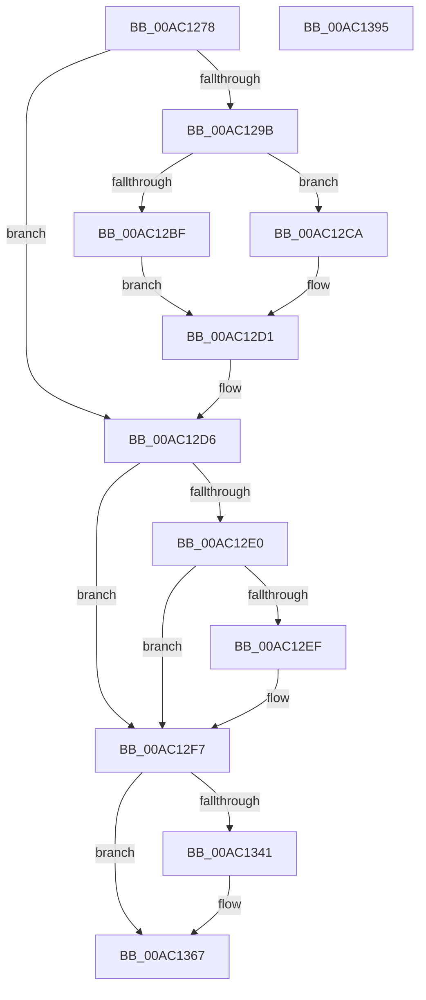

# PfpLogEventRequest

- RVA: `0x00AC1278`–`0x00AC1396` (길이 `286` bytes)
- VA: `0x0000000140AC1278`
- 실행 섹션: `PAGE`
- PDB 이름 있음: `예`; PDB Function 태그: `아니요`
- unwind 정보 RVA: `0x000794E0`
- 디코드: `80`개 명령, `286/286` bytes 표시
- 미해석 바이트: `0` (있으면 어셈블리에 `.byte`로 보존)

> 이 문서는 커널 이미지의 기계어와 PDB 기호를 분석해 생성했습니다. 4번과 5번은 함수 원형과 자료형을 바이너리 사용 방식에서 추정한 C 해석이며 원본 소스 복구 결과는 아닙니다.

## 1. Dependencies

- 직접 호출 지점: **6**; 고유 호출 대상: **6**
- 직접 호출자로 확인된 함수: **1**
- RIP 상대 이미지 참조: **2**

### Outgoing calls
- `0x00AC12CA` → [KeQueryHeteroCpuPolicyThread](../../text/48/KeQueryHeteroCpuPolicyThread_function_00488A70.md) (function, `0x00488A70`)
- `0x00AC12D1` → [PfTSetTracingPriority](../../pagelk/B6/PfTSetTracingPriority_function_00B6BA6C.md) (function, `0x00B6BA6C`)
- `0x00AC1344` → [CsanRead64NoCheck](../../text/4C/CsanRead64NoCheck_function_004C82C0.md) (function, `0x004C82C0`)
- `0x00AC1358` → [MmIssueMemoryListCommand](../7F/MmIssueMemoryListCommand_function_007FE8B0.md) (function, `0x007FE8B0`)
- `0x00AC1362` → [PfGenerateTrace](../75/PfGenerateTrace_function_0075101C.md) (function, `0x0075101C`)
- `0x00AC1380` → [PfLogEvent](../../text/34/PfLogEvent_function_00349BA8.md) (function, `0x00349BA8`)

### Direct callers
- [PfSetSuperfetchInformation](../AD/PfSetSuperfetchInformation_function_00ADE6E8.md) at `0x00ADEC76`

### Static image references
- `0x00AC12EF` → RVA `0x00F0F22C` (`.data`; read/write)
- `0x00AC1335` → RVA `0x00E670CC` (`.data`; read)

## 2. Other-region calls and transfers

- 다른 실행 섹션으로 향하는 call: **4**
  - `0x00AC12CA` → [KeQueryHeteroCpuPolicyThread](../../text/48/KeQueryHeteroCpuPolicyThread_function_00488A70.md) (`PAGE` → `.text`)
  - `0x00AC12D1` → [PfTSetTracingPriority](../../pagelk/B6/PfTSetTracingPriority_function_00B6BA6C.md) (`PAGE` → `PAGELK`)
  - `0x00AC1344` → [CsanRead64NoCheck](../../text/4C/CsanRead64NoCheck_function_004C82C0.md) (`PAGE` → `.text`)
  - `0x00AC1380` → [PfLogEvent](../../text/34/PfLogEvent_function_00349BA8.md) (`PAGE` → `.text`)
- 별도 외부 분기/꼬리 이동을 확인하지 못했습니다.

## 3. Assembly (complete function range)

```asm
00AC1278  48 89 5C 24 08                  mov qword ptr [rsp + 8], rbx
00AC127D  48 89 74 24 10                  mov qword ptr [rsp + 0x10], rsi
00AC1282  57                              push rdi
00AC1283  48 83 EC 30                     sub rsp, 0x30
00AC1287  8B 42 04                        mov eax, dword ptr [rdx + 4]
00AC128A  48 8B DA                        mov rbx, rdx
00AC128D  83 E0 1F                        and eax, 0x1f
00AC1290  48 8B F9                        mov rdi, rcx
00AC1293  83 E8 02                        sub eax, 2
00AC1296  83 F8 01                        cmp eax, 1
00AC1299  77 3B                           ja 0x140ac12d6
00AC129B  48 8B 52 10                     mov rdx, qword ptr [rdx + 0x10]
00AC129F  0F 10 81 B0 02 00 00            movups xmm0, xmmword ptr [rcx + 0x2b0]
00AC12A6  0F 11 02                        movups xmmword ptr [rdx], xmm0
00AC12A9  F2 0F 10 89 C0 02 00 00         movsd xmm1, qword ptr [rcx + 0x2c0]
00AC12B1  F2 0F 11 4A 10                  movsd qword ptr [rdx + 0x10], xmm1
00AC12B6  8B 43 04                        mov eax, dword ptr [rbx + 4]
00AC12B9  24 1F                           and al, 0x1f
00AC12BB  3C 02                           cmp al, 2
00AC12BD  75 0B                           jne 0x140ac12ca
00AC12BF  8B 52 18                        mov edx, dword ptr [rdx + 0x18]
00AC12C2  C1 EA 05                        shr edx, 5
00AC12C5  83 E2 07                        and edx, 7
00AC12C8  EB 07                           jmp 0x140ac12d1
00AC12CA  E8 A1 77 9C FF                  call 0x140488a70
00AC12CF  8B D0                           mov edx, eax
00AC12D1  E8 96 A7 0A 00                  call 0x140b6ba6c
00AC12D6  8B 43 04                        mov eax, dword ptr [rbx + 4]
00AC12D9  83 E0 1F                        and eax, 0x1f
00AC12DC  3C 1B                           cmp al, 0x1b
00AC12DE  75 17                           jne 0x140ac12f7
00AC12E0  48 8B 43 10                     mov rax, qword ptr [rbx + 0x10]
00AC12E4  8B 48 08                        mov ecx, dword ptr [rax + 8]
00AC12E7  80 E1 03                        and cl, 3
00AC12EA  80 F9 01                        cmp cl, 1
00AC12ED  75 08                           jne 0x140ac12f7
00AC12EF  F0 83 25 35 DF 44 00 FE         lock and dword ptr [rip + 0x44df35], 0xfffffffe
00AC12F7  48 B8 20 03 00 00 80 F7 FF FF   movabs rax, 0xfffff78000000320
00AC1301  48 B9 04 00 00 00 80 F7 FF FF   movabs rcx, 0xfffff78000000004
00AC130B  48 8B 00                        mov rax, qword ptr [rax]
00AC130E  8B 09                           mov ecx, dword ptr [rcx]
00AC1310  44 8B 4B 04                     mov r9d, dword ptr [rbx + 4]
00AC1314  8B F0                           mov esi, eax
00AC1316  48 0F AF F1                     imul rsi, rcx
00AC131A  48 C1 E8 20                     shr rax, 0x20
00AC131E  48 C1 EE 18                     shr rsi, 0x18
00AC1322  48 0F AF C1                     imul rax, rcx
00AC1326  41 C1 E9 05                     shr r9d, 5
00AC132A  48 C1 E0 08                     shl rax, 8
00AC132E  48 03 F0                        add rsi, rax
00AC1331  48 C1 EE 0A                     shr rsi, 0xa
00AC1335  03 35 91 5D 3A 00               add esi, dword ptr [rip + 0x3a5d91]
00AC133B  41 F6 C1 01                     test r9b, 1
00AC133F  74 26                           je 0x140ac1367
00AC1341  48 8B CF                        mov rcx, rdi
00AC1344  E8 77 6F A0 FF                  call 0x1404c82c0
00AC1349  41 D1 E9                        shr r9d, 1
00AC134C  4C 8B C0                        mov r8, rax
00AC134F  41 83 E1 01                     and r9d, 1
00AC1353  33 D2                           xor edx, edx
00AC1355  41 8B C9                        mov ecx, r9d
00AC1358  E8 53 D5 D3 FF                  call 0x1407fe8b0
00AC135D  33 D2                           xor edx, edx
00AC135F  48 8B CF                        mov rcx, rdi
00AC1362  E8 B5 FC C8 FF                  call 0x14075101c
00AC1367  8B 53 04                        mov edx, dword ptr [rbx + 4]
00AC136A  44 8B C6                        mov r8d, esi
00AC136D  4C 8B 4B 10                     mov r9, qword ptr [rbx + 0x10]
00AC1371  8B C2                           mov eax, edx
00AC1373  C1 E8 07                        shr eax, 7
00AC1376  83 E2 1F                        and edx, 0x1f
00AC1379  48 8B CF                        mov rcx, rdi
00AC137C  89 44 24 20                     mov dword ptr [rsp + 0x20], eax
00AC1380  E8 23 88 88 FF                  call 0x140349ba8
00AC1385  48 8B 5C 24 40                  mov rbx, qword ptr [rsp + 0x40]
00AC138A  48 8B 74 24 48                  mov rsi, qword ptr [rsp + 0x48]
00AC138F  48 83 C4 30                     add rsp, 0x30
00AC1393  5F                              pop rdi
00AC1394  C3                              ret
00AC1395  CC                              int3
```

## 4. C-style interpretation (structured pseudocode)

```c
__int64 __fastcall PfpLogEventRequest(__int64 a1, __int64 a2)
{
    __int64 result;
    __int64 v_rsi;
    __int64 v_rsp;
    unsigned int v_stack_m18;
    unsigned __int64 v_stack_p10;
    unsigned __int64 v_stack_p8;

    v_stack_p8 = v_rbx;
    v_stack_p10 = v_rsi;
    v_rsp = (v_rsp) - (48);
    result = (unsigned int)(((unsigned int)(*(unsigned int *)(a2 + 4))) & (31));
    result = (unsigned int)((result) - (2));
    if (((unsigned int)(result)) > 1) goto loc_00AC12D6;
    *(unsigned __int64 *)(*(unsigned __int64 *)(a2 + 16)) = v_xmm0;
    *(unsigned __int64 *)(*(unsigned __int64 *)(a2 + 16) + 16) = v_xmm1;
    result = (unsigned __int8)(((unsigned int)(*(unsigned int *)(a2 + 4))) & (31));
    if (((unsigned __int8)(result)) != 2) goto loc_00AC12CA;
    a2 = (unsigned int)(((unsigned int)(*(unsigned int *)(*(unsigned __int64 *)(a2 + 16) + 24))) >> (5));
    a2 = (unsigned int)((a2) & (7));
    goto loc_00AC12D1;
loc_00AC12CA:
    result = KeQueryHeteroCpuPolicyThread(a1, a2, a3, a4);
loc_00AC12D1:
    result = PfTSetTracingPriority(a1, (unsigned int)((unsigned int)(result)), a3, a4);
loc_00AC12D6:
    result = (unsigned int)(((unsigned int)(*(unsigned int *)(a2 + 4))) & (31));
    if (((unsigned __int8)(result)) != 27) goto loc_00AC12F7;
    a1 = (unsigned __int8)(((unsigned int)(*(unsigned int *)(*(unsigned __int64 *)(a2 + 16) + 8))) & (3));
    if (((unsigned __int8)(a1)) == 1) {
    }
    v_rsi = ((unsigned int)((unsigned int)(*(unsigned __int64 *)(*(unsigned __int64 *)(a2 + 16))))) * ((unsigned int)(*(unsigned int *)(a1)));
    result = (*(unsigned __int64 *)(*(unsigned __int64 *)(a2 + 16))) >> (32);
    v_rsi = (v_rsi) >> (24);
    result = (result) * ((unsigned int)(*(unsigned int *)(a1)));
    a4 = (unsigned int)(((unsigned int)(*(unsigned int *)(a2 + 4))) >> (5));
    result = (result) << (8);
    v_rsi = (v_rsi) + (result);
    v_rsi = (v_rsi) >> (10);
    v_rsi = (unsigned int)((v_rsi) + (*(unsigned int *)(v_rip + 3825041)));
    if ((((unsigned __int8)(a4)) & (1)) != 0) {
        a1 = a1;
        result = CsanRead64NoCheck(a1, (unsigned int)((unsigned int)(result)), a3, a4);
        a4 = (unsigned int)((a4) >> (1));
        a3 = result;
        a4 = (unsigned int)((a4) & (1));
        a2 = 0;
        a1 = (unsigned int)(a4);
        result = MmIssueMemoryListCommand(a1, a2, a3, a4);
        a2 = 0;
        a1 = a1;
        result = PfGenerateTrace(a1, a2, a3, a4);
    }
    result = (unsigned int)(((unsigned int)((unsigned int)((unsigned int)(*(unsigned int *)(a2 + 4))))) >> (7));
    a2 = (unsigned int)(((unsigned int)(*(unsigned int *)(a2 + 4))) & (31));
    v_stack_m18 = (unsigned int)(result);
    result = PfLogEvent(a1, a2, (unsigned int)((unsigned int)(v_rsi)), *(unsigned __int64 *)(a2 + 16));
    v_rsp = (v_rsp) + (48);
    return result;
}
```

## 5. (Beta) C Style

```c
int64_t PfpLogEventRequest(void *Arg1, void *Arg2)
{
    uint8_t *arg1 = (uint8_t *)Arg1;
    uint8_t *arg2 = (uint8_t *)Arg2;

    int64_t result;
    int64_t local_rsi;
    int64_t local_rsp;
    uint32_t v_stack_m18;
    uint64_t v_stack_p10;
    uint64_t v_stack_p8;

    v_stack_p8 = local_rbx;
    v_stack_p10 = local_rsi;
    local_rsp = (local_rsp) - (48);
    result = (uint32_t)(((uint32_t)(*(uint32_t *)(arg2 + 0x4))) & (31));
    result = (uint32_t)((result) - (2));
    if (((uint32_t)(result)) > 1) goto loc_00AC12D6;
    *(uint64_t *)(*(uint64_t *)(arg2 + 0x10)) = v_xmm0;
    *(uint64_t *)(*(uint64_t *)(arg2 + 0x10) + 0x10) = v_xmm1;
    result = (uint8_t)(((uint32_t)(*(uint32_t *)(arg2 + 0x4))) & (31));
    if (((uint8_t)(result)) != 2) goto loc_00AC12CA;
    Arg2 = (uint32_t)(((uint32_t)(*(uint32_t *)(*(uint64_t *)(arg2 + 0x10) + 0x18))) >> (5));
    Arg2 = (uint32_t)((Arg2) & (7));
    goto loc_00AC12D1;
loc_00AC12CA:
    result = KeQueryHeteroCpuPolicyThread(Arg1, Arg2, a3, a4);
loc_00AC12D1:
    result = PfTSetTracingPriority(Arg1, (uint32_t)((uint32_t)(result)), a3, a4);
loc_00AC12D6:
    result = (uint32_t)(((uint32_t)(*(uint32_t *)(arg2 + 0x4))) & (31));
    if (((uint8_t)(result)) != 27) goto loc_00AC12F7;
    Arg1 = (uint8_t)(((uint32_t)(*(uint32_t *)(*(uint64_t *)(arg2 + 0x10) + 0x8))) & (3));
    if (((uint8_t)(Arg1)) == 1) {
    }
    local_rsi = ((uint32_t)((uint32_t)(*(uint64_t *)(*(uint64_t *)(arg2 + 0x10))))) * ((uint32_t)(*(uint32_t *)(arg1)));
    result = (*(uint64_t *)(*(uint64_t *)(arg2 + 0x10))) >> (32);
    local_rsi = (local_rsi) >> (24);
    result = (result) * ((uint32_t)(*(uint32_t *)(arg1)));
    a4 = (uint32_t)(((uint32_t)(*(uint32_t *)(arg2 + 0x4))) >> (5));
    result = (result) << (8);
    local_rsi = (local_rsi) + (result);
    local_rsi = (local_rsi) >> (10);
    local_rsi = (uint32_t)((local_rsi) + (*(uint32_t *)(v_rip + 0x3A5D91)));
    if ((((uint8_t)(a4)) & (1)) != 0) {
        Arg1 = Arg1;
        result = CsanRead64NoCheck(Arg1, (uint32_t)((uint32_t)(result)), a3, a4);
        a4 = (uint32_t)((a4) >> (1));
        a3 = result;
        a4 = (uint32_t)((a4) & (1));
        Arg2 = 0;
        Arg1 = (uint32_t)(a4);
        result = MmIssueMemoryListCommand(Arg1, Arg2, a3, a4);
        Arg2 = 0;
        Arg1 = Arg1;
        result = PfGenerateTrace(Arg1, Arg2, a3, a4);
    }
    result = (uint32_t)(((uint32_t)((uint32_t)((uint32_t)(*(uint32_t *)(arg2 + 0x4))))) >> (7));
    Arg2 = (uint32_t)(((uint32_t)(*(uint32_t *)(arg2 + 0x4))) & (31));
    v_stack_m18 = (uint32_t)(result);
    result = PfLogEvent(Arg1, Arg2, (uint32_t)((uint32_t)(local_rsi)), *(uint64_t *)(arg2 + 0x10));
    local_rsp = (local_rsp) + (48);
    return result;
}
```

### 관측된 메모리 오프셋

구조체 형식이 확인되지 않은 접근은 인자 기준의 오프셋으로만 기록했습니다.

| 기준 인자 | 오프셋 표현 | 폭 (bit) | 접근 |
|---|---:|---:|---|
| `Arg1` | `+ 0x2B0` | `128` | `R` |
| `Arg1` | `+ 0x2C0` | `64` | `R` |
| `Arg2` | `+ 0x4` | `32` | `R` |
| `Arg2` | `+ 0x10` | `64` | `R` |

## 6. Execution-region graph

[열기: 2D/3D 그래프와 함수 탐색 컨트롤 패널](../../../control-panel.html?section=page&rva=0x00AC1278&view=graph)

- 2D 그래프는 위에서 아래로 흐르고, 3D 그래프는 빈 공간을 드래그해 회전합니다. Shift+드래그는 이동, 휠은 확대·축소, 함수 노드 선택은 대상 보고서 이동입니다.

### Static fallback


