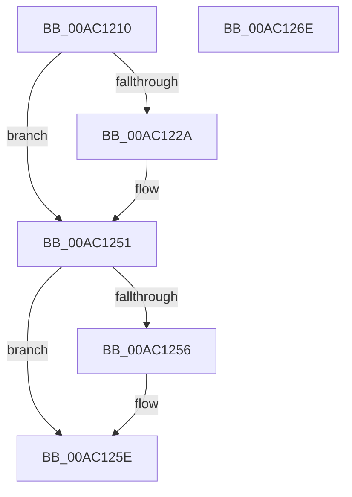

# PfpPrefetchSharedConflictNotifyEnd

- RVA: `0x00AC1210`–`0x00AC126F` (길이 `95` bytes)
- VA: `0x0000000140AC1210`
- 실행 섹션: `PAGE`
- PDB 이름 있음: `예`; PDB Function 태그: `아니요`
- unwind 정보 RVA: `0x00060BC4`
- 디코드: `28`개 명령, `95/95` bytes 표시
- 미해석 바이트: `0` (있으면 어셈블리에 `.byte`로 보존)

> 이 문서는 커널 이미지의 기계어와 PDB 기호를 분석해 생성했습니다. 4번과 5번은 함수 원형과 자료형을 바이너리 사용 방식에서 추정한 C 해석이며 원본 소스 복구 결과는 아닙니다.

## 1. Dependencies

- 직접 호출 지점: **3**; 고유 호출 대상: **3**
- 직접 호출자로 확인된 함수: **0**
- RIP 상대 이미지 참조: **1**

### Outgoing calls
- `0x00AC1241` → [KeAbPreAcquire](../../text/21/KeAbPreAcquire_function_00210230.md) (function, `0x00210230`)
- `0x00AC124C` → [KeAbPostReleaseEx](../../text/26/KeAbPostReleaseEx_function_00262210.md) (function, `0x00262210`)
- `0x00AC1259` → [PfpPrefetchSharedDeref](../93/PfpPrefetchSharedDeref_function_00939E78.md) (function, `0x00939E78`)

### Direct callers
- 이 함수 시작 RVA로 연결되는 직접 call은 확인되지 않았습니다. 간접 호출은 완전히 역산할 수 없습니다.

### Static image references
- `0x00AC122D` → RVA `0x00E66EB0` (`.data`; read)

## 2. Other-region calls and transfers

- 다른 실행 섹션으로 향하는 call: **2**
  - `0x00AC1241` → [KeAbPreAcquire](../../text/21/KeAbPreAcquire_function_00210230.md) (`PAGE` → `.text`)
  - `0x00AC124C` → [KeAbPostReleaseEx](../../text/26/KeAbPostReleaseEx_function_00262210.md) (`PAGE` → `.text`)
- 별도 외부 분기/꼬리 이동을 확인하지 못했습니다.

## 3. Assembly (complete function range)

```asm
00AC1210  48 89 5C 24 08                  mov qword ptr [rsp + 8], rbx
00AC1215  48 89 74 24 10                  mov qword ptr [rsp + 0x10], rsi
00AC121A  57                              push rdi
00AC121B  48 83 EC 20                     sub rsp, 0x20
00AC121F  48 8B F2                        mov rsi, rdx
00AC1222  48 8B F9                        mov rdi, rcx
00AC1225  48 85 D2                        test rdx, rdx
00AC1228  74 27                           je 0x140ac1251
00AC122A  48 85 C9                        test rcx, rcx
00AC122D  48 8D 05 7C 5C 3A 00            lea rax, [rip + 0x3a5c7c]
00AC1234  48 8B D9                        mov rbx, rcx
00AC1237  48 0F 44 D8                     cmove rbx, rax
00AC123B  45 33 C0                        xor r8d, r8d
00AC123E  48 8B CB                        mov rcx, rbx
00AC1241  E8 EA EF 74 FF                  call 0x140210230
00AC1246  48 8B D6                        mov rdx, rsi
00AC1249  48 8B CB                        mov rcx, rbx
00AC124C  E8 BF 0F 7A FF                  call 0x140262210
00AC1251  48 85 FF                        test rdi, rdi
00AC1254  74 08                           je 0x140ac125e
00AC1256  48 8B CF                        mov rcx, rdi
00AC1259  E8 1A 8C E7 FF                  call 0x140939e78
00AC125E  48 8B 5C 24 30                  mov rbx, qword ptr [rsp + 0x30]
00AC1263  48 8B 74 24 38                  mov rsi, qword ptr [rsp + 0x38]
00AC1268  48 83 C4 20                     add rsp, 0x20
00AC126C  5F                              pop rdi
00AC126D  C3                              ret
00AC126E  CC                              int3
```

## 4. C-style interpretation (structured pseudocode)

```c
__int64 __fastcall PfpPrefetchSharedConflictNotifyEnd(__int64 a1, __int64 a2, int a3)
{
    __int64 result;
    __int64 v_rbx;
    __int64 v_rsp;
    unsigned __int64 v_stack_p10;
    unsigned __int64 v_stack_p8;

    v_stack_p8 = v_rbx;
    v_stack_p10 = v_rsi;
    v_rsp = (v_rsp) - (32);
    if (a2 != 0) {
        result = v_rip + 3824764;
        v_rbx = a1;
        if (a1 == 0) { v_rbx = result; }
        a3 = 0;
        a1 = v_rbx;
        result = KeAbPreAcquire(a1, a2, a3, a4);
        a2 = a2;
        a1 = v_rbx;
        result = KeAbPostReleaseEx(a1, a2, a3, a4);
    }
    if (a1 != 0) {
        a1 = a1;
        result = PfpPrefetchSharedDeref(a1, a2, a3, a4);
    }
    v_rsp = (v_rsp) + (32);
    return result;
}
```

## 5. (Beta) C Style

```c
int64_t PfpPrefetchSharedConflictNotifyEnd(int64_t Arg1, int64_t Arg2, int32_t Arg3)
{
    int64_t result;
    int64_t local_rbx;
    int64_t local_rsp;
    uint64_t v_stack_p10;
    uint64_t v_stack_p8;

    v_stack_p8 = local_rbx;
    v_stack_p10 = local_rsi;
    local_rsp = (local_rsp) - (32);
    if (Arg2 != 0) {
        result = v_rip + 3824764;
        local_rbx = Arg1;
        if (Arg1 == 0) { local_rbx = result; }
        Arg3 = 0;
        Arg1 = local_rbx;
        result = KeAbPreAcquire(Arg1, Arg2, Arg3, a4);
        Arg2 = Arg2;
        Arg1 = local_rbx;
        result = KeAbPostReleaseEx(Arg1, Arg2, Arg3, a4);
    }
    if (Arg1 != 0) {
        Arg1 = Arg1;
        result = PfpPrefetchSharedDeref(Arg1, Arg2, Arg3, a4);
    }
    local_rsp = (local_rsp) + (32);
    return result;
}
```

## 6. Execution-region graph

[열기: 2D/3D 그래프와 함수 탐색 컨트롤 패널](../../../control-panel.html?section=page&rva=0x00AC1210&view=graph)

- 2D 그래프는 위에서 아래로 흐르고, 3D 그래프는 빈 공간을 드래그해 회전합니다. Shift+드래그는 이동, 휠은 확대·축소, 함수 노드 선택은 대상 보고서 이동입니다.

### Static fallback


