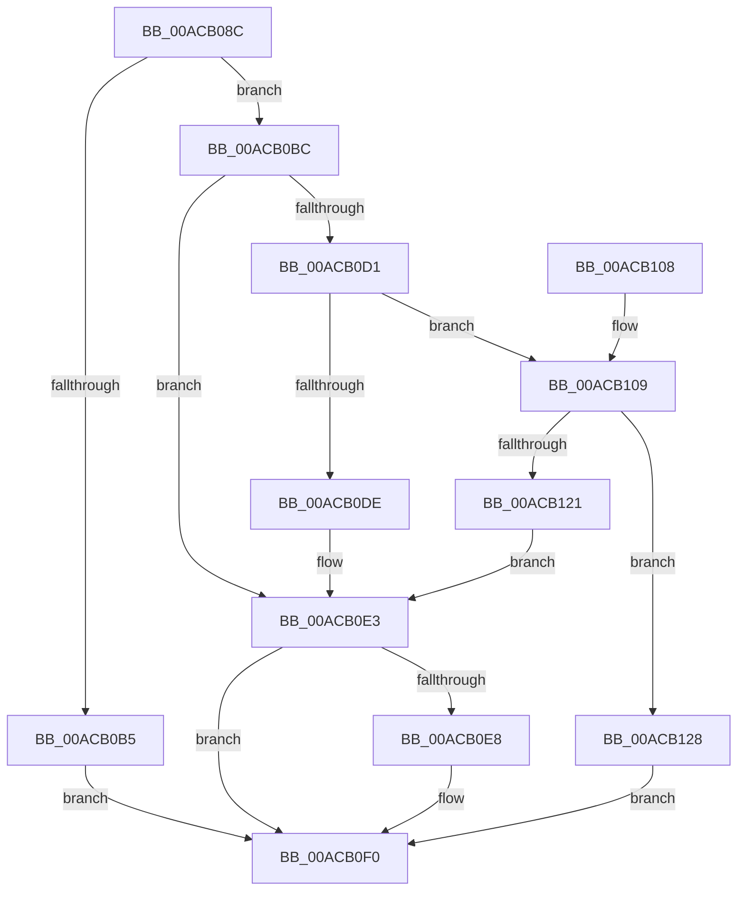

# PfpServiceMainThreadBoostPrep

- RVA: `0x00ACB08C`–`0x00ACB133` (길이 `167` bytes)
- VA: `0x0000000140ACB08C`
- 실행 섹션: `PAGE`
- PDB 이름 있음: `예`; PDB Function 태그: `아니요`
- unwind 정보 RVA: `0x000BE444`
- 디코드: `48`개 명령, `167/167` bytes 표시
- 미해석 바이트: `0` (있으면 어셈블리에 `.byte`로 보존)

> 이 문서는 커널 이미지의 기계어와 PDB 기호를 분석해 생성했습니다. 4번과 5번은 함수 원형과 자료형을 바이너리 사용 방식에서 추정한 C 해석이며 원본 소스 복구 결과는 아닙니다.

## 1. Dependencies

- 직접 호출 지점: **3**; 고유 호출 대상: **3**
- 직접 호출자로 확인된 함수: **1**
- RIP 상대 이미지 참조: **0**

### Outgoing calls
- `0x00ACB0C1` → [PsLookupThreadByThreadId](../86/PsLookupThreadByThreadId_function_00868300.md) (function, `0x00868300`)
- `0x00ACB0EB` → [ObDereferenceObjectDeferDelete](../../text/3F/ObDereferenceObjectDeferDelete_function_003FCE40.md) (function, `0x003FCE40`)
- `0x00ACB117` → [ExAllocatePool2](../../poolcode/B8/ExAllocatePool2_function_00B820F0.md) (function, `0x00B820F0`)

### Direct callers
- [PfpScenCtxScenarioSet](../../pagelk/B7/PfpScenCtxScenarioSet_function_00B7CFF0.md) at `0x00B7D036`

### Static image references
- 디코드된 RIP-relative 메모리 참조가 없습니다.

## 2. Other-region calls and transfers

- 다른 실행 섹션으로 향하는 call: **2**
  - `0x00ACB0EB` → [ObDereferenceObjectDeferDelete](../../text/3F/ObDereferenceObjectDeferDelete_function_003FCE40.md) (`PAGE` → `.text`)
  - `0x00ACB117` → [ExAllocatePool2](../../poolcode/B8/ExAllocatePool2_function_00B820F0.md) (`PAGE` → `POOLCODE`)
- 별도 외부 분기/꼬리 이동을 확인하지 못했습니다.

## 3. Assembly (complete function range)

```asm
00ACB08C  48 8B C4                        mov rax, rsp
00ACB08F  48 89 58 10                     mov qword ptr [rax + 0x10], rbx
00ACB093  48 89 70 18                     mov qword ptr [rax + 0x18], rsi
00ACB097  48 89 78 20                     mov qword ptr [rax + 0x20], rdi
00ACB09B  41 56                           push r14
00ACB09D  48 83 EC 20                     sub rsp, 0x20
00ACB0A1  48 83 60 08 00                  and qword ptr [rax + 8], 0
00ACB0A6  48 8B F1                        mov rsi, rcx
00ACB0A9  48 8B 49 48                     mov rcx, qword ptr [rcx + 0x48]
00ACB0AD  4C 8B F2                        mov r14, rdx
00ACB0B0  48 85 C9                        test rcx, rcx
00ACB0B3  75 07                           jne 0x140acb0bc
00ACB0B5  BB 22 00 00 80                  mov ebx, 0x80000022
00ACB0BA  EB 34                           jmp 0x140acb0f0
00ACB0BC  48 8D 54 24 30                  lea rdx, [rsp + 0x30]
00ACB0C1  E8 3A D2 D9 FF                  call 0x140868300
00ACB0C6  48 8B 7C 24 30                  mov rdi, qword ptr [rsp + 0x30]
00ACB0CB  8B D8                           mov ebx, eax
00ACB0CD  85 C0                           test eax, eax
00ACB0CF  78 12                           js 0x140acb0e3
00ACB0D1  48 8B 46 50                     mov rax, qword ptr [rsi + 0x50]
00ACB0D5  48 39 87 C0 04 00 00            cmp qword ptr [rdi + 0x4c0], rax
00ACB0DC  74 2B                           je 0x140acb109
00ACB0DE  BB 59 00 00 C0                  mov ebx, 0xc0000059
00ACB0E3  48 85 FF                        test rdi, rdi
00ACB0E6  74 08                           je 0x140acb0f0
00ACB0E8  48 8B CF                        mov rcx, rdi
00ACB0EB  E8 50 1D 93 FF                  call 0x1403fce40
00ACB0F0  48 8B 74 24 40                  mov rsi, qword ptr [rsp + 0x40]
00ACB0F5  8B C3                           mov eax, ebx
00ACB0F7  48 8B 5C 24 38                  mov rbx, qword ptr [rsp + 0x38]
00ACB0FC  48 8B 7C 24 48                  mov rdi, qword ptr [rsp + 0x48]
00ACB101  48 83 C4 20                     add rsp, 0x20
00ACB105  41 5E                           pop r14
00ACB107  C3                              ret
00ACB108  CC                              int3
00ACB109  BA A8 00 00 00                  mov edx, 0xa8
00ACB10E  41 B8 50 66 50 44               mov r8d, 0x44506650
00ACB114  8D 4A 98                        lea ecx, [rdx - 0x68]
00ACB117  E8 D4 6F 0B 00                  call 0x140b820f0
00ACB11C  48 85 C0                        test rax, rax
00ACB11F  75 07                           jne 0x140acb128
00ACB121  BB 9A 00 00 C0                  mov ebx, 0xc000009a
00ACB126  EB BB                           jmp 0x140acb0e3
00ACB128  49 89 3E                        mov qword ptr [r14], rdi
00ACB12B  33 DB                           xor ebx, ebx
00ACB12D  49 89 46 08                     mov qword ptr [r14 + 8], rax
00ACB131  EB BD                           jmp 0x140acb0f0
```

## 4. C-style interpretation (structured pseudocode)

```c
__int64 __fastcall PfpServiceMainThreadBoostPrep(__int64 a1, __int64 a2)
{
    __int64 result;
    __int64 v_rbx;
    __int64 v_rsp;
    unsigned __int64 v_stack_p10;
    unsigned __int64 v_stack_p18;
    unsigned __int64 v_stack_p20;
    unsigned __int64 v_stack_p8;

    *(unsigned __int64 *)(v_rsp + 16) = v_rbx;
    *(unsigned __int64 *)(v_rsp + 24) = v_rsi;
    *(unsigned __int64 *)(v_rsp + 32) = v_rdi;
    v_rsp = (v_rsp) - (32);
    if (*(unsigned __int64 *)(a1 + 72) != 0) goto loc_00ACB0BC;
    goto loc_00ACB0F0;
loc_00ACB0BC:
    result = PsLookupThreadByThreadId(*(unsigned __int64 *)(a1 + 72), v_stack_p8, a3, a4);
    if (sign_flag) goto loc_00ACB0E3;
    if ((*(unsigned __int64 *)(v_stack_p8 + 1216)) == (*(unsigned __int64 *)(a1 + 80))) goto loc_00ACB109;
loc_00ACB0E3:
    result = *(unsigned __int64 *)(a1 + 80);
    if (v_stack_p8 != 0) {
        a1 = v_stack_p8;
        result = ObDereferenceObjectDeferDelete(a1, v_stack_p8, a3, a4);
    }
    v_rsp = (v_rsp) + (32);
    return (unsigned int)((unsigned int)((unsigned int)(0xC0000059ULL)));
loc_00ACB109:
    result = ExAllocatePool2(168 - 104, 168, (unsigned int)(0x44506650ULL), a4);
    if (result != 0) goto loc_00ACB128;
    goto loc_00ACB0E3;
loc_00ACB128:
    *(unsigned __int64 *)(a2) = v_stack_p20;
    v_rbx = 0;
    *(unsigned __int64 *)(a2 + 8) = result;
    goto loc_00ACB0F0;
}
```

## 5. (Beta) C Style

```c
int64_t PfpServiceMainThreadBoostPrep(void *Arg1, void *Arg2)
{
    uint8_t *arg1 = (uint8_t *)Arg1;
    uint8_t *arg2 = (uint8_t *)Arg2;

    int64_t result;
    int64_t local_rbx;
    int64_t local_rsp;
    uint64_t v_stack_p10;
    uint64_t v_stack_p18;
    uint64_t v_stack_p20;
    uint64_t v_stack_p8;

    *(uint64_t *)(local_rsp + 0x10) = local_rbx;
    *(uint64_t *)(local_rsp + 0x18) = local_rsi;
    *(uint64_t *)(local_rsp + 0x20) = local_rdi;
    local_rsp = (local_rsp) - (32);
    if (*(uint64_t *)(arg1 + 0x48) != 0) goto loc_00ACB0BC;
    goto loc_00ACB0F0;
loc_00ACB0BC:
    result = PsLookupThreadByThreadId(*(uint64_t *)(arg1 + 0x48), v_stack_p8, a3, a4);
    if (sign_flag) goto loc_00ACB0E3;
    if ((*(uint64_t *)(v_stack_p8 + 0x4C0)) == (*(uint64_t *)(arg1 + 0x50))) goto loc_00ACB109;
loc_00ACB0E3:
    result = *(uint64_t *)(arg1 + 0x50);
    if (v_stack_p8 != 0) {
        Arg1 = v_stack_p8;
        result = ObDereferenceObjectDeferDelete(Arg1, v_stack_p8, a3, a4);
    }
    local_rsp = (local_rsp) + (32);
    return (uint32_t)((uint32_t)((uint32_t)(0xC0000059ULL)));
loc_00ACB109:
    result = ExAllocatePool2(168 - 104, 168, (uint32_t)(0x44506650ULL), a4);
    if (result != 0) goto loc_00ACB128;
    goto loc_00ACB0E3;
loc_00ACB128:
    *(uint64_t *)(arg2) = v_stack_p20;
    local_rbx = 0;
    *(uint64_t *)(arg2 + 0x8) = result;
    goto loc_00ACB0F0;
}
```

### 관측된 메모리 오프셋

구조체 형식이 확인되지 않은 접근은 인자 기준의 오프셋으로만 기록했습니다.

| 기준 인자 | 오프셋 표현 | 폭 (bit) | 접근 |
|---|---:|---:|---|
| `Arg1` | `+ 0x48` | `64` | `R` |
| `Arg1` | `+ 0x50` | `64` | `R` |
| `Arg2` | `+ 0x0` | `64` | `W` |
| `Arg2` | `+ 0x8` | `64` | `W` |

## 6. Execution-region graph

[열기: 2D/3D 그래프와 함수 탐색 컨트롤 패널](../../../control-panel.html?section=page&rva=0x00ACB08C&view=graph)

- 2D 그래프는 위에서 아래로 흐르고, 3D 그래프는 빈 공간을 드래그해 회전합니다. Shift+드래그는 이동, 휠은 확대·축소, 함수 노드 선택은 대상 보고서 이동입니다.

### Static fallback


