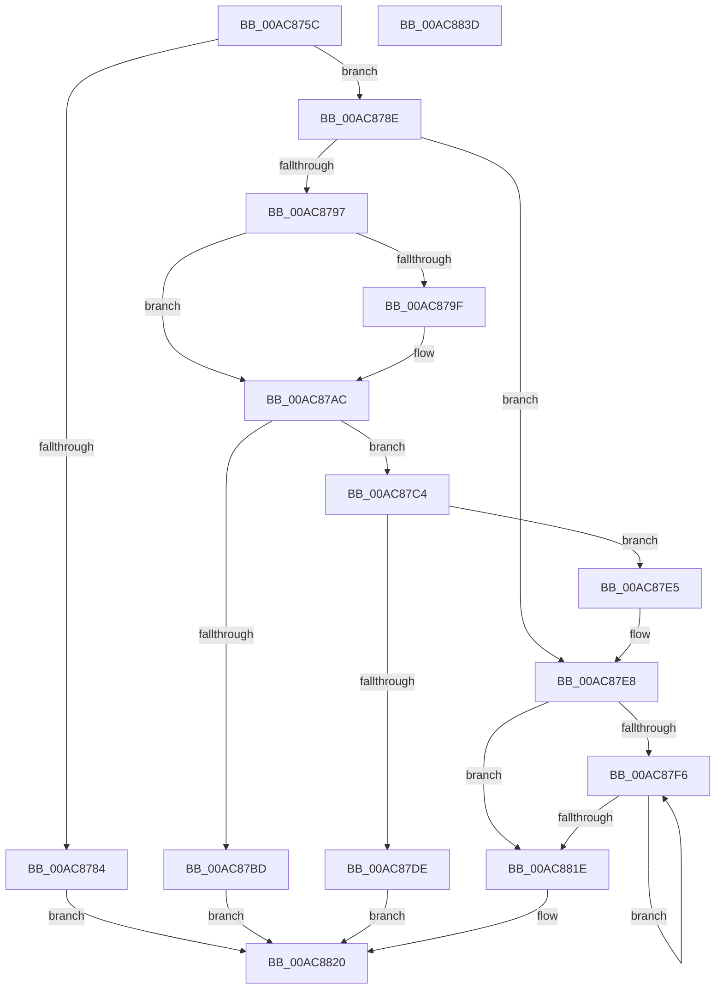

# PfpSourceBuildVaArray

- RVA: `0x00AC875C`–`0x00AC883E` (길이 `226` bytes)
- VA: `0x0000000140AC875C`
- 실행 섹션: `PAGE`
- PDB 이름 있음: `예`; PDB Function 태그: `아니요`
- unwind 정보 RVA: `0x0005E6B4`
- 디코드: `69`개 명령, `226/226` bytes 표시
- 미해석 바이트: `0` (있으면 어셈블리에 `.byte`로 보존)

> 이 문서는 커널 이미지의 기계어와 PDB 기호를 분석해 생성했습니다. 4번과 5번은 함수 원형과 자료형을 바이너리 사용 방식에서 추정한 C 해석이며 원본 소스 복구 결과는 아닙니다.

## 1. Dependencies

- 직접 호출 지점: **2**; 고유 호출 대상: **2**
- 직접 호출자로 확인된 함수: **1**
- RIP 상대 이미지 참조: **0**

### Outgoing calls
- `0x00AC87A1` → [ExFreePoolWithTag](../../poolcode/B8/ExFreePoolWithTag_function_00B82870.md) (function, `0x00B82870`)
- `0x00AC87D1` → [ExAllocatePool2](../../poolcode/B8/ExAllocatePool2_function_00B820F0.md) (function, `0x00B820F0`)

### Direct callers
- [PfpPrefetchPrivatePages](../93/PfpPrefetchPrivatePages_function_0093A7FC.md) at `0x0093A93B`

### Static image references
- 디코드된 RIP-relative 메모리 참조가 없습니다.

## 2. Other-region calls and transfers

- 다른 실행 섹션으로 향하는 call: **2**
  - `0x00AC87A1` → [ExFreePoolWithTag](../../poolcode/B8/ExFreePoolWithTag_function_00B82870.md) (`PAGE` → `POOLCODE`)
  - `0x00AC87D1` → [ExAllocatePool2](../../poolcode/B8/ExAllocatePool2_function_00B820F0.md) (`PAGE` → `POOLCODE`)
- 별도 외부 분기/꼬리 이동을 확인하지 못했습니다.

## 3. Assembly (complete function range)

```asm
00AC875C  48 8B C4                        mov rax, rsp
00AC875F  48 89 58 08                     mov qword ptr [rax + 8], rbx
00AC8763  48 89 68 10                     mov qword ptr [rax + 0x10], rbp
00AC8767  48 89 70 18                     mov qword ptr [rax + 0x18], rsi
00AC876B  48 89 78 20                     mov qword ptr [rax + 0x20], rdi
00AC876F  41 56                           push r14
00AC8771  48 83 EC 20                     sub rsp, 0x20
00AC8775  8B 69 18                        mov ebp, dword ptr [rcx + 0x18]
00AC8778  33 DB                           xor ebx, ebx
00AC877A  48 8B F2                        mov rsi, rdx
00AC877D  4C 8B F1                        mov r14, rcx
00AC8780  85 ED                           test ebp, ebp
00AC8782  75 0A                           jne 0x140ac878e
00AC8784  BB 25 02 00 C0                  mov ebx, 0xc0000225
00AC8789  E9 92 00 00 00                  jmp 0x140ac8820
00AC878E  48 8D 7A 08                     lea rdi, [rdx + 8]
00AC8792  39 6A 04                        cmp dword ptr [rdx + 4], ebp
00AC8795  73 51                           jae 0x140ac87e8
00AC8797  48 8B 0F                        mov rcx, qword ptr [rdi]
00AC879A  48 85 C9                        test rcx, rcx
00AC879D  74 0D                           je 0x140ac87ac
00AC879F  33 D2                           xor edx, edx
00AC87A1  E8 CA A0 0B 00                  call 0x140b82870
00AC87A6  48 89 1F                        mov qword ptr [rdi], rbx
00AC87A9  89 5E 04                        mov dword ptr [rsi + 4], ebx
00AC87AC  48 8B C5                        mov rax, rbp
00AC87AF  B9 FF FF FF FF                  mov ecx, 0xffffffff
00AC87B4  48 C1 E0 04                     shl rax, 4
00AC87B8  48 3B C1                        cmp rax, rcx
00AC87BB  76 07                           jbe 0x140ac87c4
00AC87BD  BB 95 00 00 C0                  mov ebx, 0xc0000095
00AC87C2  EB 5C                           jmp 0x140ac8820
00AC87C4  8B D0                           mov edx, eax
00AC87C6  B9 40 00 00 00                  mov ecx, 0x40
00AC87CB  41 B8 50 66 56 41               mov r8d, 0x41566650
00AC87D1  E8 1A 99 0B 00                  call 0x140b820f0
00AC87D6  48 89 07                        mov qword ptr [rdi], rax
00AC87D9  48 85 C0                        test rax, rax
00AC87DC  75 07                           jne 0x140ac87e5
00AC87DE  BB 9A 00 00 C0                  mov ebx, 0xc000009a
00AC87E3  EB 3B                           jmp 0x140ac8820
00AC87E5  89 6E 04                        mov dword ptr [rsi + 4], ebp
00AC87E8  41 8B 46 18                     mov eax, dword ptr [r14 + 0x18]
00AC87EC  44 8B C3                        mov r8d, ebx
00AC87EF  48 8B 17                        mov rdx, qword ptr [rdi]
00AC87F2  85 C0                           test eax, eax
00AC87F4  74 28                           je 0x140ac881e
00AC87F6  41 8B C8                        mov ecx, r8d
00AC87F9  41 FF C0                        inc r8d
00AC87FC  48 C1 E1 04                     shl rcx, 4
00AC8800  49 03 4E 20                     add rcx, qword ptr [r14 + 0x20]
00AC8804  48 8B 01                        mov rax, qword ptr [rcx]
00AC8807  48 89 02                        mov qword ptr [rdx], rax
00AC880A  48 8D 52 10                     lea rdx, [rdx + 0x10]
00AC880E  8B 41 08                        mov eax, dword ptr [rcx + 8]
00AC8811  48 89 42 F8                     mov qword ptr [rdx - 8], rax
00AC8815  41 8B 46 18                     mov eax, dword ptr [r14 + 0x18]
00AC8819  44 3B C0                        cmp r8d, eax
00AC881C  72 D8                           jb 0x140ac87f6
00AC881E  89 06                           mov dword ptr [rsi], eax
00AC8820  48 8B 6C 24 38                  mov rbp, qword ptr [rsp + 0x38]
00AC8825  8B C3                           mov eax, ebx
00AC8827  48 8B 5C 24 30                  mov rbx, qword ptr [rsp + 0x30]
00AC882C  48 8B 74 24 40                  mov rsi, qword ptr [rsp + 0x40]
00AC8831  48 8B 7C 24 48                  mov rdi, qword ptr [rsp + 0x48]
00AC8836  48 83 C4 20                     add rsp, 0x20
00AC883A  41 5E                           pop r14
00AC883C  C3                              ret
00AC883D  CC                              int3
```

## 4. C-style interpretation (structured pseudocode)

```c
__int64 __fastcall PfpSourceBuildVaArray(__int64 a1, __int64 a2)
{
    __int64 result;
    __int64 v_rbx;
    __int64 v_rsp;
    unsigned __int64 v_stack_p10;
    unsigned __int64 v_stack_p18;
    unsigned __int64 v_stack_p20;
    unsigned __int64 v_stack_p8;

    *(unsigned __int64 *)(v_rsp + 8) = v_rbx;
    *(unsigned __int64 *)(v_rsp + 16) = v_rbp;
    *(unsigned __int64 *)(v_rsp + 24) = v_rsi;
    *(unsigned __int64 *)(v_rsp + 32) = v_rdi;
    v_rsp = (v_rsp) - (32);
    v_rbx = 0;
    if ((unsigned int)((unsigned int)(*(unsigned int *)(a1 + 24))) != 0) goto loc_00AC878E;
    goto loc_00AC8820;
loc_00AC878E:
    if ((*(unsigned int *)(a2 + 4)) >= ((unsigned int)((unsigned int)(*(unsigned int *)(a1 + 24))))) goto loc_00AC87E8;
    result = v_rsp;
    if (*(unsigned __int64 *)(a2 + 8) != 0) {
        a2 = 0;
        result = ExFreePoolWithTag(*(unsigned __int64 *)(a2 + 8), a2, a3, a4);
        *(unsigned __int64 *)(a2 + 8) = (unsigned int)(0xC0000225ULL);
        *(unsigned int *)(a2 + 4) = (unsigned int)((unsigned int)(0xC0000225ULL));
    }
    result = ((unsigned int)(*(unsigned int *)(a1 + 24))) << (4);
    if (result <= ((unsigned int)(0xFFFFFFFFULL))) goto loc_00AC87C4;
    goto loc_00AC8820;
loc_00AC87C4:
    result = ExAllocatePool2(64, (unsigned int)((unsigned int)(result)), (unsigned int)(0x41566650ULL), a4);
    *(unsigned __int64 *)(a2 + 8) = result;
    if (result != 0) goto loc_00AC87E5;
    goto loc_00AC8820;
loc_00AC87E5:
    *(unsigned int *)(a2 + 4) = (unsigned int)((unsigned int)(*(unsigned int *)(a1 + 24)));
loc_00AC87E8:
    if ((unsigned int)((unsigned int)(*(unsigned int *)(a1 + 24))) == 0) goto loc_00AC881E;
loc_00AC87F6:
    a3 = (unsigned int)(((unsigned int)((unsigned int)((unsigned int)(0xC000009AULL)))) + 1);
    a1 = ((unsigned int)((unsigned int)((unsigned int)((unsigned int)((unsigned int)(0xC000009AULL)))))) << (4);
    a1 = (a1) + (*(unsigned __int64 *)(a1 + 32));
    *(unsigned __int64 *)(*(unsigned __int64 *)(a2 + 8)) = *(unsigned __int64 *)(a1);
    *(unsigned __int64 *)(*(unsigned __int64 *)(a2 + 8) + 16 - 8) = (unsigned int)(*(unsigned int *)(a1 + 8));
    if (((unsigned int)(a3)) < ((unsigned int)((unsigned int)(*(unsigned int *)(a1 + 24))))) goto loc_00AC87F6;
loc_00AC881E:
    *(unsigned int *)(a2) = (unsigned int)((unsigned int)(*(unsigned int *)(a1 + 24)));
loc_00AC8820:
    v_rsp = (v_rsp) + (32);
    return (unsigned int)((unsigned int)((unsigned int)(0xC000009AULL)));
}
```

## 5. (Beta) C Style

```c
int64_t PfpSourceBuildVaArray(void *Arg1, void *Arg2)
{
    uint8_t *arg1 = (uint8_t *)Arg1;
    uint8_t *arg2 = (uint8_t *)Arg2;

    int64_t result;
    int64_t local_rbx;
    int64_t local_rsp;
    uint64_t v_stack_p10;
    uint64_t v_stack_p18;
    uint64_t v_stack_p20;
    uint64_t v_stack_p8;

    *(uint64_t *)(local_rsp + 0x8) = local_rbx;
    *(uint64_t *)(local_rsp + 0x10) = local_rbp;
    *(uint64_t *)(local_rsp + 0x18) = local_rsi;
    *(uint64_t *)(local_rsp + 0x20) = local_rdi;
    local_rsp = (local_rsp) - (32);
    local_rbx = 0;
    if ((uint32_t)((uint32_t)(*(uint32_t *)(arg1 + 0x18))) != 0) goto loc_00AC878E;
    goto loc_00AC8820;
loc_00AC878E:
    if ((*(uint32_t *)(arg2 + 0x4)) >= ((uint32_t)((uint32_t)(*(uint32_t *)(arg1 + 0x18))))) goto loc_00AC87E8;
    result = local_rsp;
    if (*(uint64_t *)(arg2 + 0x8) != 0) {
        Arg2 = 0;
        result = ExFreePoolWithTag(*(uint64_t *)(arg2 + 0x8), Arg2, a3, a4);
        *(uint64_t *)(arg2 + 0x8) = (uint32_t)(0xC0000225ULL);
        *(uint32_t *)(arg2 + 0x4) = (uint32_t)((uint32_t)(0xC0000225ULL));
    }
    result = ((uint32_t)(*(uint32_t *)(arg1 + 0x18))) << (4);
    if (result <= ((uint32_t)(0xFFFFFFFFULL))) goto loc_00AC87C4;
    goto loc_00AC8820;
loc_00AC87C4:
    result = ExAllocatePool2(64, (uint32_t)((uint32_t)(result)), (uint32_t)(0x41566650ULL), a4);
    *(uint64_t *)(arg2 + 0x8) = result;
    if (result != 0) goto loc_00AC87E5;
    goto loc_00AC8820;
loc_00AC87E5:
    *(uint32_t *)(arg2 + 0x4) = (uint32_t)((uint32_t)(*(uint32_t *)(arg1 + 0x18)));
loc_00AC87E8:
    if ((uint32_t)((uint32_t)(*(uint32_t *)(arg1 + 0x18))) == 0) goto loc_00AC881E;
loc_00AC87F6:
    a3 = (uint32_t)(((uint32_t)((uint32_t)((uint32_t)(0xC000009AULL)))) + 1);
    Arg1 = ((uint32_t)((uint32_t)((uint32_t)((uint32_t)((uint32_t)(0xC000009AULL)))))) << (4);
    Arg1 = (Arg1) + (*(uint64_t *)(arg1 + 0x20));
    *(uint64_t *)(*(uint64_t *)(arg2 + 0x8)) = *(uint64_t *)(arg1);
    *(uint64_t *)(*(uint64_t *)(arg2 + 0x8) + 0x10 - 0x8) = (uint32_t)(*(uint32_t *)(arg1 + 0x8));
    if (((uint32_t)(a3)) < ((uint32_t)((uint32_t)(*(uint32_t *)(arg1 + 0x18))))) goto loc_00AC87F6;
loc_00AC881E:
    *(uint32_t *)(arg2) = (uint32_t)((uint32_t)(*(uint32_t *)(arg1 + 0x18)));
loc_00AC8820:
    local_rsp = (local_rsp) + (32);
    return (uint32_t)((uint32_t)((uint32_t)(0xC000009AULL)));
}
```

### 관측된 메모리 오프셋

구조체 형식이 확인되지 않은 접근은 인자 기준의 오프셋으로만 기록했습니다.

| 기준 인자 | 오프셋 표현 | 폭 (bit) | 접근 |
|---|---:|---:|---|
| `Arg1` | `+ 0x18` | `32` | `R` |
| `Arg1` | `+ 0x20` | `64` | `R` |
| `Arg2` | `+ 0x0` | `32` | `W` |
| `Arg2` | `+ 0x0` | `64` | `R` |
| `Arg2` | `+ 0x0` | `64` | `W` |
| `Arg2` | `+ 0x4` | `32` | `R` |
| `Arg2` | `+ 0x4` | `32` | `W` |
| `Arg2` | `+ 0x8` | `64` | `R` |

## 6. Execution-region graph

[열기: 2D/3D 그래프와 함수 탐색 컨트롤 패널](../../../control-panel.html?section=page&rva=0x00AC875C&view=graph)

- 2D 그래프는 위에서 아래로 흐르고, 3D 그래프는 빈 공간을 드래그해 회전합니다. Shift+드래그는 이동, 휠은 확대·축소, 함수 노드 선택은 대상 보고서 이동입니다.

### Static fallback


