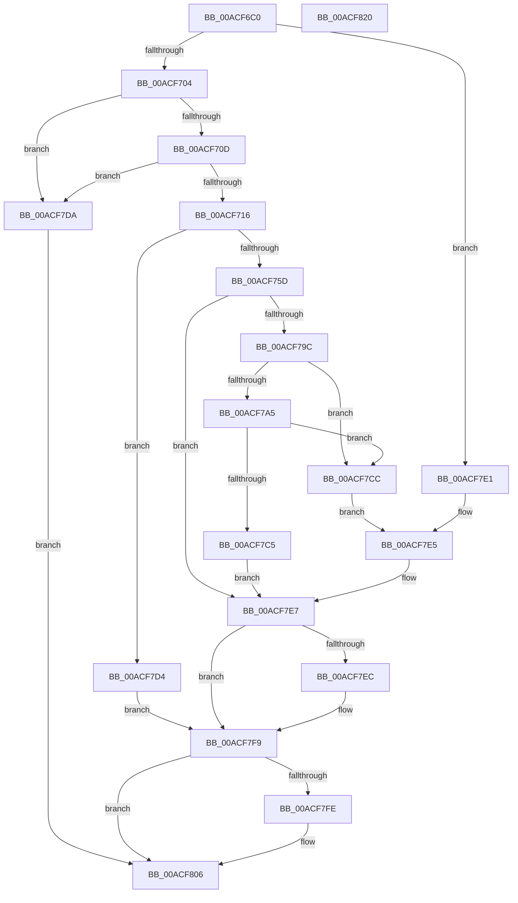

# PfpSourceGetPrefetchSupport

- RVA: `0x00ACF6C0`–`0x00ACF821` (길이 `353` bytes)
- VA: `0x0000000140ACF6C0`
- 실행 섹션: `PAGE`
- PDB 이름 있음: `예`; PDB Function 태그: `아니요`
- unwind 정보 RVA: `0x000BE8A0`
- 디코드: `98`개 명령, `353/353` bytes 표시
- 미해석 바이트: `0` (있으면 어셈블리에 `.byte`로 보존)

> 이 문서는 커널 이미지의 기계어와 PDB 기호를 분석해 생성했습니다. 4번과 5번은 함수 원형과 자료형을 바이너리 사용 방식에서 추정한 C 해석이며 원본 소스 복구 결과는 아닙니다.

## 1. Dependencies

- 직접 호출 지점: **4**; 고유 호출 대상: **4**
- 직접 호출자로 확인된 함수: **1**
- RIP 상대 이미지 참조: **1**

### Outgoing calls
- `0x00ACF752` → [NtOpenProcess](../89/NtOpenProcess_function_00894A00.md) (function, `0x00894A00`)
- `0x00ACF78D` → [ObpReferenceObjectByHandleWithTag](../86/ObpReferenceObjectByHandleWithTag_function_00869650.md) (function, `0x00869650`)
- `0x00ACF7F4` → [ObfDereferenceObjectWithTag](../../text/2F/ObfDereferenceObjectWithTag_function_002F78E0.md) (function, `0x002F78E0`)
- `0x00ACF801` → [NtClose](../86/NtClose_function_00868870.md) (function, `0x00868870`)

### Direct callers
- [PfpPrefetchPrivatePages](../93/PfpPrefetchPrivatePages_function_0093A7FC.md) at `0x0093A94F`

### Static image references
- `0x00ACF776` → RVA `0x00FC6A98` (`ALMOSTRO`; read)

## 2. Other-region calls and transfers

- 다른 실행 섹션으로 향하는 call: **1**
  - `0x00ACF7F4` → [ObfDereferenceObjectWithTag](../../text/2F/ObfDereferenceObjectWithTag_function_002F78E0.md) (`PAGE` → `.text`)
- 별도 외부 분기/꼬리 이동을 확인하지 못했습니다.

## 3. Assembly (complete function range)

```asm
00ACF6C0  48 89 5C 24 18                  mov qword ptr [rsp + 0x18], rbx
00ACF6C5  48 89 74 24 20                  mov qword ptr [rsp + 0x20], rsi
00ACF6CA  55                              push rbp
00ACF6CB  57                              push rdi
00ACF6CC  41 56                           push r14
00ACF6CE  48 8B EC                        mov rbp, rsp
00ACF6D1  48 81 EC 80 00 00 00            sub rsp, 0x80
00ACF6D8  33 C0                           xor eax, eax
00ACF6DA  45 33 C0                        xor r8d, r8d
00ACF6DD  21 45 EC                        and dword ptr [rbp - 0x14], eax
00ACF6E0  33 DB                           xor ebx, ebx
00ACF6E2  89 45 D4                        mov dword ptr [rbp - 0x2c], eax
00ACF6E5  48 8B F1                        mov rsi, rcx
00ACF6E8  21 45 D4                        and dword ptr [rbp - 0x2c], eax
00ACF6EB  4C 8B F2                        mov r14, rdx
00ACF6EE  8B 01                           mov eax, dword ptr [rcx]
00ACF6F0  89 02                           mov dword ptr [rdx], eax
00ACF6F2  8B 09                           mov ecx, dword ptr [rcx]
00ACF6F4  4C 89 45 20                     mov qword ptr [rbp + 0x20], r8
00ACF6F8  48 89 5D 28                     mov qword ptr [rbp + 0x28], rbx
00ACF6FC  85 C9                           test ecx, ecx
00ACF6FE  0F 84 DD 00 00 00               je 0x140acf7e1
00ACF704  83 E9 01                        sub ecx, 1
00ACF707  0F 84 CD 00 00 00               je 0x140acf7da
00ACF70D  83 F9 01                        cmp ecx, 1
00ACF710  0F 85 C4 00 00 00               jne 0x140acf7da
00ACF716  48 21 5D D8                     and qword ptr [rbp - 0x28], rbx
00ACF71A  4C 8D 4D C0                     lea r9, [rbp - 0x40]
00ACF71E  48 21 5D E0                     and qword ptr [rbp - 0x20], rbx
00ACF722  4C 8D 45 D0                     lea r8, [rbp - 0x30]
00ACF726  48 21 5D C8                     and qword ptr [rbp - 0x38], rbx
00ACF72A  48 8D 4D 28                     lea rcx, [rbp + 0x28]
00ACF72E  8B 46 04                        mov eax, dword ptr [rsi + 4]
00ACF731  0F 57 C0                        xorps xmm0, xmm0
00ACF734  BB FF FF 1F 00                  mov ebx, 0x1fffff
00ACF739  C7 45 D0 30 00 00 00            mov dword ptr [rbp - 0x30], 0x30
00ACF740  8B D3                           mov edx, ebx
00ACF742  C7 45 E8 00 02 00 00            mov dword ptr [rbp - 0x18], 0x200
00ACF749  F3 0F 7F 45 F0                  movdqu xmmword ptr [rbp - 0x10], xmm0
00ACF74E  48 89 45 C0                     mov qword ptr [rbp - 0x40], rax
00ACF752  E8 A9 52 DC FF                  call 0x140894a00
00ACF757  8B F8                           mov edi, eax
00ACF759  85 C0                           test eax, eax
00ACF75B  78 77                           js 0x140acf7d4
00ACF75D  48 83 64 24 38 00               and qword ptr [rsp + 0x38], 0
00ACF763  48 8D 45 20                     lea rax, [rbp + 0x20]
00ACF767  48 83 64 24 30 00               and qword ptr [rsp + 0x30], 0
00ACF76D  8B D3                           mov edx, ebx
00ACF76F  48 8B 5D 28                     mov rbx, qword ptr [rbp + 0x28]
00ACF773  45 33 C9                        xor r9d, r9d
00ACF776  4C 8B 05 1B 73 4F 00            mov r8, qword ptr [rip + 0x4f731b]
00ACF77D  48 8B CB                        mov rcx, rbx
00ACF780  48 89 44 24 28                  mov qword ptr [rsp + 0x28], rax
00ACF785  C7 44 24 20 50 66 57 73         mov dword ptr [rsp + 0x20], 0x73576650
00ACF78D  E8 BE 9E D9 FF                  call 0x140869650
00ACF792  4C 8B 45 20                     mov r8, qword ptr [rbp + 0x20]
00ACF796  8B F8                           mov edi, eax
00ACF798  85 C0                           test eax, eax
00ACF79A  78 4B                           js 0x140acf7e7
00ACF79C  48 8B 56 10                     mov rdx, qword ptr [rsi + 0x10]
00ACF7A0  48 85 D2                        test rdx, rdx
00ACF7A3  74 27                           je 0x140acf7cc
00ACF7A5  49 8B 88 F8 01 00 00            mov rcx, qword ptr [r8 + 0x1f8]
00ACF7AC  48 B8 FF FF FF FF FF FF FF 1F   movabs rax, 0x1fffffffffffffff
00ACF7B6  49 33 88 D0 01 00 00            xor rcx, qword ptr [r8 + 0x1d0]
00ACF7BD  48 23 C8                        and rcx, rax
00ACF7C0  48 3B D1                        cmp rdx, rcx
00ACF7C3  74 07                           je 0x140acf7cc
00ACF7C5  BF 25 02 00 C0                  mov edi, 0xc0000225
00ACF7CA  EB 1B                           jmp 0x140acf7e7
00ACF7CC  49 89 5E 08                     mov qword ptr [r14 + 8], rbx
00ACF7D0  33 DB                           xor ebx, ebx
00ACF7D2  EB 11                           jmp 0x140acf7e5
00ACF7D4  48 8B 5D 28                     mov rbx, qword ptr [rbp + 0x28]
00ACF7D8  EB 1F                           jmp 0x140acf7f9
00ACF7DA  BF BB 00 00 C0                  mov edi, 0xc00000bb
00ACF7DF  EB 25                           jmp 0x140acf806
00ACF7E1  48 21 5A 08                     and qword ptr [rdx + 8], rbx
00ACF7E5  33 FF                           xor edi, edi
00ACF7E7  4D 85 C0                        test r8, r8
00ACF7EA  74 0D                           je 0x140acf7f9
00ACF7EC  BA 50 66 57 73                  mov edx, 0x73576650
00ACF7F1  49 8B C8                        mov rcx, r8
00ACF7F4  E8 E7 80 82 FF                  call 0x1402f78e0
00ACF7F9  48 85 DB                        test rbx, rbx
00ACF7FC  74 08                           je 0x140acf806
00ACF7FE  48 8B CB                        mov rcx, rbx
00ACF801  E8 6A 90 D9 FF                  call 0x140868870
00ACF806  4C 8D 9C 24 80 00 00 00         lea r11, [rsp + 0x80]
00ACF80E  8B C7                           mov eax, edi
00ACF810  49 8B 5B 30                     mov rbx, qword ptr [r11 + 0x30]
00ACF814  49 8B 73 38                     mov rsi, qword ptr [r11 + 0x38]
00ACF818  49 8B E3                        mov rsp, r11
00ACF81B  41 5E                           pop r14
00ACF81D  5F                              pop rdi
00ACF81E  5D                              pop rbp
00ACF81F  C3                              ret
00ACF820  CC                              int3
```

## 4. C-style interpretation (structured pseudocode)

```c
__int64 __fastcall PfpSourceGetPrefetchSupport(__int64 a1, __int64 a2, int a3)
{
    __int64 result;
    __int64 v_rbx;
    __int64 v_rdi;
    __int64 v_rsp;
    unsigned __int64 v_stack_m18;
    unsigned __int64 v_stack_m28;
    unsigned int v_stack_m2C;
    unsigned int v_stack_m30;
    unsigned __int64 v_stack_m38;
    unsigned __int64 v_stack_m40;
    unsigned int v_stack_m44;
    unsigned __int64 v_stack_m48;
    unsigned __int64 v_stack_m50;
    unsigned __int64 v_stack_m58;
    unsigned __int64 v_stack_m60;
    unsigned __int64 v_stack_m68;
    unsigned __int64 v_stack_m70;
    unsigned int v_stack_m78;
    unsigned __int64 v_stack_p10;
    unsigned __int64 v_stack_p18;
    unsigned __int64 v_stack_p20;
    unsigned __int64 v_stack_p8;

    v_stack_p18 = v_rbx;
    v_stack_p20 = v_rsi;
    v_rsp = (v_rsp) - (128);
    result = 0;
    a3 = 0;
    v_rbx = 0;
    v_stack_m44 = 0;
    *(unsigned int *)(a2) = (unsigned int)((unsigned int)(*(unsigned int *)(a1)));
    v_stack_p8 = 0;
    v_stack_p10 = 0;
    if ((unsigned int)((unsigned int)(*(unsigned int *)(a1))) == 0) goto loc_00ACF7E1;
    a1 = (unsigned int)(((unsigned int)(*(unsigned int *)(a1))) - (1));
    if (condition_is_equal) goto loc_00ACF7DA;
    if (((unsigned int)(a1)) != 1) goto loc_00ACF7DA;
    v_stack_m48 = 48;
    v_stack_m30 = 512;
    v_stack_m28 = v_xmm0;
    v_stack_m58 = (unsigned int)(*(unsigned int *)(a1 + 4));
    result = NtOpenProcess(v_stack_p10, (unsigned int)((unsigned int)((unsigned int)(0x1FFFFFULL))), v_stack_m48, v_stack_m58);
    if (sign_flag) goto loc_00ACF7D4;
    a4 = 0;
    v_stack_m70 = v_stack_p8;
    v_stack_m78 = 0x73576650ULL;
    result = ObpReferenceObjectByHandleWithTag(v_stack_p10, (unsigned int)((unsigned int)((unsigned int)(0x1FFFFFULL))), *(unsigned __int64 *)(v_rip + 5206811), a4);
    if (sign_flag) goto loc_00ACF7E7;
    if (*(unsigned __int64 *)(a1 + 16) == 0) goto loc_00ACF7CC;
    a1 = (*(unsigned __int64 *)(v_stack_p8 + 504)) ^ (*(unsigned __int64 *)(v_stack_p8 + 464));
    a1 = (a1) & (result);
    if ((*(unsigned __int64 *)(a1 + 16)) == a1) goto loc_00ACF7CC;
    goto loc_00ACF7E7;
loc_00ACF7CC:
    *(unsigned __int64 *)(a2 + 8) = v_stack_p10;
    v_rbx = 0;
    goto loc_00ACF7E5;
loc_00ACF7D4:
    goto loc_00ACF7F9;
loc_00ACF7DA:
    goto loc_00ACF806;
loc_00ACF7E1:
loc_00ACF7E5:
    v_rdi = 0;
loc_00ACF7E7:
    if (v_stack_p8 != 0) {
        a2 = 0x73576650ULL;
        a1 = v_stack_p8;
        result = ObfDereferenceObjectWithTag(a1, a2, v_stack_p8, a4);
    }
    if (v_stack_p10 != 0) {
        a1 = v_stack_p10;
        result = NtClose(a1, a2, v_stack_p8, a4);
    }
    return 0;
}
```

## 5. (Beta) C Style

```c
int64_t PfpSourceGetPrefetchSupport(void *Arg1, void *Arg2, int32_t Arg3)
{
    uint8_t *arg1 = (uint8_t *)Arg1;
    uint8_t *arg2 = (uint8_t *)Arg2;

    int64_t result;
    int64_t local_rbx;
    int64_t local_rdi;
    int64_t local_rsp;
    uint64_t v_stack_m18;
    uint64_t v_stack_m28;
    uint32_t v_stack_m2C;
    uint32_t v_stack_m30;
    uint64_t v_stack_m38;
    uint64_t v_stack_m40;
    uint32_t v_stack_m44;
    uint64_t v_stack_m48;
    uint64_t v_stack_m50;
    uint64_t v_stack_m58;
    uint64_t v_stack_m60;
    uint64_t v_stack_m68;
    uint64_t v_stack_m70;
    uint32_t v_stack_m78;
    uint64_t v_stack_p10;
    uint64_t v_stack_p18;
    uint64_t v_stack_p20;
    uint64_t v_stack_p8;

    v_stack_p18 = local_rbx;
    v_stack_p20 = local_rsi;
    local_rsp = (local_rsp) - (128);
    result = 0;
    Arg3 = 0;
    local_rbx = 0;
    v_stack_m44 = 0;
    *(uint32_t *)(arg2) = (uint32_t)((uint32_t)(*(uint32_t *)(arg1)));
    v_stack_p8 = 0;
    v_stack_p10 = 0;
    if ((uint32_t)((uint32_t)(*(uint32_t *)(arg1))) == 0) goto loc_00ACF7E1;
    Arg1 = (uint32_t)(((uint32_t)(*(uint32_t *)(arg1))) - (1));
    if (condition_is_equal) goto loc_00ACF7DA;
    if (((uint32_t)(Arg1)) != 1) goto loc_00ACF7DA;
    v_stack_m48 = 48;
    v_stack_m30 = 512;
    v_stack_m28 = v_xmm0;
    v_stack_m58 = (uint32_t)(*(uint32_t *)(arg1 + 0x4));
    result = NtOpenProcess(v_stack_p10, (uint32_t)((uint32_t)((uint32_t)(0x1FFFFFULL))), v_stack_m48, v_stack_m58);
    if (sign_flag) goto loc_00ACF7D4;
    a4 = 0;
    v_stack_m70 = v_stack_p8;
    v_stack_m78 = 0x73576650ULL;
    result = ObpReferenceObjectByHandleWithTag(v_stack_p10, (uint32_t)((uint32_t)((uint32_t)(0x1FFFFFULL))), *(uint64_t *)(v_rip + 0x4F731B), a4);
    if (sign_flag) goto loc_00ACF7E7;
    if (*(uint64_t *)(arg1 + 0x10) == 0) goto loc_00ACF7CC;
    Arg1 = (*(uint64_t *)(v_stack_p8 + 0x1F8)) ^ (*(uint64_t *)(v_stack_p8 + 0x1D0));
    Arg1 = (Arg1) & (result);
    if ((*(uint64_t *)(arg1 + 0x10)) == Arg1) goto loc_00ACF7CC;
    goto loc_00ACF7E7;
loc_00ACF7CC:
    *(uint64_t *)(arg2 + 0x8) = v_stack_p10;
    local_rbx = 0;
    goto loc_00ACF7E5;
loc_00ACF7D4:
    goto loc_00ACF7F9;
loc_00ACF7DA:
    goto loc_00ACF806;
loc_00ACF7E1:
loc_00ACF7E5:
    local_rdi = 0;
loc_00ACF7E7:
    if (v_stack_p8 != 0) {
        Arg2 = 0x73576650ULL;
        Arg1 = v_stack_p8;
        result = ObfDereferenceObjectWithTag(Arg1, Arg2, v_stack_p8, a4);
    }
    if (v_stack_p10 != 0) {
        Arg1 = v_stack_p10;
        result = NtClose(Arg1, Arg2, v_stack_p8, a4);
    }
    return 0;
}
```

### 관측된 메모리 오프셋

구조체 형식이 확인되지 않은 접근은 인자 기준의 오프셋으로만 기록했습니다.

| 기준 인자 | 오프셋 표현 | 폭 (bit) | 접근 |
|---|---:|---:|---|
| `Arg1` | `+ 0x0` | `32` | `R` |
| `Arg1` | `+ 0x4` | `32` | `R` |
| `Arg1` | `+ 0x10` | `64` | `R` |
| `Arg2` | `+ 0x0` | `32` | `W` |
| `Arg2` | `+ 0x8` | `64` | `R/W` |
| `Arg2` | `+ 0x8` | `64` | `W` |

## 6. Execution-region graph

[열기: 2D/3D 그래프와 함수 탐색 컨트롤 패널](../../../control-panel.html?section=page&rva=0x00ACF6C0&view=graph)

- 2D 그래프는 위에서 아래로 흐르고, 3D 그래프는 빈 공간을 드래그해 회전합니다. Shift+드래그는 이동, 휠은 확대·축소, 함수 노드 선택은 대상 보고서 이동입니다.

### Static fallback


