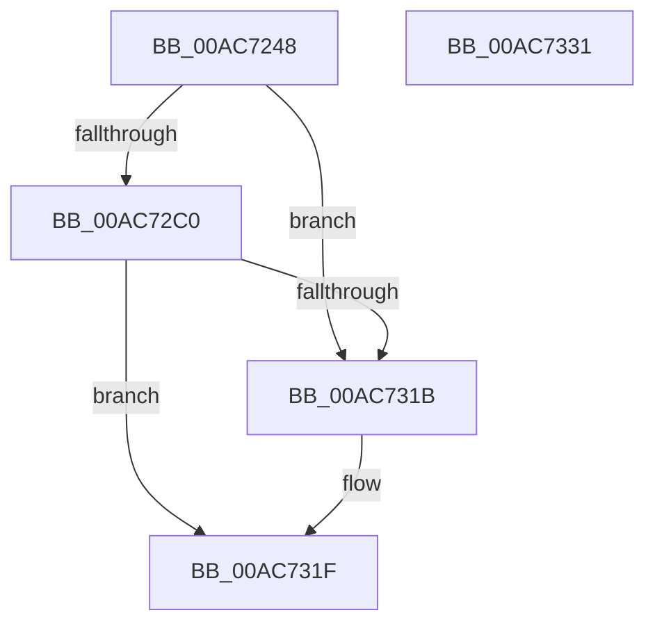

# PiDevCfgGetDeviceClassConfigFlags

- RVA: `0x00AC7248`–`0x00AC7332` (길이 `234` bytes)
- VA: `0x0000000140AC7248`
- 실행 섹션: `PAGE`
- PDB 이름 있음: `예`; PDB Function 태그: `아니요`
- unwind 정보 RVA: `0x0007AFEC`
- 디코드: `53`개 명령, `234/234` bytes 표시
- 미해석 바이트: `0` (있으면 어셈블리에 `.byte`로 보존)

> 이 문서는 커널 이미지의 기계어와 PDB 기호를 분석해 생성했습니다. 4번과 5번은 함수 원형과 자료형을 바이너리 사용 방식에서 추정한 C 해석이며 원본 소스 복구 결과는 아닙니다.

## 1. Dependencies

- 직접 호출 지점: **2**; 고유 호출 대상: **1**
- 직접 호출자로 확인된 함수: **2**
- RIP 상대 이미지 참조: **3**

### Outgoing calls
- `0x00AC72B4` → [PnpGetObjectProperty](../8E/PnpGetObjectProperty_function_008E2180.md) (function, `0x008E2180`)
- `0x00AC730F` → [PnpGetObjectProperty](../8E/PnpGetObjectProperty_function_008E2180.md) (function, `0x008E2180`)

### Direct callers
- [PpDevCfgProcessDeviceClass](../73/PpDevCfgProcessDeviceClass_function_00736824.md) at `0x00736B2A`
- [PiDevCfgConfigureDevice](../97/PiDevCfgConfigureDevice_function_00977BB4.md) at `0x00979C7B`

### Static image references
- `0x00AC728F` → RVA `0x00E66398` (`.data`; read)
- `0x00AC7296` → RVA `0x0001EA00` (`.rdata`; read)
- `0x00AC72FD` → RVA `0x0001E9E8` (`.rdata`; read)

## 2. Other-region calls and transfers

- 다른 실행 섹션으로 향하는 call: **0**
- 별도 외부 분기/꼬리 이동을 확인하지 못했습니다.

## 3. Assembly (complete function range)

```asm
00AC7248  4C 8B DC                        mov r11, rsp
00AC724B  49 89 5B 08                     mov qword ptr [r11 + 8], rbx
00AC724F  49 89 73 10                     mov qword ptr [r11 + 0x10], rsi
00AC7253  57                              push rdi
00AC7254  48 83 EC 60                     sub rsp, 0x60
00AC7258  83 64 24 50 00                  and dword ptr [rsp + 0x50], 0
00AC725D  49 8D 43 18                     lea rax, [r11 + 0x18]
00AC7261  41 83 20 00                     and dword ptr [r8], 0
00AC7265  48 8B FA                        mov rdi, rdx
00AC7268  41 83 63 18 00                  and dword ptr [r11 + 0x18], 0
00AC726D  4C 8B CA                        mov r9, rdx
00AC7270  49 89 43 E0                     mov qword ptr [r11 - 0x20], rax
00AC7274  49 8B D8                        mov rbx, r8
00AC7277  83 64 24 40 00                  and dword ptr [rsp + 0x40], 0
00AC727C  49 8D 43 20                     lea rax, [r11 + 0x20]
00AC7280  49 83 63 D0 00                  and qword ptr [r11 - 0x30], 0
00AC7285  48 8B F1                        mov rsi, rcx
00AC7288  49 89 43 C8                     mov qword ptr [r11 - 0x38], rax
00AC728C  48 8B D1                        mov rdx, rcx
00AC728F  48 8B 0D 02 F1 39 00            mov rcx, qword ptr [rip + 0x39f102]
00AC7296  48 8D 05 63 77 55 FF            lea rax, [rip - 0xaa889d]
00AC729D  49 89 43 C0                     mov qword ptr [r11 - 0x40], rax
00AC72A1  41 B8 02 00 00 00               mov r8d, 2
00AC72A7  49 83 63 B8 00                  and qword ptr [r11 - 0x48], 0
00AC72AC  41 C7 43 20 01 00 00 00         mov dword ptr [r11 + 0x20], 1
00AC72B4  E8 C7 AE E1 FF                  call 0x1408e2180
00AC72B9  3D 23 00 00 C0                  cmp eax, 0xc0000023
00AC72BE  74 5B                           je 0x140ac731b
00AC72C0  83 64 24 50 00                  and dword ptr [rsp + 0x50], 0
00AC72C5  48 8D 84 24 80 00 00 00         lea rax, [rsp + 0x80]
00AC72CD  48 8B 0D C4 F0 39 00            mov rcx, qword ptr [rip + 0x39f0c4]
00AC72D4  4C 8B CF                        mov r9, rdi
00AC72D7  48 89 44 24 48                  mov qword ptr [rsp + 0x48], rax
00AC72DC  41 B8 02 00 00 00               mov r8d, 2
00AC72E2  83 64 24 40 00                  and dword ptr [rsp + 0x40], 0
00AC72E7  48 8D 84 24 88 00 00 00         lea rax, [rsp + 0x88]
00AC72EF  48 83 64 24 38 00               and qword ptr [rsp + 0x38], 0
00AC72F5  48 8B D6                        mov rdx, rsi
00AC72F8  48 89 44 24 30                  mov qword ptr [rsp + 0x30], rax
00AC72FD  48 8D 05 E4 76 55 FF            lea rax, [rip - 0xaa891c]
00AC7304  48 89 44 24 28                  mov qword ptr [rsp + 0x28], rax
00AC7309  48 83 64 24 20 00               and qword ptr [rsp + 0x20], 0
00AC730F  E8 6C AE E1 FF                  call 0x1408e2180
00AC7314  3D 23 00 00 C0                  cmp eax, 0xc0000023
00AC7319  75 04                           jne 0x140ac731f
00AC731B  0F BA 2B 13                     bts dword ptr [rbx], 0x13
00AC731F  48 8B 5C 24 70                  mov rbx, qword ptr [rsp + 0x70]
00AC7324  33 C0                           xor eax, eax
00AC7326  48 8B 74 24 78                  mov rsi, qword ptr [rsp + 0x78]
00AC732B  48 83 C4 60                     add rsp, 0x60
00AC732F  5F                              pop rdi
00AC7330  C3                              ret
00AC7331  CC                              int3
```

## 4. C-style interpretation (structured pseudocode)

```c
__int64 __fastcall PiDevCfgGetDeviceClassConfigFlags(__int64 a1, __int64 a2, __int64 a3)
{
    __int64 result;
    __int64 v_rsp;
    unsigned int v_stack_m18;
    unsigned __int64 v_stack_m20;
    unsigned int v_stack_m28;
    unsigned __int64 v_stack_m30;
    unsigned __int64 v_stack_m38;
    unsigned __int64 v_stack_m40;
    unsigned __int64 v_stack_m48;
    unsigned __int64 v_stack_p10;
    unsigned __int64 v_stack_p18;
    unsigned __int64 v_stack_p20;
    unsigned __int64 v_stack_p8;

    *(unsigned __int64 *)(v_rsp + 8) = v_rbx;
    *(unsigned __int64 *)(v_rsp + 16) = v_rsi;
    v_rsp = (v_rsp) - (96);
    *(unsigned __int64 *)(v_rsp - 32) = v_rsp + 24;
    *(unsigned __int64 *)(v_rsp - 56) = v_rsp + 32;
    *(unsigned __int64 *)(v_rsp - 64) = v_rip - 11176093;
    *(unsigned int *)(v_rsp + 32) = 1;
    result = PnpGetObjectProperty(*(unsigned __int64 *)(v_rip + 3797250), a1, 2, a2);
    if (((unsigned int)(result)) == 0xC0000023ULL) goto loc_00AC731B;
    v_stack_m20 = v_stack_p18;
    v_stack_m38 = v_stack_p20;
    v_stack_m40 = v_rip - 11176220;
    result = PnpGetObjectProperty(*(unsigned __int64 *)(v_rip + 3797188), a1, 2, a2);
    if (((unsigned int)(result)) == 0xC0000023ULL) {
    }
    result = 0;
    v_rsp = (v_rsp) + (96);
    return result;
}
```

## 5. (Beta) C Style

```c
int64_t PiDevCfgGetDeviceClassConfigFlags(int64_t Arg1, int64_t Arg2, void *Arg3)
{
    uint8_t *arg3 = (uint8_t *)Arg3;

    int64_t result;
    int64_t local_rsp;
    uint32_t v_stack_m18;
    uint64_t v_stack_m20;
    uint32_t v_stack_m28;
    uint64_t v_stack_m30;
    uint64_t v_stack_m38;
    uint64_t v_stack_m40;
    uint64_t v_stack_m48;
    uint64_t v_stack_p10;
    uint64_t v_stack_p18;
    uint64_t v_stack_p20;
    uint64_t v_stack_p8;

    *(uint64_t *)(local_rsp + 0x8) = local_rbx;
    *(uint64_t *)(local_rsp + 0x10) = local_rsi;
    local_rsp = (local_rsp) - (96);
    *(uint64_t *)(local_rsp - 0x20) = local_rsp + 24;
    *(uint64_t *)(local_rsp - 0x38) = local_rsp + 32;
    *(uint64_t *)(local_rsp - 0x40) = v_rip - 11176093;
    *(uint32_t *)(local_rsp + 0x20) = 1;
    result = PnpGetObjectProperty(*(uint64_t *)(v_rip + 0x39F102), Arg1, 2, Arg2);
    if (((uint32_t)(result)) == 0xC0000023ULL) goto loc_00AC731B;
    v_stack_m20 = v_stack_p18;
    v_stack_m38 = v_stack_p20;
    v_stack_m40 = v_rip - 11176220;
    result = PnpGetObjectProperty(*(uint64_t *)(v_rip + 0x39F0C4), Arg1, 2, Arg2);
    if (((uint32_t)(result)) == 0xC0000023ULL) {
    }
    result = 0;
    local_rsp = (local_rsp) + (96);
    return result;
}
```

### 관측된 메모리 오프셋

구조체 형식이 확인되지 않은 접근은 인자 기준의 오프셋으로만 기록했습니다.

| 기준 인자 | 오프셋 표현 | 폭 (bit) | 접근 |
|---|---:|---:|---|
| `Arg3` | `+ 0x0` | `32` | `R/W` |

## 6. Execution-region graph

[열기: 2D/3D 그래프와 함수 탐색 컨트롤 패널](../../../control-panel.html?section=page&rva=0x00AC7248&view=graph)

- 2D 그래프는 위에서 아래로 흐르고, 3D 그래프는 빈 공간을 드래그해 회전합니다. Shift+드래그는 이동, 휠은 확대·축소, 함수 노드 선택은 대상 보고서 이동입니다.

### Static fallback


