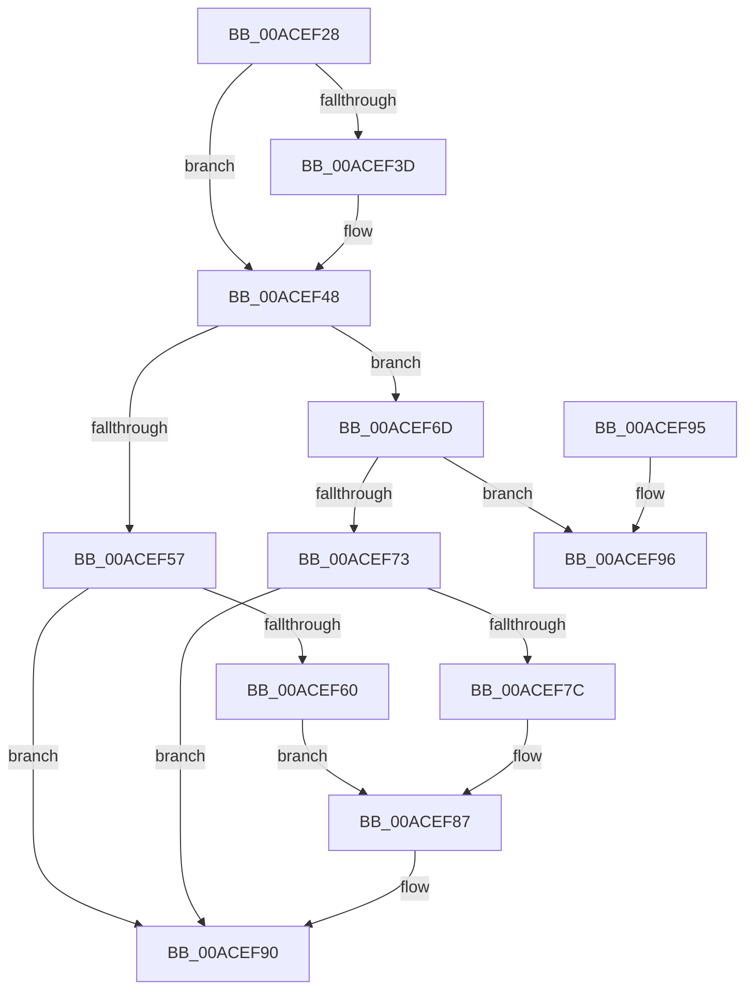

# PiLogSurpriseRemoveEvent

- RVA: `0x00ACEF28`–`0x00ACEF9D` (길이 `117` bytes)
- VA: `0x0000000140ACEF28`
- 실행 섹션: `PAGE`
- PDB 이름 있음: `예`; PDB Function 태그: `아니요`
- unwind 정보 RVA: `0x000789BC`
- 디코드: `31`개 명령, `117/117` bytes 표시
- 미해석 바이트: `0` (있으면 어셈블리에 `.byte`로 보존)

> 이 문서는 커널 이미지의 기계어와 PDB 기호를 분석해 생성했습니다. 4번과 5번은 함수 원형과 자료형을 바이너리 사용 방식에서 추정한 C 해석이며 원본 소스 복구 결과는 아닙니다.

## 1. Dependencies

- 직접 호출 지점: **1**; 고유 호출 대상: **1**
- 직접 호출자로 확인된 함수: **1**
- RIP 상대 이미지 참조: **3**

### Outgoing calls
- `0x00ACEF8B` → [McTemplateK0zq_EtwWriteTransfer](../../text/42/McTemplateK0zq_EtwWriteTransfer_function_00424958.md) (function, `0x00424958`)

### Direct callers
- [PnpProcessQueryRemoveAndEject](../A0/PnpProcessQueryRemoveAndEject_function_00A05170.md) at `0x00A05607`

### Static image references
- `0x00ACEF57` → RVA `0x00EF012C` (`.data`; read)
- `0x00ACEF64` → RVA `0x00026F30` (`.rdata`; read)
- `0x00ACEF80` → RVA `0x000273F0` (`.rdata`; read)

## 2. Other-region calls and transfers

- 다른 실행 섹션으로 향하는 call: **1**
  - `0x00ACEF8B` → [McTemplateK0zq_EtwWriteTransfer](../../text/42/McTemplateK0zq_EtwWriteTransfer_function_00424958.md) (`PAGE` → `.text`)
- 별도 외부 분기/꼬리 이동을 확인하지 못했습니다.

## 3. Assembly (complete function range)

```asm
00ACEF28  48 83 EC 38                     sub rsp, 0x38
00ACEF2C  44 8B D2                        mov r10d, edx
00ACEF2F  33 C0                           xor eax, eax
00ACEF31  48 8B 91 A0 00 00 00            mov rdx, qword ptr [rcx + 0xa0]
00ACEF38  48 85 D2                        test rdx, rdx
00ACEF3B  74 0B                           je 0x140acef48
00ACEF3D  48 8B 82 38 01 00 00            mov rax, qword ptr [rdx + 0x138]
00ACEF44  48 8B 40 28                     mov rax, qword ptr [rax + 0x28]
00ACEF48  4C 8B 48 30                     mov r9, qword ptr [rax + 0x30]
00ACEF4C  49 8B 00                        mov rax, qword ptr [r8]
00ACEF4F  8B 10                           mov edx, dword ptr [rax]
00ACEF51  41 83 FA 03                     cmp r10d, 3
00ACEF55  75 16                           jne 0x140acef6d
00ACEF57  F6 05 CE 11 42 00 08            test byte ptr [rip + 0x4211ce], 8
00ACEF5E  74 30                           je 0x140acef90
00ACEF60  89 54 24 20                     mov dword ptr [rsp + 0x20], edx
00ACEF64  48 8D 15 C5 7F 55 FF            lea rdx, [rip - 0xaa803b]
00ACEF6B  EB 1A                           jmp 0x140acef87
00ACEF6D  41 83 FA 05                     cmp r10d, 5
00ACEF71  75 23                           jne 0x140acef96
00ACEF73  F6 05 B2 11 42 00 04            test byte ptr [rip + 0x4211b2], 4
00ACEF7A  74 14                           je 0x140acef90
00ACEF7C  89 54 24 20                     mov dword ptr [rsp + 0x20], edx
00ACEF80  48 8D 15 69 84 55 FF            lea rdx, [rip - 0xaa7b97]
00ACEF87  4C 8D 41 58                     lea r8, [rcx + 0x58]
00ACEF8B  E8 C8 59 95 FF                  call 0x140424958
00ACEF90  48 83 C4 38                     add rsp, 0x38
00ACEF94  C3                              ret
00ACEF95  CC                              int3
00ACEF96  B9 05 00 00 00                  mov ecx, 5
00ACEF9B  CD 29                           int 0x29
```

## 4. C-style interpretation (structured pseudocode)

```c
__int64 __fastcall PiLogSurpriseRemoveEvent(__int64 a1, int a2, __int64 a3)
{
    __int64 result;
    __int64 v_rsp;
    unsigned int v_stack_m18;

    v_rsp = (v_rsp) - (56);
    result = 0;
    if (*(unsigned __int64 *)(a1 + 160) != 0) {
        result = *(unsigned __int64 *)(*(unsigned __int64 *)(a1 + 160) + 312);
        result = *(unsigned __int64 *)(result + 40);
    }
    if (((unsigned int)((unsigned int)(a2))) != 3) goto loc_00ACEF6D;
    if (((*(unsigned __int8 *)(v_rip + 4329934)) & (8)) == 0) goto loc_00ACEF90;
    v_stack_m18 = (unsigned int)((unsigned int)(*(unsigned int *)(*(unsigned __int64 *)(a3))));
    goto loc_00ACEF87;
loc_00ACEF6D:
    if (((unsigned int)((unsigned int)(a2))) != 5) goto loc_00ACEF96;
    if (((*(unsigned __int8 *)(v_rip + 4329906)) & (4)) == 0) goto loc_00ACEF90;
    v_stack_m18 = (unsigned int)(v_rip - 11173947);
loc_00ACEF87:
    result = McTemplateK0zq_EtwWriteTransfer(a1, v_rip - 11172759, a1 + 88, *(unsigned __int64 *)(result + 48));
loc_00ACEF90:
    v_rsp = (v_rsp) + (56);
    return result;
loc_00ACEF96:
    return result;
}
```

## 5. (Beta) C Style

```c
int64_t PiLogSurpriseRemoveEvent(void *Arg1, int32_t Arg2, void *Arg3)
{
    uint8_t *arg1 = (uint8_t *)Arg1;
    uint8_t *arg3 = (uint8_t *)Arg3;

    int64_t result;
    int64_t local_rsp;
    uint32_t v_stack_m18;

    local_rsp = (local_rsp) - (56);
    result = 0;
    if (*(uint64_t *)(arg1 + 0xA0) != 0) {
        result = *(uint64_t *)(*(uint64_t *)(arg1 + 0xA0) + 0x138);
        result = *(uint64_t *)(result + 0x28);
    }
    if (((uint32_t)((uint32_t)(Arg2))) != 3) goto loc_00ACEF6D;
    if (((*(uint8_t *)(v_rip + 0x4211CE)) & (8)) == 0) goto loc_00ACEF90;
    v_stack_m18 = (uint32_t)((uint32_t)(*(uint32_t *)(*(uint64_t *)(arg3))));
    goto loc_00ACEF87;
loc_00ACEF6D:
    if (((uint32_t)((uint32_t)(Arg2))) != 5) goto loc_00ACEF96;
    if (((*(uint8_t *)(v_rip + 0x4211B2)) & (4)) == 0) goto loc_00ACEF90;
    v_stack_m18 = (uint32_t)(v_rip - 11173947);
loc_00ACEF87:
    result = McTemplateK0zq_EtwWriteTransfer(Arg1, v_rip - 11172759, Arg1 + 88, *(uint64_t *)(result + 0x30));
loc_00ACEF90:
    local_rsp = (local_rsp) + (56);
    return result;
loc_00ACEF96:
    return result;
}
```

### 관측된 메모리 오프셋

구조체 형식이 확인되지 않은 접근은 인자 기준의 오프셋으로만 기록했습니다.

| 기준 인자 | 오프셋 표현 | 폭 (bit) | 접근 |
|---|---:|---:|---|
| `Arg1` | `+ 0x58` | `64` | `R` |
| `Arg1` | `+ 0xA0` | `64` | `R` |
| `Arg3` | `+ 0x0` | `64` | `R` |

## 6. Execution-region graph

[열기: 2D/3D 그래프와 함수 탐색 컨트롤 패널](../../../control-panel.html?section=page&rva=0x00ACEF28&view=graph)

- 2D 그래프는 위에서 아래로 흐르고, 3D 그래프는 빈 공간을 드래그해 회전합니다. Shift+드래그는 이동, 휠은 확대·축소, 함수 노드 선택은 대상 보고서 이동입니다.

### Static fallback


