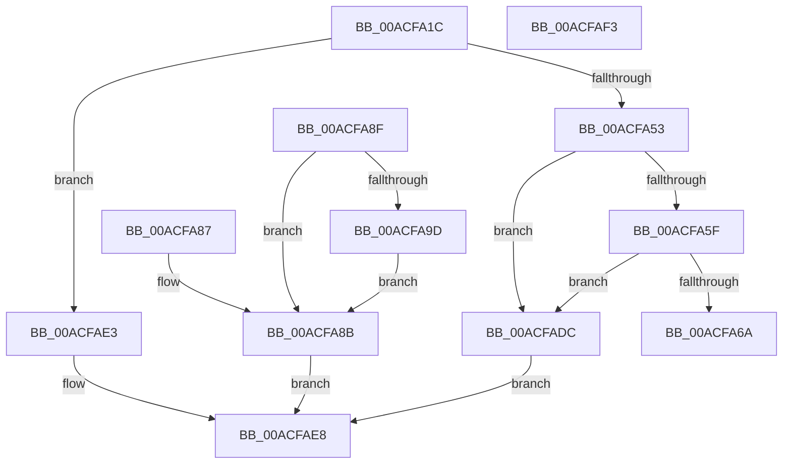

# PiRestartDevice

- RVA: `0x00ACFA1C`–`0x00ACFB1B` (길이 `255` bytes)
- VA: `0x0000000140ACFA1C`
- 실행 섹션: `PAGE`
- PDB 이름 있음: `예`; PDB Function 태그: `아니요`
- unwind 정보 RVA: `0x000BE8D0`
- 디코드: `72`개 명령, `255/255` bytes 표시
- 미해석 바이트: `0` (있으면 어셈블리에 `.byte`로 보존)

> 이 문서는 커널 이미지의 기계어와 PDB 기호를 분석해 생성했습니다. 4번과 5번은 함수 원형과 자료형을 바이너리 사용 방식에서 추정한 C 해석이며 원본 소스 복구 결과는 아닙니다.

## 1. Dependencies

- 직접 호출 지점: **3**; 고유 호출 대상: **3**
- 직접 호출자로 확인된 함수: **1**
- RIP 상대 이미지 참조: **2**

### Outgoing calls
- `0x00ACFA92` → [PnpRestartDeviceNode](../72/PnpRestartDeviceNode_function_0072CD60.md) (function, `0x0072CD60`)
- `0x00ACFAB3` → [ObfReferenceObject](../../text/20/ObfReferenceObject_function_0020FA20.md) (function, `0x0020FA20`)
- `0x00ACFAD5` → [PipProcessDevNodeTree](../8F/PipProcessDevNodeTree_function_008F9068.md) (function, `0x008F9068`)

### Direct callers
- [PnpDeviceActionWorker](../../text/47/PnpDeviceActionWorker_function_00478400.md) at `0x004786B1`

### Static image references
- `0x00ACFA6A` → RVA `0x00000000` (`image boundary/outside`; read)
- `0x00ACFA9D` → RVA `0x00F8C5FA` (`.data`; read)

## 2. Other-region calls and transfers

- 다른 실행 섹션으로 향하는 call: **1**
  - `0x00ACFAB3` → [ObfReferenceObject](../../text/20/ObfReferenceObject_function_0020FA20.md) (`PAGE` → `.text`)
- 별도 외부 분기/꼬리 이동을 확인하지 못했습니다.

## 3. Assembly (complete function range)

```asm
00ACFA1C  48 89 5C 24 10                  mov qword ptr [rsp + 0x10], rbx
00ACFA21  57                              push rdi
00ACFA22  48 83 EC 40                     sub rsp, 0x40
00ACFA26  48 83 64 24 50 00               and qword ptr [rsp + 0x50], 0
00ACFA2C  48 8B F9                        mov rdi, rcx
00ACFA2F  48 8B 41 10                     mov rax, qword ptr [rcx + 0x10]
00ACFA33  48 8B 90 38 01 00 00            mov rdx, qword ptr [rax + 0x138]
00ACFA3A  48 8B 5A 28                     mov rbx, qword ptr [rdx + 0x28]
00ACFA3E  8B 8B 2C 01 00 00               mov ecx, dword ptr [rbx + 0x12c]
00ACFA44  8D 81 EB FC FF FF               lea eax, [rcx - 0x315]
00ACFA4A  83 F8 01                        cmp eax, 1
00ACFA4D  0F 86 90 00 00 00               jbe 0x140acfae3
00ACFA53  F7 83 8C 01 00 00 00 60 00 00   test dword ptr [rbx + 0x18c], 0x6000
00ACFA5D  75 7D                           jne 0x140acfadc
00ACFA5F  8D 81 00 FD FF FF               lea eax, [rcx - 0x300]
00ACFA65  83 F8 16                        cmp eax, 0x16
00ACFA68  77 72                           ja 0x140acfadc
00ACFA6A  48 8D 15 8F 05 53 FF            lea rdx, [rip - 0xacfa71]
00ACFA71  48 98                           cdqe
00ACFA73  0F B6 84 02 04 FB AC 00         movzx eax, byte ptr [rdx + rax + 0xacfb04]
00ACFA7B  8B 8C 82 F4 FA AC 00            mov ecx, dword ptr [rdx + rax*4 + 0xacfaf4]
00ACFA82  48 03 CA                        add rcx, rdx
00ACFA85  FF E1                           jmp rcx
00ACFA87  CC                              int3
00ACFA88  CC                              int3
00ACFA89  CC                              int3
00ACFA8A  CC                              int3
00ACFA8B  33 C0                           xor eax, eax
00ACFA8D  EB 59                           jmp 0x140acfae8
00ACFA8F  48 8B CB                        mov rcx, rbx
00ACFA92  E8 C9 D2 C5 FF                  call 0x14072cd60
00ACFA97  83 7F 18 10                     cmp dword ptr [rdi + 0x18], 0x10
00ACFA9B  75 EE                           jne 0x140acfa8b
00ACFA9D  8A 05 57 CB 4B 00               mov al, byte ptr [rip + 0x4bcb57]
00ACFAA3  88 44 24 54                     mov byte ptr [rsp + 0x54], al
00ACFAA7  C7 44 24 50 03 00 00 00         mov dword ptr [rsp + 0x50], 3
00ACFAAF  48 8B 4B 20                     mov rcx, qword ptr [rbx + 0x20]
00ACFAB3  E8 68 FF 73 FF                  call 0x14020fa20
00ACFAB8  C6 44 24 30 00                  mov byte ptr [rsp + 0x30], 0
00ACFABD  4C 8D 44 24 50                  lea r8, [rsp + 0x50]
00ACFAC2  C6 44 24 28 00                  mov byte ptr [rsp + 0x28], 0
00ACFAC7  45 33 C9                        xor r9d, r9d
00ACFACA  48 8B D7                        mov rdx, rdi
00ACFACD  C6 44 24 20 00                  mov byte ptr [rsp + 0x20], 0
00ACFAD2  48 8B CB                        mov rcx, rbx
00ACFAD5  E8 8E 95 E2 FF                  call 0x1408f9068
00ACFADA  EB AF                           jmp 0x140acfa8b
00ACFADC  B8 01 00 00 C0                  mov eax, 0xc0000001
00ACFAE1  EB 05                           jmp 0x140acfae8
00ACFAE3  B8 56 00 00 C0                  mov eax, 0xc0000056
00ACFAE8  48 8B 5C 24 58                  mov rbx, qword ptr [rsp + 0x58]
00ACFAED  48 83 C4 40                     add rsp, 0x40
00ACFAF1  5F                              pop rdi
00ACFAF2  C3                              ret
00ACFAF3  CC                              int3
00ACFAF4  DC FA                           fdiv st(2), st(0)
00ACFAF6  AC                              lodsb al, byte ptr [rsi]
00ACFAF7  00 97 FA AC 00 8F               add byte ptr [rdi - 0x70ff5306], dl
00ACFAFD  FA                              cli
00ACFAFE  AC                              lodsb al, byte ptr [rsi]
00ACFAFF  00 8B FA AC 00 00               add byte ptr [rbx + 0xacfa], cl
00ACFB05  01 01                           add dword ptr [rcx], eax
00ACFB07  02 02                           add al, byte ptr [rdx]
00ACFB09  01 01                           add dword ptr [rcx], eax
00ACFB0B  03 01                           add eax, dword ptr [rcx]
00ACFB0D  01 03                           add dword ptr [rbx], eax
00ACFB0F  03 03                           add eax, dword ptr [rbx]
00ACFB11  03 03                           add eax, dword ptr [rbx]
00ACFB13  01 00                           add dword ptr [rax], eax
00ACFB15  00 00                           add byte ptr [rax], al
00ACFB17  00 02                           add byte ptr [rdx], al
00ACFB19  00 00                           add byte ptr [rax], al
```

## 4. C-style interpretation (structured pseudocode)

```c
__int64 __fastcall PiRestartDevice(__int64 a1, __int64 a2, __int64 a3, int a4)
{
    __int64 v_rsp;
    unsigned __int8 v_stack_m18;
    unsigned __int8 v_stack_m20;
    unsigned __int8 v_stack_m28;
    unsigned __int64 v_stack_p10;
    unsigned __int64 v_stack_p8;
    unsigned __int8 v_stack_pC;

    v_stack_p10 = v_rbx;
    v_rsp = (v_rsp) - (64);
    if (((unsigned int)((unsigned int)(*(unsigned int *)(*(unsigned __int64 *)(*(unsigned __int64 *)(*(unsigned __int64 *)(a1 + 16) + 312) + 40) + 300)) - 789)) <= 1) goto loc_00ACFAE3;
    if (((*(unsigned int *)(*(unsigned __int64 *)(*(unsigned __int64 *)(*(unsigned __int64 *)(a1 + 16) + 312) + 40) + 396)) & (0x6000ULL)) != 0) goto loc_00ACFADC;
    if (((unsigned int)((unsigned int)(*(unsigned int *)(*(unsigned __int64 *)(*(unsigned __int64 *)(*(unsigned __int64 *)(a1 + 16) + 312) + 40) + 300)) - 768)) > 22) goto loc_00ACFADC;
    a1 = ((unsigned int)(*(unsigned int *)(v_rip - 11336305 + *(unsigned __int8 *)(v_rip - 11336305 + (unsigned int)(*(unsigned int *)(*(unsigned __int64 *)(*(unsigned __int64 *)(*(unsigned __int64 *)(a1 + 16) + 312) + 40) + 300)) - 768 * 1 + 11336452) * 4 + 11336436))) + (v_rip - 11336305);
loc_00ACFADC:
    goto loc_00ACFAE8;
loc_00ACFAE3:
loc_00ACFAE8:
    v_rsp = (v_rsp) + (64);
    return (unsigned int)(0xC0000056ULL);
}
```

## 5. (Beta) C Style

```c
int64_t PiRestartDevice(void *Arg1, int64_t Arg2, int64_t Arg3, int32_t Arg4)
{
    uint8_t *arg1 = (uint8_t *)Arg1;

    int64_t local_rsp;
    uint8_t v_stack_m18;
    uint8_t v_stack_m20;
    uint8_t v_stack_m28;
    uint64_t v_stack_p10;
    uint64_t v_stack_p8;
    uint8_t v_stack_pC;

    v_stack_p10 = local_rbx;
    local_rsp = (local_rsp) - (64);
    if (((uint32_t)((uint32_t)(*(uint32_t *)(*(uint64_t *)(*(uint64_t *)(*(uint64_t *)(arg1 + 0x10) + 0x138) + 0x28) + 0x12C)) - 789)) <= 1) goto loc_00ACFAE3;
    if (((*(uint32_t *)(*(uint64_t *)(*(uint64_t *)(*(uint64_t *)(arg1 + 0x10) + 0x138) + 0x28) + 0x18C)) & (0x6000ULL)) != 0) goto loc_00ACFADC;
    if (((uint32_t)((uint32_t)(*(uint32_t *)(*(uint64_t *)(*(uint64_t *)(*(uint64_t *)(arg1 + 0x10) + 0x138) + 0x28) + 0x12C)) - 768)) > 22) goto loc_00ACFADC;
    Arg1 = ((uint32_t)(*(uint32_t *)(v_rip - 0xACFA71 + *(uint8_t *)(v_rip - 0xACFA71 + (uint32_t)(*(uint32_t *)(*(uint64_t *)(*(uint64_t *)(*(uint64_t *)(arg1 + 0x10) + 0x138) + 0x28) + 0x12C)) - 0x300 * 1 + 0xACFB04) * 4 + 0xACFAF4))) + (v_rip - 11336305);
loc_00ACFADC:
    goto loc_00ACFAE8;
loc_00ACFAE3:
loc_00ACFAE8:
    local_rsp = (local_rsp) + (64);
    return (uint32_t)(0xC0000056ULL);
}
```

### 관측된 메모리 오프셋

구조체 형식이 확인되지 않은 접근은 인자 기준의 오프셋으로만 기록했습니다.

| 기준 인자 | 오프셋 표현 | 폭 (bit) | 접근 |
|---|---:|---:|---|
| `Arg1` | `+ 0x10` | `64` | `R` |

## 6. Execution-region graph

[열기: 2D/3D 그래프와 함수 탐색 컨트롤 패널](../../../control-panel.html?section=page&rva=0x00ACFA1C&view=graph)

- 2D 그래프는 위에서 아래로 흐르고, 3D 그래프는 빈 공간을 드래그해 회전합니다. Shift+드래그는 이동, 휠은 확대·축소, 함수 노드 선택은 대상 보고서 이동입니다.

### Static fallback


