# PiSwGetChildPdo

- RVA: `0x00AC3544`–`0x00AC3862` (길이 `798` bytes)
- VA: `0x0000000140AC3544`
- 실행 섹션: `PAGE`
- PDB 이름 있음: `예`; PDB Function 태그: `아니요`
- unwind 정보 RVA: `0x000BD508`
- 디코드: `213`개 명령, `798/798` bytes 표시
- 미해석 바이트: `0` (있으면 어셈블리에 `.byte`로 보존)

> 이 문서는 커널 이미지의 기계어와 PDB 기호를 분석해 생성했습니다. 4번과 5번은 함수 원형과 자료형을 바이너리 사용 방식에서 추정한 C 해석이며 원본 소스 복구 결과는 아닙니다.

## 1. Dependencies

- 직접 호출 지점: **16**; 고유 호출 대상: **16**
- 직접 호출자로 확인된 함수: **1**
- RIP 상대 이미지 참조: **7**

### Outgoing calls
- `0x00AC35AB` → [McTemplateK0zzzd_EtwWriteTransfer](../../text/5A/McTemplateK0zzzd_EtwWriteTransfer_function_005A97D4.md) (function, `0x005A97D4`)
- `0x00AC3663` → [PnpConcatPWSTR](../99/PnpConcatPWSTR_function_00990A00.md) (function, `0x00990A00`)
- `0x00AC367B` → [RtlInitUnicodeStringEx](../../text/46/RtlInitUnicodeStringEx_function_00463960.md) (function, `0x00463960`)
- `0x00AC368D` → [PnpDeviceObjectFromDeviceInstanceWithTag](../8E/PnpDeviceObjectFromDeviceInstanceWithTag_function_008E7490.md) (function, `0x008E7490`)
- `0x00AC36BB` → [McTemplateK0zzq_EtwWriteTransfer](../../text/5A/McTemplateK0zzq_EtwWriteTransfer_function_005A94D8.md) (function, `0x005A94D8`)
- `0x00AC36C3` → [ObfDereferenceObject](../../text/2F/ObfDereferenceObject_function_002F9350.md) (function, `0x002F9350`)
- `0x00AC36DA` → [IoInvalidateDeviceRelations](../../text/49/IoInvalidateDeviceRelations_function_0049E160.md) (function, `0x0049E160`)
- `0x00AC3714` → [PiSwMakePdoInactive](../94/PiSwMakePdoInactive_function_0094D9A0.md) (function, `0x0094D9A0`)
- `0x00AC3746` → [IoCreateDevice](../9A/IoCreateDevice_function_009A4B00.md) (function, `0x009A4B00`)
- `0x00AC3775` → [ObSetSecurityObjectByPointer](../8B/ObSetSecurityObjectByPointer_function_008BAD20.md) (function, `0x008BAD20`)
- `0x00AC3781` → [IoDeleteDevice](../../text/26/IoDeleteDevice_function_0026FE90.md) (function, `0x0026FE90`)
- `0x00AC37AF` → [PiSwAddPdoAssociation](../A9/PiSwAddPdoAssociation_function_00A9E490.md) (function, `0x00A9E490`)
- `0x00AC37DB` → [PiSwProcessRemove](../94/PiSwProcessRemove_function_0094E3B8.md) (function, `0x0094E3B8`)
- `0x00AC37F0` → [ExFreePoolWithTag](../../poolcode/B8/ExFreePoolWithTag_function_00B82870.md) (function, `0x00B82870`)
- `0x00AC37FD` → [ObfReferenceObject](../../text/20/ObfReferenceObject_function_0020FA20.md) (function, `0x0020FA20`)
- `0x00AC3841` → [McTemplateK0zzqq_EtwWriteTransfer](../../text/5A/McTemplateK0zzqq_EtwWriteTransfer_function_005A95C0.md) (function, `0x005A95C0`)

### Direct callers
- [PipEnumerateCompleted](../8F/PipEnumerateCompleted_function_008F7B1C.md) at `0x008F7CBA`

### Static image references
- `0x00AC3562` → RVA `0x00EF012C` (`.data`; read)
- `0x00AC3586` → RVA `0x00026D80` (`.rdata`; read)
- `0x00AC3610` → RVA `0x00F8C438` (`.data`; read)
- `0x00AC3644` → RVA `0x00AFC990` (` ?? ::NNGAKEGL::`string'`; read)
- `0x00AC3719` → RVA `0x00F8AC08` (`.data`; read)
- `0x00AC3823` → RVA `0x00AFCAD0` (` ?? ::NNGAKEGL::`string'`; read)
- `0x00AC3831` → RVA `0x00027000` (`.rdata`; read)

## 2. Other-region calls and transfers

- 다른 실행 섹션으로 향하는 call: **9**
  - `0x00AC35AB` → [McTemplateK0zzzd_EtwWriteTransfer](../../text/5A/McTemplateK0zzzd_EtwWriteTransfer_function_005A97D4.md) (`PAGE` → `.text`)
  - `0x00AC367B` → [RtlInitUnicodeStringEx](../../text/46/RtlInitUnicodeStringEx_function_00463960.md) (`PAGE` → `.text`)
  - `0x00AC36BB` → [McTemplateK0zzq_EtwWriteTransfer](../../text/5A/McTemplateK0zzq_EtwWriteTransfer_function_005A94D8.md) (`PAGE` → `.text`)
  - `0x00AC36C3` → [ObfDereferenceObject](../../text/2F/ObfDereferenceObject_function_002F9350.md) (`PAGE` → `.text`)
  - `0x00AC36DA` → [IoInvalidateDeviceRelations](../../text/49/IoInvalidateDeviceRelations_function_0049E160.md) (`PAGE` → `.text`)
  - `0x00AC3781` → [IoDeleteDevice](../../text/26/IoDeleteDevice_function_0026FE90.md) (`PAGE` → `.text`)
  - `0x00AC37F0` → [ExFreePoolWithTag](../../poolcode/B8/ExFreePoolWithTag_function_00B82870.md) (`PAGE` → `POOLCODE`)
  - `0x00AC37FD` → [ObfReferenceObject](../../text/20/ObfReferenceObject_function_0020FA20.md) (`PAGE` → `.text`)
  - `0x00AC3841` → [McTemplateK0zzqq_EtwWriteTransfer](../../text/5A/McTemplateK0zzqq_EtwWriteTransfer_function_005A95C0.md) (`PAGE` → `.text`)
- 별도 외부 분기/꼬리 이동을 확인하지 못했습니다.

## 3. Assembly (complete function range)

```asm
00AC3544  48 89 5C 24 08                  mov qword ptr [rsp + 8], rbx
00AC3549  55                              push rbp
00AC354A  56                              push rsi
00AC354B  57                              push rdi
00AC354C  41 54                           push r12
00AC354E  41 55                           push r13
00AC3550  41 56                           push r14
00AC3552  41 57                           push r15
00AC3554  48 8B EC                        mov rbp, rsp
00AC3557  48 83 EC 50                     sub rsp, 0x50
00AC355B  45 33 ED                        xor r13d, r13d
00AC355E  48 8D 5A A0                     lea rbx, [rdx - 0x60]
00AC3562  F6 05 C3 CB 42 00 40            test byte ptr [rip + 0x42cbc3], 0x40
00AC3569  0F 57 C0                        xorps xmm0, xmm0
00AC356C  4C 8B E1                        mov r12, rcx
00AC356F  4C 89 6D 50                     mov qword ptr [rbp + 0x50], r13
00AC3573  41 8B FD                        mov edi, r13d
00AC3576  4C 89 6D 48                     mov qword ptr [rbp + 0x48], r13
00AC357A  45 8B F5                        mov r14d, r13d
00AC357D  0F 11 45 F0                     movups xmmword ptr [rbp - 0x10], xmm0
00AC3581  74 2D                           je 0x140ac35b0
00AC3583  8B 43 04                        mov eax, dword ptr [rbx + 4]
00AC3586  48 8D 15 F3 37 56 FF            lea rdx, [rip - 0xa9c80d]
00AC358D  48 8B 4B 70                     mov rcx, qword ptr [rbx + 0x70]
00AC3591  4C 8B 4B 08                     mov r9, qword ptr [rbx + 8]
00AC3595  89 44 24 30                     mov dword ptr [rsp + 0x30], eax
00AC3599  48 8B 41 08                     mov rax, qword ptr [rcx + 8]
00AC359D  48 89 44 24 28                  mov qword ptr [rsp + 0x28], rax
00AC35A2  48 8B 43 10                     mov rax, qword ptr [rbx + 0x10]
00AC35A6  48 89 44 24 20                  mov qword ptr [rsp + 0x20], rax
00AC35AB  E8 24 62 AE FF                  call 0x1405a97d4
00AC35B0  4C 8D 83 80 00 00 00            lea r8, [rbx + 0x80]
00AC35B7  4D 8B CD                        mov r9, r13
00AC35BA  49 8B 08                        mov rcx, qword ptr [r8]
00AC35BD  41 8A D5                        mov dl, r13b
00AC35C0  41 BF 01 00 00 00               mov r15d, 1
00AC35C6  49 3B C8                        cmp rcx, r8
00AC35C9  74 11                           je 0x140ac35dc
00AC35CB  4C 8B C9                        mov r9, rcx
00AC35CE  4C 39 61 20                     cmp qword ptr [rcx + 0x20], r12
00AC35D2  74 05                           je 0x140ac35d9
00AC35D4  48 8B 09                        mov rcx, qword ptr [rcx]
00AC35D7  EB E7                           jmp 0x140ac35c0
00AC35D9  41 8A D7                        mov dl, r15b
00AC35DC  8B 43 04                        mov eax, dword ptr [rbx + 4]
00AC35DF  F6 DA                           neg dl
00AC35E1  4D 1B C0                        sbb r8, r8
00AC35E4  4D 23 C1                        and r8, r9
00AC35E7  A8 02                           test al, 2
00AC35E9  0F 85 CB 01 00 00               jne 0x140ac37ba
00AC35EF  4D 85 C0                        test r8, r8
00AC35F2  74 1C                           je 0x140ac3610
00AC35F4  49 8B 78 28                     mov rdi, qword ptr [r8 + 0x28]
00AC35F8  45 8B FD                        mov r15d, r13d
00AC35FB  48 8B 4F 40                     mov rcx, qword ptr [rdi + 0x40]
00AC35FF  8B 41 08                        mov eax, dword ptr [rcx + 8]
00AC3602  83 E0 BF                        and eax, 0xffffffbf
00AC3605  83 C8 08                        or eax, 8
00AC3608  89 41 08                        mov dword ptr [rcx + 8], eax
00AC360B  E9 79 01 00 00                  jmp 0x140ac3789
00AC3610  48 8B 05 21 8E 4C 00            mov rax, qword ptr [rip + 0x4c8e21]
00AC3617  4C 3B 60 20                     cmp r12, qword ptr [rax + 0x20]
00AC361B  0F 85 E2 00 00 00               jne 0x140ac3703
00AC3621  4C 39 6B 50                     cmp qword ptr [rbx + 0x50], r13
00AC3625  74 0A                           je 0x140ac3631
00AC3627  48 8D 4B 48                     lea rcx, [rbx + 0x48]
00AC362B  66 83 39 02                     cmp word ptr [rcx], 2
00AC362F  73 57                           jae 0x140ac3688
00AC3631  48 8B 43 10                     mov rax, qword ptr [rbx + 0x10]
00AC3635  4C 8D 45 48                     lea r8, [rbp + 0x48]
00AC3639  48 89 44 24 30                  mov qword ptr [rsp + 0x30], rax
00AC363E  41 B9 03 00 00 00               mov r9d, 3
00AC3644  48 8D 05 45 93 03 00            lea rax, [rip + 0x39345]
00AC364B  BA 50 6E 70 57                  mov edx, 0x57706e50
00AC3650  48 89 44 24 28                  mov qword ptr [rsp + 0x28], rax
00AC3655  B9 C8 00 00 00                  mov ecx, 0xc8
00AC365A  48 8B 43 08                     mov rax, qword ptr [rbx + 8]
00AC365E  48 89 44 24 20                  mov qword ptr [rsp + 0x20], rax
00AC3663  E8 98 D3 EC FF                  call 0x140990a00
00AC3668  4C 8B 75 48                     mov r14, qword ptr [rbp + 0x48]
00AC366C  85 C0                           test eax, eax
00AC366E  0F 88 8F 00 00 00               js 0x140ac3703
00AC3674  49 8B D6                        mov rdx, r14
00AC3677  48 8D 4D F0                     lea rcx, [rbp - 0x10]
00AC367B  E8 E0 02 9A FF                  call 0x140463960
00AC3680  85 C0                           test eax, eax
00AC3682  78 7F                           js 0x140ac3703
00AC3684  48 8D 4D F0                     lea rcx, [rbp - 0x10]
00AC3688  BA 44 66 6C 74                  mov edx, 0x746c6644
00AC368D  E8 FE 3D E2 FF                  call 0x1408e7490
00AC3692  48 8B F0                        mov rsi, rax
00AC3695  48 85 C0                        test rax, rax
00AC3698  74 69                           je 0x140ac3703
00AC369A  F6 05 8B CA 42 00 40            test byte ptr [rip + 0x42ca8b], 0x40
00AC36A1  74 1D                           je 0x140ac36c0
00AC36A3  0F B7 8B C8 00 00 00            movzx ecx, word ptr [rbx + 0xc8]
00AC36AA  4C 8B 4B 08                     mov r9, qword ptr [rbx + 8]
00AC36AE  89 4C 24 28                     mov dword ptr [rsp + 0x28], ecx
00AC36B2  48 8B 4B 10                     mov rcx, qword ptr [rbx + 0x10]
00AC36B6  48 89 4C 24 20                  mov qword ptr [rsp + 0x20], rcx
00AC36BB  E8 18 5E AE FF                  call 0x1405a94d8
00AC36C0  48 8B CE                        mov rcx, rsi
00AC36C3  E8 88 5C 83 FF                  call 0x1402f9350
00AC36C8  66 44 39 AB C8 00 00 00         cmp word ptr [rbx + 0xc8], r13w
00AC36D0  75 0D                           jne 0x140ac36df
00AC36D2  BA 05 00 00 00                  mov edx, 5
00AC36D7  49 8B CC                        mov rcx, r12
00AC36DA  E8 81 AA 9D FF                  call 0x14049e160
00AC36DF  0F B7 83 C8 00 00 00            movzx eax, word ptr [rbx + 0xc8]
00AC36E6  B9 FF FF 00 00                  mov ecx, 0xffff
00AC36EB  66 3B C1                        cmp ax, cx
00AC36EE  73 0B                           jae 0x140ac36fb
00AC36F0  66 41 03 C7                     add ax, r15w
00AC36F4  66 89 83 C8 00 00 00            mov word ptr [rbx + 0xc8], ax
00AC36FB  41 8B F5                        mov esi, r13d
00AC36FE  E9 E0 00 00 00                  jmp 0x140ac37e3
00AC3703  48 8B 4B 78                     mov rcx, qword ptr [rbx + 0x78]
00AC3707  66 44 89 AB C8 00 00 00         mov word ptr [rbx + 0xc8], r13w
00AC370F  48 85 C9                        test rcx, rcx
00AC3712  74 05                           je 0x140ac3719
00AC3714  E8 87 A2 E8 FF                  call 0x14094d9a0
00AC3719  48 8B 0D E8 74 4C 00            mov rcx, qword ptr [rip + 0x4c74e8]
00AC3720  48 8D 45 50                     lea rax, [rbp + 0x50]
00AC3724  48 89 44 24 30                  mov qword ptr [rsp + 0x30], rax
00AC3729  41 B9 22 00 00 00               mov r9d, 0x22
00AC372F  44 88 6C 24 28                  mov byte ptr [rsp + 0x28], r13b
00AC3734  45 33 C0                        xor r8d, r8d
00AC3737  41 8B F5                        mov esi, r13d
00AC373A  C7 44 24 20 80 00 00 00         mov dword ptr [rsp + 0x20], 0x80
00AC3742  41 8D 51 EE                     lea edx, [r9 - 0x12]
00AC3746  E8 B5 13 EE FF                  call 0x1409a4b00
00AC374B  48 8B 7D 50                     mov rdi, qword ptr [rbp + 0x50]
00AC374F  85 C0                           test eax, eax
00AC3751  0F 88 8C 00 00 00               js 0x140ac37e3
00AC3757  48 8B 77 40                     mov rsi, qword ptr [rdi + 0x40]
00AC375B  0F 57 C0                        xorps xmm0, xmm0
00AC375E  0F 11 06                        movups xmmword ptr [rsi], xmm0
00AC3761  4C 8B 83 98 00 00 00            mov r8, qword ptr [rbx + 0x98]
00AC3768  4D 85 C0                        test r8, r8
00AC376B  74 21                           je 0x140ac378e
00AC376D  BA 1C 00 00 00                  mov edx, 0x1c
00AC3772  48 8B CF                        mov rcx, rdi
00AC3775  E8 A6 75 DF FF                  call 0x1408bad20
00AC377A  85 C0                           test eax, eax
00AC377C  79 10                           jns 0x140ac378e
00AC377E  48 8B CF                        mov rcx, rdi
00AC3781  E8 0A C7 7A FF                  call 0x14026fe90
00AC3786  49 8B FD                        mov rdi, r13
00AC3789  41 8B F7                        mov esi, r15d
00AC378C  EB 55                           jmp 0x140ac37e3
00AC378E  48 89 1E                        mov qword ptr [rsi], rbx
00AC3791  F0 44 01 3B                     lock add dword ptr [rbx], r15d
00AC3795  48 8B 7D 50                     mov rdi, qword ptr [rbp + 0x50]
00AC3799  49 8B D4                        mov rdx, r12
00AC379C  48 89 7B 78                     mov qword ptr [rbx + 0x78], rdi
00AC37A0  4C 8B C7                        mov r8, rdi
00AC37A3  83 4E 08 08                     or dword ptr [rsi + 8], 8
00AC37A7  48 8B CB                        mov rcx, rbx
00AC37AA  0F BA 77 30 07                  btr dword ptr [rdi + 0x30], 7
00AC37AF  E8 DC AC FD FF                  call 0x140a9e490
00AC37B4  4C 8B 75 48                     mov r14, qword ptr [rbp + 0x48]
00AC37B8  EB CF                           jmp 0x140ac3789
00AC37BA  41 8B F5                        mov esi, r13d
00AC37BD  4D 85 C0                        test r8, r8
00AC37C0  74 21                           je 0x140ac37e3
00AC37C2  49 8B 40 28                     mov rax, qword ptr [r8 + 0x28]
00AC37C6  48 8B 48 40                     mov rcx, qword ptr [rax + 0x40]
00AC37CA  83 61 08 F7                     and dword ptr [rcx + 8], 0xfffffff7
00AC37CE  8B 41 08                        mov eax, dword ptr [rcx + 8]
00AC37D1  A8 04                           test al, 4
00AC37D3  74 0E                           je 0x140ac37e3
00AC37D5  49 8B 48 28                     mov rcx, qword ptr [r8 + 0x28]
00AC37D9  33 D2                           xor edx, edx
00AC37DB  E8 D8 AB E8 FF                  call 0x14094e3b8
00AC37E0  49 8B DD                        mov rbx, r13
00AC37E3  4D 85 F6                        test r14, r14
00AC37E6  74 0D                           je 0x140ac37f5
00AC37E8  BA 50 6E 70 57                  mov edx, 0x57706e50
00AC37ED  49 8B CE                        mov rcx, r14
00AC37F0  E8 7B F0 0B 00                  call 0x140b82870
00AC37F5  48 85 FF                        test rdi, rdi
00AC37F8  74 08                           je 0x140ac3802
00AC37FA  48 8B CF                        mov rcx, rdi
00AC37FD  E8 1E C2 74 FF                  call 0x14020fa20
00AC3802  F6 05 23 C9 42 00 40            test byte ptr [rip + 0x42c923], 0x40
00AC3809  74 3B                           je 0x140ac3846
00AC380B  48 85 FF                        test rdi, rdi
00AC380E  41 8B CD                        mov ecx, r13d
00AC3811  0F 95 C1                        setne cl
00AC3814  48 85 DB                        test rbx, rbx
00AC3817  74 0A                           je 0x140ac3823
00AC3819  48 8B 43 10                     mov rax, qword ptr [rbx + 0x10]
00AC381D  4C 8B 4B 08                     mov r9, qword ptr [rbx + 8]
00AC3821  EB 0A                           jmp 0x140ac382d
00AC3823  48 8D 05 A6 92 03 00            lea rax, [rip + 0x392a6]
00AC382A  4C 8B C8                        mov r9, rax
00AC382D  89 74 24 30                     mov dword ptr [rsp + 0x30], esi
00AC3831  48 8D 15 C8 37 56 FF            lea rdx, [rip - 0xa9c838]
00AC3838  89 4C 24 28                     mov dword ptr [rsp + 0x28], ecx
00AC383C  48 89 44 24 20                  mov qword ptr [rsp + 0x20], rax
00AC3841  E8 7A 5D AE FF                  call 0x1405a95c0
00AC3846  48 8B 9C 24 90 00 00 00         mov rbx, qword ptr [rsp + 0x90]
00AC384E  48 8B C7                        mov rax, rdi
00AC3851  48 83 C4 50                     add rsp, 0x50
00AC3855  41 5F                           pop r15
00AC3857  41 5E                           pop r14
00AC3859  41 5D                           pop r13
00AC385B  41 5C                           pop r12
00AC385D  5F                              pop rdi
00AC385E  5E                              pop rsi
00AC385F  5D                              pop rbp
00AC3860  C3                              ret
00AC3861  CC                              int3
```

## 4. C-style interpretation (structured pseudocode)

```c
__int64 __fastcall PiSwGetChildPdo(__int64 a1, __int64 a2)
{
    __int64 result;
    __int64 v_r13;
    __int64 v_rbx;
    __int64 v_rsp;
    unsigned __int64 v_stack_m48;
    unsigned int v_stack_m58;
    unsigned __int64 v_stack_m60;
    unsigned __int64 v_stack_m68;
    unsigned __int64 v_stack_p10;
    unsigned __int64 v_stack_p18;
    unsigned __int64 v_stack_p8;

    v_stack_p8 = v_rbx;
    v_rsp = (v_rsp) - (80);
    v_r13 = 0;
    v_stack_p18 = 0;
    v_stack_p10 = 0;
    v_stack_m48 = v_xmm0;
    if (((*(unsigned __int8 *)(v_rip + 4377539)) & (64)) != 0) {
        result = *(unsigned int *)(a2 - 96 + 4);
        a2 = v_rip - 11126797;
        a1 = *(unsigned __int64 *)(a2 - 96 + 112);
        a4 = *(unsigned __int64 *)(a2 - 96 + 8);
        v_stack_m58 = (unsigned int)(result);
        result = *(unsigned __int64 *)(a1 + 8);
        v_stack_m60 = result;
        result = *(unsigned __int64 *)(a2 - 96 + 16);
        v_stack_m68 = result;
        result = McTemplateK0zzzd_EtwWriteTransfer(a1, a2, a3, a4);
    }
loc_00AC35C0:
    if ((*(unsigned __int64 *)(a2 - 96 + 128)) == (a2 - 96 + 128)) goto loc_00AC35DC;
    if ((*(unsigned __int64 *)(*(unsigned __int64 *)(a2 - 96 + 128) + 32)) == a1) goto loc_00AC35D9;
    goto loc_00AC35C0;
loc_00AC35D9:
loc_00AC35DC:
    a2 = (unsigned __int8)(-(1));
    a3 = (a2 - 96 + 128) & (*(unsigned __int64 *)(a2 - 96 + 128));
    if ((((unsigned __int8)((unsigned int)(*(unsigned int *)(a2 - 96 + 4)))) & (2)) != 0) goto loc_00AC37BA;
    if (a3 == 0) goto loc_00AC3610;
    result = (unsigned int)(((unsigned int)(*(unsigned int *)(*(unsigned __int64 *)(*(unsigned __int64 *)(a3 + 40) + 64) + 8))) & (0xFFFFFFBFULL));
    result = (unsigned int)((result) | (8));
    *(unsigned int *)(*(unsigned __int64 *)(*(unsigned __int64 *)(a3 + 40) + 64) + 8) = (unsigned int)(result);
    goto loc_00AC3789;
loc_00AC3610:
    if (a1 != (*(unsigned __int64 *)(*(unsigned __int64 *)(v_rip + 5017121) + 32))) goto loc_00AC3703;
    if ((*(unsigned __int64 *)(a2 - 96 + 80)) == 0) goto loc_00AC3631;
    if ((*(unsigned __int16 *)(a2 - 96 + 72)) >= 2) goto loc_00AC3688;
loc_00AC3631:
    v_stack_m58 = *(unsigned __int64 *)(a2 - 96 + 16);
    v_stack_m60 = v_rip + 234309;
    v_stack_m68 = *(unsigned __int64 *)(a2 - 96 + 8);
    result = PnpConcatPWSTR(200, (unsigned int)(0x57706E50ULL), v_stack_p10, 3);
    if (sign_flag) goto loc_00AC3703;
    result = RtlInitUnicodeStringEx(v_stack_m48, v_stack_p10, v_stack_p10, 3);
    if (sign_flag) goto loc_00AC3703;
loc_00AC3688:
    result = PnpDeviceObjectFromDeviceInstanceWithTag(v_stack_m48, (unsigned int)(0x746C6644ULL), v_stack_p10, 3);
    if (result == 0) goto loc_00AC3703;
    if (((*(unsigned __int8 *)(v_rip + 4377227)) & (64)) != 0) {
        a1 = *(unsigned __int16 *)(a2 - 96 + 200);
        a4 = *(unsigned __int64 *)(a2 - 96 + 8);
        v_stack_m60 = (unsigned int)(a1);
        a1 = *(unsigned __int64 *)(a2 - 96 + 16);
        v_stack_m68 = a1;
        result = McTemplateK0zzq_EtwWriteTransfer(a1, (unsigned int)(0x746C6644ULL), v_stack_p10, a4);
    }
    result = ObfDereferenceObject(result, (unsigned int)(0x746C6644ULL), v_stack_p10, a4);
    if ((*(unsigned __int16 *)(a2 - 96 + 200)) == 0) {
        a2 = 5;
        a1 = a1;
        result = IoInvalidateDeviceRelations(a1, a2, v_stack_p10, a4);
    }
    result = *(unsigned __int16 *)(a2 - 96 + 200);
    if (((unsigned __int16)(*(unsigned __int16 *)(a2 - 96 + 200))) < ((unsigned __int16)((unsigned int)(0xFFFFULL)))) {
        result = (unsigned __int16)((*(unsigned __int16 *)(a2 - 96 + 200)) + (0));
        *(unsigned __int16 *)(a2 - 96 + 200) = (unsigned __int16)(result);
    }
    goto loc_00AC37E3;
loc_00AC3703:
    *(unsigned __int16 *)(a2 - 96 + 200) = 0;
    if (*(unsigned __int64 *)(a2 - 96 + 120) != 0) {
        result = PiSwMakePdoInactive(*(unsigned __int64 *)(a2 - 96 + 120), a2, v_stack_p10, a4);
    }
    v_stack_m58 = v_stack_p18;
    v_stack_m60 = 0;
    a3 = 0;
    v_stack_m68 = 128;
    result = IoCreateDevice(*(unsigned __int64 *)(v_rip + 5010664), 34 - 18, a3, 34);
    if (sign_flag) goto loc_00AC37E3;
    *(unsigned __int64 *)(*(unsigned __int64 *)(v_stack_p18 + 64)) = v_xmm0;
    if (*(unsigned __int64 *)(a2 - 96 + 152) == 0) goto loc_00AC378E;
    result = ObSetSecurityObjectByPointer(v_stack_p18, 28, *(unsigned __int64 *)(a2 - 96 + 152), 34);
    if (!sign_flag) goto loc_00AC378E;
    result = IoDeleteDevice(v_stack_p18, 28, *(unsigned __int64 *)(a2 - 96 + 152), 34);
loc_00AC3789:
    goto loc_00AC37E3;
loc_00AC378E:
    *(unsigned __int64 *)(0) = a2 - 96;
    *(unsigned __int64 *)(a2 - 96 + 120) = v_stack_p18;
    result = PiSwAddPdoAssociation(a2 - 96, a1, v_stack_p18, 34);
    goto loc_00AC3789;
loc_00AC37BA:
    if (v_stack_p18 == 0) goto loc_00AC37E3;
    result = (unsigned int)(*(unsigned int *)(*(unsigned __int64 *)(*(unsigned __int64 *)(v_stack_p18 + 40) + 64) + 8));
    v_rbx = a2 - 96;
    if ((((unsigned __int8)((unsigned int)(*(unsigned int *)(*(unsigned __int64 *)(*(unsigned __int64 *)(v_stack_p18 + 40) + 64) + 8)))) & (4)) != 0) {
        a1 = *(unsigned __int64 *)(v_stack_p18 + 40);
        a2 = 0;
        result = PiSwProcessRemove(a1, a2, v_stack_p18, 34);
        v_rbx = 0;
    }
    if (v_stack_p10 != 0) {
        a2 = 0x57706E50ULL;
        a1 = v_stack_p10;
        result = ExFreePoolWithTag(a1, a2, v_stack_p18, 34);
    }
    if (v_stack_p18 != 0) {
        a1 = v_stack_p18;
        result = ObfReferenceObject(a1, a2, v_stack_p18, 34);
    }
    if (((*(unsigned __int8 *)(v_rip + 4376867)) & (64)) == 0) goto loc_00AC3846;
    a1 = (v_stack_p18 != 0) ? 1 : 0;
    if (v_rbx == 0) goto loc_00AC3823;
    goto loc_00AC382D;
loc_00AC3823:
loc_00AC382D:
    v_stack_m58 = 0;
    v_stack_m60 = (unsigned int)(a1);
    v_stack_m68 = v_rip + 234150;
    result = McTemplateK0zzqq_EtwWriteTransfer(a1, v_rip - 11126840, v_stack_p18, v_rip + 234150);
loc_00AC3846:
    v_rsp = (v_rsp) + (80);
    return v_stack_p18;
}
```

## 5. (Beta) C Style

```c
int64_t PiSwGetChildPdo(int64_t Arg1, void *Arg2)
{
    uint8_t *arg2 = (uint8_t *)Arg2;

    int64_t result;
    int64_t local_r13;
    int64_t local_rbx;
    int64_t local_rsp;
    uint64_t v_stack_m48;
    uint32_t v_stack_m58;
    uint64_t v_stack_m60;
    uint64_t v_stack_m68;
    uint64_t v_stack_p10;
    uint64_t v_stack_p18;
    uint64_t v_stack_p8;

    v_stack_p8 = local_rbx;
    local_rsp = (local_rsp) - (80);
    local_r13 = 0;
    v_stack_p18 = 0;
    v_stack_p10 = 0;
    v_stack_m48 = v_xmm0;
    if (((*(uint8_t *)(v_rip + 0x42CBC3)) & (64)) != 0) {
        result = *(uint32_t *)(arg2 - 0x60 + 0x4);
        Arg2 = v_rip - 11126797;
        Arg1 = *(uint64_t *)(arg2 - 0x60 + 0x70);
        a4 = *(uint64_t *)(arg2 - 0x60 + 0x8);
        v_stack_m58 = (uint32_t)(result);
        result = *(uint64_t *)(Arg1 + 0x8);
        v_stack_m60 = result;
        result = *(uint64_t *)(arg2 - 0x60 + 0x10);
        v_stack_m68 = result;
        result = McTemplateK0zzzd_EtwWriteTransfer(Arg1, Arg2, a3, a4);
    }
loc_00AC35C0:
    if ((*(uint64_t *)(arg2 - 0x60 + 0x80)) == (Arg2 - 96 + 128)) goto loc_00AC35DC;
    if ((*(uint64_t *)(*(uint64_t *)(arg2 - 0x60 + 0x80) + 0x20)) == Arg1) goto loc_00AC35D9;
    goto loc_00AC35C0;
loc_00AC35D9:
loc_00AC35DC:
    Arg2 = (uint8_t)(-(1));
    a3 = (Arg2 - 96 + 128) & (*(uint64_t *)(arg2 - 0x60 + 0x80));
    if ((((uint8_t)((uint32_t)(*(uint32_t *)(arg2 - 0x60 + 0x4)))) & (2)) != 0) goto loc_00AC37BA;
    if (a3 == 0) goto loc_00AC3610;
    result = (uint32_t)(((uint32_t)(*(uint32_t *)(*(uint64_t *)(*(uint64_t *)(a3 + 0x28) + 0x40) + 0x8))) & (0xFFFFFFBFULL));
    result = (uint32_t)((result) | (8));
    *(uint32_t *)(*(uint64_t *)(*(uint64_t *)(a3 + 0x28) + 0x40) + 0x8) = (uint32_t)(result);
    goto loc_00AC3789;
loc_00AC3610:
    if (Arg1 != (*(uint64_t *)(*(uint64_t *)(v_rip + 0x4C8E21) + 0x20))) goto loc_00AC3703;
    if ((*(uint64_t *)(arg2 - 0x60 + 0x50)) == 0) goto loc_00AC3631;
    if ((*(uint16_t *)(arg2 - 0x60 + 0x48)) >= 2) goto loc_00AC3688;
loc_00AC3631:
    v_stack_m58 = *(uint64_t *)(arg2 - 0x60 + 0x10);
    v_stack_m60 = v_rip + 234309;
    v_stack_m68 = *(uint64_t *)(arg2 - 0x60 + 0x8);
    result = PnpConcatPWSTR(200, (uint32_t)(0x57706E50ULL), v_stack_p10, 3);
    if (sign_flag) goto loc_00AC3703;
    result = RtlInitUnicodeStringEx(v_stack_m48, v_stack_p10, v_stack_p10, 3);
    if (sign_flag) goto loc_00AC3703;
loc_00AC3688:
    result = PnpDeviceObjectFromDeviceInstanceWithTag(v_stack_m48, (uint32_t)(0x746C6644ULL), v_stack_p10, 3);
    if (result == 0) goto loc_00AC3703;
    if (((*(uint8_t *)(v_rip + 0x42CA8B)) & (64)) != 0) {
        Arg1 = *(uint16_t *)(arg2 - 0x60 + 0xC8);
        a4 = *(uint64_t *)(arg2 - 0x60 + 0x8);
        v_stack_m60 = (uint32_t)(Arg1);
        Arg1 = *(uint64_t *)(arg2 - 0x60 + 0x10);
        v_stack_m68 = Arg1;
        result = McTemplateK0zzq_EtwWriteTransfer(Arg1, (uint32_t)(0x746C6644ULL), v_stack_p10, a4);
    }
    result = ObfDereferenceObject(result, (uint32_t)(0x746C6644ULL), v_stack_p10, a4);
    if ((*(uint16_t *)(arg2 - 0x60 + 0xC8)) == 0) {
        Arg2 = 5;
        Arg1 = Arg1;
        result = IoInvalidateDeviceRelations(Arg1, Arg2, v_stack_p10, a4);
    }
    result = *(uint16_t *)(arg2 - 0x60 + 0xC8);
    if (((uint16_t)(*(uint16_t *)(arg2 - 0x60 + 0xC8))) < ((uint16_t)((uint32_t)(0xFFFFULL)))) {
        result = (uint16_t)((*(uint16_t *)(arg2 - 0x60 + 0xC8)) + (0));
        *(uint16_t *)(arg2 - 0x60 + 0xC8) = (uint16_t)(result);
    }
    goto loc_00AC37E3;
loc_00AC3703:
    *(uint16_t *)(arg2 - 0x60 + 0xC8) = 0;
    if (*(uint64_t *)(arg2 - 0x60 + 0x78) != 0) {
        result = PiSwMakePdoInactive(*(uint64_t *)(arg2 - 0x60 + 0x78), Arg2, v_stack_p10, a4);
    }
    v_stack_m58 = v_stack_p18;
    v_stack_m60 = 0;
    a3 = 0;
    v_stack_m68 = 128;
    result = IoCreateDevice(*(uint64_t *)(v_rip + 0x4C74E8), 34 - 18, a3, 34);
    if (sign_flag) goto loc_00AC37E3;
    *(uint64_t *)(*(uint64_t *)(v_stack_p18 + 0x40)) = v_xmm0;
    if (*(uint64_t *)(arg2 - 0x60 + 0x98) == 0) goto loc_00AC378E;
    result = ObSetSecurityObjectByPointer(v_stack_p18, 28, *(uint64_t *)(arg2 - 0x60 + 0x98), 34);
    if (!sign_flag) goto loc_00AC378E;
    result = IoDeleteDevice(v_stack_p18, 28, *(uint64_t *)(arg2 - 0x60 + 0x98), 34);
loc_00AC3789:
    goto loc_00AC37E3;
loc_00AC378E:
    *(void **)(0) = Arg2 - 96;
    *(uint64_t *)(arg2 - 0x60 + 0x78) = v_stack_p18;
    result = PiSwAddPdoAssociation(Arg2 - 96, Arg1, v_stack_p18, 34);
    goto loc_00AC3789;
loc_00AC37BA:
    if (v_stack_p18 == 0) goto loc_00AC37E3;
    result = (uint32_t)(*(uint32_t *)(*(uint64_t *)(*(uint64_t *)(v_stack_p18 + 0x28) + 0x40) + 0x8));
    local_rbx = Arg2 - 96;
    if ((((uint8_t)((uint32_t)(*(uint32_t *)(*(uint64_t *)(*(uint64_t *)(v_stack_p18 + 0x28) + 0x40) + 0x8)))) & (4)) != 0) {
        Arg1 = *(uint64_t *)(v_stack_p18 + 0x28);
        Arg2 = 0;
        result = PiSwProcessRemove(Arg1, Arg2, v_stack_p18, 34);
        local_rbx = 0;
    }
    if (v_stack_p10 != 0) {
        Arg2 = 0x57706E50ULL;
        Arg1 = v_stack_p10;
        result = ExFreePoolWithTag(Arg1, Arg2, v_stack_p18, 34);
    }
    if (v_stack_p18 != 0) {
        Arg1 = v_stack_p18;
        result = ObfReferenceObject(Arg1, Arg2, v_stack_p18, 34);
    }
    if (((*(uint8_t *)(v_rip + 0x42C923)) & (64)) == 0) goto loc_00AC3846;
    Arg1 = (v_stack_p18 != 0) ? 1 : 0;
    if (local_rbx == 0) goto loc_00AC3823;
    goto loc_00AC382D;
loc_00AC3823:
loc_00AC382D:
    v_stack_m58 = 0;
    v_stack_m60 = (uint32_t)(Arg1);
    v_stack_m68 = v_rip + 234150;
    result = McTemplateK0zzqq_EtwWriteTransfer(Arg1, v_rip - 11126840, v_stack_p18, v_rip + 234150);
loc_00AC3846:
    local_rsp = (local_rsp) + (80);
    return v_stack_p18;
}
```

### 관측된 메모리 오프셋

구조체 형식이 확인되지 않은 접근은 인자 기준의 오프셋으로만 기록했습니다.

| 기준 인자 | 오프셋 표현 | 폭 (bit) | 접근 |
|---|---:|---:|---|
| `Arg2` | `- 0x60` | `64` | `R` |
| `Arg2` | `+ 0x0` | `16` | `R` |
| `Arg2` | `+ 0x0` | `32` | `R/W` |
| `Arg2` | `+ 0x0` | `64` | `R` |
| `Arg2` | `+ 0x4` | `32` | `R` |
| `Arg2` | `+ 0x8` | `64` | `R` |
| `Arg2` | `+ 0x10` | `64` | `R` |
| `Arg2` | `+ 0x48` | `64` | `R` |
| `Arg2` | `+ 0x50` | `64` | `R` |
| `Arg2` | `+ 0x70` | `64` | `R` |
| `Arg2` | `+ 0x78` | `64` | `R` |
| `Arg2` | `+ 0x78` | `64` | `W` |
| `Arg2` | `+ 0x80` | `64` | `R` |
| `Arg2` | `+ 0x98` | `64` | `R` |
| `Arg2` | `+ 0xC8` | `16` | `R` |
| `Arg2` | `+ 0xC8` | `16` | `W` |

## 6. Execution-region graph

[열기: 2D/3D 그래프와 함수 탐색 컨트롤 패널](../../../control-panel.html?section=page&rva=0x00AC3544&view=graph)

- 2D 그래프는 위에서 아래로 흐르고, 3D 그래프는 빈 공간을 드래그해 회전합니다. Shift+드래그는 이동, 휠은 확대·축소, 함수 노드 선택은 대상 보고서 이동입니다.

### Static fallback

```mermaid
flowchart TD
  bb_00AC3544[BB_00AC3544]
  bb_00AC3583[BB_00AC3583]
  bb_00AC35B0[BB_00AC35B0]
  bb_00AC35C0[BB_00AC35C0]
  bb_00AC35CB[BB_00AC35CB]
  bb_00AC35D4[BB_00AC35D4]
  bb_00AC35D9[BB_00AC35D9]
  bb_00AC35DC[BB_00AC35DC]
  bb_00AC35EF[BB_00AC35EF]
  bb_00AC35F4[BB_00AC35F4]
  bb_00AC3610[BB_00AC3610]
  bb_00AC3621[BB_00AC3621]
  bb_00AC3627[BB_00AC3627]
  bb_00AC3631[BB_00AC3631]
  bb_00AC3674[BB_00AC3674]
  bb_00AC3684[BB_00AC3684]
  bb_00AC3688[BB_00AC3688]
  bb_00AC369A[BB_00AC369A]
  bb_00AC36A3[BB_00AC36A3]
  bb_00AC36C0[BB_00AC36C0]
  bb_00AC36D2[BB_00AC36D2]
  bb_00AC36DF[BB_00AC36DF]
  bb_00AC36F0[BB_00AC36F0]
  bb_00AC36FB[BB_00AC36FB]
  bb_00AC3703[BB_00AC3703]
  bb_00AC3714[BB_00AC3714]
  bb_00AC3719[BB_00AC3719]
  bb_00AC3757[BB_00AC3757]
  bb_00AC376D[BB_00AC376D]
  bb_00AC377E[BB_00AC377E]
  bb_00AC3789[BB_00AC3789]
  bb_00AC378E[BB_00AC378E]
  bb_00AC37BA[BB_00AC37BA]
  bb_00AC37C2[BB_00AC37C2]
  bb_00AC37D5[BB_00AC37D5]
  bb_00AC37E3[BB_00AC37E3]
  bb_00AC37E8[BB_00AC37E8]
  bb_00AC37F5[BB_00AC37F5]
  bb_00AC37FA[BB_00AC37FA]
  bb_00AC3802[BB_00AC3802]
  bb_00AC380B[BB_00AC380B]
  bb_00AC3819[BB_00AC3819]
  bb_00AC3823[BB_00AC3823]
  bb_00AC382D[BB_00AC382D]
  bb_00AC3846[BB_00AC3846]
  bb_00AC3861[BB_00AC3861]
  bb_00AC3544 -->|branch| bb_00AC35B0
  bb_00AC3544 -->|fallthrough| bb_00AC3583
  bb_00AC3583 -->|flow| bb_00AC35B0
  bb_00AC35B0 -->|flow| bb_00AC35C0
  bb_00AC35C0 -->|branch| bb_00AC35DC
  bb_00AC35C0 -->|fallthrough| bb_00AC35CB
  bb_00AC35CB -->|branch| bb_00AC35D9
  bb_00AC35CB -->|fallthrough| bb_00AC35D4
  bb_00AC35D4 -->|branch| bb_00AC35C0
  bb_00AC35D9 -->|flow| bb_00AC35DC
  bb_00AC35DC -->|branch| bb_00AC37BA
  bb_00AC35DC -->|fallthrough| bb_00AC35EF
  bb_00AC35EF -->|branch| bb_00AC3610
  bb_00AC35EF -->|fallthrough| bb_00AC35F4
  bb_00AC35F4 -->|branch| bb_00AC3789
  bb_00AC3610 -->|branch| bb_00AC3703
  bb_00AC3610 -->|fallthrough| bb_00AC3621
  bb_00AC3621 -->|branch| bb_00AC3631
  bb_00AC3621 -->|fallthrough| bb_00AC3627
  bb_00AC3627 -->|branch| bb_00AC3688
  bb_00AC3627 -->|fallthrough| bb_00AC3631
  bb_00AC3631 -->|branch| bb_00AC3703
  bb_00AC3631 -->|fallthrough| bb_00AC3674
  bb_00AC3674 -->|branch| bb_00AC3703
  bb_00AC3674 -->|fallthrough| bb_00AC3684
  bb_00AC3684 -->|flow| bb_00AC3688
  bb_00AC3688 -->|branch| bb_00AC3703
  bb_00AC3688 -->|fallthrough| bb_00AC369A
  bb_00AC369A -->|branch| bb_00AC36C0
  bb_00AC369A -->|fallthrough| bb_00AC36A3
  bb_00AC36A3 -->|flow| bb_00AC36C0
  bb_00AC36C0 -->|branch| bb_00AC36DF
  bb_00AC36C0 -->|fallthrough| bb_00AC36D2
  bb_00AC36D2 -->|flow| bb_00AC36DF
  bb_00AC36DF -->|branch| bb_00AC36FB
  bb_00AC36DF -->|fallthrough| bb_00AC36F0
  bb_00AC36F0 -->|flow| bb_00AC36FB
  bb_00AC36FB -->|branch| bb_00AC37E3
  bb_00AC3703 -->|branch| bb_00AC3719
  bb_00AC3703 -->|fallthrough| bb_00AC3714
  bb_00AC3714 -->|flow| bb_00AC3719
  bb_00AC3719 -->|branch| bb_00AC37E3
  bb_00AC3719 -->|fallthrough| bb_00AC3757
  bb_00AC3757 -->|branch| bb_00AC378E
  bb_00AC3757 -->|fallthrough| bb_00AC376D
  bb_00AC376D -->|branch| bb_00AC378E
  bb_00AC376D -->|fallthrough| bb_00AC377E
  bb_00AC377E -->|flow| bb_00AC3789
  bb_00AC3789 -->|branch| bb_00AC37E3
  bb_00AC378E -->|branch| bb_00AC3789
  bb_00AC37BA -->|branch| bb_00AC37E3
  bb_00AC37BA -->|fallthrough| bb_00AC37C2
  bb_00AC37C2 -->|branch| bb_00AC37E3
  bb_00AC37C2 -->|fallthrough| bb_00AC37D5
  bb_00AC37D5 -->|flow| bb_00AC37E3
  bb_00AC37E3 -->|branch| bb_00AC37F5
  bb_00AC37E3 -->|fallthrough| bb_00AC37E8
  bb_00AC37E8 -->|flow| bb_00AC37F5
  bb_00AC37F5 -->|branch| bb_00AC3802
  bb_00AC37F5 -->|fallthrough| bb_00AC37FA
  bb_00AC37FA -->|flow| bb_00AC3802
  bb_00AC3802 -->|branch| bb_00AC3846
  bb_00AC3802 -->|fallthrough| bb_00AC380B
  bb_00AC380B -->|branch| bb_00AC3823
  bb_00AC380B -->|fallthrough| bb_00AC3819
  bb_00AC3819 -->|branch| bb_00AC382D
  bb_00AC3823 -->|flow| bb_00AC382D
  bb_00AC382D -->|flow| bb_00AC3846
```


