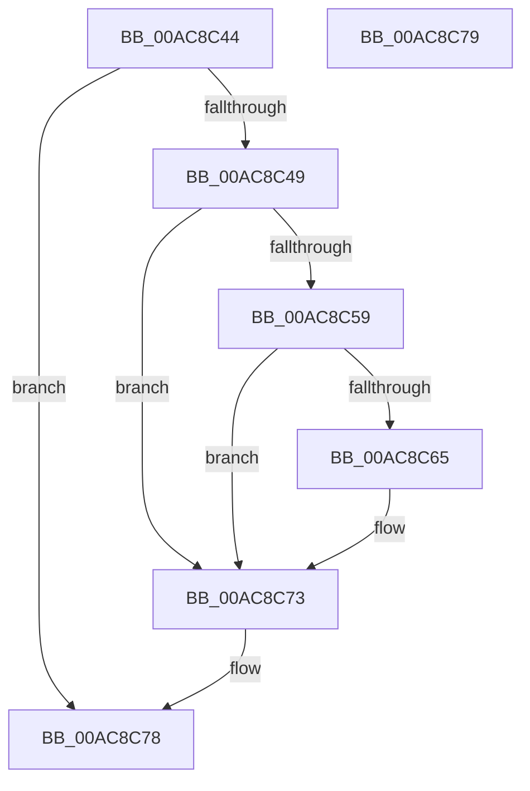

# PiUEventFreeProcessImagePath

- RVA: `0x00AC8C44`–`0x00AC8C7A` (길이 `54` bytes)
- VA: `0x0000000140AC8C44`
- 실행 섹션: `PAGE`
- PDB 이름 있음: `예`; PDB Function 태그: `아니요`
- unwind 정보 RVA: `0x000805BC`
- 디코드: `18`개 명령, `54/54` bytes 표시
- 미해석 바이트: `0` (있으면 어셈블리에 `.byte`로 보존)

> 이 문서는 커널 이미지의 기계어와 PDB 기호를 분석해 생성했습니다. 4번과 5번은 함수 원형과 자료형을 바이너리 사용 방식에서 추정한 C 해석이며 원본 소스 복구 결과는 아닙니다.

## 1. Dependencies

- 직접 호출 지점: **1**; 고유 호출 대상: **1**
- 직접 호출자로 확인된 함수: **4**
- RIP 상대 이미지 참조: **1**

### Outgoing calls
- `0x00AC8C6A` → [ExFreePoolWithTag](../../poolcode/B8/ExFreePoolWithTag_function_00B82870.md) (function, `0x00B82870`)

### Direct callers
- [PiUEventMovePendingEventToSynchronousQueue](../70/PiUEventMovePendingEventToSynchronousQueue_function_00700798.md) at `0x007008D9`
- [sub_00B1D4A4](../B1/Unknown_function_00B1D4A4.md) at `0x00B1D544`
- [sub_00B1D4A4](../B1/Unknown_function_00B1D4A4.md) at `0x00B1D5F5`
- [sub_00B1D4A4](../B1/Unknown_function_00B1D4A4.md) at `0x00B1D6C4`
- [sub_00B2EF58](../B2/Unknown_function_00B2EF58.md) at `0x00B2F084`
- [sub_00B2F090](../B2/Unknown_function_00B2F090.md) at `0x00B2F215`

### Static image references
- `0x00AC8C59` → RVA `0x0001E288` (`.rdata`; read)

## 2. Other-region calls and transfers

- 다른 실행 섹션으로 향하는 call: **1**
  - `0x00AC8C6A` → [ExFreePoolWithTag](../../poolcode/B8/ExFreePoolWithTag_function_00B82870.md) (`PAGE` → `POOLCODE`)
- 별도 외부 분기/꼬리 이동을 확인하지 못했습니다.

## 3. Assembly (complete function range)

```asm
00AC8C44  48 85 C9                        test rcx, rcx
00AC8C47  74 2F                           je 0x140ac8c78
00AC8C49  53                              push rbx
00AC8C4A  48 83 EC 20                     sub rsp, 0x20
00AC8C4E  48 8B D9                        mov rbx, rcx
00AC8C51  48 8B 09                        mov rcx, qword ptr [rcx]
00AC8C54  48 85 C9                        test rcx, rcx
00AC8C57  74 1A                           je 0x140ac8c73
00AC8C59  48 8D 05 28 56 55 FF            lea rax, [rip - 0xaaa9d8]
00AC8C60  48 3B C8                        cmp rcx, rax
00AC8C63  74 0E                           je 0x140ac8c73
00AC8C65  BA 50 6E 70 59                  mov edx, 0x59706e50
00AC8C6A  E8 01 9C 0B 00                  call 0x140b82870
00AC8C6F  48 83 23 00                     and qword ptr [rbx], 0
00AC8C73  48 83 C4 20                     add rsp, 0x20
00AC8C77  5B                              pop rbx
00AC8C78  C3                              ret
00AC8C79  CC                              int3
```

## 4. C-style interpretation (structured pseudocode)

```c
__int64 __fastcall PiUEventFreeProcessImagePath(__int64 a1)
{
    __int64 result;
    __int64 v_rsp;

    if (a1 == 0) goto loc_00AC8C78;
    v_rsp = (v_rsp) - (32);
    if (*(unsigned __int64 *)(a1) == 0) goto loc_00AC8C73;
    result = v_rip - 11184600;
    if ((*(unsigned __int64 *)(a1)) != (v_rip - 11184600)) {
        a2 = 0x59706E50ULL;
        result = ExFreePoolWithTag(*(unsigned __int64 *)(a1), a2, a3, a4);
    }
    v_rsp = (v_rsp) + (32);
loc_00AC8C78:
    return result;
}
```

## 5. (Beta) C Style

```c
int64_t PiUEventFreeProcessImagePath(int64_t Arg1)
{
    int64_t result;
    int64_t local_rsp;

    if (Arg1 == 0) goto loc_00AC8C78;
    local_rsp = (local_rsp) - (32);
    if (*(uint64_t *)(Arg1) == 0) goto loc_00AC8C73;
    result = v_rip - 11184600;
    if ((*(uint64_t *)(Arg1)) != (v_rip - 11184600)) {
        a2 = 0x59706E50ULL;
        result = ExFreePoolWithTag(*(uint64_t *)(Arg1), a2, a3, a4);
    }
    local_rsp = (local_rsp) + (32);
loc_00AC8C78:
    return result;
}
```

## 6. Execution-region graph

[열기: 2D/3D 그래프와 함수 탐색 컨트롤 패널](../../../control-panel.html?section=page&rva=0x00AC8C44&view=graph)

- 2D 그래프는 위에서 아래로 흐르고, 3D 그래프는 빈 공간을 드래그해 회전합니다. Shift+드래그는 이동, 휠은 확대·축소, 함수 노드 선택은 대상 보고서 이동입니다.

### Static fallback


