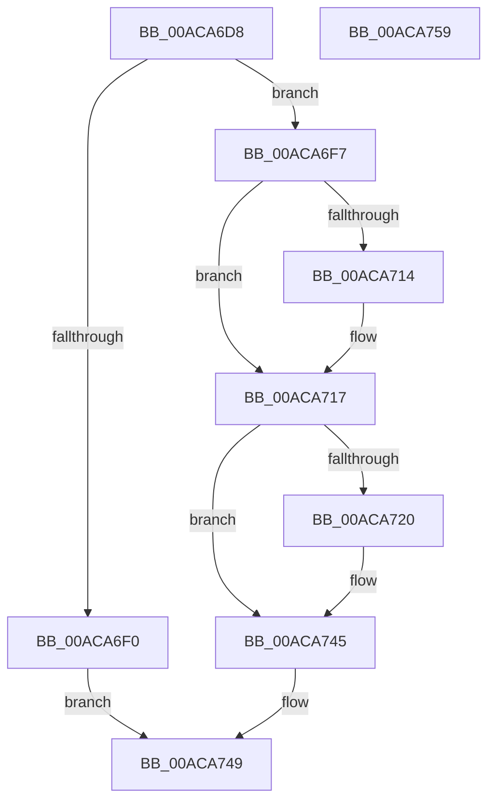

# PipDeviceObjectListRemove

- RVA: `0x00ACA6D8`–`0x00ACA75A` (길이 `130` bytes)
- VA: `0x0000000140ACA6D8`
- 실행 섹션: `PAGE`
- PDB 이름 있음: `예`; PDB Function 태그: `아니요`
- unwind 정보 RVA: `0x00060BC4`
- 디코드: `42`개 명령, `130/130` bytes 표시
- 미해석 바이트: `0` (있으면 어셈블리에 `.byte`로 보존)

> 이 문서는 커널 이미지의 기계어와 PDB 기호를 분석해 생성했습니다. 4번과 5번은 함수 원형과 자료형을 바이너리 사용 방식에서 추정한 C 해석이며 원본 소스 복구 결과는 아닙니다.

## 1. Dependencies

- 직접 호출 지점: **2**; 고유 호출 대상: **2**
- 직접 호출자로 확인된 함수: **3**
- RIP 상대 이미지 참조: **0**

### Outgoing calls
- `0x00ACA708` → [ObfDereferenceObjectWithTag](../../text/2F/ObfDereferenceObjectWithTag_function_002F78E0.md) (function, `0x002F78E0`)
- `0x00ACA740` → [memcpy](../../text/6C/memcpy_function_006C6840.md) (function, `0x006C6840`)

### Direct callers
- [IopRemoveCurrentRelationFromList](../73/IopRemoveCurrentRelationFromList_function_0073DB30.md) at `0x0073DB8C`
- [IopRemoveRelationFromList](../73/IopRemoveRelationFromList_function_0073DBB8.md) at `0x0073DBE0`
- [IopRemoveDeviceRelationsFromList](../A0/IopRemoveDeviceRelationsFromList_function_00A05C18.md) at `0x00A05C7F`

### Static image references
- 디코드된 RIP-relative 메모리 참조가 없습니다.

## 2. Other-region calls and transfers

- 다른 실행 섹션으로 향하는 call: **2**
  - `0x00ACA708` → [ObfDereferenceObjectWithTag](../../text/2F/ObfDereferenceObjectWithTag_function_002F78E0.md) (`PAGE` → `.text`)
  - `0x00ACA740` → [memcpy](../../text/6C/memcpy_function_006C6840.md) (`PAGE` → `.text`)
- 별도 외부 분기/꼬리 이동을 확인하지 못했습니다.

## 3. Assembly (complete function range)

```asm
00ACA6D8  48 89 5C 24 08                  mov qword ptr [rsp + 8], rbx
00ACA6DD  48 89 74 24 10                  mov qword ptr [rsp + 0x10], rsi
00ACA6E2  57                              push rdi
00ACA6E3  48 83 EC 20                     sub rsp, 0x20
00ACA6E7  48 8B D9                        mov rbx, rcx
00ACA6EA  8B FA                           mov edi, edx
00ACA6EC  3B 11                           cmp edx, dword ptr [rcx]
00ACA6EE  72 07                           jb 0x140aca6f7
00ACA6F0  B8 8C 00 00 C0                  mov eax, 0xc000008c
00ACA6F5  EB 52                           jmp 0x140aca749
00ACA6F7  48 8D 0C 7F                     lea rcx, [rdi + rdi*2]
00ACA6FB  BA 50 6E 70 4C                  mov edx, 0x4c706e50
00ACA700  48 8D 34 CB                     lea rsi, [rbx + rcx*8]
00ACA704  48 8B 4E 10                     mov rcx, qword ptr [rsi + 0x10]
00ACA708  E8 D3 D1 82 FF                  call 0x1402f78e0
00ACA70D  8B 46 20                        mov eax, dword ptr [rsi + 0x20]
00ACA710  A8 01                           test al, 1
00ACA712  74 03                           je 0x140aca717
00ACA714  FF 4B 08                        dec dword ptr [rbx + 8]
00ACA717  8B 13                           mov edx, dword ptr [rbx]
00ACA719  8D 42 FF                        lea eax, [rdx - 1]
00ACA71C  3B F8                           cmp edi, eax
00ACA71E  73 25                           jae 0x140aca745
00ACA720  2B D7                           sub edx, edi
00ACA722  8D 47 01                        lea eax, [rdi + 1]
00ACA725  FF CA                           dec edx
00ACA727  48 8D 4E 10                     lea rcx, [rsi + 0x10]
00ACA72B  4C 8D 04 52                     lea r8, [rdx + rdx*2]
00ACA72F  8B D0                           mov edx, eax
00ACA731  48 FF C0                        inc rax
00ACA734  49 C1 E0 03                     shl r8, 3
00ACA738  48 8D 04 42                     lea rax, [rdx + rax*2]
00ACA73C  48 8D 14 C3                     lea rdx, [rbx + rax*8]
00ACA740  E8 FB C0 BF FF                  call 0x1406c6840
00ACA745  FF 0B                           dec dword ptr [rbx]
00ACA747  33 C0                           xor eax, eax
00ACA749  48 8B 5C 24 30                  mov rbx, qword ptr [rsp + 0x30]
00ACA74E  48 8B 74 24 38                  mov rsi, qword ptr [rsp + 0x38]
00ACA753  48 83 C4 20                     add rsp, 0x20
00ACA757  5F                              pop rdi
00ACA758  C3                              ret
00ACA759  CC                              int3
```

## 4. C-style interpretation (structured pseudocode)

```c
__int64 __fastcall PipDeviceObjectListRemove(__int64 a1, int a2)
{
    __int64 result;
    __int64 v_rsp;
    unsigned __int64 v_stack_p10;
    unsigned __int64 v_stack_p8;

    v_stack_p8 = v_rbx;
    v_stack_p10 = v_rsi;
    v_rsp = (v_rsp) - (32);
    if (a2 < (*(unsigned int *)(a1))) goto loc_00ACA6F7;
    goto loc_00ACA749;
loc_00ACA6F7:
    result = ObfDereferenceObjectWithTag(*(unsigned __int64 *)(a1 + (unsigned int)(a2) + (unsigned int)(a2) * 2 * 8 + 16), (unsigned int)(0x4C706E50ULL), a3, a4);
    if ((((unsigned __int8)((unsigned int)(*(unsigned int *)(a1 + (unsigned int)(a2) + (unsigned int)(a2) * 2 * 8 + 32)))) & (1)) != 0) {
    }
    result = (unsigned int)(*(unsigned int *)(a1)) - 1;
    if (((unsigned int)((unsigned int)(a2))) < ((unsigned int)((unsigned int)(*(unsigned int *)(a1)) - 1))) {
        a2 = (unsigned int)(((unsigned int)(*(unsigned int *)(a1))) - ((unsigned int)((unsigned int)(a2))));
        result = (unsigned int)(a2) + 1;
        a2 = (unsigned int)((a2) - 1);
        a1 = a1 + (unsigned int)(a2) + (unsigned int)(a2) * 2 * 8 + 16;
        a3 = a2 + a2 * 2;
        a2 = (unsigned int)(result);
        result = (result) + 1;
        a3 = (a3) << (3);
        result = a2 + result * 2;
        a2 = a1 + result * 8;
        result = memcpy(a1, a2, a3, a4);
    }
    result = 0;
loc_00ACA749:
    v_rsp = (v_rsp) + (32);
    return result;
}
```

## 5. (Beta) C Style

```c
int64_t PipDeviceObjectListRemove(void *Arg1, void *Arg2)
{
    uint8_t *arg1 = (uint8_t *)Arg1;
    uint8_t *arg2 = (uint8_t *)Arg2;

    int64_t result;
    int64_t local_rsp;
    uint64_t v_stack_p10;
    uint64_t v_stack_p8;

    v_stack_p8 = local_rbx;
    v_stack_p10 = local_rsi;
    local_rsp = (local_rsp) - (32);
    if (Arg2 < (*(uint32_t *)(arg1))) goto loc_00ACA6F7;
    goto loc_00ACA749;
loc_00ACA6F7:
    result = ObfDereferenceObjectWithTag(*(uint64_t *)(arg1 + (uint32_t)(arg2) + (uint32_t)(arg2) * 2 * 8 + 0x10), (uint32_t)(0x4C706E50ULL), a3, a4);
    if ((((uint8_t)((uint32_t)(*(uint32_t *)(arg1 + (uint32_t)(arg2) + (uint32_t)(arg2) * 2 * 8 + 0x20)))) & (1)) != 0) {
    }
    result = (uint32_t)(*(uint32_t *)(arg1)) - 1;
    if (((uint32_t)((uint32_t)(Arg2))) < ((uint32_t)((uint32_t)(*(uint32_t *)(arg1)) - 1))) {
        Arg2 = (uint32_t)(((uint32_t)(*(uint32_t *)(arg1))) - ((uint32_t)((uint32_t)(Arg2))));
        result = (uint32_t)(Arg2) + 1;
        Arg2 = (uint32_t)((Arg2) - 1);
        Arg1 = Arg1 + (uint32_t)(Arg2) + (uint32_t)(Arg2) * 2 * 8 + 16;
        a3 = Arg2 + Arg2 * 2;
        Arg2 = (uint32_t)(result);
        result = (result) + 1;
        a3 = (a3) << (3);
        result = Arg2 + result * 2;
        Arg2 = Arg1 + result * 8;
        result = memcpy(Arg1, Arg2, a3, a4);
    }
    result = 0;
loc_00ACA749:
    local_rsp = (local_rsp) + (32);
    return result;
}
```

### 관측된 메모리 오프셋

구조체 형식이 확인되지 않은 접근은 인자 기준의 오프셋으로만 기록했습니다.

| 기준 인자 | 오프셋 표현 | 폭 (bit) | 접근 |
|---|---:|---:|---|
| `Arg1` | `+ 0x0` | `32` | `R` |
| `Arg1` | `+ 0x0` | `32` | `R/W` |
| `Arg1` | `+ 0x0 + rax*8` | `64` | `R` |
| `Arg1` | `+ 0x0 + rcx*8` | `64` | `R` |
| `Arg1` | `+ 0x8` | `32` | `R/W` |
| `Arg1` | `+ 0x10` | `64` | `R` |
| `Arg1` | `+ 0x20` | `32` | `R` |
| `Arg2` | `+ 0x0 + rdi*2` | `64` | `R` |

## 6. Execution-region graph

[열기: 2D/3D 그래프와 함수 탐색 컨트롤 패널](../../../control-panel.html?section=page&rva=0x00ACA6D8&view=graph)

- 2D 그래프는 위에서 아래로 흐르고, 3D 그래프는 빈 공간을 드래그해 회전합니다. Shift+드래그는 이동, 휠은 확대·축소, 함수 노드 선택은 대상 보고서 이동입니다.

### Static fallback


