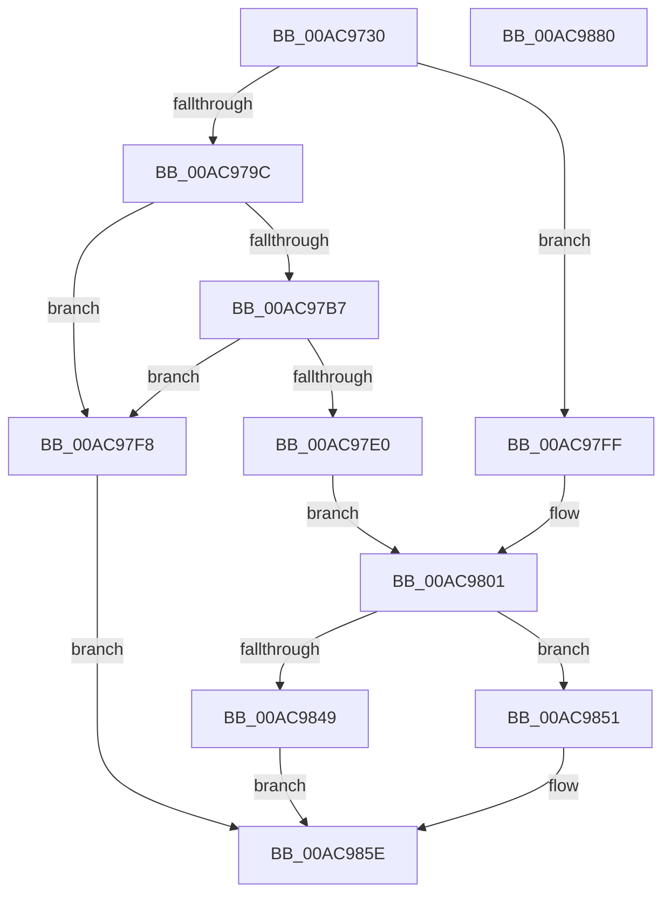

# PnpGetDeviceInstancePropertyData

- RVA: `0x00AC9730`–`0x00AC9881` (길이 `337` bytes)
- VA: `0x0000000140AC9730`
- 실행 섹션: `PAGE`
- PDB 이름 있음: `예`; PDB Function 태그: `아니요`
- unwind 정보 RVA: `0x000BE2A8`
- 디코드: `83`개 명령, `337/337` bytes 표시
- 미해석 바이트: `0` (있으면 어셈블리에 `.byte`로 보존)

> 이 문서는 커널 이미지의 기계어와 PDB 기호를 분석해 생성했습니다. 4번과 5번은 함수 원형과 자료형을 바이너리 사용 방식에서 추정한 C 해석이며 원본 소스 복구 결과는 아닙니다.

## 1. Dependencies

- 직접 호출 지점: **6**; 고유 호출 대상: **6**
- 직접 호출자로 확인된 함수: **0**
- RIP 상대 이미지 참조: **4**

### Outgoing calls
- `0x00AC9788` → [memset](../../text/6C/memset_function_006C6C40.md) (function, `0x006C6C40`)
- `0x00AC97BE` → [DbgPrint](../../text/35/DbgPrint_function_00358CB0.md) (function, `0x00358CB0`)
- `0x00AC97D7` → [DownLevelLangIDToLanguageName](../../text/4B/DownLevelLangIDToLanguageName_function_004BBAA8.md) (function, `0x004BBAA8`)
- `0x00AC97EC` → [RtlInitUnicodeString](../../text/42/RtlInitUnicodeString_function_0042A780.md) (function, `0x0042A780`)
- `0x00AC9840` → [PnpGetObjectProperty](../8E/PnpGetObjectProperty_function_008E2180.md) (function, `0x008E2180`)
- `0x00AC9869` → [_security_check_cookie](../../text/6A/_security_check_cookie_function_006AC640.md) (function, `0x006AC640`)

### Direct callers
- 이 함수 시작 RVA로 연결되는 직접 call은 확인되지 않았습니다. 간접 호출은 완전히 역산할 수 없습니다.

### Static image references
- `0x00AC9742` → RVA `0x00E0A740` (`.data`; read)
- `0x00AC97B7` → RVA `0x00B05A50` (` ?? ::NNGAKEGL::`string'`; read)
- `0x00AC97CD` → RVA `0x00E62390` (`.data`; read)
- `0x00AC9839` → RVA `0x00E66398` (`.data`; read)

## 2. Other-region calls and transfers

- 다른 실행 섹션으로 향하는 call: **5**
  - `0x00AC9788` → [memset](../../text/6C/memset_function_006C6C40.md) (`PAGE` → `.text`)
  - `0x00AC97BE` → [DbgPrint](../../text/35/DbgPrint_function_00358CB0.md) (`PAGE` → `.text`)
  - `0x00AC97D7` → [DownLevelLangIDToLanguageName](../../text/4B/DownLevelLangIDToLanguageName_function_004BBAA8.md) (`PAGE` → `.text`)
  - `0x00AC97EC` → [RtlInitUnicodeString](../../text/42/RtlInitUnicodeString_function_0042A780.md) (`PAGE` → `.text`)
  - `0x00AC9869` → [_security_check_cookie](../../text/6A/_security_check_cookie_function_006AC640.md) (`PAGE` → `.text`)
- 별도 외부 분기/꼬리 이동을 확인하지 못했습니다.

## 3. Assembly (complete function range)

```asm
00AC9730  40 53                           push rbx
00AC9732  55                              push rbp
00AC9733  56                              push rsi
00AC9734  57                              push rdi
00AC9735  41 55                           push r13
00AC9737  41 56                           push r14
00AC9739  41 57                           push r15
00AC973B  48 81 EC 40 01 00 00            sub rsp, 0x140
00AC9742  48 8B 05 F7 0F 34 00            mov rax, qword ptr [rip + 0x340ff7]
00AC9749  48 33 C4                        xor rax, rsp
00AC974C  48 89 84 24 30 01 00 00         mov qword ptr [rsp + 0x130], rax
00AC9754  4C 8B B4 24 A8 01 00 00         mov r14, qword ptr [rsp + 0x1a8]
00AC975C  41 8B D8                        mov ebx, r8d
00AC975F  4C 8B BC 24 B0 01 00 00         mov r15, qword ptr [rsp + 0x1b0]
00AC9767  48 8B EA                        mov rbp, rdx
00AC976A  48 8B BC 24 B8 01 00 00         mov rdi, qword ptr [rsp + 0x1b8]
00AC9772  48 8B F1                        mov rsi, rcx
00AC9775  41 BD AA 00 00 00               mov r13d, 0xaa
00AC977B  48 8D 8C 24 80 00 00 00         lea rcx, [rsp + 0x80]
00AC9783  45 8B C5                        mov r8d, r13d
00AC9786  33 D2                           xor edx, edx
00AC9788  E8 B3 D4 BF FF                  call 0x1406c6c40
00AC978D  48 83 64 24 68 00               and qword ptr [rsp + 0x68], 0
00AC9793  83 64 24 60 00                  and dword ptr [rsp + 0x60], 0
00AC9798  85 DB                           test ebx, ebx
00AC979A  74 63                           je 0x140ac97ff
00AC979C  66 44 89 6C 24 6A               mov word ptr [rsp + 0x6a], r13w
00AC97A2  48 8D 84 24 80 00 00 00         lea rax, [rsp + 0x80]
00AC97AA  48 89 44 24 70                  mov qword ptr [rsp + 0x70], rax
00AC97AF  81 FB 00 10 00 00               cmp ebx, 0x1000
00AC97B5  74 41                           je 0x140ac97f8
00AC97B7  48 8D 0D 92 C2 03 00            lea rcx, [rip + 0x3c292]
00AC97BE  E8 ED F4 88 FF                  call 0x140358cb0
00AC97C3  41 B9 02 00 00 00               mov r9d, 2
00AC97C9  45 8D 45 96                     lea r8d, [r13 - 0x6a]
00AC97CD  48 8D 15 BC 8B 39 00            lea rdx, [rip + 0x398bbc]
00AC97D4  0F B7 CB                        movzx ecx, bx
00AC97D7  E8 CC 22 9F FF                  call 0x1404bbaa8
00AC97DC  85 C0                           test eax, eax
00AC97DE  7E 18                           jle 0x140ac97f8
00AC97E0  48 8D 15 A9 8B 39 00            lea rdx, [rip + 0x398ba9]
00AC97E7  48 8D 4C 24 68                  lea rcx, [rsp + 0x68]
00AC97EC  E8 8F 0F 96 FF                  call 0x14042a780
00AC97F1  48 8B 4C 24 70                  mov rcx, qword ptr [rsp + 0x70]
00AC97F6  EB 09                           jmp 0x140ac9801
00AC97F8  B8 01 00 00 C0                  mov eax, 0xc0000001
00AC97FD  EB 5F                           jmp 0x140ac985e
00AC97FF  33 C9                           xor ecx, ecx
00AC9801  83 64 24 50 00                  and dword ptr [rsp + 0x50], 0
00AC9806  45 33 C9                        xor r9d, r9d
00AC9809  8B 84 24 A0 01 00 00            mov eax, dword ptr [rsp + 0x1a0]
00AC9810  48 8B D6                        mov rdx, rsi
00AC9813  4C 89 7C 24 48                  mov qword ptr [rsp + 0x48], r15
00AC9818  89 44 24 40                     mov dword ptr [rsp + 0x40], eax
00AC981C  48 8D 44 24 60                  lea rax, [rsp + 0x60]
00AC9821  4C 89 74 24 38                  mov qword ptr [rsp + 0x38], r14
00AC9826  45 8D 41 01                     lea r8d, [r9 + 1]
00AC982A  48 89 44 24 30                  mov qword ptr [rsp + 0x30], rax
00AC982F  48 89 6C 24 28                  mov qword ptr [rsp + 0x28], rbp
00AC9834  48 89 4C 24 20                  mov qword ptr [rsp + 0x20], rcx
00AC9839  48 8B 0D 58 CB 39 00            mov rcx, qword ptr [rip + 0x39cb58]
00AC9840  E8 3B 89 E1 FF                  call 0x1408e2180
00AC9845  85 C0                           test eax, eax
00AC9847  78 08                           js 0x140ac9851
00AC9849  8B 4C 24 60                     mov ecx, dword ptr [rsp + 0x60]
00AC984D  89 0F                           mov dword ptr [rdi], ecx
00AC984F  EB 0D                           jmp 0x140ac985e
00AC9851  3D 25 02 00 C0                  cmp eax, 0xc0000225
00AC9856  B9 34 00 00 C0                  mov ecx, 0xc0000034
00AC985B  0F 44 C1                        cmove eax, ecx
00AC985E  48 8B 8C 24 30 01 00 00         mov rcx, qword ptr [rsp + 0x130]
00AC9866  48 33 CC                        xor rcx, rsp
00AC9869  E8 D2 2D BE FF                  call 0x1406ac640
00AC986E  48 81 C4 40 01 00 00            add rsp, 0x140
00AC9875  41 5F                           pop r15
00AC9877  41 5E                           pop r14
00AC9879  41 5D                           pop r13
00AC987B  5F                              pop rdi
00AC987C  5E                              pop rsi
00AC987D  5D                              pop rbp
00AC987E  5B                              pop rbx
00AC987F  C3                              ret
00AC9880  CC                              int3
```

## 4. C-style interpretation (structured pseudocode)

```c
__int64 __fastcall PnpGetDeviceInstancePropertyData(__int64 a1, __int64 a2, int a3, __int64 a4, unsigned int a5, __int64 a6, __int64 a7, __int64 a8)
{
    __int64 result;
    __int64 v_rsp;
    unsigned __int64 v_stack_m108;
    unsigned __int16 v_stack_m10E;
    unsigned __int64 v_stack_m110;
    unsigned int v_stack_m118;
    unsigned int v_stack_m128;
    unsigned __int64 v_stack_m130;
    unsigned int v_stack_m138;
    unsigned __int64 v_stack_m140;
    unsigned __int64 v_stack_m148;
    unsigned __int64 v_stack_m150;
    unsigned __int64 v_stack_m158;
    unsigned __int64 v_stack_m48;
    unsigned __int64 v_stack_mF8;

    v_rsp = (v_rsp) - (320);
    result = (*(unsigned __int64 *)(v_rip + 3411959)) ^ (v_rsp);
    v_stack_m48 = result;
    a2 = 0;
    result = memset(v_stack_mF8, a2, 170, a4);
    if ((unsigned int)((unsigned int)(a3)) == 0) goto loc_00AC97FF;
    v_stack_m10E = 170;
    v_stack_m108 = v_stack_mF8;
    if (((unsigned int)((unsigned int)(a3))) == 0x1000ULL) goto loc_00AC97F8;
    result = DbgPrint(v_rip + 246418, a2, 170, a4);
    result = DownLevelLangIDToLanguageName((unsigned __int16)((unsigned int)(a3)), v_rip + 3771324, 170 - 106, 2);
    if (condition_is_less_or_equal) goto loc_00AC97F8;
    result = RtlInitUnicodeString(v_stack_m110, v_rip + 3771305, 170 - 106, 2);
    goto loc_00AC9801;
loc_00AC97F8:
    goto loc_00AC985E;
loc_00AC97FF:
    a1 = 0;
loc_00AC9801:
    a4 = 0;
    v_stack_m130 = a7;
    v_stack_m138 = (unsigned int)((unsigned int)(a5));
    v_stack_m140 = a6;
    v_stack_m148 = v_stack_m118;
    v_stack_m150 = 0;
    v_stack_m158 = 0;
    result = PnpGetObjectProperty(*(unsigned __int64 *)(v_rip + 3787608), 0, a4 + 1, a4);
    if (sign_flag) goto loc_00AC9851;
    *(unsigned int *)(a8) = (unsigned int)((unsigned int)(v_stack_m118));
    goto loc_00AC985E;
loc_00AC9851:
    if (((unsigned int)(result)) == 0xC0000225ULL) { result = (unsigned int)((unsigned int)(0xC0000034ULL)); }
loc_00AC985E:
    a1 = (v_stack_m48) ^ (v_rsp);
    result = _security_check_cookie(a1, 0, a4 + 1, a4);
    v_rsp = (v_rsp) + (320);
    return result;
}
```

## 5. (Beta) C Style

```c
int64_t PnpGetDeviceInstancePropertyData(int64_t Arg1, int64_t Arg2, int32_t Arg3, int64_t Arg4, uint32_t Arg5, int64_t Arg6, int64_t Arg7, void *Arg8)
{
    uint8_t *arg8 = (uint8_t *)Arg8;

    int64_t result;
    int64_t local_rsp;
    uint64_t v_stack_m108;
    uint16_t v_stack_m10E;
    uint64_t v_stack_m110;
    uint32_t v_stack_m118;
    uint32_t v_stack_m128;
    uint64_t v_stack_m130;
    uint32_t v_stack_m138;
    uint64_t v_stack_m140;
    uint64_t v_stack_m148;
    uint64_t v_stack_m150;
    uint64_t v_stack_m158;
    uint64_t v_stack_m48;
    uint64_t v_stack_mF8;

    local_rsp = (local_rsp) - (320);
    result = (*(uint64_t *)(v_rip + 0x340FF7)) ^ (local_rsp);
    v_stack_m48 = result;
    Arg2 = 0;
    result = memset(v_stack_mF8, Arg2, 170, Arg4);
    if ((uint32_t)((uint32_t)(Arg3)) == 0) goto loc_00AC97FF;
    v_stack_m10E = 170;
    v_stack_m108 = v_stack_mF8;
    if (((uint32_t)((uint32_t)(Arg3))) == 0x1000ULL) goto loc_00AC97F8;
    result = DbgPrint(v_rip + 246418, Arg2, 170, Arg4);
    result = DownLevelLangIDToLanguageName((uint16_t)((uint32_t)(Arg3)), v_rip + 3771324, 170 - 106, 2);
    if (condition_is_less_or_equal) goto loc_00AC97F8;
    result = RtlInitUnicodeString(v_stack_m110, v_rip + 3771305, 170 - 106, 2);
    goto loc_00AC9801;
loc_00AC97F8:
    goto loc_00AC985E;
loc_00AC97FF:
    Arg1 = 0;
loc_00AC9801:
    Arg4 = 0;
    v_stack_m130 = Arg7;
    v_stack_m138 = (uint32_t)((uint32_t)(Arg5));
    v_stack_m140 = Arg6;
    v_stack_m148 = v_stack_m118;
    v_stack_m150 = 0;
    v_stack_m158 = 0;
    result = PnpGetObjectProperty(*(uint64_t *)(v_rip + 0x39CB58), 0, Arg4 + 1, Arg4);
    if (sign_flag) goto loc_00AC9851;
    *(uint32_t *)(arg8) = (uint32_t)((uint32_t)(v_stack_m118));
    goto loc_00AC985E;
loc_00AC9851:
    if (((uint32_t)(result)) == 0xC0000225ULL) { result = (uint32_t)((uint32_t)(0xC0000034ULL)); }
loc_00AC985E:
    Arg1 = (v_stack_m48) ^ (local_rsp);
    result = _security_check_cookie(Arg1, 0, Arg4 + 1, Arg4);
    local_rsp = (local_rsp) + (320);
    return result;
}
```

### 관측된 메모리 오프셋

구조체 형식이 확인되지 않은 접근은 인자 기준의 오프셋으로만 기록했습니다.

| 기준 인자 | 오프셋 표현 | 폭 (bit) | 접근 |
|---|---:|---:|---|
| `Arg8` | `+ 0x0` | `32` | `W` |

## 6. Execution-region graph

[열기: 2D/3D 그래프와 함수 탐색 컨트롤 패널](../../../control-panel.html?section=page&rva=0x00AC9730&view=graph)

- 2D 그래프는 위에서 아래로 흐르고, 3D 그래프는 빈 공간을 드래그해 회전합니다. Shift+드래그는 이동, 휠은 확대·축소, 함수 노드 선택은 대상 보고서 이동입니다.

### Static fallback


