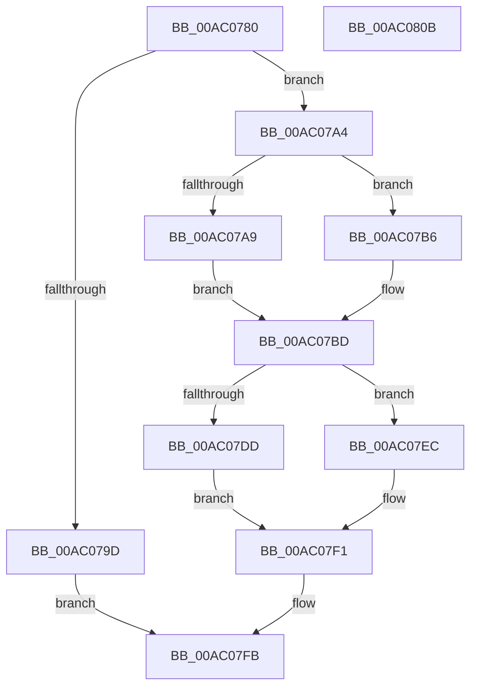

# PnpGetSystemPdoList

- RVA: `0x00AC0780`–`0x00AC080C` (길이 `140` bytes)
- VA: `0x0000000140AC0780`
- 실행 섹션: `PAGE`
- PDB 이름 있음: `예`; PDB Function 태그: `아니요`
- unwind 정보 RVA: `0x000794E0`
- 디코드: `39`개 명령, `140/140` bytes 표시
- 미해석 바이트: `0` (있으면 어셈블리에 `.byte`로 보존)

> 이 문서는 커널 이미지의 기계어와 PDB 기호를 분석해 생성했습니다. 4번과 5번은 함수 원형과 자료형을 바이너리 사용 방식에서 추정한 C 해석이며 원본 소스 복구 결과는 아닙니다.

## 1. Dependencies

- 직접 호출 지점: **2**; 고유 호출 대상: **2**
- 직접 호출자로 확인된 함수: **0**
- RIP 상대 이미지 참조: **2**

### Outgoing calls
- `0x00AC07D2` → [PipForDeviceNodeSubtree](../A5/PipForDeviceNodeSubtree_function_00A51920.md) (function, `0x00A51920`)
- `0x00AC07F4` → [PiPnpFreePdoDeviceList](../A9/PiPnpFreePdoDeviceList_function_00A9B5F8.md) (function, `0x00A9B5F8`)

### Direct callers
- 이 함수 시작 RVA로 연결되는 직접 call은 확인되지 않았습니다. 간접 호출은 완전히 역산할 수 없습니다.

### Static image references
- `0x00AC07B6` → RVA `0x00F8C438` (`.data`; read)
- `0x00AC07C7` → RVA `0x00A79830` (`PiPnpPdoDeviceListEnumCallback`; read)

## 2. Other-region calls and transfers

- 다른 실행 섹션으로 향하는 call: **0**
- 별도 외부 분기/꼬리 이동을 확인하지 못했습니다.

## 3. Assembly (complete function range)

```asm
00AC0780  48 89 5C 24 08                  mov qword ptr [rsp + 8], rbx
00AC0785  48 89 74 24 10                  mov qword ptr [rsp + 0x10], rsi
00AC078A  57                              push rdi
00AC078B  48 83 EC 30                     sub rsp, 0x30
00AC078F  33 DB                           xor ebx, ebx
00AC0791  48 8B FA                        mov rdi, rdx
00AC0794  89 5C 24 24                     mov dword ptr [rsp + 0x24], ebx
00AC0798  48 85 D2                        test rdx, rdx
00AC079B  75 07                           jne 0x140ac07a4
00AC079D  B8 0D 00 00 C0                  mov eax, 0xc000000d
00AC07A2  EB 57                           jmp 0x140ac07fb
00AC07A4  48 85 C9                        test rcx, rcx
00AC07A7  74 0D                           je 0x140ac07b6
00AC07A9  48 8B 81 38 01 00 00            mov rax, qword ptr [rcx + 0x138]
00AC07B0  48 8B 48 28                     mov rcx, qword ptr [rax + 0x28]
00AC07B4  EB 07                           jmp 0x140ac07bd
00AC07B6  48 8B 0D 7B BC 4C 00            mov rcx, qword ptr [rip + 0x4cbc7b]
00AC07BD  4C 8D 44 24 20                  lea r8, [rsp + 0x20]
00AC07C2  48 89 5C 24 28                  mov qword ptr [rsp + 0x28], rbx
00AC07C7  48 8D 15 62 90 FB FF            lea rdx, [rip - 0x46f9e]
00AC07CE  89 5C 24 20                     mov dword ptr [rsp + 0x20], ebx
00AC07D2  E8 49 11 F9 FF                  call 0x140a51920
00AC07D7  8B F0                           mov esi, eax
00AC07D9  85 C0                           test eax, eax
00AC07DB  78 0F                           js 0x140ac07ec
00AC07DD  48 8B 4C 24 28                  mov rcx, qword ptr [rsp + 0x28]
00AC07E2  48 89 0F                        mov qword ptr [rdi], rcx
00AC07E5  48 89 5C 24 28                  mov qword ptr [rsp + 0x28], rbx
00AC07EA  EB 05                           jmp 0x140ac07f1
00AC07EC  48 8B 5C 24 28                  mov rbx, qword ptr [rsp + 0x28]
00AC07F1  48 8B CB                        mov rcx, rbx
00AC07F4  E8 FF AD FD FF                  call 0x140a9b5f8
00AC07F9  8B C6                           mov eax, esi
00AC07FB  48 8B 5C 24 40                  mov rbx, qword ptr [rsp + 0x40]
00AC0800  48 8B 74 24 48                  mov rsi, qword ptr [rsp + 0x48]
00AC0805  48 83 C4 30                     add rsp, 0x30
00AC0809  5F                              pop rdi
00AC080A  C3                              ret
00AC080B  CC                              int3
```

## 4. C-style interpretation (structured pseudocode)

```c
__int64 __fastcall PnpGetSystemPdoList(__int64 a1, __int64 a2)
{
    __int64 result;
    __int64 v_rbx;
    __int64 v_rsp;
    unsigned __int64 v_stack_m10;
    unsigned int v_stack_m14;
    unsigned __int64 v_stack_m18;
    unsigned __int64 v_stack_p10;
    unsigned __int64 v_stack_p8;

    v_stack_p8 = v_rbx;
    v_stack_p10 = v_rsi;
    v_rsp = (v_rsp) - (48);
    v_rbx = 0;
    v_stack_m14 = 0;
    if (a2 != 0) goto loc_00AC07A4;
    goto loc_00AC07FB;
loc_00AC07A4:
    if (a1 == 0) goto loc_00AC07B6;
    goto loc_00AC07BD;
loc_00AC07B6:
loc_00AC07BD:
    v_stack_m10 = 0;
    v_stack_m18 = 0;
    result = PipForDeviceNodeSubtree(*(unsigned __int64 *)(v_rip + 5028987), v_rip - 290718, v_stack_m18, a4);
    if (sign_flag) goto loc_00AC07EC;
    *(unsigned __int64 *)(a2) = v_stack_m10;
    v_stack_m10 = 0;
    goto loc_00AC07F1;
loc_00AC07EC:
loc_00AC07F1:
    result = PiPnpFreePdoDeviceList(v_stack_m10, v_rip - 290718, v_stack_m18, a4);
loc_00AC07FB:
    v_rsp = (v_rsp) + (48);
    return (unsigned int)((unsigned int)((unsigned int)((unsigned int)(result))));
}
```

## 5. (Beta) C Style

```c
int64_t PnpGetSystemPdoList(int64_t Arg1, void *Arg2)
{
    uint8_t *arg2 = (uint8_t *)Arg2;

    int64_t result;
    int64_t local_rbx;
    int64_t local_rsp;
    uint64_t v_stack_m10;
    uint32_t v_stack_m14;
    uint64_t v_stack_m18;
    uint64_t v_stack_p10;
    uint64_t v_stack_p8;

    v_stack_p8 = local_rbx;
    v_stack_p10 = local_rsi;
    local_rsp = (local_rsp) - (48);
    local_rbx = 0;
    v_stack_m14 = 0;
    if (Arg2 != NULL) goto loc_00AC07A4;
    goto loc_00AC07FB;
loc_00AC07A4:
    if (Arg1 == 0) goto loc_00AC07B6;
    goto loc_00AC07BD;
loc_00AC07B6:
loc_00AC07BD:
    v_stack_m10 = 0;
    v_stack_m18 = 0;
    result = PipForDeviceNodeSubtree(*(uint64_t *)(v_rip + 0x4CBC7B), v_rip - 290718, v_stack_m18, a4);
    if (sign_flag) goto loc_00AC07EC;
    *(uint64_t *)(arg2) = v_stack_m10;
    v_stack_m10 = 0;
    goto loc_00AC07F1;
loc_00AC07EC:
loc_00AC07F1:
    result = PiPnpFreePdoDeviceList(v_stack_m10, v_rip - 290718, v_stack_m18, a4);
loc_00AC07FB:
    local_rsp = (local_rsp) + (48);
    return (uint32_t)((uint32_t)((uint32_t)((uint32_t)(result))));
}
```

### 관측된 메모리 오프셋

구조체 형식이 확인되지 않은 접근은 인자 기준의 오프셋으로만 기록했습니다.

| 기준 인자 | 오프셋 표현 | 폭 (bit) | 접근 |
|---|---:|---:|---|
| `Arg2` | `+ 0x0` | `64` | `W` |

## 6. Execution-region graph

[열기: 2D/3D 그래프와 함수 탐색 컨트롤 패널](../../../control-panel.html?section=page&rva=0x00AC0780&view=graph)

- 2D 그래프는 위에서 아래로 흐르고, 3D 그래프는 빈 공간을 드래그해 회전합니다. Shift+드래그는 이동, 휠은 확대·축소, 함수 노드 선택은 대상 보고서 이동입니다.

### Static fallback


