# PnpInstallerClassRaisePropertyChangeEventWorker

- RVA: `0x00ACAF9C`–`0x00ACB084` (길이 `232` bytes)
- VA: `0x0000000140ACAF9C`
- 실행 섹션: `PAGE`
- PDB 이름 있음: `예`; PDB Function 태그: `아니요`
- unwind 정보 RVA: `0x00091ECC`
- 디코드: `60`개 명령, `232/232` bytes 표시
- 미해석 바이트: `0` (있으면 어셈블리에 `.byte`로 보존)

> 이 문서는 커널 이미지의 기계어와 PDB 기호를 분석해 생성했습니다. 4번과 5번은 함수 원형과 자료형을 바이너리 사용 방식에서 추정한 C 해석이며 원본 소스 복구 결과는 아닙니다.

## 1. Dependencies

- 직접 호출 지점: **2**; 고유 호출 대상: **1**
- 직접 호출자로 확인된 함수: **1**
- RIP 상대 이미지 참조: **1**

### Outgoing calls
- `0x00ACAFE9` → [guard_dispatch_icall](../../text/6B/guard_dispatch_icall_function_006BAAD0.md) (function, `0x006BAAD0`)
- `0x00ACB059` → [guard_dispatch_icall](../../text/6B/guard_dispatch_icall_function_006BAAD0.md) (function, `0x006BAAD0`)

### Direct callers
- [PnpObjectRaisePropertyChangeEvent](../8F/PnpObjectRaisePropertyChangeEvent_function_008F7E94.md) at `0x008F7F76`

### Static image references
- `0x00ACAFEE` → RVA `0x000063B8` (`.rdata`; read)

## 2. Other-region calls and transfers

- 다른 실행 섹션으로 향하는 call: **2**
  - `0x00ACAFE9` → [guard_dispatch_icall](../../text/6B/guard_dispatch_icall_function_006BAAD0.md) (`PAGE` → `.text`)
  - `0x00ACB059` → [guard_dispatch_icall](../../text/6B/guard_dispatch_icall_function_006BAAD0.md) (`PAGE` → `.text`)
- 별도 외부 분기/꼬리 이동을 확인하지 못했습니다.

## 3. Assembly (complete function range)

```asm
00ACAF9C  4C 8B DC                        mov r11, rsp
00ACAF9F  49 89 5B 08                     mov qword ptr [r11 + 8], rbx
00ACAFA3  49 89 6B 10                     mov qword ptr [r11 + 0x10], rbp
00ACAFA7  49 89 73 18                     mov qword ptr [r11 + 0x18], rsi
00ACAFAB  49 89 7B 20                     mov qword ptr [r11 + 0x20], rdi
00ACAFAF  41 56                           push r14
00ACAFB1  48 83 EC 50                     sub rsp, 0x50
00ACAFB5  48 8B BC 24 80 00 00 00         mov rdi, qword ptr [rsp + 0x80]
00ACAFBD  49 8D 43 D8                     lea rax, [r11 - 0x28]
00ACAFC1  4D 89 4B E0                     mov qword ptr [r11 - 0x20], r9
00ACAFC5  48 8B EA                        mov rbp, rdx
00ACAFC8  41 B9 04 00 00 00               mov r9d, 4
00ACAFCE  4D 89 43 D8                     mov qword ptr [r11 - 0x28], r8
00ACAFD2  49 89 43 C8                     mov qword ptr [r11 - 0x38], rax
00ACAFD6  4C 8B F1                        mov r14, rcx
00ACAFD9  48 8B 84 24 88 00 00 00         mov rax, qword ptr [rsp + 0x88]
00ACAFE1  49 89 7B E8                     mov qword ptr [r11 - 0x18], rdi
00ACAFE5  45 8D 41 FE                     lea r8d, [r9 - 2]
00ACAFE9  E8 E2 FA BE FF                  call 0x1406baad0
00ACAFEE  48 8D 1D C3 B3 53 FF            lea rbx, [rip - 0xac4c3d]
00ACAFF5  BE 03 00 00 00                  mov esi, 3
00ACAFFA  44 8B 0B                        mov r9d, dword ptr [rbx]
00ACAFFD  33 D2                           xor edx, edx
00ACAFFF  41 3B D1                        cmp edx, r9d
00ACB002  73 5A                           jae 0x140acb05e
00ACB004  48 8B 43 F8                     mov rax, qword ptr [rbx - 8]
00ACB008  4C 8B 04 D0                     mov r8, qword ptr [rax + rdx*8]
00ACB00C  41 8B 40 10                     mov eax, dword ptr [r8 + 0x10]
00ACB010  39 47 10                        cmp dword ptr [rdi + 0x10], eax
00ACB013  75 15                           jne 0x140acb02a
00ACB015  48 8B 0F                        mov rcx, qword ptr [rdi]
00ACB018  49 2B 08                        sub rcx, qword ptr [r8]
00ACB01B  75 08                           jne 0x140acb025
00ACB01D  48 8B 4F 08                     mov rcx, qword ptr [rdi + 8]
00ACB021  49 2B 48 08                     sub rcx, qword ptr [r8 + 8]
00ACB025  48 85 C9                        test rcx, rcx
00ACB028  74 04                           je 0x140acb02e
00ACB02A  FF C2                           inc edx
00ACB02C  EB D1                           jmp 0x140acafff
00ACB02E  48 8B 43 08                     mov rax, qword ptr [rbx + 8]
00ACB032  41 B9 04 00 00 00               mov r9d, 4
00ACB038  48 89 44 24 40                  mov qword ptr [rsp + 0x40], rax
00ACB03D  48 8B D5                        mov rdx, rbp
00ACB040  48 8D 44 24 30                  lea rax, [rsp + 0x30]
00ACB045  49 8B CE                        mov rcx, r14
00ACB048  48 89 44 24 20                  mov qword ptr [rsp + 0x20], rax
00ACB04D  48 8B 84 24 88 00 00 00         mov rax, qword ptr [rsp + 0x88]
00ACB055  45 8D 41 FE                     lea r8d, [r9 - 2]
00ACB059  E8 72 FA BE FF                  call 0x1406baad0
00ACB05E  48 83 C3 18                     add rbx, 0x18
00ACB062  48 83 EE 01                     sub rsi, 1
00ACB066  75 92                           jne 0x140acaffa
00ACB068  48 8B 5C 24 60                  mov rbx, qword ptr [rsp + 0x60]
00ACB06D  48 8B 6C 24 68                  mov rbp, qword ptr [rsp + 0x68]
00ACB072  48 8B 74 24 70                  mov rsi, qword ptr [rsp + 0x70]
00ACB077  48 8B 7C 24 78                  mov rdi, qword ptr [rsp + 0x78]
00ACB07C  48 83 C4 50                     add rsp, 0x50
00ACB080  41 5E                           pop r14
00ACB082  C3                              ret
00ACB083  CC                              int3
```

## 4. C-style interpretation (structured pseudocode)

```c
__int64 __fastcall PnpInstallerClassRaisePropertyChangeEventWorker(__int64 a1, __int64 a2, __int64 a3, __int64 a4, __int64 a5, __int64 a6)
{
    __int64 result;
    __int64 v_rbx;
    __int64 v_rsi;
    __int64 v_rsp;
    unsigned __int64 v_stack_m18;
    unsigned __int64 v_stack_m28;
    unsigned __int64 v_stack_m38;
    unsigned __int64 v_stack_p10;
    unsigned __int64 v_stack_p18;
    unsigned __int64 v_stack_p20;
    unsigned __int64 v_stack_p8;

    *(unsigned __int64 *)(v_rsp + 8) = v_rbx;
    *(unsigned __int64 *)(v_rsp + 16) = v_rbp;
    *(unsigned __int64 *)(v_rsp + 24) = v_rsi;
    *(unsigned __int64 *)(v_rsp + 32) = v_rdi;
    v_rsp = (v_rsp) - (80);
    *(unsigned __int64 *)(v_rsp - 32) = a4;
    *(unsigned __int64 *)(v_rsp - 40) = a3;
    *(unsigned __int64 *)(v_rsp - 56) = v_rsp - 40;
    *(unsigned __int64 *)(v_rsp - 24) = a5;
    result = guard_dispatch_icall(a1, a2, 4 - 2, 4);
loc_00ACAFFA:
    a2 = 0;
loc_00ACAFFF:
    if (0 >= ((unsigned int)((unsigned int)(*(unsigned int *)(v_rip - 11291709))))) goto loc_00ACB05E;
    if ((*(unsigned int *)(a5 + 16)) != ((unsigned int)((unsigned int)(*(unsigned int *)(*(unsigned __int64 *)(*(unsigned __int64 *)(v_rip - 11291709 - 8) + a2 * 8) + 16))))) goto loc_00ACB02A;
    a1 = (*(unsigned __int64 *)(a5)) - (*(unsigned __int64 *)(*(unsigned __int64 *)(*(unsigned __int64 *)(v_rip - 11291709 - 8) + a2 * 8)));
    if (!(condition_is_not_equal)) {
        a1 = *(unsigned __int64 *)(a5 + 8);
        a1 = (a1) - (*(unsigned __int64 *)(*(unsigned __int64 *)(*(unsigned __int64 *)(v_rip - 11291709 - 8) + a2 * 8) + 8));
    }
    if (a1 == 0) goto loc_00ACB02E;
loc_00ACB02A:
    a2 = (unsigned int)((a2) + 1);
    goto loc_00ACAFFF;
loc_00ACB02E:
    v_stack_m18 = *(unsigned __int64 *)(v_rip - 11291709 + 8);
    v_stack_m38 = v_stack_m28;
    result = guard_dispatch_icall(a1, a2, 4 - 2, 4);
loc_00ACB05E:
    v_rbx = (v_rip - 11291709) + (24);
    v_rsi = (3) - (1);
    if (condition_is_not_equal) goto loc_00ACAFFA;
    v_rsp = (v_rsp) + (80);
    return result;
}
```

## 5. (Beta) C Style

```c
int64_t PnpInstallerClassRaisePropertyChangeEventWorker(int64_t Arg1, int64_t Arg2, int64_t Arg3, int64_t Arg4, void *Arg5, int64_t Arg6)
{
    uint8_t *arg5 = (uint8_t *)Arg5;

    int64_t result;
    int64_t local_rbx;
    int64_t local_rsi;
    int64_t local_rsp;
    uint64_t v_stack_m18;
    uint64_t v_stack_m28;
    uint64_t v_stack_m38;
    uint64_t v_stack_p10;
    uint64_t v_stack_p18;
    uint64_t v_stack_p20;
    uint64_t v_stack_p8;

    *(uint64_t *)(local_rsp + 0x8) = local_rbx;
    *(uint64_t *)(local_rsp + 0x10) = local_rbp;
    *(uint64_t *)(local_rsp + 0x18) = local_rsi;
    *(uint64_t *)(local_rsp + 0x20) = local_rdi;
    local_rsp = (local_rsp) - (80);
    *(uint64_t *)(local_rsp - 0x20) = Arg4;
    *(uint64_t *)(local_rsp - 0x28) = Arg3;
    *(uint64_t *)(local_rsp - 0x38) = local_rsp - 40;
    *(void **)(local_rsp - 0x18) = Arg5;
    result = guard_dispatch_icall(Arg1, Arg2, 4 - 2, 4);
loc_00ACAFFA:
    Arg2 = 0;
loc_00ACAFFF:
    if (0 >= ((uint32_t)((uint32_t)(*(uint32_t *)(v_rip - 0xAC4C3D))))) goto loc_00ACB05E;
    if ((*(uint32_t *)(arg5 + 0x10)) != ((uint32_t)((uint32_t)(*(uint32_t *)(*(uint64_t *)(*(uint64_t *)(v_rip - 0xAC4C3D - 0x8) + Arg2 * 8) + 0x10))))) goto loc_00ACB02A;
    Arg1 = (*(uint64_t *)(arg5)) - (*(uint64_t *)(*(uint64_t *)(*(uint64_t *)(v_rip - 0xAC4C3D - 0x8) + Arg2 * 8)));
    if (!(condition_is_not_equal)) {
        Arg1 = *(uint64_t *)(arg5 + 0x8);
        Arg1 = (Arg1) - (*(uint64_t *)(*(uint64_t *)(*(uint64_t *)(v_rip - 0xAC4C3D - 0x8) + Arg2 * 8) + 0x8));
    }
    if (Arg1 == 0) goto loc_00ACB02E;
loc_00ACB02A:
    Arg2 = (uint32_t)((Arg2) + 1);
    goto loc_00ACAFFF;
loc_00ACB02E:
    v_stack_m18 = *(uint64_t *)(v_rip - 0xAC4C3D + 0x8);
    v_stack_m38 = v_stack_m28;
    result = guard_dispatch_icall(Arg1, Arg2, 4 - 2, 4);
loc_00ACB05E:
    local_rbx = (v_rip - 11291709) + (24);
    local_rsi = (3) - (1);
    if (condition_is_not_equal) goto loc_00ACAFFA;
    local_rsp = (local_rsp) + (80);
    return result;
}
```

### 관측된 메모리 오프셋

구조체 형식이 확인되지 않은 접근은 인자 기준의 오프셋으로만 기록했습니다.

| 기준 인자 | 오프셋 표현 | 폭 (bit) | 접근 |
|---|---:|---:|---|
| `Arg5` | `+ 0x0` | `64` | `R` |
| `Arg5` | `+ 0x8` | `64` | `R` |
| `Arg5` | `+ 0x10` | `32` | `R` |

## 6. Execution-region graph

[열기: 2D/3D 그래프와 함수 탐색 컨트롤 패널](../../../control-panel.html?section=page&rva=0x00ACAF9C&view=graph)

- 2D 그래프는 위에서 아래로 흐르고, 3D 그래프는 빈 공간을 드래그해 회전합니다. Shift+드래그는 이동, 휠은 확대·축소, 함수 노드 선택은 대상 보고서 이동입니다.

### Static fallback

```mermaid
flowchart TD
  bb_00ACAF9C[BB_00ACAF9C]
  bb_00ACAFFA[BB_00ACAFFA]
  bb_00ACAFFF[BB_00ACAFFF]
  bb_00ACB004[BB_00ACB004]
  bb_00ACB015[BB_00ACB015]
  bb_00ACB01D[BB_00ACB01D]
  bb_00ACB025[BB_00ACB025]
  bb_00ACB02A[BB_00ACB02A]
  bb_00ACB02E[BB_00ACB02E]
  bb_00ACB05E[BB_00ACB05E]
  bb_00ACB068[BB_00ACB068]
  bb_00ACB083[BB_00ACB083]
  bb_00ACAF9C -->|flow| bb_00ACAFFA
  bb_00ACAFFA -->|flow| bb_00ACAFFF
  bb_00ACAFFF -->|branch| bb_00ACB05E
  bb_00ACAFFF -->|fallthrough| bb_00ACB004
  bb_00ACB004 -->|branch| bb_00ACB02A
  bb_00ACB004 -->|fallthrough| bb_00ACB015
  bb_00ACB015 -->|branch| bb_00ACB025
  bb_00ACB015 -->|fallthrough| bb_00ACB01D
  bb_00ACB01D -->|flow| bb_00ACB025
  bb_00ACB025 -->|branch| bb_00ACB02E
  bb_00ACB025 -->|fallthrough| bb_00ACB02A
  bb_00ACB02A -->|branch| bb_00ACAFFF
  bb_00ACB02E -->|flow| bb_00ACB05E
  bb_00ACB05E -->|branch| bb_00ACAFFA
  bb_00ACB05E -->|fallthrough| bb_00ACB068
```


