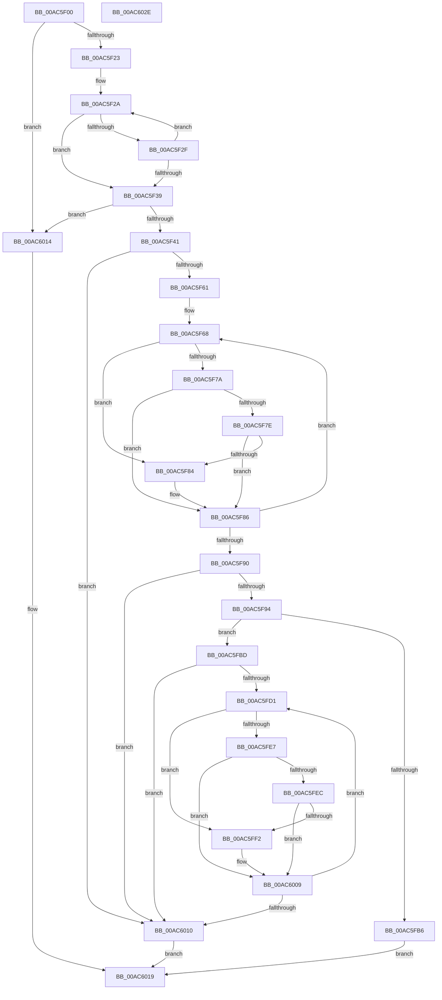

# PnpLookupArbitersNewResources

- RVA: `0x00AC5F00`–`0x00AC602F` (길이 `303` bytes)
- VA: `0x0000000140AC5F00`
- 실행 섹션: `PAGE`
- PDB 이름 있음: `예`; PDB Function 태그: `아니요`
- unwind 정보 RVA: `0x0005C954`
- 디코드: `91`개 명령, `303/303` bytes 표시
- 미해석 바이트: `0` (있으면 어셈블리에 `.byte`로 보존)

> 이 문서는 커널 이미지의 기계어와 PDB 기호를 분석해 생성했습니다. 4번과 5번은 함수 원형과 자료형을 바이너리 사용 방식에서 추정한 C 해석이며 원본 소스 복구 결과는 아닙니다.

## 1. Dependencies

- 직접 호출 지점: **1**; 고유 호출 대상: **1**
- 직접 호출자로 확인된 함수: **2**
- RIP 상대 이미지 참조: **0**

### Outgoing calls
- `0x00AC5FA9` → [ExAllocatePool2](../../poolcode/B8/ExAllocatePool2_function_00B820F0.md) (function, `0x00B820F0`)

### Direct callers
- [IopRetestConfiguration](../72/IopRetestConfiguration_function_0072AE8C.md) at `0x0072AF08`
- [IopTestConfiguration](../72/IopTestConfiguration_function_0072B1AC.md) at `0x0072B23B`

### Static image references
- 디코드된 RIP-relative 메모리 참조가 없습니다.

## 2. Other-region calls and transfers

- 다른 실행 섹션으로 향하는 call: **1**
  - `0x00AC5FA9` → [ExAllocatePool2](../../poolcode/B8/ExAllocatePool2_function_00B820F0.md) (`PAGE` → `POOLCODE`)
- 별도 외부 분기/꼬리 이동을 확인하지 못했습니다.

## 3. Assembly (complete function range)

```asm
00AC5F00  48 89 5C 24 08                  mov qword ptr [rsp + 8], rbx
00AC5F05  48 89 6C 24 10                  mov qword ptr [rsp + 0x10], rbp
00AC5F0A  48 89 74 24 18                  mov qword ptr [rsp + 0x18], rsi
00AC5F0F  57                              push rdi
00AC5F10  48 83 EC 20                     sub rsp, 0x20
00AC5F14  33 DB                           xor ebx, ebx
00AC5F16  41 8A E9                        mov bpl, r9b
00AC5F19  8B C3                           mov eax, ebx
00AC5F1B  85 D2                           test edx, edx
00AC5F1D  0F 84 F1 00 00 00               je 0x140ac6014
00AC5F23  4D 8B 50 20                     mov r10, qword ptr [r8 + 0x20]
00AC5F27  4C 8B C1                        mov r8, rcx
00AC5F2A  4D 39 10                        cmp qword ptr [r8], r10
00AC5F2D  74 0A                           je 0x140ac5f39
00AC5F2F  FF C0                           inc eax
00AC5F31  49 83 C0 40                     add r8, 0x40
00AC5F35  3B C2                           cmp eax, edx
00AC5F37  72 F1                           jb 0x140ac5f2a
00AC5F39  3B C2                           cmp eax, edx
00AC5F3B  0F 83 D3 00 00 00               jae 0x140ac6014
00AC5F41  0F AE E8                        lfence
00AC5F44  48 C1 E0 06                     shl rax, 6
00AC5F48  8B FB                           mov edi, ebx
00AC5F4A  48 8B 44 08 20                  mov rax, qword ptr [rax + rcx + 0x20]
00AC5F4F  48 8B 48 10                     mov rcx, qword ptr [rax + 0x10]
00AC5F53  48 8B 31                        mov rsi, qword ptr [rcx]
00AC5F56  8B 46 14                        mov eax, dword ptr [rsi + 0x14]
00AC5F59  85 C0                           test eax, eax
00AC5F5B  0F 84 AF 00 00 00               je 0x140ac6010
00AC5F61  48 8D 56 18                     lea rdx, [rsi + 0x18]
00AC5F65  44 8B C0                        mov r8d, eax
00AC5F68  48 8B 02                        mov rax, qword ptr [rdx]
00AC5F6B  48 8B 48 20                     mov rcx, qword ptr [rax + 0x20]
00AC5F6F  8A 81 88 00 00 00               mov al, byte ptr [rcx + 0x88]
00AC5F75  40 3A C5                        cmp al, bpl
00AC5F78  74 0A                           je 0x140ac5f84
00AC5F7A  3C 07                           cmp al, 7
00AC5F7C  75 08                           jne 0x140ac5f86
00AC5F7E  40 80 FD 03                     cmp bpl, 3
00AC5F82  75 02                           jne 0x140ac5f86
00AC5F84  FF C7                           inc edi
00AC5F86  48 83 C2 08                     add rdx, 8
00AC5F8A  49 83 E8 01                     sub r8, 1
00AC5F8E  75 D8                           jne 0x140ac5f68
00AC5F90  85 FF                           test edi, edi
00AC5F92  74 7C                           je 0x140ac6010
00AC5F94  8B C7                           mov eax, edi
00AC5F96  B9 00 01 00 00                  mov ecx, 0x100
00AC5F9B  41 B8 50 70 20 20               mov r8d, 0x20207050
00AC5FA1  48 8D 14 80                     lea rdx, [rax + rax*4]
00AC5FA5  48 C1 E2 02                     shl rdx, 2
00AC5FA9  E8 42 C1 0B 00                  call 0x140b820f0
00AC5FAE  48 8B D0                        mov rdx, rax
00AC5FB1  48 85 C0                        test rax, rax
00AC5FB4  75 07                           jne 0x140ac5fbd
00AC5FB6  B8 9A 00 00 C0                  mov eax, 0xc000009a
00AC5FBB  EB 5C                           jmp 0x140ac6019
00AC5FBD  48 8B 44 24 58                  mov rax, qword ptr [rsp + 0x58]
00AC5FC2  89 38                           mov dword ptr [rax], edi
00AC5FC4  48 8B 44 24 50                  mov rax, qword ptr [rsp + 0x50]
00AC5FC9  48 89 10                        mov qword ptr [rax], rdx
00AC5FCC  39 5E 14                        cmp dword ptr [rsi + 0x14], ebx
00AC5FCF  76 3F                           jbe 0x140ac6010
00AC5FD1  8B C3                           mov eax, ebx
00AC5FD3  48 8B 4C C6 18                  mov rcx, qword ptr [rsi + rax*8 + 0x18]
00AC5FD8  48 8B 41 20                     mov rax, qword ptr [rcx + 0x20]
00AC5FDC  8A 88 88 00 00 00               mov cl, byte ptr [rax + 0x88]
00AC5FE2  40 3A CD                        cmp cl, bpl
00AC5FE5  74 0B                           je 0x140ac5ff2
00AC5FE7  80 F9 07                        cmp cl, 7
00AC5FEA  75 1D                           jne 0x140ac6009
00AC5FEC  40 80 FD 03                     cmp bpl, 3
00AC5FF0  75 17                           jne 0x140ac6009
00AC5FF2  0F 10 80 88 00 00 00            movups xmm0, xmmword ptr [rax + 0x88]
00AC5FF9  0F 11 02                        movups xmmword ptr [rdx], xmm0
00AC5FFC  8B 80 98 00 00 00               mov eax, dword ptr [rax + 0x98]
00AC6002  89 42 10                        mov dword ptr [rdx + 0x10], eax
00AC6005  48 83 C2 14                     add rdx, 0x14
00AC6009  FF C3                           inc ebx
00AC600B  3B 5E 14                        cmp ebx, dword ptr [rsi + 0x14]
00AC600E  72 C1                           jb 0x140ac5fd1
00AC6010  33 C0                           xor eax, eax
00AC6012  EB 05                           jmp 0x140ac6019
00AC6014  B8 01 00 00 C0                  mov eax, 0xc0000001
00AC6019  48 8B 5C 24 30                  mov rbx, qword ptr [rsp + 0x30]
00AC601E  48 8B 6C 24 38                  mov rbp, qword ptr [rsp + 0x38]
00AC6023  48 8B 74 24 40                  mov rsi, qword ptr [rsp + 0x40]
00AC6028  48 83 C4 20                     add rsp, 0x20
00AC602C  5F                              pop rdi
00AC602D  C3                              ret
00AC602E  CC                              int3
```

## 4. C-style interpretation (structured pseudocode)

```c
__int64 __fastcall PnpLookupArbitersNewResources(__int64 a1, int a2, __int64 a3, unsigned __int8 a4, __int64 a5, __int64 a6)
{
    __int64 result;
    __int64 v_rbx;
    __int64 v_rdi;
    __int64 v_rsp;
    unsigned __int64 v_stack_p10;
    unsigned __int64 v_stack_p18;
    unsigned __int64 v_stack_p8;

    v_stack_p8 = v_rbx;
    v_stack_p10 = v_rbp;
    v_stack_p18 = v_rsi;
    v_rsp = (v_rsp) - (32);
    v_rbx = 0;
    if (a2 == 0) goto loc_00AC6014;
loc_00AC5F2A:
    if ((*(unsigned __int64 *)(a1)) == (*(unsigned __int64 *)(a3 + 32))) goto loc_00AC5F39;
    result = (unsigned int)((0) + 1);
    a3 = (a1) + (64);
    if (((unsigned int)(result)) < a2) goto loc_00AC5F2A;
loc_00AC5F39:
    if (((unsigned int)(result)) >= a2) goto loc_00AC6014;
    result = (result) << (6);
    if ((unsigned int)((unsigned int)(*(unsigned int *)(*(unsigned __int64 *)(*(unsigned __int64 *)(*(unsigned __int64 *)(result + a1 * 1 + 32) + 16)) + 20))) == 0) goto loc_00AC6010;
loc_00AC5F68:
    if (((unsigned __int8)(*(unsigned __int8 *)(*(unsigned __int64 *)(*(unsigned __int64 *)(*(unsigned __int64 *)(*(unsigned __int64 *)(*(unsigned __int64 *)(result + a1 * 1 + 32) + 16)) + 24) + 32) + 136))) == a4) goto loc_00AC5F84;
    if (((unsigned __int8)(*(unsigned __int8 *)(*(unsigned __int64 *)(*(unsigned __int64 *)(*(unsigned __int64 *)(*(unsigned __int64 *)(*(unsigned __int64 *)(result + a1 * 1 + 32) + 16)) + 24) + 32) + 136))) != 7) goto loc_00AC5F86;
    v_rdi = 0;
    if (a4 == 3) {
        v_rdi = (unsigned int)((0) + 1);
    }
    a2 = (*(unsigned __int64 *)(*(unsigned __int64 *)(*(unsigned __int64 *)(result + a1 * 1 + 32) + 16)) + 24) + (8);
    a3 = ((unsigned int)((unsigned int)((unsigned int)(*(unsigned int *)(*(unsigned __int64 *)(*(unsigned __int64 *)(*(unsigned __int64 *)(result + a1 * 1 + 32) + 16)) + 20))))) - (1);
    if (condition_is_not_equal) goto loc_00AC5F68;
    if ((unsigned int)(v_rdi) == 0) goto loc_00AC6010;
    a2 = ((unsigned int)((unsigned int)(v_rdi)) + (unsigned int)((unsigned int)(v_rdi)) * 4) << (2);
    result = ExAllocatePool2(256, a2, (unsigned int)(0x20207050ULL), a4);
    if (result != 0) goto loc_00AC5FBD;
    goto loc_00AC6019;
loc_00AC5FBD:
    *(unsigned int *)(a6) = (unsigned int)(v_rdi);
    *(unsigned __int64 *)(a5) = result;
    if ((*(unsigned int *)(*(unsigned __int64 *)(*(unsigned __int64 *)(*(unsigned __int64 *)(result + a1 * 1 + 32) + 16)) + 20)) <= 0) goto loc_00AC6010;
loc_00AC5FD1:
    if (((unsigned __int8)(*(unsigned __int8 *)(*(unsigned __int64 *)(*(unsigned __int64 *)(*(unsigned __int64 *)(*(unsigned __int64 *)(*(unsigned __int64 *)(result + a1 * 1 + 32) + 16)) + 0 * 8 + 24) + 32) + 136))) == a4) goto loc_00AC5FF2;
    if (((unsigned __int8)(*(unsigned __int8 *)(*(unsigned __int64 *)(*(unsigned __int64 *)(*(unsigned __int64 *)(*(unsigned __int64 *)(*(unsigned __int64 *)(result + a1 * 1 + 32) + 16)) + 0 * 8 + 24) + 32) + 136))) != 7) goto loc_00AC6009;
    result = *(unsigned __int64 *)(*(unsigned __int64 *)(*(unsigned __int64 *)(*(unsigned __int64 *)(*(unsigned __int64 *)(result + a1 * 1 + 32) + 16)) + 0 * 8 + 24) + 32);
    if (a4 == 3) {
        *(unsigned __int64 *)(result) = v_xmm0;
        result = *(unsigned int *)(*(unsigned __int64 *)(*(unsigned __int64 *)(*(unsigned __int64 *)(*(unsigned __int64 *)(*(unsigned __int64 *)(result + a1 * 1 + 32) + 16)) + 0 * 8 + 24) + 32) + 152);
        *(unsigned int *)(result + 16) = (unsigned int)(result);
        a2 = (result) + (20);
    }
    v_rbx = (unsigned int)((v_rbx) + 1);
    if (((unsigned int)(v_rbx)) < (*(unsigned int *)(*(unsigned __int64 *)(*(unsigned __int64 *)(*(unsigned __int64 *)(result + a1 * 1 + 32) + 16)) + 20))) goto loc_00AC5FD1;
loc_00AC6010:
    result = 0;
    goto loc_00AC6019;
loc_00AC6014:
loc_00AC6019:
    v_rsp = (v_rsp) + (32);
    return (unsigned int)(0xC0000001ULL);
}
```

## 5. (Beta) C Style

```c
int64_t PnpLookupArbitersNewResources(void *Arg1, int32_t Arg2, void *Arg3, uint8_t Arg4, void *Arg5, void *Arg6)
{
    uint8_t *arg1 = (uint8_t *)Arg1;
    uint8_t *arg3 = (uint8_t *)Arg3;
    uint8_t *arg5 = (uint8_t *)Arg5;
    uint8_t *arg6 = (uint8_t *)Arg6;

    int64_t result;
    int64_t local_rbx;
    int64_t local_rdi;
    int64_t local_rsp;
    uint64_t v_stack_p10;
    uint64_t v_stack_p18;
    uint64_t v_stack_p8;

    v_stack_p8 = local_rbx;
    v_stack_p10 = local_rbp;
    v_stack_p18 = local_rsi;
    local_rsp = (local_rsp) - (32);
    local_rbx = 0;
    if (Arg2 == 0) goto loc_00AC6014;
loc_00AC5F2A:
    if ((*(uint64_t *)(arg1)) == (*(uint64_t *)(arg3 + 0x20))) goto loc_00AC5F39;
    result = (uint32_t)((0) + 1);
    Arg3 = (Arg1) + (64);
    if (((uint32_t)(result)) < Arg2) goto loc_00AC5F2A;
loc_00AC5F39:
    if (((uint32_t)(result)) >= Arg2) goto loc_00AC6014;
    result = (result) << (6);
    if ((uint32_t)((uint32_t)(*(uint32_t *)(*(uint64_t *)(*(uint64_t *)(*(uint64_t *)(result + arg1 * 1 + 0x20) + 0x10)) + 0x14))) == 0) goto loc_00AC6010;
loc_00AC5F68:
    if (((uint8_t)(*(uint8_t *)(*(uint64_t *)(*(uint64_t *)(*(uint64_t *)(*(uint64_t *)(*(uint64_t *)(result + arg1 * 1 + 0x20) + 0x10)) + 0x18) + 0x20) + 0x88))) == Arg4) goto loc_00AC5F84;
    if (((uint8_t)(*(uint8_t *)(*(uint64_t *)(*(uint64_t *)(*(uint64_t *)(*(uint64_t *)(*(uint64_t *)(result + arg1 * 1 + 0x20) + 0x10)) + 0x18) + 0x20) + 0x88))) != 7) goto loc_00AC5F86;
    local_rdi = 0;
    if (Arg4 == 3) {
        local_rdi = (uint32_t)((0) + 1);
    }
    Arg2 = (*(uint64_t *)(*(uint64_t *)(*(uint64_t *)(result + arg1 * 1 + 0x20) + 0x10)) + 24) + (8);
    Arg3 = ((uint32_t)((uint32_t)((uint32_t)(*(uint32_t *)(*(uint64_t *)(*(uint64_t *)(*(uint64_t *)(result + arg1 * 1 + 0x20) + 0x10)) + 0x14))))) - (1);
    if (condition_is_not_equal) goto loc_00AC5F68;
    if ((uint32_t)(local_rdi) == 0) goto loc_00AC6010;
    Arg2 = ((uint32_t)((uint32_t)(local_rdi)) + (uint32_t)((uint32_t)(local_rdi)) * 4) << (2);
    result = ExAllocatePool2(256, Arg2, (uint32_t)(0x20207050ULL), Arg4);
    if (result != 0) goto loc_00AC5FBD;
    goto loc_00AC6019;
loc_00AC5FBD:
    *(uint32_t *)(arg6) = (uint32_t)(local_rdi);
    *(uint64_t *)(arg5) = result;
    if ((*(uint32_t *)(*(uint64_t *)(*(uint64_t *)(*(uint64_t *)(result + arg1 * 1 + 0x20) + 0x10)) + 0x14)) <= 0) goto loc_00AC6010;
loc_00AC5FD1:
    if (((uint8_t)(*(uint8_t *)(*(uint64_t *)(*(uint64_t *)(*(uint64_t *)(*(uint64_t *)(*(uint64_t *)(result + arg1 * 1 + 0x20) + 0x10)) + 0x0 * 8 + 0x18) + 0x20) + 0x88))) == Arg4) goto loc_00AC5FF2;
    if (((uint8_t)(*(uint8_t *)(*(uint64_t *)(*(uint64_t *)(*(uint64_t *)(*(uint64_t *)(*(uint64_t *)(result + arg1 * 1 + 0x20) + 0x10)) + 0x0 * 8 + 0x18) + 0x20) + 0x88))) != 7) goto loc_00AC6009;
    result = *(uint64_t *)(*(uint64_t *)(*(uint64_t *)(*(uint64_t *)(*(uint64_t *)(result + arg1 * 1 + 0x20) + 0x10)) + 0x0 * 8 + 0x18) + 0x20);
    if (Arg4 == 3) {
        *(uint64_t *)(result) = v_xmm0;
        result = *(uint32_t *)(*(uint64_t *)(*(uint64_t *)(*(uint64_t *)(*(uint64_t *)(*(uint64_t *)(result + arg1 * 1 + 0x20) + 0x10)) + 0x0 * 8 + 0x18) + 0x20) + 0x98);
        *(uint32_t *)(result + 0x10) = (uint32_t)(result);
        Arg2 = (result) + (20);
    }
    local_rbx = (uint32_t)((local_rbx) + 1);
    if (((uint32_t)(local_rbx)) < (*(uint32_t *)(*(uint64_t *)(*(uint64_t *)(*(uint64_t *)(result + arg1 * 1 + 0x20) + 0x10)) + 0x14))) goto loc_00AC5FD1;
loc_00AC6010:
    result = 0;
    goto loc_00AC6019;
loc_00AC6014:
loc_00AC6019:
    local_rsp = (local_rsp) + (32);
    return (uint32_t)(0xC0000001ULL);
}
```

### 관측된 메모리 오프셋

구조체 형식이 확인되지 않은 접근은 인자 기준의 오프셋으로만 기록했습니다.

| 기준 인자 | 오프셋 표현 | 폭 (bit) | 접근 |
|---|---:|---:|---|
| `Arg1` | `+ 0x0` | `64` | `R` |
| `Arg3` | `+ 0x20` | `64` | `R` |
| `Arg5` | `+ 0x0` | `64` | `W` |
| `Arg6` | `+ 0x0` | `32` | `W` |

## 6. Execution-region graph

[열기: 2D/3D 그래프와 함수 탐색 컨트롤 패널](../../../control-panel.html?section=page&rva=0x00AC5F00&view=graph)

- 2D 그래프는 위에서 아래로 흐르고, 3D 그래프는 빈 공간을 드래그해 회전합니다. Shift+드래그는 이동, 휠은 확대·축소, 함수 노드 선택은 대상 보고서 이동입니다.

### Static fallback


