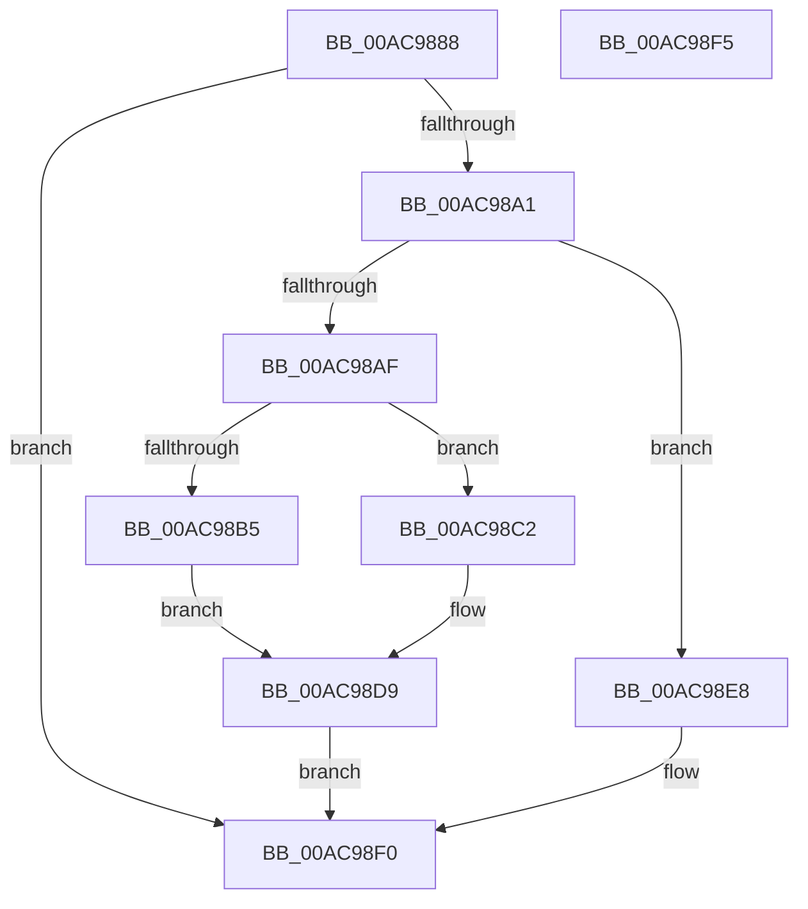

# PnpObjectRaiseDevicesChangeEvent

- RVA: `0x00AC9888`–`0x00AC98F6` (길이 `110` bytes)
- VA: `0x0000000140AC9888`
- 실행 섹션: `PAGE`
- PDB 이름 있음: `예`; PDB Function 태그: `아니요`
- unwind 정보 RVA: `0x0006E590`
- 디코드: `28`개 명령, `110/110` bytes 표시
- 미해석 바이트: `0` (있으면 어셈블리에 `.byte`로 보존)

> 이 문서는 커널 이미지의 기계어와 PDB 기호를 분석해 생성했습니다. 4번과 5번은 함수 원형과 자료형을 바이너리 사용 방식에서 추정한 C 해석이며 원본 소스 복구 결과는 아닙니다.

## 1. Dependencies

- 직접 호출 지점: **2**; 고유 호출 대상: **2**
- 직접 호출자로 확인된 함수: **4**
- RIP 상대 이미지 참조: **0**

### Outgoing calls
- `0x00AC98E1` → [guard_dispatch_icall](../../text/6B/guard_dispatch_icall_function_006BAAD0.md) (function, `0x006BAAD0`)
- `0x00AC98EB` → [PnpContainerRaiseDevicesChangeEvent](../A9/PnpContainerRaiseDevicesChangeEvent_function_00A98BF4.md) (function, `0x00A98BF4`)

### Direct callers
- [CmRemoveDeviceFromContainer](../82/CmRemoveDeviceFromContainer_function_0082BF40.md) at `0x0082C03D`
- [CmAddPanelDevice](../82/CmAddPanelDevice_function_0082DDEC.md) at `0x0082DEE2`
- [CmRemovePanelDevice](../82/CmRemovePanelDevice_function_0082F32C.md) at `0x0082F422`
- [CmAddDeviceToContainer](../8F/CmAddDeviceToContainer_function_008FF190.md) at `0x008FF2DE`

### Static image references
- 디코드된 RIP-relative 메모리 참조가 없습니다.

## 2. Other-region calls and transfers

- 다른 실행 섹션으로 향하는 call: **1**
  - `0x00AC98E1` → [guard_dispatch_icall](../../text/6B/guard_dispatch_icall_function_006BAAD0.md) (`PAGE` → `.text`)
- 별도 외부 분기/꼬리 이동을 확인하지 못했습니다.

## 3. Assembly (complete function range)

```asm
00AC9888  48 83 EC 68                     sub rsp, 0x68
00AC988C  4C 8B 99 F0 01 00 00            mov r11, qword ptr [rcx + 0x1f0]
00AC9893  0F 57 C0                        xorps xmm0, xmm0
00AC9896  F3 0F 7F 44 24 38               movdqu xmmword ptr [rsp + 0x38], xmm0
00AC989C  4D 85 DB                        test r11, r11
00AC989F  74 4F                           je 0x140ac98f0
00AC98A1  45 8B D0                        mov r10d, r8d
00AC98A4  41 B9 05 00 00 00               mov r9d, 5
00AC98AA  45 2B D1                        sub r10d, r9d
00AC98AD  74 39                           je 0x140ac98e8
00AC98AF  41 83 FA 01                     cmp r10d, 1
00AC98B3  74 0D                           je 0x140ac98c2
00AC98B5  48 83 64 24 30 00               and qword ptr [rsp + 0x30], 0
00AC98BB  48 8D 44 24 30                  lea rax, [rsp + 0x30]
00AC98C0  EB 17                           jmp 0x140ac98d9
00AC98C2  48 83 64 24 48 00               and qword ptr [rsp + 0x48], 0
00AC98C8  48 8D 44 24 48                  lea rax, [rsp + 0x48]
00AC98CD  F3 0F 7F 44 24 50               movdqu xmmword ptr [rsp + 0x50], xmm0
00AC98D3  41 B8 06 00 00 00               mov r8d, 6
00AC98D9  48 89 44 24 20                  mov qword ptr [rsp + 0x20], rax
00AC98DE  49 8B C3                        mov rax, r11
00AC98E1  E8 EA 11 BF FF                  call 0x1406baad0
00AC98E6  EB 08                           jmp 0x140ac98f0
00AC98E8  4D 8B C3                        mov r8, r11
00AC98EB  E8 04 F3 FC FF                  call 0x140a98bf4
00AC98F0  48 83 C4 68                     add rsp, 0x68
00AC98F4  C3                              ret
00AC98F5  CC                              int3
```

## 4. C-style interpretation (structured pseudocode)

```c
__int64 __fastcall PnpObjectRaiseDevicesChangeEvent(__int64 a1, __int64 a2, int a3)
{
    __int64 result;
    __int64 v_r10;
    __int64 v_rsp;
    unsigned __int64 v_stack_m18;
    unsigned __int64 v_stack_m20;
    unsigned __int64 v_stack_m30;
    unsigned __int64 v_stack_m38;
    unsigned __int64 v_stack_m48;

    v_rsp = (v_rsp) - (104);
    v_stack_m30 = v_xmm0;
    if (*(unsigned __int64 *)(a1 + 496) == 0) goto loc_00AC98F0;
    v_r10 = (unsigned int)(((unsigned int)(a3)) - (5));
    if (condition_is_equal) goto loc_00AC98E8;
    if (((unsigned int)(v_r10)) == 1) goto loc_00AC98C2;
    goto loc_00AC98D9;
loc_00AC98C2:
    v_stack_m18 = v_xmm0;
loc_00AC98D9:
    v_stack_m48 = v_stack_m20;
    result = guard_dispatch_icall(a1, a2, 6, 5);
    goto loc_00AC98F0;
loc_00AC98E8:
    result = PnpContainerRaiseDevicesChangeEvent(a1, a2, *(unsigned __int64 *)(a1 + 496), 5);
loc_00AC98F0:
    v_rsp = (v_rsp) + (104);
    return result;
}
```

## 5. (Beta) C Style

```c
int64_t PnpObjectRaiseDevicesChangeEvent(void *Arg1, int64_t Arg2, int32_t Arg3)
{
    uint8_t *arg1 = (uint8_t *)Arg1;

    int64_t result;
    int64_t local_r10;
    int64_t local_rsp;
    uint64_t v_stack_m18;
    uint64_t v_stack_m20;
    uint64_t v_stack_m30;
    uint64_t v_stack_m38;
    uint64_t v_stack_m48;

    local_rsp = (local_rsp) - (104);
    v_stack_m30 = v_xmm0;
    if (*(uint64_t *)(arg1 + 0x1F0) == 0) goto loc_00AC98F0;
    local_r10 = (uint32_t)(((uint32_t)(Arg3)) - (5));
    if (condition_is_equal) goto loc_00AC98E8;
    if (((uint32_t)(local_r10)) == 1) goto loc_00AC98C2;
    goto loc_00AC98D9;
loc_00AC98C2:
    v_stack_m18 = v_xmm0;
loc_00AC98D9:
    v_stack_m48 = v_stack_m20;
    result = guard_dispatch_icall(Arg1, Arg2, 6, 5);
    goto loc_00AC98F0;
loc_00AC98E8:
    result = PnpContainerRaiseDevicesChangeEvent(Arg1, Arg2, *(uint64_t *)(arg1 + 0x1F0), 5);
loc_00AC98F0:
    local_rsp = (local_rsp) + (104);
    return result;
}
```

### 관측된 메모리 오프셋

구조체 형식이 확인되지 않은 접근은 인자 기준의 오프셋으로만 기록했습니다.

| 기준 인자 | 오프셋 표현 | 폭 (bit) | 접근 |
|---|---:|---:|---|
| `Arg1` | `+ 0x1F0` | `64` | `R` |

## 6. Execution-region graph

[열기: 2D/3D 그래프와 함수 탐색 컨트롤 패널](../../../control-panel.html?section=page&rva=0x00AC9888&view=graph)

- 2D 그래프는 위에서 아래로 흐르고, 3D 그래프는 빈 공간을 드래그해 회전합니다. Shift+드래그는 이동, 휠은 확대·축소, 함수 노드 선택은 대상 보고서 이동입니다.

### Static fallback


