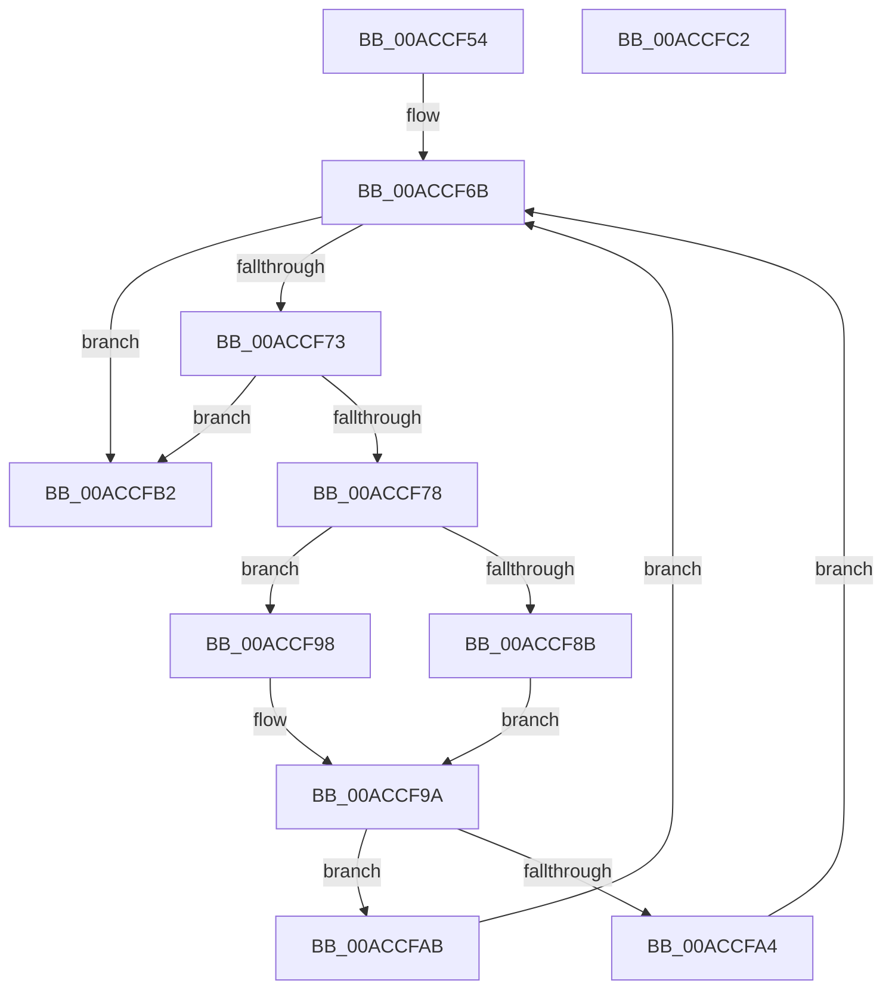

# PnpTrackQueryRemoveDevices

- RVA: `0x00ACCF54`–`0x00ACCFC3` (길이 `111` bytes)
- VA: `0x0000000140ACCF54`
- 실행 섹션: `PAGE`
- PDB 이름 있음: `예`; PDB Function 태그: `아니요`
- unwind 정보 RVA: `0x00060BC4`
- 디코드: `35`개 명령, `111/111` bytes 표시
- 미해석 바이트: `0` (있으면 어셈블리에 `.byte`로 보존)

> 이 문서는 커널 이미지의 기계어와 PDB 기호를 분석해 생성했습니다. 4번과 5번은 함수 원형과 자료형을 바이너리 사용 방식에서 추정한 C 해석이며 원본 소스 복구 결과는 아닙니다.

## 1. Dependencies

- 직접 호출 지점: **2**; 고유 호출 대상: **2**
- 직접 호출자로 확인된 함수: **2**
- RIP 상대 이미지 참조: **0**

### Outgoing calls
- `0x00ACCFA4` → [PipSetDevNodeUserFlags](../8F/PipSetDevNodeUserFlags_function_008FB8FC.md) (function, `0x008FB8FC`)
- `0x00ACCFAB` → [PipClearDevNodeUserFlags](../A2/PipClearDevNodeUserFlags_function_00A2ABC4.md) (function, `0x00A2ABC4`)

### Direct callers
- [PnpProcessCompletedEject](../72/PnpProcessCompletedEject_function_0072D090.md) at `0x0072D18D`
- [sub_00B33FE8](../B3/Unknown_function_00B33FE8.md) at `0x00B3416A`
- [sub_00B33FE8](../B3/Unknown_function_00B33FE8.md) at `0x00B341A8`
- [sub_00B33FE8](../B3/Unknown_function_00B33FE8.md) at `0x00B34245`
- [sub_00B33FE8](../B3/Unknown_function_00B33FE8.md) at `0x00B34302`

### Static image references
- 디코드된 RIP-relative 메모리 참조가 없습니다.

## 2. Other-region calls and transfers

- 다른 실행 섹션으로 향하는 call: **0**
- 별도 외부 분기/꼬리 이동을 확인하지 못했습니다.

## 3. Assembly (complete function range)

```asm
00ACCF54  48 89 5C 24 08                  mov qword ptr [rsp + 8], rbx
00ACCF59  48 89 74 24 10                  mov qword ptr [rsp + 0x10], rsi
00ACCF5E  57                              push rdi
00ACCF5F  48 83 EC 20                     sub rsp, 0x20
00ACCF63  40 8A FA                        mov dil, dl
00ACCF66  48 8B F1                        mov rsi, rcx
00ACCF69  33 DB                           xor ebx, ebx
00ACCF6B  4C 8B 06                        mov r8, qword ptr [rsi]
00ACCF6E  41 3B 18                        cmp ebx, dword ptr [r8]
00ACCF71  73 3F                           jae 0x140accfb2
00ACCF73  4D 85 C0                        test r8, r8
00ACCF76  74 3A                           je 0x140accfb2
00ACCF78  0F AE E8                        lfence
00ACCF7B  48 8D 0C 5B                     lea rcx, [rbx + rbx*2]
00ACCF7F  FF C3                           inc ebx
00ACCF81  49 8B 44 C8 10                  mov rax, qword ptr [r8 + rcx*8 + 0x10]
00ACCF86  48 85 C0                        test rax, rax
00ACCF89  74 0D                           je 0x140accf98
00ACCF8B  48 8B 80 38 01 00 00            mov rax, qword ptr [rax + 0x138]
00ACCF92  48 8B 48 28                     mov rcx, qword ptr [rax + 0x28]
00ACCF96  EB 02                           jmp 0x140accf9a
00ACCF98  33 C9                           xor ecx, ecx
00ACCF9A  BA 00 01 00 00                  mov edx, 0x100
00ACCF9F  40 84 FF                        test dil, dil
00ACCFA2  74 07                           je 0x140accfab
00ACCFA4  E8 53 E9 E2 FF                  call 0x1408fb8fc
00ACCFA9  EB C0                           jmp 0x140accf6b
00ACCFAB  E8 14 DC F5 FF                  call 0x140a2abc4
00ACCFB0  EB B9                           jmp 0x140accf6b
00ACCFB2  48 8B 5C 24 30                  mov rbx, qword ptr [rsp + 0x30]
00ACCFB7  48 8B 74 24 38                  mov rsi, qword ptr [rsp + 0x38]
00ACCFBC  48 83 C4 20                     add rsp, 0x20
00ACCFC0  5F                              pop rdi
00ACCFC1  C3                              ret
00ACCFC2  CC                              int3
```

## 4. C-style interpretation (structured pseudocode)

```c
__int64 __fastcall PnpTrackQueryRemoveDevices(__int64 a1, unsigned __int8 a2)
{
    __int64 result;
    __int64 v_rbx;
    __int64 v_rsp;
    unsigned __int64 v_stack_p10;
    unsigned __int64 v_stack_p8;

    v_stack_p8 = v_rbx;
    v_stack_p10 = v_rsi;
    v_rsp = (v_rsp) - (32);
    v_rbx = 0;
loc_00ACCF6B:
    if (0 >= (*(unsigned int *)(*(unsigned __int64 *)(a1)))) goto loc_00ACCFB2;
    if (*(unsigned __int64 *)(a1) == 0) goto loc_00ACCFB2;
    v_rbx = (unsigned int)((v_rbx) + 1);
    if (*(unsigned __int64 *)(*(unsigned __int64 *)(a1) + v_rbx + v_rbx * 2 * 8 + 16) == 0) goto loc_00ACCF98;
    goto loc_00ACCF9A;
loc_00ACCF98:
    a1 = 0;
loc_00ACCF9A:
    if (a2 == 0) goto loc_00ACCFAB;
    result = PipSetDevNodeUserFlags(a1, 256, *(unsigned __int64 *)(a1), a4);
    goto loc_00ACCF6B;
loc_00ACCFAB:
    result = PipClearDevNodeUserFlags(a1, 256, *(unsigned __int64 *)(a1), a4);
    goto loc_00ACCF6B;
loc_00ACCFB2:
    v_rsp = (v_rsp) + (32);
    return result;
}
```

## 5. (Beta) C Style

```c
int64_t PnpTrackQueryRemoveDevices(void *Arg1, uint8_t Arg2)
{
    uint8_t *arg1 = (uint8_t *)Arg1;

    int64_t result;
    int64_t local_rbx;
    int64_t local_rsp;
    uint64_t v_stack_p10;
    uint64_t v_stack_p8;

    v_stack_p8 = local_rbx;
    v_stack_p10 = local_rsi;
    local_rsp = (local_rsp) - (32);
    local_rbx = 0;
loc_00ACCF6B:
    if (0 >= (*(uint32_t *)(*(uint64_t *)(arg1)))) goto loc_00ACCFB2;
    if (*(uint64_t *)(arg1) == 0) goto loc_00ACCFB2;
    local_rbx = (uint32_t)((local_rbx) + 1);
    if (*(uint64_t *)(*(uint64_t *)(arg1) + local_rbx + local_rbx * 2 * 8 + 0x10) == 0) goto loc_00ACCF98;
    goto loc_00ACCF9A;
loc_00ACCF98:
    Arg1 = 0;
loc_00ACCF9A:
    if (Arg2 == 0) goto loc_00ACCFAB;
    result = PipSetDevNodeUserFlags(Arg1, 256, *(uint64_t *)(arg1), a4);
    goto loc_00ACCF6B;
loc_00ACCFAB:
    result = PipClearDevNodeUserFlags(Arg1, 256, *(uint64_t *)(arg1), a4);
    goto loc_00ACCF6B;
loc_00ACCFB2:
    local_rsp = (local_rsp) + (32);
    return result;
}
```

### 관측된 메모리 오프셋

구조체 형식이 확인되지 않은 접근은 인자 기준의 오프셋으로만 기록했습니다.

| 기준 인자 | 오프셋 표현 | 폭 (bit) | 접근 |
|---|---:|---:|---|
| `Arg1` | `+ 0x0` | `64` | `R` |

## 6. Execution-region graph

[열기: 2D/3D 그래프와 함수 탐색 컨트롤 패널](../../../control-panel.html?section=page&rva=0x00ACCF54&view=graph)

- 2D 그래프는 위에서 아래로 흐르고, 3D 그래프는 빈 공간을 드래그해 회전합니다. Shift+드래그는 이동, 휠은 확대·축소, 함수 노드 선택은 대상 보고서 이동입니다.

### Static fallback


