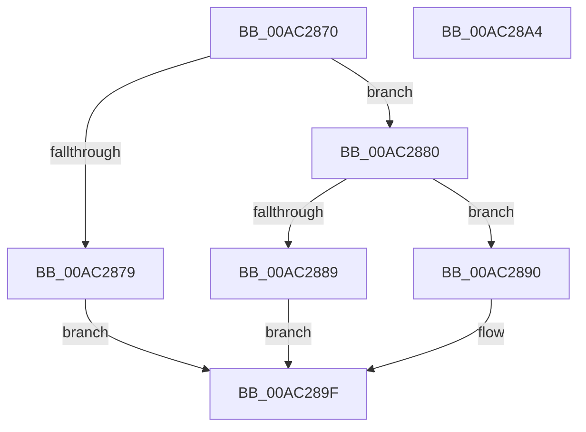

# PoFxRegisterCrashdumpDevice

- RVA: `0x00AC2870`–`0x00AC28A5` (길이 `53` bytes)
- VA: `0x0000000140AC2870`
- 실행 섹션: `PAGE`
- PDB 이름 있음: `예`; PDB Function 태그: `아니요`
- unwind 정보 RVA: `0x0005C788`
- 디코드: `17`개 명령, `53/53` bytes 표시
- 미해석 바이트: `0` (있으면 어셈블리에 `.byte`로 보존)

> 이 문서는 커널 이미지의 기계어와 PDB 기호를 분석해 생성했습니다. 4번과 5번은 함수 원형과 자료형을 바이너리 사용 방식에서 추정한 C 해석이며 원본 소스 복구 결과는 아닙니다.

## 1. Dependencies

- 직접 호출 지점: **1**; 고유 호출 대상: **1**
- 직접 호출자로 확인된 함수: **0**
- RIP 상대 이미지 참조: **0**

### Outgoing calls
- `0x00AC289A` → [PopPluginRegisterCrashdumpDevice](../../text/4D/PopPluginRegisterCrashdumpDevice_function_004D8944.md) (function, `0x004D8944`)

### Direct callers
- 이 함수 시작 RVA로 연결되는 직접 call은 확인되지 않았습니다. 간접 호출은 완전히 역산할 수 없습니다.

### Static image references
- 디코드된 RIP-relative 메모리 참조가 없습니다.

## 2. Other-region calls and transfers

- 다른 실행 섹션으로 향하는 call: **1**
  - `0x00AC289A` → [PopPluginRegisterCrashdumpDevice](../../text/4D/PopPluginRegisterCrashdumpDevice_function_004D8944.md) (`PAGE` → `.text`)
- 별도 외부 분기/꼬리 이동을 확인하지 못했습니다.

## 3. Assembly (complete function range)

```asm
00AC2870  48 83 EC 28                     sub rsp, 0x28
00AC2874  48 85 C9                        test rcx, rcx
00AC2877  75 07                           jne 0x140ac2880
00AC2879  B8 0D 00 00 C0                  mov eax, 0xc000000d
00AC287E  EB 1F                           jmp 0x140ac289f
00AC2880  48 8B 41 40                     mov rax, qword ptr [rcx + 0x40]
00AC2884  48 85 C0                        test rax, rax
00AC2887  75 07                           jne 0x140ac2890
00AC2889  B8 BB 00 00 C0                  mov eax, 0xc00000bb
00AC288E  EB 0F                           jmp 0x140ac289f
00AC2890  48 8B 51 48                     mov rdx, qword ptr [rcx + 0x48]
00AC2894  4C 8B C1                        mov r8, rcx
00AC2897  48 8B C8                        mov rcx, rax
00AC289A  E8 A5 60 A1 FF                  call 0x1404d8944
00AC289F  48 83 C4 28                     add rsp, 0x28
00AC28A3  C3                              ret
00AC28A4  CC                              int3
```

## 4. C-style interpretation (structured pseudocode)

```c
__int64 __fastcall PoFxRegisterCrashdumpDevice(__int64 a1)
{
    __int64 result;
    __int64 v_rsp;

    v_rsp = (v_rsp) - (40);
    if (a1 != 0) goto loc_00AC2880;
    goto loc_00AC289F;
loc_00AC2880:
    if (*(unsigned __int64 *)(a1 + 64) != 0) goto loc_00AC2890;
    goto loc_00AC289F;
loc_00AC2890:
    result = PopPluginRegisterCrashdumpDevice((unsigned int)(0xC00000BBULL), *(unsigned __int64 *)(a1 + 72), a1, a4);
loc_00AC289F:
    v_rsp = (v_rsp) + (40);
    return result;
}
```

## 5. (Beta) C Style

```c
int64_t PoFxRegisterCrashdumpDevice(int64_t Arg1)
{
    int64_t result;
    int64_t local_rsp;

    local_rsp = (local_rsp) - (40);
    if (Arg1 != 0) goto loc_00AC2880;
    goto loc_00AC289F;
loc_00AC2880:
    if (*(uint64_t *)(Arg1 + 0x40) != 0) goto loc_00AC2890;
    goto loc_00AC289F;
loc_00AC2890:
    result = PopPluginRegisterCrashdumpDevice((uint32_t)(0xC00000BBULL), *(uint64_t *)(Arg1 + 0x48), Arg1, a4);
loc_00AC289F:
    local_rsp = (local_rsp) + (40);
    return result;
}
```

## 6. Execution-region graph

[열기: 2D/3D 그래프와 함수 탐색 컨트롤 패널](../../../control-panel.html?section=page&rva=0x00AC2870&view=graph)

- 2D 그래프는 위에서 아래로 흐르고, 3D 그래프는 빈 공간을 드래그해 회전합니다. Shift+드래그는 이동, 휠은 확대·축소, 함수 노드 선택은 대상 보고서 이동입니다.

### Static fallback


