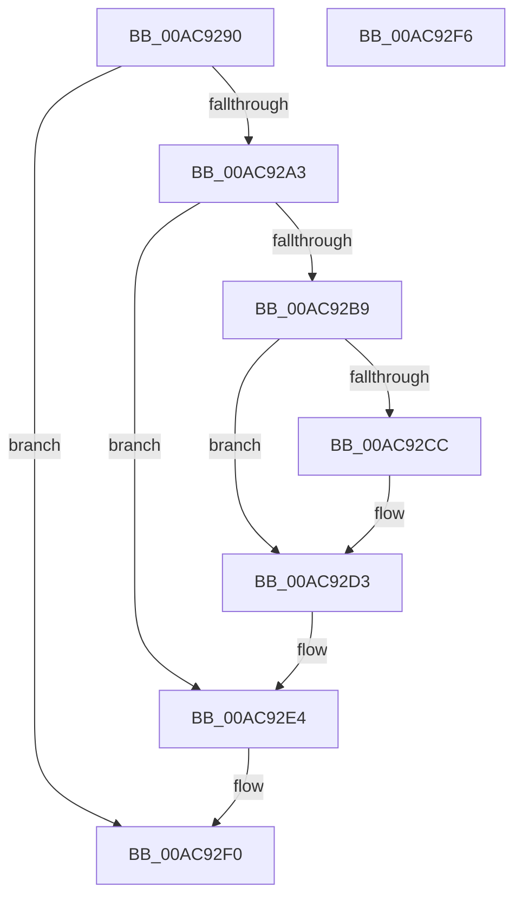

# PoVolumeDevice

- RVA: `0x00AC9290`–`0x00AC92F7` (길이 `103` bytes)
- VA: `0x0000000140AC9290`
- 실행 섹션: `PAGE`
- PDB 이름 있음: `예`; PDB Function 태그: `아니요`
- unwind 정보 RVA: `0x0005CF00`
- 디코드: `27`개 명령, `103/103` bytes 표시
- 미해석 바이트: `0` (있으면 어셈블리에 `.byte`로 보존)

> 이 문서는 커널 이미지의 기계어와 PDB 기호를 분석해 생성했습니다. 4번과 5번은 함수 원형과 자료형을 바이너리 사용 방식에서 추정한 C 해석이며 원본 소스 복구 결과는 아닙니다.

## 1. Dependencies

- 직접 호출 지점: **3**; 고유 호출 대상: **3**
- 직접 호출자로 확인된 함수: **2**
- RIP 상대 이미지 참조: **4**

### Outgoing calls
- `0x00AC9296` → [PopGetDope](../../text/4C/PopGetDope_function_004CB77C.md) (function, `0x004CB77C`)
- `0x00AC92AA` → [ExAcquireFastMutex](../../text/20/ExAcquireFastMutex_function_0020E5A0.md) (function, `0x0020E5A0`)
- `0x00AC92EB` → [ExReleaseFastMutex](../../text/25/ExReleaseFastMutex_function_002519C0.md) (function, `0x002519C0`)

### Direct callers
- [IoCreateDevice](../9A/IoCreateDevice_function_009A4B00.md) at `0x009A4FEB`
- [IoVerifyVolume](IoVerifyVolume_function_00ACF200.md) at `0x00ACF379`

### Static image references
- `0x00AC92A3` → RVA `0x00F0CAA0` (`.data`; read)
- `0x00AC92B9` → RVA `0x00F0CEB8` (`.data`; read)
- `0x00AC92C0` → RVA `0x00F0CEB0` (`.data`; read)
- `0x00AC92DD` → RVA `0x00F0CEB8` (`.data`; write)

## 2. Other-region calls and transfers

- 다른 실행 섹션으로 향하는 call: **3**
  - `0x00AC9296` → [PopGetDope](../../text/4C/PopGetDope_function_004CB77C.md) (`PAGE` → `.text`)
  - `0x00AC92AA` → [ExAcquireFastMutex](../../text/20/ExAcquireFastMutex_function_0020E5A0.md) (`PAGE` → `.text`)
  - `0x00AC92EB` → [ExReleaseFastMutex](../../text/25/ExReleaseFastMutex_function_002519C0.md) (`PAGE` → `.text`)
- 별도 외부 분기/꼬리 이동을 확인하지 못했습니다.

## 3. Assembly (complete function range)

```asm
00AC9290  40 53                           push rbx
00AC9292  48 83 EC 20                     sub rsp, 0x20
00AC9296  E8 E1 24 A0 FF                  call 0x1404cb77c
00AC929B  48 8B D8                        mov rbx, rax
00AC929E  48 85 C0                        test rax, rax
00AC92A1  74 4D                           je 0x140ac92f0
00AC92A3  48 8D 0D F6 37 44 00            lea rcx, [rip + 0x4437f6]
00AC92AA  E8 F1 52 74 FF                  call 0x14020e5a0
00AC92AF  48 8D 43 50                     lea rax, [rbx + 0x50]
00AC92B3  48 83 38 00                     cmp qword ptr [rax], 0
00AC92B7  75 2B                           jne 0x140ac92e4
00AC92B9  48 8B 0D F8 3B 44 00            mov rcx, qword ptr [rip + 0x443bf8]
00AC92C0  48 8D 15 E9 3B 44 00            lea rdx, [rip + 0x443be9]
00AC92C7  48 39 11                        cmp qword ptr [rcx], rdx
00AC92CA  74 07                           je 0x140ac92d3
00AC92CC  B9 03 00 00 00                  mov ecx, 3
00AC92D1  CD 29                           int 0x29
00AC92D3  48 89 10                        mov qword ptr [rax], rdx
00AC92D6  48 89 48 08                     mov qword ptr [rax + 8], rcx
00AC92DA  48 89 01                        mov qword ptr [rcx], rax
00AC92DD  48 89 05 D4 3B 44 00            mov qword ptr [rip + 0x443bd4], rax
00AC92E4  48 8D 0D B5 37 44 00            lea rcx, [rip + 0x4437b5]
00AC92EB  E8 D0 86 78 FF                  call 0x1402519c0
00AC92F0  48 83 C4 20                     add rsp, 0x20
00AC92F4  5B                              pop rbx
00AC92F5  C3                              ret
00AC92F6  CC                              int3
```

## 4. C-style interpretation (structured pseudocode)

```c
__int64 __fastcall PoVolumeDevice(void)
{
    __int64 result;
    __int64 v_rsp;

    v_rsp = (v_rsp) - (32);
    result = PopGetDope(a1, a2, a3, a4);
    if (result == 0) goto loc_00AC92F0;
    result = ExAcquireFastMutex(v_rip + 4470774, a2, a3, a4);
    if ((*(unsigned __int64 *)(result + 80)) != 0) goto loc_00AC92E4;
    if ((*(unsigned __int64 *)(*(unsigned __int64 *)(v_rip + 4471800))) != (v_rip + 4471785)) {
        a1 = 3;
    }
    *(unsigned __int64 *)(result + 80) = v_rip + 4471785;
    *(unsigned __int64 *)(result + 80 + 8) = a1;
    *(unsigned __int64 *)(a1) = result + 80;
    *(unsigned __int64 *)(v_rip + 4471764) = result + 80;
loc_00AC92E4:
    result = ExReleaseFastMutex(v_rip + 4470709, v_rip + 4471785, a3, a4);
loc_00AC92F0:
    v_rsp = (v_rsp) + (32);
    return result;
}
```

## 5. (Beta) C Style

```c
void PoVolumeDevice(void)
{
    int64_t result;
    int64_t local_rsp;

    local_rsp = (local_rsp) - (32);
    result = PopGetDope(a1, a2, a3, a4);
    if (result == 0) goto loc_00AC92F0;
    result = ExAcquireFastMutex(v_rip + 4470774, a2, a3, a4);
    if ((*(uint64_t *)(result + 0x50)) != 0) goto loc_00AC92E4;
    if ((*(uint64_t *)(*(uint64_t *)(v_rip + 0x443BF8))) != (v_rip + 4471785)) {
        a1 = 3;
    }
    *(uint64_t *)(result + 0x50) = v_rip + 4471785;
    *(uint64_t *)(result + 0x50 + 0x8) = a1;
    *(uint64_t *)(a1) = result + 80;
    *(uint64_t *)(v_rip + 0x443BD4) = result + 80;
loc_00AC92E4:
    result = ExReleaseFastMutex(v_rip + 4470709, v_rip + 4471785, a3, a4);
loc_00AC92F0:
    local_rsp = (local_rsp) + (32);
    return result;
}
```

## 6. Execution-region graph

[열기: 2D/3D 그래프와 함수 탐색 컨트롤 패널](../../../control-panel.html?section=page&rva=0x00AC9290&view=graph)

- 2D 그래프는 위에서 아래로 흐르고, 3D 그래프는 빈 공간을 드래그해 회전합니다. Shift+드래그는 이동, 휠은 확대·축소, 함수 노드 선택은 대상 보고서 이동입니다.

### Static fallback


