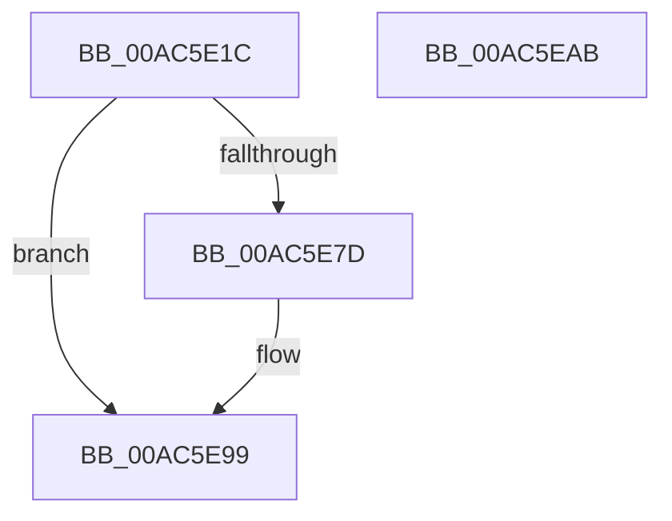

# PopBatteryReadTag

- RVA: `0x00AC5E1C`–`0x00AC5EAC` (길이 `144` bytes)
- VA: `0x0000000140AC5E1C`
- 실행 섹션: `PAGE`
- PDB 이름 있음: `예`; PDB Function 태그: `아니요`
- unwind 정보 RVA: `0x00060BC4`
- 디코드: `39`개 명령, `144/144` bytes 표시
- 미해석 바이트: `0` (있으면 어셈블리에 `.byte`로 보존)

> 이 문서는 커널 이미지의 기계어와 PDB 기호를 분석해 생성했습니다. 4번과 5번은 함수 원형과 자료형을 바이너리 사용 방식에서 추정한 C 해석이며 원본 소스 복구 결과는 아닙니다.

## 1. Dependencies

- 직접 호출 지점: **3**; 고유 호출 대상: **3**
- 직접 호출자로 확인된 함수: **1**
- RIP 상대 이미지 참조: **0**

### Outgoing calls
- `0x00AC5E44` → [IoReuseIrp](../../text/24/IoReuseIrp_function_0024DD70.md) (function, `0x0024DD70`)
- `0x00AC5E72` → [IoSynchronousCallDriver](../../text/48/IoSynchronousCallDriver_function_00484050.md) (function, `0x00484050`)
- `0x00AC5E94` → [KeSetEvent](../../text/33/KeSetEvent_function_0033F310.md) (function, `0x0033F310`)

### Direct callers
- [PopBatteryWorker](../AE/PopBatteryWorker_function_00AE1650.md) at `0x00AE1911`

### Static image references
- 디코드된 RIP-relative 메모리 참조가 없습니다.

## 2. Other-region calls and transfers

- 다른 실행 섹션으로 향하는 call: **3**
  - `0x00AC5E44` → [IoReuseIrp](../../text/24/IoReuseIrp_function_0024DD70.md) (`PAGE` → `.text`)
  - `0x00AC5E72` → [IoSynchronousCallDriver](../../text/48/IoSynchronousCallDriver_function_00484050.md) (`PAGE` → `.text`)
  - `0x00AC5E94` → [KeSetEvent](../../text/33/KeSetEvent_function_0033F310.md) (`PAGE` → `.text`)
- 별도 외부 분기/꼬리 이동을 확인하지 못했습니다.

## 3. Assembly (complete function range)

```asm
00AC5E1C  48 89 5C 24 08                  mov qword ptr [rsp + 8], rbx
00AC5E21  48 89 74 24 10                  mov qword ptr [rsp + 0x10], rsi
00AC5E26  57                              push rdi
00AC5E27  48 83 EC 20                     sub rsp, 0x20
00AC5E2B  48 8B 59 38                     mov rbx, qword ptr [rcx + 0x38]
00AC5E2F  48 8D B1 D4 00 00 00            lea rsi, [rcx + 0xd4]
00AC5E36  83 26 00                        and dword ptr [rsi], 0
00AC5E39  48 8B F9                        mov rdi, rcx
00AC5E3C  48 8B CB                        mov rcx, rbx
00AC5E3F  BA BB 00 00 C0                  mov edx, 0xc00000bb
00AC5E44  E8 27 7F 78 FF                  call 0x14024dd70
00AC5E49  48 8B 83 B8 00 00 00            mov rax, qword ptr [rbx + 0xb8]
00AC5E50  B9 04 00 00 00                  mov ecx, 4
00AC5E55  C6 40 B8 0E                     mov byte ptr [rax - 0x48], 0xe
00AC5E59  C7 40 D0 40 40 29 00            mov dword ptr [rax - 0x30], 0x294040
00AC5E60  89 48 C8                        mov dword ptr [rax - 0x38], ecx
00AC5E63  89 48 C0                        mov dword ptr [rax - 0x40], ecx
00AC5E66  48 89 73 18                     mov qword ptr [rbx + 0x18], rsi
00AC5E6A  48 8B 57 38                     mov rdx, qword ptr [rdi + 0x38]
00AC5E6E  48 8B 4F 30                     mov rcx, qword ptr [rdi + 0x30]
00AC5E72  E8 D9 E1 9B FF                  call 0x140484050
00AC5E77  8B D8                           mov ebx, eax
00AC5E79  85 C0                           test eax, eax
00AC5E7B  78 1C                           js 0x140ac5e99
00AC5E7D  8B 06                           mov eax, dword ptr [rsi]
00AC5E7F  48 8D 4F 50                     lea rcx, [rdi + 0x50]
00AC5E83  33 DB                           xor ebx, ebx
00AC5E85  89 47 6C                        mov dword ptr [rdi + 0x6c], eax
00AC5E88  45 33 C0                        xor r8d, r8d
00AC5E8B  C7 47 68 01 00 00 00            mov dword ptr [rdi + 0x68], 1
00AC5E92  33 D2                           xor edx, edx
00AC5E94  E8 77 94 87 FF                  call 0x14033f310
00AC5E99  48 8B 74 24 38                  mov rsi, qword ptr [rsp + 0x38]
00AC5E9E  8B C3                           mov eax, ebx
00AC5EA0  48 8B 5C 24 30                  mov rbx, qword ptr [rsp + 0x30]
00AC5EA5  48 83 C4 20                     add rsp, 0x20
00AC5EA9  5F                              pop rdi
00AC5EAA  C3                              ret
00AC5EAB  CC                              int3
```

## 4. C-style interpretation (structured pseudocode)

```c
__int64 __fastcall PopBatteryReadTag(__int64 a1, __int64 a2, int a3)
{
    __int64 result;
    __int64 v_rbx;
    __int64 v_rsp;
    unsigned __int64 v_stack_p10;
    unsigned __int64 v_stack_p8;

    v_stack_p8 = v_rbx;
    v_stack_p10 = v_rsi;
    v_rsp = (v_rsp) - (32);
    result = IoReuseIrp(*(unsigned __int64 *)(a1 + 56), (unsigned int)(0xC00000BBULL), a3, a4);
    *(unsigned __int8 *)(*(unsigned __int64 *)(*(unsigned __int64 *)(a1 + 56) + 184) - 72) = 14;
    *(unsigned int *)(*(unsigned __int64 *)(*(unsigned __int64 *)(a1 + 56) + 184) - 48) = 0x294040ULL;
    *(unsigned int *)(*(unsigned __int64 *)(*(unsigned __int64 *)(a1 + 56) + 184) - 56) = 4;
    *(unsigned int *)(*(unsigned __int64 *)(*(unsigned __int64 *)(a1 + 56) + 184) - 64) = 4;
    *(unsigned __int64 *)(*(unsigned __int64 *)(a1 + 56) + 24) = a1 + 212;
    result = IoSynchronousCallDriver(*(unsigned __int64 *)(a1 + 48), *(unsigned __int64 *)(a1 + 56), a3, a4);
    v_rbx = (unsigned int)((unsigned int)(result));
    if (!(sign_flag)) {
        result = *(unsigned int *)(a1 + 212);
        a1 = a1 + 80;
        v_rbx = 0;
        *(unsigned int *)(a1 + 108) = (unsigned int)(result);
        a3 = 0;
        *(unsigned int *)(a1 + 104) = 1;
        a2 = 0;
        result = KeSetEvent(a1, a2, a3, a4);
    }
    v_rsp = (v_rsp) + (32);
    return 0;
}
```

## 5. (Beta) C Style

```c
int64_t PopBatteryReadTag(void *Arg1, int64_t Arg2, int32_t Arg3)
{
    uint8_t *arg1 = (uint8_t *)Arg1;

    int64_t result;
    int64_t local_rbx;
    int64_t local_rsp;
    uint64_t v_stack_p10;
    uint64_t v_stack_p8;

    v_stack_p8 = local_rbx;
    v_stack_p10 = local_rsi;
    local_rsp = (local_rsp) - (32);
    result = IoReuseIrp(*(uint64_t *)(arg1 + 0x38), (uint32_t)(0xC00000BBULL), Arg3, a4);
    *(uint8_t *)(*(uint64_t *)(*(uint64_t *)(arg1 + 0x38) + 0xB8) - 0x48) = 14;
    *(uint32_t *)(*(uint64_t *)(*(uint64_t *)(arg1 + 0x38) + 0xB8) - 0x30) = 0x294040ULL;
    *(uint32_t *)(*(uint64_t *)(*(uint64_t *)(arg1 + 0x38) + 0xB8) - 0x38) = 4;
    *(uint32_t *)(*(uint64_t *)(*(uint64_t *)(arg1 + 0x38) + 0xB8) - 0x40) = 4;
    *(void **)(*(uint64_t *)(arg1 + 0x38) + 0x18) = Arg1 + 212;
    result = IoSynchronousCallDriver(*(uint64_t *)(arg1 + 0x30), *(uint64_t *)(arg1 + 0x38), Arg3, a4);
    local_rbx = (uint32_t)((uint32_t)(result));
    if (!(sign_flag)) {
        result = *(uint32_t *)(arg1 + 0xD4);
        Arg1 = Arg1 + 80;
        local_rbx = 0;
        *(uint32_t *)(arg1 + 0x6C) = (uint32_t)(result);
        Arg3 = 0;
        *(uint32_t *)(arg1 + 0x68) = 1;
        Arg2 = 0;
        result = KeSetEvent(Arg1, Arg2, Arg3, a4);
    }
    local_rsp = (local_rsp) + (32);
    return 0;
}
```

### 관측된 메모리 오프셋

구조체 형식이 확인되지 않은 접근은 인자 기준의 오프셋으로만 기록했습니다.

| 기준 인자 | 오프셋 표현 | 폭 (bit) | 접근 |
|---|---:|---:|---|
| `Arg1` | `+ 0x0` | `32` | `R` |
| `Arg1` | `+ 0x0` | `32` | `R/W` |
| `Arg1` | `+ 0x30` | `64` | `R` |
| `Arg1` | `+ 0x38` | `64` | `R` |
| `Arg1` | `+ 0x50` | `64` | `R` |
| `Arg1` | `+ 0x68` | `32` | `W` |
| `Arg1` | `+ 0x6C` | `32` | `W` |
| `Arg1` | `+ 0xD4` | `64` | `R` |

## 6. Execution-region graph

[열기: 2D/3D 그래프와 함수 탐색 컨트롤 패널](../../../control-panel.html?section=page&rva=0x00AC5E1C&view=graph)

- 2D 그래프는 위에서 아래로 흐르고, 3D 그래프는 빈 공간을 드래그해 회전합니다. Shift+드래그는 이동, 휠은 확대·축소, 함수 노드 선택은 대상 보고서 이동입니다.

### Static fallback


