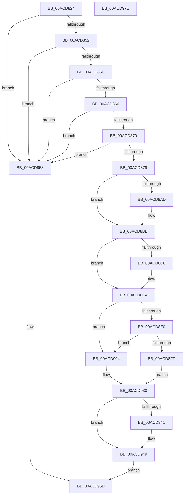

# PopBlackBoxDirectAccess

- RVA: `0x00ACD824`–`0x00ACD97F` (길이 `347` bytes)
- VA: `0x0000000140ACD824`
- 실행 섹션: `PAGE`
- PDB 이름 있음: `예`; PDB Function 태그: `아니요`
- unwind 정보 RVA: `0x0005FEF8`
- 디코드: `88`개 명령, `347/347` bytes 표시
- 미해석 바이트: `0` (있으면 어셈블리에 `.byte`로 보존)

> 이 문서는 커널 이미지의 기계어와 PDB 기호를 분석해 생성했습니다. 4번과 5번은 함수 원형과 자료형을 바이너리 사용 방식에서 추정한 C 해석이며 원본 소스 복구 결과는 아닙니다.

## 1. Dependencies

- 직접 호출 지점: **7**; 고유 호출 대상: **7**
- 직접 호출자로 확인된 함수: **1**
- RIP 상대 이미지 참조: **3**

### Outgoing calls
- `0x00ACD89D` → [KeAbPreAcquire](../../text/21/KeAbPreAcquire_function_00210230.md) (function, `0x00210230`)
- `0x00ACD8B6` → [ExfAcquirePushLockExclusiveEx](../../text/20/ExfAcquirePushLockExclusiveEx_function_0020FC90.md) (function, `0x0020FC90`)
- `0x00ACD8EE` → [ExAllocatePool2](../../poolcode/B8/ExAllocatePool2_function_00B820F0.md) (function, `0x00B820F0`)
- `0x00ACD90B` → [KiQueryUnbiasedInterruptTime](../../text/42/KiQueryUnbiasedInterruptTime_function_0042D180.md) (function, `0x0042D180`)
- `0x00ACD944` → [ExfTryToWakePushLock](../../text/26/ExfTryToWakePushLock_function_00265DD0.md) (function, `0x00265DD0`)
- `0x00ACD94C` → [KeAbPostRelease](../../text/2E/KeAbPostRelease_function_002E1600.md) (function, `0x002E1600`)
- `0x00ACD951` → [KeLeaveCriticalRegion](../../text/25/KeLeaveCriticalRegion_function_0025D8B0.md) (function, `0x0025D8B0`)

### Direct callers
- [NtPowerInformation](../95/NtPowerInformation_function_00955D80.md) at `0x00957DFE`

### Static image references
- `0x00ACD882` → RVA `0x00F084E8` (`.data`; read)
- `0x00ACD8C8` → RVA `0x00E07800` (`.data`; read)
- `0x00ACD930` → RVA `0x00F084E8` (`.data`; read/write)

## 2. Other-region calls and transfers

- 다른 실행 섹션으로 향하는 call: **7**
  - `0x00ACD89D` → [KeAbPreAcquire](../../text/21/KeAbPreAcquire_function_00210230.md) (`PAGE` → `.text`)
  - `0x00ACD8B6` → [ExfAcquirePushLockExclusiveEx](../../text/20/ExfAcquirePushLockExclusiveEx_function_0020FC90.md) (`PAGE` → `.text`)
  - `0x00ACD8EE` → [ExAllocatePool2](../../poolcode/B8/ExAllocatePool2_function_00B820F0.md) (`PAGE` → `POOLCODE`)
  - `0x00ACD90B` → [KiQueryUnbiasedInterruptTime](../../text/42/KiQueryUnbiasedInterruptTime_function_0042D180.md) (`PAGE` → `.text`)
  - `0x00ACD944` → [ExfTryToWakePushLock](../../text/26/ExfTryToWakePushLock_function_00265DD0.md) (`PAGE` → `.text`)
  - `0x00ACD94C` → [KeAbPostRelease](../../text/2E/KeAbPostRelease_function_002E1600.md) (`PAGE` → `.text`)
  - `0x00ACD951` → [KeLeaveCriticalRegion](../../text/25/KeLeaveCriticalRegion_function_0025D8B0.md) (`PAGE` → `.text`)
- 별도 외부 분기/꼬리 이동을 확인하지 못했습니다.

## 3. Assembly (complete function range)

```asm
00ACD824  48 8B C4                        mov rax, rsp
00ACD827  48 89 58 08                     mov qword ptr [rax + 8], rbx
00ACD82B  48 89 68 10                     mov qword ptr [rax + 0x10], rbp
00ACD82F  48 89 70 18                     mov qword ptr [rax + 0x18], rsi
00ACD833  48 89 78 20                     mov qword ptr [rax + 0x20], rdi
00ACD837  41 54                           push r12
00ACD839  41 56                           push r14
00ACD83B  41 57                           push r15
00ACD83D  48 83 EC 20                     sub rsp, 0x20
00ACD841  33 FF                           xor edi, edi
00ACD843  4C 8B F2                        mov r14, rdx
00ACD846  48 8B F1                        mov rsi, rcx
00ACD849  48 39 39                        cmp qword ptr [rcx], rdi
00ACD84C  0F 85 06 01 00 00               jne 0x140acd958
00ACD852  48 39 79 08                     cmp qword ptr [rcx + 8], rdi
00ACD856  0F 85 FC 00 00 00               jne 0x140acd958
00ACD85C  48 39 79 10                     cmp qword ptr [rcx + 0x10], rdi
00ACD860  0F 85 F2 00 00 00               jne 0x140acd958
00ACD866  83 79 18 18                     cmp dword ptr [rcx + 0x18], 0x18
00ACD86A  0F 87 E8 00 00 00               ja 0x140acd958
00ACD870  39 79 1C                        cmp dword ptr [rcx + 0x1c], edi
00ACD873  0F 85 DF 00 00 00               jne 0x140acd958
00ACD879  65 48 8B 04 25 88 01 00 00      mov rax, qword ptr gs:[0x188]
00ACD882  4C 8D 3D 5F AC 43 00            lea r15, [rip + 0x43ac5f]
00ACD889  48 83 CB FF                     or rbx, 0xffffffffffffffff
00ACD88D  45 33 C0                        xor r8d, r8d
00ACD890  33 D2                           xor edx, edx
00ACD892  49 8B CF                        mov rcx, r15
00ACD895  66 01 98 E4 01 00 00            add word ptr [rax + 0x1e4], bx
00ACD89C  90                              nop
00ACD89D  E8 8E 29 74 FF                  call 0x140210230
00ACD8A2  F0 49 0F BA 2F 00               lock bts qword ptr [r15], 0
00ACD8A8  48 8B E8                        mov rbp, rax
00ACD8AB  73 0E                           jae 0x140acd8bb
00ACD8AD  4D 8B C7                        mov r8, r15
00ACD8B0  48 8B D0                        mov rdx, rax
00ACD8B3  49 8B CF                        mov rcx, r15
00ACD8B6  E8 D5 23 74 FF                  call 0x14020fc90
00ACD8BB  48 85 ED                        test rbp, rbp
00ACD8BE  74 04                           je 0x140acd8c4
00ACD8C0  C6 45 0A 01                     mov byte ptr [rbp + 0xa], 1
00ACD8C4  48 63 46 18                     movsxd rax, dword ptr [rsi + 0x18]
00ACD8C8  48 8D 2D 31 9F 33 00            lea rbp, [rip + 0x339f31]
00ACD8CF  48 6B F0 68                     imul rsi, rax, 0x68
00ACD8D3  41 BC 00 10 00 00               mov r12d, 0x1000
00ACD8D9  48 39 7C 2E 50                  cmp qword ptr [rsi + rbp + 0x50], rdi
00ACD8DE  75 24                           jne 0x140acd904
00ACD8E0  41 B8 4D 65 6D 20               mov r8d, 0x206d654d
00ACD8E6  41 8B D4                        mov edx, r12d
00ACD8E9  B9 40 00 00 00                  mov ecx, 0x40
00ACD8EE  E8 FD 47 0B 00                  call 0x140b820f0
00ACD8F3  48 89 44 2E 50                  mov qword ptr [rsi + rbp + 0x50], rax
00ACD8F8  48 85 C0                        test rax, rax
00ACD8FB  75 07                           jne 0x140acd904
00ACD8FD  BF 9A 00 00 C0                  mov edi, 0xc000009a
00ACD902  EB 2C                           jmp 0x140acd930
00ACD904  83 4C 2E 10 02                  or dword ptr [rsi + rbp + 0x10], 2
00ACD909  B1 01                           mov cl, 1
00ACD90B  E8 70 F8 95 FF                  call 0x14042d180
00ACD910  48 89 44 2E 48                  mov qword ptr [rsi + rbp + 0x48], rax
00ACD915  48 8B 44 2E 50                  mov rax, qword ptr [rsi + rbp + 0x50]
00ACD91A  4C 89 64 2E 58                  mov qword ptr [rsi + rbp + 0x58], r12
00ACD91F  4C 89 64 2E 60                  mov qword ptr [rsi + rbp + 0x60], r12
00ACD924  49 89 06                        mov qword ptr [r14], rax
00ACD927  48 8B 44 2E 58                  mov rax, qword ptr [rsi + rbp + 0x58]
00ACD92C  49 89 46 08                     mov qword ptr [r14 + 8], rax
00ACD930  F0 48 0F C1 1D AF AB 43 00      lock xadd qword ptr [rip + 0x43abaf], rbx
00ACD939  80 E3 06                        and bl, 6
00ACD93C  80 FB 02                        cmp bl, 2
00ACD93F  75 08                           jne 0x140acd949
00ACD941  49 8B CF                        mov rcx, r15
00ACD944  E8 87 84 79 FF                  call 0x140265dd0
00ACD949  49 8B CF                        mov rcx, r15
00ACD94C  E8 AF 3C 81 FF                  call 0x1402e1600
00ACD951  E8 5A FF 78 FF                  call 0x14025d8b0
00ACD956  EB 05                           jmp 0x140acd95d
00ACD958  BF 0D 00 00 C0                  mov edi, 0xc000000d
00ACD95D  48 8B 5C 24 40                  mov rbx, qword ptr [rsp + 0x40]
00ACD962  8B C7                           mov eax, edi
00ACD964  48 8B 7C 24 58                  mov rdi, qword ptr [rsp + 0x58]
00ACD969  48 8B 6C 24 48                  mov rbp, qword ptr [rsp + 0x48]
00ACD96E  48 8B 74 24 50                  mov rsi, qword ptr [rsp + 0x50]
00ACD973  48 83 C4 20                     add rsp, 0x20
00ACD977  41 5F                           pop r15
00ACD979  41 5E                           pop r14
00ACD97B  41 5C                           pop r12
00ACD97D  C3                              ret
00ACD97E  CC                              int3
```

## 4. C-style interpretation (structured pseudocode)

```c
__int64 __fastcall PopBlackBoxDirectAccess(__int64 a1, __int64 a2, int a3)
{
    __int64 result;
    __int64 v_rbx;
    __int64 v_rdi;
    __int64 v_rsi;
    __int64 v_rsp;
    unsigned __int64 v_stack_p10;
    unsigned __int64 v_stack_p18;
    unsigned __int64 v_stack_p20;
    unsigned __int64 v_stack_p8;

    *(unsigned __int64 *)(v_rsp + 8) = v_rbx;
    *(unsigned __int64 *)(v_rsp + 16) = v_rbp;
    *(unsigned __int64 *)(v_rsp + 24) = v_rsi;
    *(unsigned __int64 *)(v_rsp + 32) = v_rdi;
    v_rsp = (v_rsp) - (32);
    v_rdi = 0;
    if ((*(unsigned __int64 *)(a1)) != 0) goto loc_00ACD958;
    if ((*(unsigned __int64 *)(a1 + 8)) != 0) goto loc_00ACD958;
    if ((*(unsigned __int64 *)(a1 + 16)) != 0) goto loc_00ACD958;
    if ((*(unsigned int *)(a1 + 24)) > 24) goto loc_00ACD958;
    if ((*(unsigned int *)(a1 + 28)) != 0) goto loc_00ACD958;
    v_rbx = (v_rbx) | (-1);
    a3 = 0;
    a2 = 0;
    result = KeAbPreAcquire(v_rip + 4435039, a2, a3, a4);
    if (!(condition_is_above_or_equal)) {
        a3 = v_rip + 4435039;
        a2 = result;
        a1 = v_rip + 4435039;
        result = ExfAcquirePushLockExclusiveEx(a1, a2, a3, a4);
    }
    if (result != 0) {
        *(unsigned __int8 *)(result + 10) = 1;
    }
    v_rsi = (a1) * ((int)(*(unsigned int *)(a1 + 24)));
    if ((*(unsigned __int64 *)(v_rsi + v_rip + 3383089 * 1 + 80)) != 0) goto loc_00ACD904;
    result = ExAllocatePool2(64, (unsigned int)((unsigned int)((unsigned int)(0x1000ULL))), (unsigned int)(0x206D654DULL), a4);
    *(unsigned __int64 *)(v_rsi + v_rip + 3383089 * 1 + 80) = result;
    if (result != 0) goto loc_00ACD904;
    goto loc_00ACD930;
loc_00ACD904:
    result = KiQueryUnbiasedInterruptTime(1, (unsigned int)((unsigned int)((unsigned int)(0x1000ULL))), (unsigned int)(0x206D654DULL), a4);
    *(unsigned __int64 *)(v_rsi + v_rip + 3383089 * 1 + 72) = result;
    *(unsigned __int64 *)(v_rsi + v_rip + 3383089 * 1 + 88) = (unsigned int)(0x1000ULL);
    *(unsigned __int64 *)(v_rsi + v_rip + 3383089 * 1 + 96) = (unsigned int)(0x1000ULL);
    *(unsigned __int64 *)(a2) = *(unsigned __int64 *)(v_rsi + v_rip + 3383089 * 1 + 80);
    *(unsigned __int64 *)(a2 + 8) = *(unsigned __int64 *)(v_rsi + v_rip + 3383089 * 1 + 88);
loc_00ACD930:
    v_rbx = (unsigned __int8)((v_rbx) & (6));
    result = *(unsigned __int64 *)(v_rsi + v_rip + 3383089 * 1 + 88);
    if (((unsigned __int8)(v_rbx)) == 2) {
        a1 = v_rip + 4435039;
        result = ExfTryToWakePushLock(a1, (unsigned int)((unsigned int)((unsigned int)(0x1000ULL))), (unsigned int)(0x206D654DULL), a4);
    }
    result = KeAbPostRelease(v_rip + 4435039, (unsigned int)((unsigned int)((unsigned int)(0x1000ULL))), (unsigned int)(0x206D654DULL), a4);
    result = KeLeaveCriticalRegion(v_rip + 4435039, (unsigned int)((unsigned int)((unsigned int)(0x1000ULL))), (unsigned int)(0x206D654DULL), a4);
    goto loc_00ACD95D;
loc_00ACD958:
loc_00ACD95D:
    v_rsp = (v_rsp) + (32);
    return (unsigned int)((unsigned int)((unsigned int)(0xC000000DULL)));
}
```

## 5. (Beta) C Style

```c
int64_t PopBlackBoxDirectAccess(void *Arg1, void *Arg2, int32_t Arg3)
{
    uint8_t *arg1 = (uint8_t *)Arg1;
    uint8_t *arg2 = (uint8_t *)Arg2;

    int64_t result;
    int64_t local_rbx;
    int64_t local_rdi;
    int64_t local_rsi;
    int64_t local_rsp;
    uint64_t v_stack_p10;
    uint64_t v_stack_p18;
    uint64_t v_stack_p20;
    uint64_t v_stack_p8;

    *(uint64_t *)(local_rsp + 0x8) = local_rbx;
    *(uint64_t *)(local_rsp + 0x10) = local_rbp;
    *(uint64_t *)(local_rsp + 0x18) = local_rsi;
    *(uint64_t *)(local_rsp + 0x20) = local_rdi;
    local_rsp = (local_rsp) - (32);
    local_rdi = 0;
    if ((*(uint64_t *)(arg1)) != 0) goto loc_00ACD958;
    if ((*(uint64_t *)(arg1 + 0x8)) != 0) goto loc_00ACD958;
    if ((*(uint64_t *)(arg1 + 0x10)) != 0) goto loc_00ACD958;
    if ((*(uint32_t *)(arg1 + 0x18)) > 24) goto loc_00ACD958;
    if ((*(uint32_t *)(arg1 + 0x1C)) != 0) goto loc_00ACD958;
    local_rbx = (local_rbx) | (-1);
    Arg3 = 0;
    Arg2 = 0;
    result = KeAbPreAcquire(v_rip + 4435039, Arg2, Arg3, a4);
    if (!(condition_is_above_or_equal)) {
        Arg3 = v_rip + 4435039;
        Arg2 = result;
        Arg1 = v_rip + 4435039;
        result = ExfAcquirePushLockExclusiveEx(Arg1, Arg2, Arg3, a4);
    }
    if (result != 0) {
        *(uint8_t *)(result + 0xA) = 1;
    }
    local_rsi = (Arg1) * ((int32_t)(*(uint32_t *)(arg1 + 0x18)));
    if ((*(uint64_t *)(local_rsi + v_rip + 0x339F31 * 1 + 0x50)) != 0) goto loc_00ACD904;
    result = ExAllocatePool2(64, (uint32_t)((uint32_t)((uint32_t)(0x1000ULL))), (uint32_t)(0x206D654DULL), a4);
    *(uint64_t *)(local_rsi + v_rip + 0x339F31 * 1 + 0x50) = result;
    if (result != 0) goto loc_00ACD904;
    goto loc_00ACD930;
loc_00ACD904:
    result = KiQueryUnbiasedInterruptTime(1, (uint32_t)((uint32_t)((uint32_t)(0x1000ULL))), (uint32_t)(0x206D654DULL), a4);
    *(uint64_t *)(local_rsi + v_rip + 0x339F31 * 1 + 0x48) = result;
    *(uint64_t *)(local_rsi + v_rip + 0x339F31 * 1 + 0x58) = (uint32_t)(0x1000ULL);
    *(uint64_t *)(local_rsi + v_rip + 0x339F31 * 1 + 0x60) = (uint32_t)(0x1000ULL);
    *(uint64_t *)(arg2) = *(uint64_t *)(local_rsi + v_rip + 0x339F31 * 1 + 0x50);
    *(uint64_t *)(arg2 + 0x8) = *(uint64_t *)(local_rsi + v_rip + 0x339F31 * 1 + 0x58);
loc_00ACD930:
    local_rbx = (uint8_t)((local_rbx) & (6));
    result = *(uint64_t *)(local_rsi + v_rip + 0x339F31 * 1 + 0x58);
    if (((uint8_t)(local_rbx)) == 2) {
        Arg1 = v_rip + 4435039;
        result = ExfTryToWakePushLock(Arg1, (uint32_t)((uint32_t)((uint32_t)(0x1000ULL))), (uint32_t)(0x206D654DULL), a4);
    }
    result = KeAbPostRelease(v_rip + 4435039, (uint32_t)((uint32_t)((uint32_t)(0x1000ULL))), (uint32_t)(0x206D654DULL), a4);
    result = KeLeaveCriticalRegion(v_rip + 4435039, (uint32_t)((uint32_t)((uint32_t)(0x1000ULL))), (uint32_t)(0x206D654DULL), a4);
    goto loc_00ACD95D;
loc_00ACD958:
loc_00ACD95D:
    local_rsp = (local_rsp) + (32);
    return (uint32_t)((uint32_t)((uint32_t)(0xC000000DULL)));
}
```

### 관측된 메모리 오프셋

구조체 형식이 확인되지 않은 접근은 인자 기준의 오프셋으로만 기록했습니다.

| 기준 인자 | 오프셋 표현 | 폭 (bit) | 접근 |
|---|---:|---:|---|
| `Arg1` | `+ 0x0` | `64` | `R` |
| `Arg1` | `+ 0x8` | `64` | `R` |
| `Arg1` | `+ 0x10` | `64` | `R` |
| `Arg1` | `+ 0x10 + rbp*1` | `32` | `R/W` |
| `Arg1` | `+ 0x18` | `32` | `R` |
| `Arg1` | `+ 0x1C` | `32` | `R` |
| `Arg1` | `+ 0x48 + rbp*1` | `64` | `W` |
| `Arg1` | `+ 0x50 + rbp*1` | `64` | `R` |
| `Arg1` | `+ 0x50 + rbp*1` | `64` | `W` |
| `Arg1` | `+ 0x58 + rbp*1` | `64` | `R` |
| `Arg1` | `+ 0x58 + rbp*1` | `64` | `W` |
| `Arg1` | `+ 0x60 + rbp*1` | `64` | `W` |
| `Arg2` | `+ 0x0` | `64` | `W` |
| `Arg2` | `+ 0x8` | `64` | `W` |

## 6. Execution-region graph

[열기: 2D/3D 그래프와 함수 탐색 컨트롤 패널](../../../control-panel.html?section=page&rva=0x00ACD824&view=graph)

- 2D 그래프는 위에서 아래로 흐르고, 3D 그래프는 빈 공간을 드래그해 회전합니다. Shift+드래그는 이동, 휠은 확대·축소, 함수 노드 선택은 대상 보고서 이동입니다.

### Static fallback


