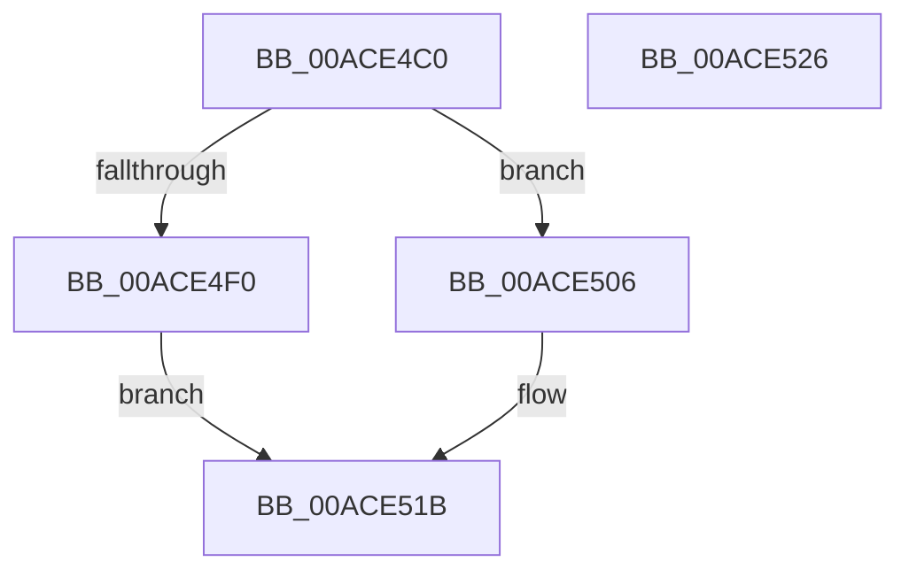

# PopBlockSessionSwitch

- RVA: `0x00ACE4C0`–`0x00ACE527` (길이 `103` bytes)
- VA: `0x0000000140ACE4C0`
- 실행 섹션: `PAGE`
- PDB 이름 있음: `예`; PDB Function 태그: `아니요`
- unwind 정보 RVA: `0x000BDDB4`
- 디코드: `31`개 명령, `103/103` bytes 표시
- 미해석 바이트: `0` (있으면 어셈블리에 `.byte`로 보존)

> 이 문서는 커널 이미지의 기계어와 PDB 기호를 분석해 생성했습니다. 4번과 5번은 함수 원형과 자료형을 바이너리 사용 방식에서 추정한 C 해석이며 원본 소스 복구 결과는 아닙니다.

## 1. Dependencies

- 직접 호출 지점: **2**; 고유 호출 대상: **2**
- 직접 호출자로 확인된 함수: **4**
- RIP 상대 이미지 참조: **0**

### Outgoing calls
- `0x00ACE4FA` → [PoBlockConsoleSwitchEx](../../text/43/PoBlockConsoleSwitchEx_function_00435CD4.md) (function, `0x00435CD4`)
- `0x00ACE516` → [PopDispatchStateCallout](../91/PopDispatchStateCallout_function_0091248C.md) (function, `0x0091248C`)

### Direct callers
- [PoSessionBuiltinPanelState](../../text/5D/PoSessionBuiltinPanelState_function_005DC420.md) at `0x005DC442`
- [PoSessionBuiltinPanelState](../../text/5D/PoSessionBuiltinPanelState_function_005DC420.md) at `0x005DC49E`
- [PoSessionEngagementUpdate](../../text/5D/PoSessionEngagementUpdate_function_005DC4B8.md) at `0x005DC4DA`
- [PoSessionEngagementUpdate](../../text/5D/PoSessionEngagementUpdate_function_005DC4B8.md) at `0x005DC536`
- [PopScreenOn](../76/PopScreenOn_function_007697E0.md) at `0x007697F4`
- [PopScreenOn](../76/PopScreenOn_function_007697E0.md) at `0x0076981E`
- [PoSessionPowerControl](../76/PoSessionPowerControl_function_0076C038.md) at `0x0076C062`
- [PoSessionPowerControl](../76/PoSessionPowerControl_function_0076C038.md) at `0x0076C0C7`

### Static image references
- 디코드된 RIP-relative 메모리 참조가 없습니다.

## 2. Other-region calls and transfers

- 다른 실행 섹션으로 향하는 call: **1**
  - `0x00ACE4FA` → [PoBlockConsoleSwitchEx](../../text/43/PoBlockConsoleSwitchEx_function_00435CD4.md) (`PAGE` → `.text`)
- 별도 외부 분기/꼬리 이동을 확인하지 못했습니다.

## 3. Assembly (complete function range)

```asm
00ACE4C0  48 89 5C 24 10                  mov qword ptr [rsp + 0x10], rbx
00ACE4C5  55                              push rbp
00ACE4C6  48 8B EC                        mov rbp, rsp
00ACE4C9  48 83 EC 50                     sub rsp, 0x50
00ACE4CD  0F 57 C0                        xorps xmm0, xmm0
00ACE4D0  33 C0                           xor eax, eax
00ACE4D2  0F 11 45 E0                     movups xmmword ptr [rbp - 0x20], xmm0
00ACE4D6  84 C9                           test cl, cl
00ACE4D8  C7 45 E8 01 00 00 00            mov dword ptr [rbp - 0x18], 1
00ACE4DF  48 8D 4D D0                     lea rcx, [rbp - 0x30]
00ACE4E3  48 89 45 F0                     mov qword ptr [rbp - 0x10], rax
00ACE4E7  48 8B DA                        mov rbx, rdx
00ACE4EA  0F 11 45 D0                     movups xmmword ptr [rbp - 0x30], xmm0
00ACE4EE  74 16                           je 0x140ace506
00ACE4F0  21 45 10                        and dword ptr [rbp + 0x10], eax
00ACE4F3  48 8D 55 10                     lea rdx, [rbp + 0x10]
00ACE4F7  45 33 C0                        xor r8d, r8d
00ACE4FA  E8 D5 77 96 FF                  call 0x140435cd4
00ACE4FF  8B 45 10                        mov eax, dword ptr [rbp + 0x10]
00ACE502  89 03                           mov dword ptr [rbx], eax
00ACE504  EB 15                           jmp 0x140ace51b
00ACE506  8B 02                           mov eax, dword ptr [rdx]
00ACE508  48 8D 55 10                     lea rdx, [rbp + 0x10]
00ACE50C  89 45 10                        mov dword ptr [rbp + 0x10], eax
00ACE50F  C7 45 F0 07 00 00 00            mov dword ptr [rbp - 0x10], 7
00ACE516  E8 71 3F E4 FF                  call 0x14091248c
00ACE51B  48 8B 5C 24 68                  mov rbx, qword ptr [rsp + 0x68]
00ACE520  48 83 C4 50                     add rsp, 0x50
00ACE524  5D                              pop rbp
00ACE525  C3                              ret
00ACE526  CC                              int3
```

## 4. C-style interpretation (structured pseudocode)

```c
__int64 __fastcall PopBlockSessionSwitch(unsigned __int8 a1, __int64 a2, int a3)
{
    __int64 result;
    __int64 v_rsp;
    unsigned __int64 v_stack_m18;
    unsigned int v_stack_m20;
    unsigned __int64 v_stack_m28;
    unsigned __int64 v_stack_m38;
    unsigned __int64 v_stack_p10;
    unsigned int v_stack_p8;

    v_stack_p10 = v_rbx;
    v_rsp = (v_rsp) - (80);
    result = 0;
    v_stack_m28 = v_xmm0;
    v_stack_m20 = 1;
    v_stack_m18 = 0;
    v_stack_m38 = v_xmm0;
    if (a1 == 0) goto loc_00ACE506;
    a3 = 0;
    result = PoBlockConsoleSwitchEx(v_stack_m38, v_stack_p8, a3, a4);
    *(unsigned int *)(a2) = (unsigned int)((unsigned int)(v_stack_p8));
    goto loc_00ACE51B;
loc_00ACE506:
    v_stack_p8 = (unsigned int)((unsigned int)(*(unsigned int *)(v_stack_p8)));
    v_stack_m18 = 7;
    result = PopDispatchStateCallout(v_stack_m38, v_stack_p8, a3, a4);
loc_00ACE51B:
    v_rsp = (v_rsp) + (80);
    return result;
}
```

## 5. (Beta) C Style

```c
int64_t PopBlockSessionSwitch(uint8_t Arg1, void *Arg2, int32_t Arg3)
{
    uint8_t *arg2 = (uint8_t *)Arg2;

    int64_t result;
    int64_t local_rsp;
    uint64_t v_stack_m18;
    uint32_t v_stack_m20;
    uint64_t v_stack_m28;
    uint64_t v_stack_m38;
    uint64_t v_stack_p10;
    uint32_t v_stack_p8;

    v_stack_p10 = local_rbx;
    local_rsp = (local_rsp) - (80);
    result = 0;
    v_stack_m28 = v_xmm0;
    v_stack_m20 = 1;
    v_stack_m18 = 0;
    v_stack_m38 = v_xmm0;
    if (Arg1 == 0) goto loc_00ACE506;
    Arg3 = 0;
    result = PoBlockConsoleSwitchEx(v_stack_m38, v_stack_p8, Arg3, a4);
    *(uint32_t *)(arg2) = (uint32_t)((uint32_t)(v_stack_p8));
    goto loc_00ACE51B;
loc_00ACE506:
    v_stack_p8 = (uint32_t)((uint32_t)(*(uint32_t *)(v_stack_p8)));
    v_stack_m18 = 7;
    result = PopDispatchStateCallout(v_stack_m38, v_stack_p8, Arg3, a4);
loc_00ACE51B:
    local_rsp = (local_rsp) + (80);
    return result;
}
```

### 관측된 메모리 오프셋

구조체 형식이 확인되지 않은 접근은 인자 기준의 오프셋으로만 기록했습니다.

| 기준 인자 | 오프셋 표현 | 폭 (bit) | 접근 |
|---|---:|---:|---|
| `Arg2` | `+ 0x0` | `32` | `R` |
| `Arg2` | `+ 0x0` | `32` | `W` |

## 6. Execution-region graph

[열기: 2D/3D 그래프와 함수 탐색 컨트롤 패널](../../../control-panel.html?section=page&rva=0x00ACE4C0&view=graph)

- 2D 그래프는 위에서 아래로 흐르고, 3D 그래프는 빈 공간을 드래그해 회전합니다. Shift+드래그는 이동, 휠은 확대·축소, 함수 노드 선택은 대상 보고서 이동입니다.

### Static fallback


