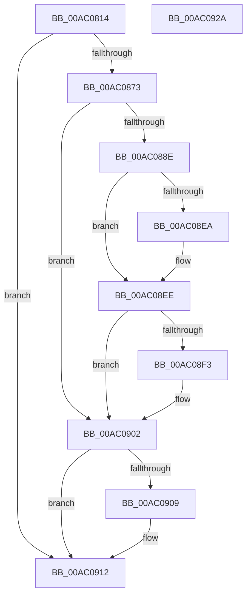

# PopBootStatAccessCheck

- RVA: `0x00AC0814`–`0x00AC092B` (길이 `279` bytes)
- VA: `0x0000000140AC0814`
- 실행 섹션: `PAGE`
- PDB 이름 있음: `예`; PDB Function 태그: `아니요`
- unwind 정보 RVA: `0x000BD8A0`
- 디코드: `74`개 명령, `279/279` bytes 표시
- 미해석 바이트: `0` (있으면 어셈블리에 `.byte`로 보존)

> 이 문서는 커널 이미지의 기계어와 PDB 기호를 분석해 생성했습니다. 4번과 5번은 함수 원형과 자료형을 바이너리 사용 방식에서 추정한 C 해석이며 원본 소스 복구 결과는 아닙니다.

## 1. Dependencies

- 직접 호출 지점: **7**; 고유 호출 대상: **7**
- 직접 호출자로 확인된 함수: **4**
- RIP 상대 이미지 참조: **1**

### Outgoing calls
- `0x00AC0863` → [ObReferenceObjectByHandle](../86/ObReferenceObjectByHandle_function_00868DB0.md) (function, `0x00868DB0`)
- `0x00AC0882` → [ObpGetObjectSecurity](../87/ObpGetObjectSecurity_function_008717E0.md) (function, `0x008717E0`)
- `0x00AC0892` → [SeCaptureSubjectContext](../86/SeCaptureSubjectContext_function_0086B820.md) (function, `0x0086B820`)
- `0x00AC08D6` → [SeAccessCheck](../../text/3A/SeAccessCheck_function_003A6BC0.md) (function, `0x003A6BC0`)
- `0x00AC08E1` → [SeReleaseSubjectContext](../86/SeReleaseSubjectContext_function_0086B710.md) (function, `0x0086B710`)
- `0x00AC08FD` → [ObReleaseObjectSecurityEx](../8C/ObReleaseObjectSecurityEx_function_008C6E30.md) (function, `0x008C6E30`)
- `0x00AC090D` → [ObfDereferenceObject](../../text/2F/ObfDereferenceObject_function_002F9350.md) (function, `0x002F9350`)

### Direct callers
- [PopBootStatGet](../A4/PopBootStatGet_function_00A4C398.md) at `0x00A4C6F2`
- [PopBootStatSet](../A4/PopBootStatSet_function_00A4C77C.md) at `0x00A4CA86`
- [PopBootStatRestoreDefaults](PopBootStatRestoreDefaults_function_00AC38E8.md) at `0x00AC3A76`
- [PopBootStatCheckIntegrity](PopBootStatCheckIntegrity_function_00ACDF4C.md) at `0x00ACE0FD`

### Static image references
- `0x00AC08B3` → RVA `0x00B4B110` (`IopFileMapping`; read)

## 2. Other-region calls and transfers

- 다른 실행 섹션으로 향하는 call: **2**
  - `0x00AC08D6` → [SeAccessCheck](../../text/3A/SeAccessCheck_function_003A6BC0.md) (`PAGE` → `.text`)
  - `0x00AC090D` → [ObfDereferenceObject](../../text/2F/ObfDereferenceObject_function_002F9350.md) (`PAGE` → `.text`)
- 별도 외부 분기/꼬리 이동을 확인하지 못했습니다.

## 3. Assembly (complete function range)

```asm
00AC0814  4C 8B DC                        mov r11, rsp
00AC0817  49 89 5B 08                     mov qword ptr [r11 + 8], rbx
00AC081B  49 89 73 10                     mov qword ptr [r11 + 0x10], rsi
00AC081F  55                              push rbp
00AC0820  49 8D 6B A1                     lea rbp, [r11 - 0x5f]
00AC0824  48 81 EC 90 00 00 00            sub rsp, 0x90
00AC082B  49 83 63 90 00                  and qword ptr [r11 - 0x70], 0
00AC0830  48 8D 45 1F                     lea rax, [rbp + 0x1f]
00AC0834  83 65 1B 00                     and dword ptr [rbp + 0x1b], 0
00AC0838  0F 57 C0                        xorps xmm0, xmm0
00AC083B  48 83 65 27 00                  and qword ptr [rbp + 0x27], 0
00AC0840  41 8B D8                        mov ebx, r8d
00AC0843  48 83 65 1F 00                  and qword ptr [rbp + 0x1f], 0
00AC0848  40 8A F2                        mov sil, dl
00AC084B  45 33 C0                        xor r8d, r8d
00AC084E  49 89 43 88                     mov qword ptr [r11 - 0x78], rax
00AC0852  33 D2                           xor edx, edx
00AC0854  C6 45 7F 00                     mov byte ptr [rbp + 0x7f], 0
00AC0858  45 33 C9                        xor r9d, r9d
00AC085B  0F 11 45 2F                     movups xmmword ptr [rbp + 0x2f], xmm0
00AC085F  0F 11 45 3F                     movups xmmword ptr [rbp + 0x3f], xmm0
00AC0863  E8 48 85 DA FF                  call 0x140868db0
00AC0868  89 45 17                        mov dword ptr [rbp + 0x17], eax
00AC086B  85 C0                           test eax, eax
00AC086D  0F 88 9F 00 00 00               js 0x140ac0912
00AC0873  48 8B 4D 1F                     mov rcx, qword ptr [rbp + 0x1f]
00AC0877  4C 8D 45 7F                     lea r8, [rbp + 0x7f]
00AC087B  45 33 C9                        xor r9d, r9d
00AC087E  48 8D 55 27                     lea rdx, [rbp + 0x27]
00AC0882  E8 59 0F DB FF                  call 0x1408717e0
00AC0887  89 45 17                        mov dword ptr [rbp + 0x17], eax
00AC088A  85 C0                           test eax, eax
00AC088C  78 74                           js 0x140ac0902
00AC088E  48 8D 4D 2F                     lea rcx, [rbp + 0x2f]
00AC0892  E8 89 AF DA FF                  call 0x14086b820
00AC0897  48 8D 45 17                     lea rax, [rbp + 0x17]
00AC089B  44 8B CB                        mov r9d, ebx
00AC089E  48 89 44 24 48                  mov qword ptr [rsp + 0x48], rax
00AC08A3  48 8D 55 2F                     lea rdx, [rbp + 0x2f]
00AC08A7  48 8D 45 1B                     lea rax, [rbp + 0x1b]
00AC08AB  45 33 C0                        xor r8d, r8d
00AC08AE  48 89 44 24 40                  mov qword ptr [rsp + 0x40], rax
00AC08B3  48 8D 05 56 A8 08 00            lea rax, [rip + 0x8a856]
00AC08BA  40 88 74 24 38                  mov byte ptr [rsp + 0x38], sil
00AC08BF  48 8B 75 27                     mov rsi, qword ptr [rbp + 0x27]
00AC08C3  48 89 44 24 30                  mov qword ptr [rsp + 0x30], rax
00AC08C8  48 8B CE                        mov rcx, rsi
00AC08CB  48 83 64 24 28 00               and qword ptr [rsp + 0x28], 0
00AC08D1  83 64 24 20 00                  and dword ptr [rsp + 0x20], 0
00AC08D6  E8 E5 62 8E FF                  call 0x1403a6bc0
00AC08DB  48 8D 4D 2F                     lea rcx, [rbp + 0x2f]
00AC08DF  8A D8                           mov bl, al
00AC08E1  E8 2A AE DA FF                  call 0x14086b710
00AC08E6  84 DB                           test bl, bl
00AC08E8  74 04                           je 0x140ac08ee
00AC08EA  83 65 17 00                     and dword ptr [rbp + 0x17], 0
00AC08EE  48 85 F6                        test rsi, rsi
00AC08F1  74 0F                           je 0x140ac0902
00AC08F3  4C 8B 45 1F                     mov r8, qword ptr [rbp + 0x1f]
00AC08F7  48 8B CE                        mov rcx, rsi
00AC08FA  8A 55 7F                        mov dl, byte ptr [rbp + 0x7f]
00AC08FD  E8 2E 65 E0 FF                  call 0x1408c6e30
00AC0902  48 83 7D 1F 00                  cmp qword ptr [rbp + 0x1f], 0
00AC0907  74 09                           je 0x140ac0912
00AC0909  48 8B 4D 1F                     mov rcx, qword ptr [rbp + 0x1f]
00AC090D  E8 3E 8A 83 FF                  call 0x1402f9350
00AC0912  8B 45 17                        mov eax, dword ptr [rbp + 0x17]
00AC0915  4C 8D 9C 24 90 00 00 00         lea r11, [rsp + 0x90]
00AC091D  49 8B 5B 10                     mov rbx, qword ptr [r11 + 0x10]
00AC0921  49 8B 73 18                     mov rsi, qword ptr [r11 + 0x18]
00AC0925  49 8B E3                        mov rsp, r11
00AC0928  5D                              pop rbp
00AC0929  C3                              ret
00AC092A  CC                              int3
```

## 4. C-style interpretation (structured pseudocode)

```c
__int64 __fastcall PopBootStatAccessCheck(__int64 a1, int a2, int a3, int a4)
{
    __int64 result;
    __int64 v_rsp;
    unsigned __int64 v_stack_m50;
    unsigned __int64 v_stack_m58;
    unsigned __int8 v_stack_m60;
    unsigned __int64 v_stack_m68;
    unsigned __int64 v_stack_m70;
    unsigned int v_stack_m78;
    unsigned __int64 v_stack_m8;

    *(unsigned __int64 *)(v_rsp + 8) = v_rbx;
    *(unsigned __int64 *)(v_rsp + 16) = v_rsi;
    v_rsp = (v_rsp) - (144);
    a3 = 0;
    *(unsigned __int64 *)(v_rsp - 120) = v_rsp - 95 + 31;
    a2 = 0;
    *(unsigned __int8 *)(v_rsp - 95 + 127) = 0;
    a4 = 0;
    *(unsigned __int64 *)(v_rsp - 95 + 47) = v_xmm0;
    *(unsigned __int64 *)(v_rsp - 95 + 63) = v_xmm0;
    result = ObReferenceObjectByHandle(a1, a2, a3, a4);
    *(unsigned int *)(v_rsp - 95 + 23) = (unsigned int)(result);
    if (sign_flag) goto loc_00AC0912;
    a4 = 0;
    result = ObpGetObjectSecurity(*(unsigned __int64 *)(v_rsp - 95 + 31), v_rsp - 95 + 39, v_rsp - 95 + 127, a4);
    *(unsigned int *)(v_rsp - 95 + 23) = (unsigned int)(result);
    if (sign_flag) goto loc_00AC0902;
    result = SeCaptureSubjectContext(v_rsp - 95 + 47, v_rsp - 95 + 39, v_rsp - 95 + 127, a4);
    v_stack_m50 = v_rsp - 95 + 23;
    a3 = 0;
    v_stack_m58 = v_rsp - 95 + 27;
    v_stack_m60 = (unsigned __int8)((unsigned __int8)(a2));
    v_stack_m68 = v_rip + 567382;
    result = SeAccessCheck(*(unsigned __int64 *)(v_rsp - 95 + 39), v_rsp - 95 + 47, a3, (unsigned int)((unsigned int)((unsigned int)(a3))));
    result = SeReleaseSubjectContext(v_rsp - 95 + 47, v_rsp - 95 + 47, a3, (unsigned int)((unsigned int)((unsigned int)(a3))));
    if ((unsigned __int8)((unsigned __int8)(result)) != 0) {
    }
    if (*(unsigned __int64 *)(v_rsp - 95 + 39) != 0) {
        a3 = *(unsigned __int64 *)(v_rsp - 95 + 31);
        a1 = *(unsigned __int64 *)(v_rsp - 95 + 39);
        a2 = *(unsigned __int8 *)(v_rsp - 95 + 127);
        result = ObReleaseObjectSecurityEx(a1, a2, a3, (unsigned int)((unsigned int)((unsigned int)(a3))));
    }
    if ((*(unsigned __int64 *)(v_rsp - 95 + 31)) != 0) {
        a1 = *(unsigned __int64 *)(v_rsp - 95 + 31);
        result = ObfDereferenceObject(a1, a2, a3, (unsigned int)((unsigned int)((unsigned int)(a3))));
    }
    return (unsigned int)(*(unsigned int *)(v_rsp - 95 + 23));
}
```

## 5. (Beta) C Style

```c
int64_t PopBootStatAccessCheck(int64_t Arg1, int32_t Arg2, int32_t Arg3, int32_t Arg4)
{
    int64_t result;
    int64_t local_rsp;
    uint64_t v_stack_m50;
    uint64_t v_stack_m58;
    uint8_t v_stack_m60;
    uint64_t v_stack_m68;
    uint64_t v_stack_m70;
    uint32_t v_stack_m78;
    uint64_t v_stack_m8;

    *(uint64_t *)(local_rsp + 0x8) = local_rbx;
    *(uint64_t *)(local_rsp + 0x10) = local_rsi;
    local_rsp = (local_rsp) - (144);
    Arg3 = 0;
    *(uint64_t *)(local_rsp - 0x78) = local_rsp - 95 + 31;
    Arg2 = 0;
    *(uint8_t *)(local_rsp - 0x5F + 0x7F) = 0;
    Arg4 = 0;
    *(uint64_t *)(local_rsp - 0x5F + 0x2F) = v_xmm0;
    *(uint64_t *)(local_rsp - 0x5F + 0x3F) = v_xmm0;
    result = ObReferenceObjectByHandle(Arg1, Arg2, Arg3, Arg4);
    *(uint32_t *)(local_rsp - 0x5F + 0x17) = (uint32_t)(result);
    if (sign_flag) goto loc_00AC0912;
    Arg4 = 0;
    result = ObpGetObjectSecurity(*(uint64_t *)(local_rsp - 0x5F + 0x1F), local_rsp - 95 + 39, local_rsp - 95 + 127, Arg4);
    *(uint32_t *)(local_rsp - 0x5F + 0x17) = (uint32_t)(result);
    if (sign_flag) goto loc_00AC0902;
    result = SeCaptureSubjectContext(local_rsp - 95 + 47, local_rsp - 95 + 39, local_rsp - 95 + 127, Arg4);
    v_stack_m50 = local_rsp - 95 + 23;
    Arg3 = 0;
    v_stack_m58 = local_rsp - 95 + 27;
    v_stack_m60 = (uint8_t)((uint8_t)(Arg2));
    v_stack_m68 = v_rip + 567382;
    result = SeAccessCheck(*(uint64_t *)(local_rsp - 0x5F + 0x27), local_rsp - 95 + 47, Arg3, (uint32_t)((uint32_t)((uint32_t)(Arg3))));
    result = SeReleaseSubjectContext(local_rsp - 95 + 47, local_rsp - 95 + 47, Arg3, (uint32_t)((uint32_t)((uint32_t)(Arg3))));
    if ((uint8_t)((uint8_t)(result)) != 0) {
    }
    if (*(uint64_t *)(local_rsp - 0x5F + 0x27) != 0) {
        Arg3 = *(uint64_t *)(local_rsp - 0x5F + 0x1F);
        Arg1 = *(uint64_t *)(local_rsp - 0x5F + 0x27);
        Arg2 = *(uint8_t *)(local_rsp - 0x5F + 0x7F);
        result = ObReleaseObjectSecurityEx(Arg1, Arg2, Arg3, (uint32_t)((uint32_t)((uint32_t)(Arg3))));
    }
    if ((*(uint64_t *)(local_rsp - 0x5F + 0x1F)) != 0) {
        Arg1 = *(uint64_t *)(local_rsp - 0x5F + 0x1F);
        result = ObfDereferenceObject(Arg1, Arg2, Arg3, (uint32_t)((uint32_t)((uint32_t)(Arg3))));
    }
    return (uint32_t)(*(uint32_t *)(local_rsp - 0x5F + 0x17));
}
```

## 6. Execution-region graph

[열기: 2D/3D 그래프와 함수 탐색 컨트롤 패널](../../../control-panel.html?section=page&rva=0x00AC0814&view=graph)

- 2D 그래프는 위에서 아래로 흐르고, 3D 그래프는 빈 공간을 드래그해 회전합니다. Shift+드래그는 이동, 휠은 확대·축소, 함수 노드 선택은 대상 보고서 이동입니다.

### Static fallback


