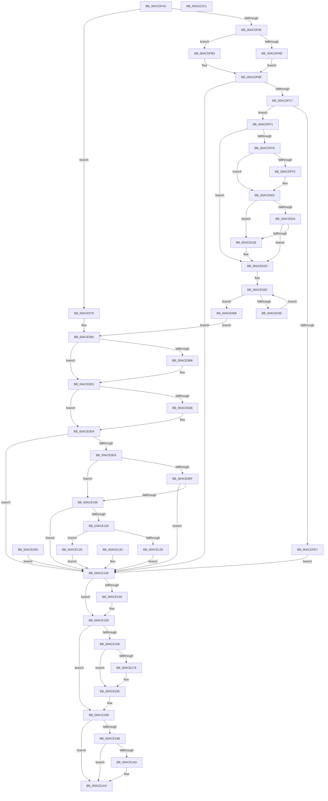

# PopBootStatCheckIntegrity

- RVA: `0x00ACDF4C`–`0x00ACE1C2` (길이 `630` bytes)
- VA: `0x0000000140ACDF4C`
- 실행 섹션: `PAGE`
- PDB 이름 있음: `예`; PDB Function 태그: `아니요`
- unwind 정보 RVA: `0x000BE6F4`
- 디코드: `164`개 명령, `630/630` bytes 표시
- 미해석 바이트: `0` (있으면 어셈블리에 `.byte`로 보존)

> 이 문서는 커널 이미지의 기계어와 PDB 기호를 분석해 생성했습니다. 4번과 5번은 함수 원형과 자료형을 바이너리 사용 방식에서 추정한 C 해석이며 원본 소스 복구 결과는 아닙니다.

## 1. Dependencies

- 직접 호출 지점: **14**; 고유 호출 대상: **14**
- 직접 호출자로 확인된 함수: **1**
- RIP 상대 이미지 참조: **2**

### Outgoing calls
- `0x00ACDFD5` → [ExAllocatePool2](../../poolcode/B8/ExAllocatePool2_function_00B820F0.md) (function, `0x00B820F0`)
- `0x00ACDFFE` → [ExRaiseDatatypeMisalignment](../89/ExRaiseDatatypeMisalignment_function_00899FD0.md) (function, `0x00899FD0`)
- `0x00ACE027` → [memcpy](../../text/6C/memcpy_function_006C6840.md) (function, `0x006C6840`)
- `0x00ACE052` → [ProbeForWrite](../8E/ProbeForWrite_function_008E91C0.md) (function, `0x008E91C0`)
- `0x00ACE0A7` → [KeAbPreAcquire](../../text/21/KeAbPreAcquire_function_00210230.md) (function, `0x00210230`)
- `0x00ACE0CC` → [ExfAcquirePushLockExclusiveEx](../../text/20/ExfAcquirePushLockExclusiveEx_function_0020FC90.md) (function, `0x0020FC90`)
- `0x00ACE0DF` → [RtlLockBootStatusData](../A9/RtlLockBootStatusData_function_00A94BE0.md) (function, `0x00A94BE0`)
- `0x00ACE0FD` → [PopBootStatAccessCheck](PopBootStatAccessCheck_function_00AC0814.md) (function, `0x00AC0814`)
- `0x00ACE115` → [RtlCheckBootStatusIntegrity](../79/RtlCheckBootStatusIntegrity_function_00790464.md) (function, `0x00790464`)
- `0x00ACE159` → [RtlUnlockBootStatusData](../A4/RtlUnlockBootStatusData_function_00A4CAF0.md) (function, `0x00A4CAF0`)
- `0x00ACE180` → [ExfTryToWakePushLock](../../text/26/ExfTryToWakePushLock_function_00265DD0.md) (function, `0x00265DD0`)
- `0x00ACE18C` → [KeAbPostRelease](../../text/2E/KeAbPostRelease_function_002E1600.md) (function, `0x002E1600`)
- `0x00ACE191` → [KeLeaveCriticalRegion](../../text/25/KeLeaveCriticalRegion_function_0025D8B0.md) (function, `0x0025D8B0`)
- `0x00ACE1A5` → [ExFreePoolWithTag](../../poolcode/B8/ExFreePoolWithTag_function_00B82870.md) (function, `0x00B82870`)

### Direct callers
- [PopPowerInformationInternal](../A8/PopPowerInformationInternal_function_00A8B7C0.md) at `0x00A8C49E`

### Static image references
- `0x00ACE0A0` → RVA `0x00F084F0` (`.data`; read)
- `0x00ACE0AF` → RVA `0x00F084F0` (`.data`; read/write)

## 2. Other-region calls and transfers

- 다른 실행 섹션으로 향하는 call: **8**
  - `0x00ACDFD5` → [ExAllocatePool2](../../poolcode/B8/ExAllocatePool2_function_00B820F0.md) (`PAGE` → `POOLCODE`)
  - `0x00ACE027` → [memcpy](../../text/6C/memcpy_function_006C6840.md) (`PAGE` → `.text`)
  - `0x00ACE0A7` → [KeAbPreAcquire](../../text/21/KeAbPreAcquire_function_00210230.md) (`PAGE` → `.text`)
  - `0x00ACE0CC` → [ExfAcquirePushLockExclusiveEx](../../text/20/ExfAcquirePushLockExclusiveEx_function_0020FC90.md) (`PAGE` → `.text`)
  - `0x00ACE180` → [ExfTryToWakePushLock](../../text/26/ExfTryToWakePushLock_function_00265DD0.md) (`PAGE` → `.text`)
  - `0x00ACE18C` → [KeAbPostRelease](../../text/2E/KeAbPostRelease_function_002E1600.md) (`PAGE` → `.text`)
  - `0x00ACE191` → [KeLeaveCriticalRegion](../../text/25/KeLeaveCriticalRegion_function_0025D8B0.md) (`PAGE` → `.text`)
  - `0x00ACE1A5` → [ExFreePoolWithTag](../../poolcode/B8/ExFreePoolWithTag_function_00B82870.md) (`PAGE` → `POOLCODE`)
- 별도 외부 분기/꼬리 이동을 확인하지 못했습니다.

## 3. Assembly (complete function range)

```asm
00ACDF4C  48 8B C4                        mov rax, rsp
00ACDF4F  48 89 58 08                     mov qword ptr [rax + 8], rbx
00ACDF53  56                              push rsi
00ACDF54  57                              push rdi
00ACDF55  41 54                           push r12
00ACDF57  41 56                           push r14
00ACDF59  41 57                           push r15
00ACDF5B  48 83 EC 50                     sub rsp, 0x50
00ACDF5F  4C 8B F9                        mov r15, rcx
00ACDF62  C6 40 10 00                     mov byte ptr [rax + 0x10], 0
00ACDF66  33 F6                           xor esi, esi
00ACDF68  48 21 70 B0                     and qword ptr [rax - 0x50], rsi
00ACDF6C  40 88 B4 24 98 00 00 00         mov byte ptr [rsp + 0x98], sil
00ACDF74  65 48 8B 04 25 88 01 00 00      mov rax, qword ptr gs:[0x188]
00ACDF7D  44 8A B0 32 02 00 00            mov r14b, byte ptr [rax + 0x232]
00ACDF84  44 88 B4 24 90 00 00 00         mov byte ptr [rsp + 0x90], r14b
00ACDF8C  45 84 F6                        test r14b, r14b
00ACDF8F  0F 84 E0 00 00 00               je 0x140ace075
00ACDF95  8B 49 08                        mov ecx, dword ptr [rcx + 8]
00ACDF98  8D 46 18                        lea eax, [rsi + 0x18]
00ACDF9B  48 F7 E1                        mul rcx
00ACDF9E  48 89 54 24 38                  mov qword ptr [rsp + 0x38], rdx
00ACDFA3  4C 8B E0                        mov r12, rax
00ACDFA6  48 85 D2                        test rdx, rdx
00ACDFA9  75 08                           jne 0x140acdfb3
00ACDFAB  33 FF                           xor edi, edi
00ACDFAD  48 83 CB FF                     or rbx, 0xffffffffffffffff
00ACDFB1  EB 0C                           jmp 0x140acdfbf
00ACDFB3  48 83 CB FF                     or rbx, 0xffffffffffffffff
00ACDFB7  4C 8B E3                        mov r12, rbx
00ACDFBA  BF 95 00 00 C0                  mov edi, 0xc0000095
00ACDFBF  85 FF                           test edi, edi
00ACDFC1  0F 88 88 01 00 00               js 0x140ace14f
00ACDFC7  41 B8 4D 65 6D 20               mov r8d, 0x206d654d
00ACDFCD  49 8B D4                        mov rdx, r12
00ACDFD0  B9 00 01 00 00                  mov ecx, 0x100
00ACDFD5  E8 16 41 0B 00                  call 0x140b820f0
00ACDFDA  48 8B F0                        mov rsi, rax
00ACDFDD  48 89 44 24 30                  mov qword ptr [rsp + 0x30], rax
00ACDFE2  48 85 C0                        test rax, rax
00ACDFE5  75 0A                           jne 0x140acdff1
00ACDFE7  BF 9A 00 00 C0                  mov edi, 0xc000009a
00ACDFEC  E9 5E 01 00 00                  jmp 0x140ace14f
00ACDFF1  4D 85 E4                        test r12, r12
00ACDFF4  74 27                           je 0x140ace01d
00ACDFF6  49 8B 47 10                     mov rax, qword ptr [r15 + 0x10]
00ACDFFA  A8 07                           test al, 7
00ACDFFC  74 05                           je 0x140ace003
00ACDFFE  E8 CD BF DC FF                  call 0x140899fd0
00ACE003  4A 8D 0C 20                     lea rcx, [rax + r12]
00ACE007  48 BA 00 00 FF FF FF 7F 00 00   movabs rdx, 0x7fffffff0000
00ACE011  48 3B CA                        cmp rcx, rdx
00ACE014  77 05                           ja 0x140ace01b
00ACE016  48 3B C8                        cmp rcx, rax
00ACE019  73 02                           jae 0x140ace01d
00ACE01B  8A 02                           mov al, byte ptr [rdx]
00ACE01D  4D 8B C4                        mov r8, r12
00ACE020  49 8B 57 10                     mov rdx, qword ptr [r15 + 0x10]
00ACE024  48 8B CE                        mov rcx, rsi
00ACE027  E8 14 88 BF FF                  call 0x1406c6840
00ACE02C  33 FF                           xor edi, edi
00ACE02E  89 7C 24 20                     mov dword ptr [rsp + 0x20], edi
00ACE032  41 3B 7F 08                     cmp edi, dword ptr [r15 + 8]
00ACE036  73 23                           jae 0x140ace05b
00ACE038  48 8D 0C 7F                     lea rcx, [rdi + rdi*2]
00ACE03C  48 8D 0C CE                     lea rcx, [rsi + rcx*8]
00ACE040  48 89 4C 24 40                  mov qword ptr [rsp + 0x40], rcx
00ACE045  8B 51 10                        mov edx, dword ptr [rcx + 0x10]
00ACE048  41 B8 01 00 00 00               mov r8d, 1
00ACE04E  48 8B 49 08                     mov rcx, qword ptr [rcx + 8]
00ACE052  E8 69 B1 E1 FF                  call 0x1408e91c0
00ACE057  FF C7                           inc edi
00ACE059  EB D3                           jmp 0x140ace02e
00ACE05B  EB 25                           jmp 0x140ace082
00ACE05D  8B F8                           mov edi, eax
00ACE05F  48 83 CB FF                     or rbx, 0xffffffffffffffff
00ACE063  48 8B 74 24 30                  mov rsi, qword ptr [rsp + 0x30]
00ACE068  44 8A B4 24 90 00 00 00         mov r14b, byte ptr [rsp + 0x90]
00ACE070  E9 DA 00 00 00                  jmp 0x140ace14f
00ACE075  48 8B 71 10                     mov rsi, qword ptr [rcx + 0x10]
00ACE079  48 89 74 24 30                  mov qword ptr [rsp + 0x30], rsi
00ACE07E  48 83 CB FF                     or rbx, 0xffffffffffffffff
00ACE082  C6 84 24 98 00 00 00 01         mov byte ptr [rsp + 0x98], 1
00ACE08A  65 48 8B 04 25 88 01 00 00      mov rax, qword ptr gs:[0x188]
00ACE093  66 01 98 E4 01 00 00            add word ptr [rax + 0x1e4], bx
00ACE09A  90                              nop
00ACE09B  45 33 C0                        xor r8d, r8d
00ACE09E  33 D2                           xor edx, edx
00ACE0A0  48 8D 0D 49 A4 43 00            lea rcx, [rip + 0x43a449]
00ACE0A7  E8 84 21 74 FF                  call 0x140210230
00ACE0AC  48 8B F8                        mov rdi, rax
00ACE0AF  F0 48 0F BA 2D 37 A4 43 00 00   lock bts qword ptr [rip + 0x43a437], 0
00ACE0B9  73 16                           jae 0x140ace0d1
00ACE0BB  4C 8D 05 2E A4 43 00            lea r8, [rip + 0x43a42e]
00ACE0C2  48 8B D0                        mov rdx, rax
00ACE0C5  48 8D 0D 24 A4 43 00            lea rcx, [rip + 0x43a424]
00ACE0CC  E8 BF 1B 74 FF                  call 0x14020fc90
00ACE0D1  48 85 FF                        test rdi, rdi
00ACE0D4  74 04                           je 0x140ace0da
00ACE0D6  C6 47 0A 01                     mov byte ptr [rdi + 0xa], 1
00ACE0DA  48 8D 4C 24 28                  lea rcx, [rsp + 0x28]
00ACE0DF  E8 FC 6A FC FF                  call 0x140a94be0
00ACE0E4  8B F8                           mov edi, eax
00ACE0E6  85 C0                           test eax, eax
00ACE0E8  78 65                           js 0x140ace14f
00ACE0EA  45 84 F6                        test r14b, r14b
00ACE0ED  74 19                           je 0x140ace108
00ACE0EF  41 B8 01 00 00 00               mov r8d, 1
00ACE0F5  41 8A D6                        mov dl, r14b
00ACE0F8  48 8B 4C 24 28                  mov rcx, qword ptr [rsp + 0x28]
00ACE0FD  E8 12 27 FF FF                  call 0x140ac0814
00ACE102  8B F8                           mov edi, eax
00ACE104  85 C0                           test eax, eax
00ACE106  78 47                           js 0x140ace14f
00ACE108  48 8D 94 24 88 00 00 00         lea rdx, [rsp + 0x88]
00ACE110  48 8B 4C 24 28                  mov rcx, qword ptr [rsp + 0x28]
00ACE115  E8 4A 23 CC FF                  call 0x140790464
00ACE11A  8B F8                           mov edi, eax
00ACE11C  85 C0                           test eax, eax
00ACE11E  78 2F                           js 0x140ace14f
00ACE120  83 7E 10 01                     cmp dword ptr [rsi + 0x10], 1
00ACE124  73 07                           jae 0x140ace12d
00ACE126  BF 0D 00 00 C0                  mov edi, 0xc000000d
00ACE12B  EB 22                           jmp 0x140ace14f
00ACE12D  48 8B 4E 08                     mov rcx, qword ptr [rsi + 8]
00ACE131  8A 84 24 88 00 00 00            mov al, byte ptr [rsp + 0x88]
00ACE138  88 01                           mov byte ptr [rcx], al
00ACE13A  EB 13                           jmp 0x140ace14f
00ACE13C  8B F8                           mov edi, eax
00ACE13E  48 83 CB FF                     or rbx, 0xffffffffffffffff
00ACE142  48 8B 74 24 30                  mov rsi, qword ptr [rsp + 0x30]
00ACE147  44 8A B4 24 90 00 00 00         mov r14b, byte ptr [rsp + 0x90]
00ACE14F  48 8B 4C 24 28                  mov rcx, qword ptr [rsp + 0x28]
00ACE154  48 85 C9                        test rcx, rcx
00ACE157  74 05                           je 0x140ace15e
00ACE159  E8 92 E9 F7 FF                  call 0x140a4caf0
00ACE15E  80 BC 24 98 00 00 00 00         cmp byte ptr [rsp + 0x98], 0
00ACE166  74 2E                           je 0x140ace196
00ACE168  F0 48 0F C1 1D 7F A3 43 00      lock xadd qword ptr [rip + 0x43a37f], rbx
00ACE171  80 E3 06                        and bl, 6
00ACE174  80 FB 02                        cmp bl, 2
00ACE177  75 0C                           jne 0x140ace185
00ACE179  48 8D 0D 70 A3 43 00            lea rcx, [rip + 0x43a370]
00ACE180  E8 4B 7C 79 FF                  call 0x140265dd0
00ACE185  48 8D 0D 64 A3 43 00            lea rcx, [rip + 0x43a364]
00ACE18C  E8 6F 34 81 FF                  call 0x1402e1600
00ACE191  E8 1A F7 78 FF                  call 0x14025d8b0
00ACE196  45 84 F6                        test r14b, r14b
00ACE199  74 0F                           je 0x140ace1aa
00ACE19B  48 85 F6                        test rsi, rsi
00ACE19E  74 0A                           je 0x140ace1aa
00ACE1A0  33 D2                           xor edx, edx
00ACE1A2  48 8B CE                        mov rcx, rsi
00ACE1A5  E8 C6 46 0B 00                  call 0x140b82870
00ACE1AA  8B C7                           mov eax, edi
00ACE1AC  48 8B 9C 24 80 00 00 00         mov rbx, qword ptr [rsp + 0x80]
00ACE1B4  48 83 C4 50                     add rsp, 0x50
00ACE1B8  41 5F                           pop r15
00ACE1BA  41 5E                           pop r14
00ACE1BC  41 5C                           pop r12
00ACE1BE  5F                              pop rdi
00ACE1BF  5E                              pop rsi
00ACE1C0  C3                              ret
00ACE1C1  CC                              int3
```

## 4. C-style interpretation (structured pseudocode)

```c
__int64 __fastcall PopBootStatCheckIntegrity(__int64 a1, __int64 a2)
{
    __int64 result;
    __int64 v_rbx;
    __int64 v_rdi;
    __int64 v_rsi;
    __int64 v_rsp;
    unsigned __int64 v_stack_m38;
    unsigned __int64 v_stack_m40;
    unsigned __int64 v_stack_m48;
    unsigned __int64 v_stack_m50;
    unsigned int v_stack_m58;
    unsigned __int64 v_stack_p10;
    unsigned __int8 v_stack_p18;
    unsigned __int8 v_stack_p20;
    unsigned __int64 v_stack_p8;

    *(unsigned __int64 *)(v_rsp + 8) = v_rbx;
    v_rsp = (v_rsp) - (80);
    *(unsigned __int8 *)(v_rsp + 16) = 0;
    v_rsi = 0;
    v_stack_p20 = 0;
    v_stack_p18 = (unsigned __int8)(*(unsigned __int8 *)(*(unsigned __int64 *)(gs_base + (0 + 392)) + 562));
    if ((unsigned __int8)(*(unsigned __int8 *)(*(unsigned __int64 *)(gs_base + (0 + 392)) + 562)) == 0) goto loc_00ACE075;
    v_stack_m40 = a2;
    if (a2 != 0) goto loc_00ACDFB3;
    v_rdi = 0;
    v_rbx = (v_rbx) | (-1);
    goto loc_00ACDFBF;
loc_00ACDFB3:
    v_rbx = (v_rbx) | (-1);
loc_00ACDFBF:
    if (sign_flag) goto loc_00ACE14F;
    result = ExAllocatePool2(256, v_rbx, (unsigned int)(0x206D654DULL), a4);
    v_stack_m48 = result;
    if (result != 0) goto loc_00ACDFF1;
    goto loc_00ACE14F;
loc_00ACDFF1:
    if (v_rbx == 0) goto loc_00ACE01D;
    result = *(unsigned __int64 *)(a1 + 16);
    if ((((unsigned __int8)(*(unsigned __int64 *)(a1 + 16))) & (7)) != 0) {
        result = ExRaiseDatatypeMisalignment(256, v_rbx, (unsigned int)(0x206D654DULL), a4);
    }
    if ((result + v_rbx * 1) > v_rbx) goto loc_00ACE01B;
    if ((result + v_rbx * 1) < result) {
        result = *(unsigned __int8 *)(v_rbx);
    }
    result = memcpy(result, *(unsigned __int64 *)(a1 + 16), v_rbx, a4);
    v_rdi = 0;
loc_00ACE02E:
    v_stack_m58 = 0;
    if (0 >= (*(unsigned int *)(a1 + 8))) goto loc_00ACE05B;
    v_stack_m38 = result + v_rdi + v_rdi * 2 * 8;
    result = ProbeForWrite(*(unsigned __int64 *)(result + v_rdi + v_rdi * 2 * 8 + 8), (unsigned int)(*(unsigned int *)(result + v_rdi + v_rdi * 2 * 8 + 16)), 1, a4);
    v_rdi = (unsigned int)((v_rdi) + 1);
    goto loc_00ACE02E;
loc_00ACE05B:
    goto loc_00ACE082;
loc_00ACE075:
    v_stack_m48 = *(unsigned __int64 *)(*(unsigned __int64 *)(result + v_rdi + v_rdi * 2 * 8 + 8) + 16);
    v_rbx = (v_rbx) | (-1);
loc_00ACE082:
    v_stack_p20 = 1;
    a3 = 0;
    a2 = 0;
    result = KeAbPreAcquire(v_rip + 4432969, a2, a3, a4);
    if (!(condition_is_above_or_equal)) {
        a3 = v_rip + 4432942;
        a2 = result;
        a1 = v_rip + 4432932;
        result = ExfAcquirePushLockExclusiveEx(a1, a2, a3, a4);
    }
    if (result != 0) {
        *(unsigned __int8 *)(result + 10) = 1;
    }
    result = RtlLockBootStatusData(v_stack_m50, a2, a3, a4);
    if (sign_flag) goto loc_00ACE14F;
    if ((unsigned __int8)(*(unsigned __int8 *)(*(unsigned __int64 *)(gs_base + (0 + 392)) + 562)) == 0) goto loc_00ACE108;
    result = PopBootStatAccessCheck(v_stack_m50, (unsigned __int8)(*(unsigned __int8 *)(*(unsigned __int64 *)(gs_base + (0 + 392)) + 562)), 1, a4);
    if (sign_flag) goto loc_00ACE14F;
loc_00ACE108:
    result = RtlCheckBootStatusIntegrity(v_stack_m50, v_stack_p10, 1, a4);
    if (sign_flag) goto loc_00ACE14F;
    if ((*(unsigned int *)(*(unsigned __int64 *)(*(unsigned __int64 *)(result + v_rdi + v_rdi * 2 * 8 + 8) + 16) + 16)) >= 1) goto loc_00ACE12D;
    goto loc_00ACE14F;
loc_00ACE12D:
    *(unsigned __int8 *)(*(unsigned __int64 *)(*(unsigned __int64 *)(*(unsigned __int64 *)(result + v_rdi + v_rdi * 2 * 8 + 8) + 16) + 8)) = (unsigned __int8)(v_stack_p10);
    goto loc_00ACE14F;
loc_00ACE14F:
    result = v_stack_p10;
    if (v_stack_m50 != 0) {
        result = RtlUnlockBootStatusData(v_stack_m50, v_stack_p10, 1, a4);
    }
    if (v_stack_p20 == 0) goto loc_00ACE196;
    v_rbx = (unsigned __int8)((v_rbx) & (6));
    if (((unsigned __int8)(v_rbx)) == 2) {
        a1 = v_rip + 4432752;
        result = ExfTryToWakePushLock(a1, v_stack_p10, 1, a4);
    }
    result = KeAbPostRelease(v_rip + 4432740, v_stack_p10, 1, a4);
    result = KeLeaveCriticalRegion(v_rip + 4432740, v_stack_p10, 1, a4);
loc_00ACE196:
    if ((unsigned __int8)(*(unsigned __int8 *)(*(unsigned __int64 *)(gs_base + (0 + 392)) + 562)) == 0) goto loc_00ACE1AA;
    if (*(unsigned __int64 *)(*(unsigned __int64 *)(result + v_rdi + v_rdi * 2 * 8 + 8) + 16) != 0) {
        a2 = 0;
        a1 = *(unsigned __int64 *)(*(unsigned __int64 *)(result + v_rdi + v_rdi * 2 * 8 + 8) + 16);
        result = ExFreePoolWithTag(a1, a2, 1, a4);
    }
    v_rsp = (v_rsp) + (80);
    return (unsigned int)((unsigned int)((unsigned int)(0xC000000DULL)));
}
```

## 5. (Beta) C Style

```c
int64_t PopBootStatCheckIntegrity(void *Arg1, int64_t Arg2)
{
    uint8_t *arg1 = (uint8_t *)Arg1;

    int64_t result;
    int64_t local_rbx;
    int64_t local_rdi;
    int64_t local_rsi;
    int64_t local_rsp;
    uint64_t v_stack_m38;
    uint64_t v_stack_m40;
    uint64_t v_stack_m48;
    uint64_t v_stack_m50;
    uint32_t v_stack_m58;
    uint64_t v_stack_p10;
    uint8_t v_stack_p18;
    uint8_t v_stack_p20;
    uint64_t v_stack_p8;

    *(uint64_t *)(local_rsp + 0x8) = local_rbx;
    local_rsp = (local_rsp) - (80);
    *(uint8_t *)(local_rsp + 0x10) = 0;
    local_rsi = 0;
    v_stack_p20 = 0;
    v_stack_p18 = (uint8_t)(*(uint8_t *)(*(uint64_t *)(gs_base + (0 + 0x188)) + 0x232));
    if ((uint8_t)(*(uint8_t *)(*(uint64_t *)(gs_base + (0 + 0x188)) + 0x232)) == 0) goto loc_00ACE075;
    v_stack_m40 = Arg2;
    if (Arg2 != 0) goto loc_00ACDFB3;
    local_rdi = 0;
    local_rbx = (local_rbx) | (-1);
    goto loc_00ACDFBF;
loc_00ACDFB3:
    local_rbx = (local_rbx) | (-1);
loc_00ACDFBF:
    if (sign_flag) goto loc_00ACE14F;
    result = ExAllocatePool2(256, local_rbx, (uint32_t)(0x206D654DULL), a4);
    v_stack_m48 = result;
    if (result != 0) goto loc_00ACDFF1;
    goto loc_00ACE14F;
loc_00ACDFF1:
    if (local_rbx == 0) goto loc_00ACE01D;
    result = *(uint64_t *)(arg1 + 0x10);
    if ((((uint8_t)(*(uint64_t *)(arg1 + 0x10))) & (7)) != 0) {
        result = ExRaiseDatatypeMisalignment(256, local_rbx, (uint32_t)(0x206D654DULL), a4);
    }
    if ((result + local_rbx * 1) > local_rbx) goto loc_00ACE01B;
    if ((result + local_rbx * 1) < result) {
        result = *(uint8_t *)(local_rbx);
    }
    result = memcpy(result, *(uint64_t *)(arg1 + 0x10), local_rbx, a4);
    local_rdi = 0;
loc_00ACE02E:
    v_stack_m58 = 0;
    if (0 >= (*(uint32_t *)(arg1 + 0x8))) goto loc_00ACE05B;
    v_stack_m38 = result + local_rdi + local_rdi * 2 * 8;
    result = ProbeForWrite(*(uint64_t *)(result + local_rdi + local_rdi * 2 * 8 + 0x8), (uint32_t)(*(uint32_t *)(result + local_rdi + local_rdi * 2 * 8 + 0x10)), 1, a4);
    local_rdi = (uint32_t)((local_rdi) + 1);
    goto loc_00ACE02E;
loc_00ACE05B:
    goto loc_00ACE082;
loc_00ACE075:
    v_stack_m48 = *(uint64_t *)(*(uint64_t *)(result + local_rdi + local_rdi * 2 * 8 + 0x8) + 0x10);
    local_rbx = (local_rbx) | (-1);
loc_00ACE082:
    v_stack_p20 = 1;
    a3 = 0;
    Arg2 = 0;
    result = KeAbPreAcquire(v_rip + 4432969, Arg2, a3, a4);
    if (!(condition_is_above_or_equal)) {
        a3 = v_rip + 4432942;
        Arg2 = result;
        Arg1 = v_rip + 4432932;
        result = ExfAcquirePushLockExclusiveEx(Arg1, Arg2, a3, a4);
    }
    if (result != 0) {
        *(uint8_t *)(result + 0xA) = 1;
    }
    result = RtlLockBootStatusData(v_stack_m50, Arg2, a3, a4);
    if (sign_flag) goto loc_00ACE14F;
    if ((uint8_t)(*(uint8_t *)(*(uint64_t *)(gs_base + (0 + 0x188)) + 0x232)) == 0) goto loc_00ACE108;
    result = PopBootStatAccessCheck(v_stack_m50, (uint8_t)(*(uint8_t *)(*(uint64_t *)(gs_base + (0 + 0x188)) + 0x232)), 1, a4);
    if (sign_flag) goto loc_00ACE14F;
loc_00ACE108:
    result = RtlCheckBootStatusIntegrity(v_stack_m50, v_stack_p10, 1, a4);
    if (sign_flag) goto loc_00ACE14F;
    if ((*(uint32_t *)(*(uint64_t *)(*(uint64_t *)(result + local_rdi + local_rdi * 2 * 8 + 0x8) + 0x10) + 0x10)) >= 1) goto loc_00ACE12D;
    goto loc_00ACE14F;
loc_00ACE12D:
    *(uint8_t *)(*(uint64_t *)(*(uint64_t *)(*(uint64_t *)(result + local_rdi + local_rdi * 2 * 8 + 0x8) + 0x10) + 0x8)) = (uint8_t)(v_stack_p10);
    goto loc_00ACE14F;
loc_00ACE14F:
    result = v_stack_p10;
    if (v_stack_m50 != 0) {
        result = RtlUnlockBootStatusData(v_stack_m50, v_stack_p10, 1, a4);
    }
    if (v_stack_p20 == 0) goto loc_00ACE196;
    local_rbx = (uint8_t)((local_rbx) & (6));
    if (((uint8_t)(local_rbx)) == 2) {
        Arg1 = v_rip + 4432752;
        result = ExfTryToWakePushLock(Arg1, v_stack_p10, 1, a4);
    }
    result = KeAbPostRelease(v_rip + 4432740, v_stack_p10, 1, a4);
    result = KeLeaveCriticalRegion(v_rip + 4432740, v_stack_p10, 1, a4);
loc_00ACE196:
    if ((uint8_t)(*(uint8_t *)(*(uint64_t *)(gs_base + (0 + 0x188)) + 0x232)) == 0) goto loc_00ACE1AA;
    if (*(uint64_t *)(*(uint64_t *)(result + local_rdi + local_rdi * 2 * 8 + 0x8) + 0x10) != 0) {
        Arg2 = 0;
        Arg1 = *(uint64_t *)(*(uint64_t *)(result + local_rdi + local_rdi * 2 * 8 + 0x8) + 0x10);
        result = ExFreePoolWithTag(Arg1, Arg2, 1, a4);
    }
    local_rsp = (local_rsp) + (80);
    return (uint32_t)((uint32_t)((uint32_t)(0xC000000DULL)));
}
```

### 관측된 메모리 오프셋

구조체 형식이 확인되지 않은 접근은 인자 기준의 오프셋으로만 기록했습니다.

| 기준 인자 | 오프셋 표현 | 폭 (bit) | 접근 |
|---|---:|---:|---|
| `Arg1` | `+ 0x8` | `32` | `R` |
| `Arg1` | `+ 0x10` | `64` | `R` |

## 6. Execution-region graph

[열기: 2D/3D 그래프와 함수 탐색 컨트롤 패널](../../../control-panel.html?section=page&rva=0x00ACDF4C&view=graph)

- 2D 그래프는 위에서 아래로 흐르고, 3D 그래프는 빈 공간을 드래그해 회전합니다. Shift+드래그는 이동, 휠은 확대·축소, 함수 노드 선택은 대상 보고서 이동입니다.

### Static fallback


