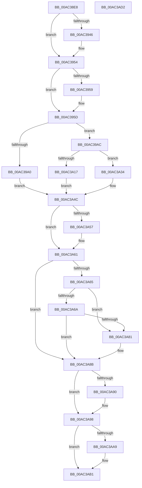

# PopBootStatRestoreDefaults

- RVA: `0x00AC38E8`–`0x00AC3AD3` (길이 `491` bytes)
- VA: `0x0000000140AC38E8`
- 실행 섹션: `PAGE`
- PDB 이름 있음: `예`; PDB Function 태그: `아니요`
- unwind 정보 RVA: `0x000BDD88`
- 디코드: `129`개 명령, `491/491` bytes 표시
- 미해석 바이트: `0` (있으면 어셈블리에 `.byte`로 보존)

> 이 문서는 커널 이미지의 기계어와 PDB 기호를 분석해 생성했습니다. 4번과 5번은 함수 원형과 자료형을 바이너리 사용 방식에서 추정한 C 해석이며 원본 소스 복구 결과는 아닙니다.

## 1. Dependencies

- 직접 호출 지점: **15**; 고유 호출 대상: **15**
- 직접 호출자로 확인된 함수: **1**
- RIP 상대 이미지 참조: **8**

### Outgoing calls
- `0x00AC3935` → [KeAbPreAcquire](../../text/21/KeAbPreAcquire_function_00210230.md) (function, `0x00210230`)
- `0x00AC394F` → [ExfAcquirePushLockExclusiveEx](../../text/20/ExfAcquirePushLockExclusiveEx_function_0020FC90.md) (function, `0x0020FC90`)
- `0x00AC398C` → [RtlpAcquireBootStatusLock](../../text/4B/RtlpAcquireBootStatusLock_function_004B26AC.md) (function, `0x004B26AC`)
- `0x00AC39B4` → [RtlpGetBootStatusPath](../../text/5E/RtlpGetBootStatusPath_function_005E7A0C.md) (function, `0x005E7A0C`)
- `0x00AC39C4` → [RtlInitUnicodeString](../../text/42/RtlInitUnicodeString_function_0042A780.md) (function, `0x0042A780`)
- `0x00AC3A0C` → [ZwOpenFile](../../text/6A/ZwOpenFile_function_006AD730.md) (function, `0x006AD730`)
- `0x00AC3A29` → [RtlInitializeBootStatDataCache](../../text/5E/RtlInitializeBootStatDataCache_function_005E78F0.md) (function, `0x005E78F0`)
- `0x00AC3A4C` → [RtlpReleaseBootStatusLock](../../text/4C/RtlpReleaseBootStatusLock_function_004C05D4.md) (function, `0x004C05D4`)
- `0x00AC3A5C` → [ExFreePoolWithTag](../../poolcode/B8/ExFreePoolWithTag_function_00B82870.md) (function, `0x00B82870`)
- `0x00AC3A76` → [PopBootStatAccessCheck](PopBootStatAccessCheck_function_00AC0814.md) (function, `0x00AC0814`)
- `0x00AC3A84` → [RtlRestoreBootStatusDefaults](../79/RtlRestoreBootStatusDefaults_function_00790758.md) (function, `0x00790758`)
- `0x00AC3A93` → [RtlUnlockBootStatusData](../A4/RtlUnlockBootStatusData_function_00A4CAF0.md) (function, `0x00A4CAF0`)
- `0x00AC3AAC` → [ExfTryToWakePushLock](../../text/26/ExfTryToWakePushLock_function_00265DD0.md) (function, `0x00265DD0`)
- `0x00AC3AB4` → [KeAbPostRelease](../../text/2E/KeAbPostRelease_function_002E1600.md) (function, `0x002E1600`)
- `0x00AC3AB9` → [KeLeaveCriticalRegion](../../text/25/KeLeaveCriticalRegion_function_0025D8B0.md) (function, `0x0025D8B0`)

### Direct callers
- [PopPowerInformationInternal](../A8/PopPowerInformationInternal_function_00A8B7C0.md) at `0x00A8C4AA`

### Static image references
- `0x00AC390A` → RVA `0x00F084F0` (`.data`; read)
- `0x00AC3991` → RVA `0x00F05C44` (`.data`; read/write)
- `0x00AC3997` → RVA `0x00F05C20` (`.data`; read)
- `0x00AC39A0` → RVA `0x00F05C28` (`.data`; read)
- `0x00AC3A1B` → RVA `0x00F05C28` (`.data`; write)
- `0x00AC3A22` → RVA `0x00F05C20` (`.data`; write)
- `0x00AC3A34` → RVA `0x00F05C28` (`.data`; read/write)
- `0x00AC3A98` → RVA `0x00F084F0` (`.data`; read/write)

## 2. Other-region calls and transfers

- 다른 실행 섹션으로 향하는 call: **12**
  - `0x00AC3935` → [KeAbPreAcquire](../../text/21/KeAbPreAcquire_function_00210230.md) (`PAGE` → `.text`)
  - `0x00AC394F` → [ExfAcquirePushLockExclusiveEx](../../text/20/ExfAcquirePushLockExclusiveEx_function_0020FC90.md) (`PAGE` → `.text`)
  - `0x00AC398C` → [RtlpAcquireBootStatusLock](../../text/4B/RtlpAcquireBootStatusLock_function_004B26AC.md) (`PAGE` → `.text`)
  - `0x00AC39B4` → [RtlpGetBootStatusPath](../../text/5E/RtlpGetBootStatusPath_function_005E7A0C.md) (`PAGE` → `.text`)
  - `0x00AC39C4` → [RtlInitUnicodeString](../../text/42/RtlInitUnicodeString_function_0042A780.md) (`PAGE` → `.text`)
  - `0x00AC3A0C` → [ZwOpenFile](../../text/6A/ZwOpenFile_function_006AD730.md) (`PAGE` → `.text`)
  - `0x00AC3A29` → [RtlInitializeBootStatDataCache](../../text/5E/RtlInitializeBootStatDataCache_function_005E78F0.md) (`PAGE` → `.text`)
  - `0x00AC3A4C` → [RtlpReleaseBootStatusLock](../../text/4C/RtlpReleaseBootStatusLock_function_004C05D4.md) (`PAGE` → `.text`)
  - `0x00AC3A5C` → [ExFreePoolWithTag](../../poolcode/B8/ExFreePoolWithTag_function_00B82870.md) (`PAGE` → `POOLCODE`)
  - `0x00AC3AAC` → [ExfTryToWakePushLock](../../text/26/ExfTryToWakePushLock_function_00265DD0.md) (`PAGE` → `.text`)
  - `0x00AC3AB4` → [KeAbPostRelease](../../text/2E/KeAbPostRelease_function_002E1600.md) (`PAGE` → `.text`)
  - `0x00AC3AB9` → [KeLeaveCriticalRegion](../../text/25/KeLeaveCriticalRegion_function_0025D8B0.md) (`PAGE` → `.text`)
- 별도 외부 분기/꼬리 이동을 확인하지 못했습니다.

## 3. Assembly (complete function range)

```asm
00AC38E8  48 89 4C 24 08                  mov qword ptr [rsp + 8], rcx
00AC38ED  55                              push rbp
00AC38EE  53                              push rbx
00AC38EF  56                              push rsi
00AC38F0  57                              push rdi
00AC38F1  41 55                           push r13
00AC38F3  41 56                           push r14
00AC38F5  41 57                           push r15
00AC38F7  48 8B EC                        mov rbp, rsp
00AC38FA  48 81 EC 80 00 00 00            sub rsp, 0x80
00AC3901  65 48 8B 04 25 88 01 00 00      mov rax, qword ptr gs:[0x188]
00AC390A  4C 8D 2D DF 4B 44 00            lea r13, [rip + 0x444bdf]
00AC3911  48 83 CB FF                     or rbx, 0xffffffffffffffff
00AC3915  45 33 C0                        xor r8d, r8d
00AC3918  33 D2                           xor edx, edx
00AC391A  49 8B CD                        mov rcx, r13
00AC391D  44 8A B8 32 02 00 00            mov r15b, byte ptr [rax + 0x232]
00AC3924  65 48 8B 04 25 88 01 00 00      mov rax, qword ptr gs:[0x188]
00AC392D  66 01 98 E4 01 00 00            add word ptr [rax + 0x1e4], bx
00AC3934  90                              nop
00AC3935  E8 F6 C8 74 FF                  call 0x140210230
00AC393A  F0 49 0F BA 6D 00 00            lock bts qword ptr [r13], 0
00AC3941  48 8B F8                        mov rdi, rax
00AC3944  73 0E                           jae 0x140ac3954
00AC3946  4D 8B C5                        mov r8, r13
00AC3949  48 8B D0                        mov rdx, rax
00AC394C  49 8B CD                        mov rcx, r13
00AC394F  E8 3C C3 74 FF                  call 0x14020fc90
00AC3954  48 85 FF                        test rdi, rdi
00AC3957  74 04                           je 0x140ac395d
00AC3959  C6 47 0A 01                     mov byte ptr [rdi + 0xa], 1
00AC395D  33 C0                           xor eax, eax
00AC395F  0F 57 C0                        xorps xmm0, xmm0
00AC3962  48 21 45 48                     and qword ptr [rbp + 0x48], rax
00AC3966  0F 57 C9                        xorps xmm1, xmm1
00AC3969  45 33 F6                        xor r14d, r14d
00AC396C  48 89 45 F0                     mov qword ptr [rbp - 0x10], rax
00AC3970  0F 11 45 D0                     movups xmmword ptr [rbp - 0x30], xmm0
00AC3974  89 45 F8                        mov dword ptr [rbp - 8], eax
00AC3977  33 F6                           xor esi, esi
00AC3979  0F 11 45 E0                     movups xmmword ptr [rbp - 0x20], xmm0
00AC397D  4C 89 75 50                     mov qword ptr [rbp + 0x50], r14
00AC3981  0F 11 45 B0                     movups xmmword ptr [rbp - 0x50], xmm0
00AC3985  88 45 40                        mov byte ptr [rbp + 0x40], al
00AC3988  0F 11 4D C0                     movups xmmword ptr [rbp - 0x40], xmm1
00AC398C  E8 1B ED 9E FF                  call 0x1404b26ac
00AC3991  FF 05 AD 22 44 00               inc dword ptr [rip + 0x4422ad]
00AC3997  40 38 35 82 22 44 00            cmp byte ptr [rip + 0x442282], sil
00AC399E  74 0C                           je 0x140ac39ac
00AC39A0  48 8B 3D 81 22 44 00            mov rdi, qword ptr [rip + 0x442281]
00AC39A7  E9 A0 00 00 00                  jmp 0x140ac3a4c
00AC39AC  48 8D 55 40                     lea rdx, [rbp + 0x40]
00AC39B0  48 8D 4D 50                     lea rcx, [rbp + 0x50]
00AC39B4  E8 53 40 B2 FF                  call 0x1405e7a0c
00AC39B9  4C 8B 75 50                     mov r14, qword ptr [rbp + 0x50]
00AC39BD  48 8D 4D B0                     lea rcx, [rbp - 0x50]
00AC39C1  49 8B D6                        mov rdx, r14
00AC39C4  E8 B7 6D 96 FF                  call 0x14042a780
00AC39C9  48 21 75 D8                     and qword ptr [rbp - 0x28], rsi
00AC39CD  48 8D 45 B0                     lea rax, [rbp - 0x50]
00AC39D1  0F 57 C0                        xorps xmm0, xmm0
00AC39D4  C7 44 24 28 20 00 00 00         mov dword ptr [rsp + 0x28], 0x20
00AC39DC  4C 8D 4D C0                     lea r9, [rbp - 0x40]
00AC39E0  48 89 45 E0                     mov qword ptr [rbp - 0x20], rax
00AC39E4  4C 8D 45 D0                     lea r8, [rbp - 0x30]
00AC39E8  C7 45 D0 30 00 00 00            mov dword ptr [rbp - 0x30], 0x30
00AC39EF  BA 9F 01 12 00                  mov edx, 0x12019f
00AC39F4  C7 45 E8 C0 02 00 00            mov dword ptr [rbp - 0x18], 0x2c0
00AC39FB  48 8D 4D 48                     lea rcx, [rbp + 0x48]
00AC39FF  C7 44 24 20 01 00 00 00         mov dword ptr [rsp + 0x20], 1
00AC3A07  F3 0F 7F 45 F0                  movdqu xmmword ptr [rbp - 0x10], xmm0
00AC3A0C  E8 1F 9D BE FF                  call 0x1406ad730
00AC3A11  8B F0                           mov esi, eax
00AC3A13  85 C0                           test eax, eax
00AC3A15  78 1D                           js 0x140ac3a34
00AC3A17  48 8B 45 48                     mov rax, qword ptr [rbp + 0x48]
00AC3A1B  48 89 05 06 22 44 00            mov qword ptr [rip + 0x442206], rax
00AC3A22  C6 05 F7 21 44 00 01            mov byte ptr [rip + 0x4421f7], 1
00AC3A29  E8 C2 3E B2 FF                  call 0x1405e78f0
00AC3A2E  48 8B 7D 48                     mov rdi, qword ptr [rbp + 0x48]
00AC3A32  EB 18                           jmp 0x140ac3a4c
00AC3A34  48 83 25 EC 21 44 00 00         and qword ptr [rip + 0x4421ec], 0
00AC3A3C  83 25 01 22 44 00 00            and dword ptr [rip + 0x442201], 0
00AC3A43  33 FF                           xor edi, edi
00AC3A45  C6 05 D4 21 44 00 00            mov byte ptr [rip + 0x4421d4], 0
00AC3A4C  E8 83 CB 9F FF                  call 0x1404c05d4
00AC3A51  80 7D 40 00                     cmp byte ptr [rbp + 0x40], 0
00AC3A55  74 0A                           je 0x140ac3a61
00AC3A57  33 D2                           xor edx, edx
00AC3A59  49 8B CE                        mov rcx, r14
00AC3A5C  E8 0F EE 0B 00                  call 0x140b82870
00AC3A61  85 F6                           test esi, esi
00AC3A63  78 26                           js 0x140ac3a8b
00AC3A65  45 84 FF                        test r15b, r15b
00AC3A68  74 17                           je 0x140ac3a81
00AC3A6A  41 B8 01 00 00 00               mov r8d, 1
00AC3A70  41 8A D7                        mov dl, r15b
00AC3A73  48 8B CF                        mov rcx, rdi
00AC3A76  E8 99 CD FF FF                  call 0x140ac0814
00AC3A7B  8B F0                           mov esi, eax
00AC3A7D  85 C0                           test eax, eax
00AC3A7F  78 0A                           js 0x140ac3a8b
00AC3A81  48 8B CF                        mov rcx, rdi
00AC3A84  E8 CF CC CC FF                  call 0x140790758
00AC3A89  8B F0                           mov esi, eax
00AC3A8B  48 85 FF                        test rdi, rdi
00AC3A8E  74 08                           je 0x140ac3a98
00AC3A90  48 8B CF                        mov rcx, rdi
00AC3A93  E8 58 90 F8 FF                  call 0x140a4caf0
00AC3A98  F0 48 0F C1 1D 4F 4A 44 00      lock xadd qword ptr [rip + 0x444a4f], rbx
00AC3AA1  80 E3 06                        and bl, 6
00AC3AA4  80 FB 02                        cmp bl, 2
00AC3AA7  75 08                           jne 0x140ac3ab1
00AC3AA9  49 8B CD                        mov rcx, r13
00AC3AAC  E8 1F 23 7A FF                  call 0x140265dd0
00AC3AB1  49 8B CD                        mov rcx, r13
00AC3AB4  E8 47 DB 81 FF                  call 0x1402e1600
00AC3AB9  E8 F2 9D 79 FF                  call 0x14025d8b0
00AC3ABE  8B C6                           mov eax, esi
00AC3AC0  48 81 C4 80 00 00 00            add rsp, 0x80
00AC3AC7  41 5F                           pop r15
00AC3AC9  41 5E                           pop r14
00AC3ACB  41 5D                           pop r13
00AC3ACD  5F                              pop rdi
00AC3ACE  5E                              pop rsi
00AC3ACF  5B                              pop rbx
00AC3AD0  5D                              pop rbp
00AC3AD1  C3                              ret
00AC3AD2  CC                              int3
```

## 4. C-style interpretation (structured pseudocode)

```c
__int64 __fastcall PopBootStatRestoreDefaults(__int64 a1, int a2, int a3)
{
    __int64 result;
    __int64 v_r14;
    __int64 v_rbx;
    __int64 v_rdi;
    __int64 v_rsi;
    __int64 v_rsp;
    unsigned int v_stack_m40;
    unsigned __int64 v_stack_m48;
    unsigned int v_stack_m50;
    unsigned __int64 v_stack_m58;
    unsigned __int64 v_stack_m60;
    unsigned __int64 v_stack_m68;
    unsigned __int64 v_stack_m78;
    unsigned __int64 v_stack_m88;
    unsigned int v_stack_m90;
    unsigned int v_stack_m98;
    unsigned __int64 v_stack_p10;
    unsigned __int64 v_stack_p18;
    unsigned __int64 v_stack_p8;

    v_stack_p8 = a1;
    v_rsp = (v_rsp) - (128);
    v_rbx = (v_rbx) | (-1);
    a3 = 0;
    a2 = 0;
    result = KeAbPreAcquire(v_rip + 4475871, a2, a3, a4);
    if (!(condition_is_above_or_equal)) {
        a3 = v_rip + 4475871;
        a2 = result;
        a1 = v_rip + 4475871;
        result = ExfAcquirePushLockExclusiveEx(a1, a2, a3, a4);
    }
    if (result != 0) {
        *(unsigned __int8 *)(result + 10) = 1;
    }
    result = 0;
    v_r14 = 0;
    v_stack_m48 = 0;
    v_stack_m68 = v_xmm0;
    v_stack_m40 = 0;
    v_rsi = 0;
    v_stack_m58 = v_xmm0;
    v_stack_p18 = 0;
    v_stack_m88 = v_xmm0;
    v_stack_p8 = 0;
    v_stack_m78 = v_xmm1;
    result = RtlpAcquireBootStatusLock(a1, a2, a3, a4);
    if ((*(unsigned __int8 *)(v_rip + 4465282)) == 0) goto loc_00AC39AC;
    goto loc_00AC3A4C;
loc_00AC39AC:
    result = RtlpGetBootStatusPath(v_stack_p18, v_stack_p8, a3, a4);
    result = RtlInitUnicodeString(v_stack_m88, v_stack_p18, a3, a4);
    v_stack_m90 = 32;
    v_stack_m58 = v_stack_m88;
    v_stack_m68 = 48;
    v_stack_m50 = 704;
    v_stack_m98 = 1;
    v_stack_m48 = v_xmm0;
    result = ZwOpenFile(v_stack_p10, (unsigned int)(0x12019FULL), v_stack_m68, v_stack_m78);
    if (sign_flag) goto loc_00AC3A34;
    *(unsigned __int64 *)(v_rip + 4465158) = v_stack_p10;
    *(unsigned __int8 *)(v_rip + 4465143) = 1;
    result = RtlInitializeBootStatDataCache(v_stack_p10, (unsigned int)(0x12019FULL), v_stack_m68, v_stack_m78);
    goto loc_00AC3A4C;
loc_00AC3A34:
    v_rdi = 0;
    *(unsigned __int8 *)(v_rip + 4465108) = 0;
loc_00AC3A4C:
    result = RtlpReleaseBootStatusLock(v_stack_p10, (unsigned int)(0x12019FULL), v_stack_m68, v_stack_m78);
    if (v_stack_p8 != 0) {
        a2 = 0;
        a1 = v_stack_p18;
        result = ExFreePoolWithTag(a1, a2, v_stack_m68, v_stack_m78);
    }
    if (sign_flag) goto loc_00AC3A8B;
    if ((unsigned __int8)(*(unsigned __int8 *)(*(unsigned __int64 *)(gs_base + (0 + 392)) + 562)) == 0) goto loc_00AC3A81;
    result = PopBootStatAccessCheck(0, (unsigned __int8)(*(unsigned __int8 *)(*(unsigned __int64 *)(gs_base + (0 + 392)) + 562)), 1, v_stack_m78);
    v_rsi = (unsigned int)((unsigned int)(result));
    if (!(sign_flag)) {
        a1 = 0;
        result = RtlRestoreBootStatusDefaults(a1, (unsigned __int8)(*(unsigned __int8 *)(*(unsigned __int64 *)(gs_base + (0 + 392)) + 562)), 1, v_stack_m78);
        v_rsi = (unsigned int)(result);
    }
    if (0 != 0) {
        a1 = 0;
        result = RtlUnlockBootStatusData(a1, (unsigned __int8)(*(unsigned __int8 *)(*(unsigned __int64 *)(gs_base + (0 + 392)) + 562)), 1, v_stack_m78);
    }
    v_rbx = (unsigned __int8)((v_rbx) & (6));
    if (((unsigned __int8)(v_rbx)) == 2) {
        a1 = v_rip + 4475871;
        result = ExfTryToWakePushLock(a1, (unsigned __int8)(*(unsigned __int8 *)(*(unsigned __int64 *)(gs_base + (0 + 392)) + 562)), 1, v_stack_m78);
    }
    result = KeAbPostRelease(v_rip + 4475871, (unsigned __int8)(*(unsigned __int8 *)(*(unsigned __int64 *)(gs_base + (0 + 392)) + 562)), 1, v_stack_m78);
    result = KeLeaveCriticalRegion(v_rip + 4475871, (unsigned __int8)(*(unsigned __int8 *)(*(unsigned __int64 *)(gs_base + (0 + 392)) + 562)), 1, v_stack_m78);
    v_rsp = (v_rsp) + (128);
    return (unsigned int)((unsigned int)(v_rsi));
}
```

## 5. (Beta) C Style

```c
int64_t PopBootStatRestoreDefaults(int64_t Arg1, int32_t Arg2, int32_t Arg3)
{
    int64_t result;
    int64_t local_r14;
    int64_t local_rbx;
    int64_t local_rdi;
    int64_t local_rsi;
    int64_t local_rsp;
    uint32_t v_stack_m40;
    uint64_t v_stack_m48;
    uint32_t v_stack_m50;
    uint64_t v_stack_m58;
    uint64_t v_stack_m60;
    uint64_t v_stack_m68;
    uint64_t v_stack_m78;
    uint64_t v_stack_m88;
    uint32_t v_stack_m90;
    uint32_t v_stack_m98;
    uint64_t v_stack_p10;
    uint64_t v_stack_p18;
    uint64_t v_stack_p8;

    v_stack_p8 = Arg1;
    local_rsp = (local_rsp) - (128);
    local_rbx = (local_rbx) | (-1);
    Arg3 = 0;
    Arg2 = 0;
    result = KeAbPreAcquire(v_rip + 4475871, Arg2, Arg3, a4);
    if (!(condition_is_above_or_equal)) {
        Arg3 = v_rip + 4475871;
        Arg2 = result;
        Arg1 = v_rip + 4475871;
        result = ExfAcquirePushLockExclusiveEx(Arg1, Arg2, Arg3, a4);
    }
    if (result != 0) {
        *(uint8_t *)(result + 0xA) = 1;
    }
    result = 0;
    local_r14 = 0;
    v_stack_m48 = 0;
    v_stack_m68 = v_xmm0;
    v_stack_m40 = 0;
    local_rsi = 0;
    v_stack_m58 = v_xmm0;
    v_stack_p18 = 0;
    v_stack_m88 = v_xmm0;
    v_stack_p8 = 0;
    v_stack_m78 = v_xmm1;
    result = RtlpAcquireBootStatusLock(Arg1, Arg2, Arg3, a4);
    if ((*(uint8_t *)(v_rip + 0x442282)) == 0) goto loc_00AC39AC;
    goto loc_00AC3A4C;
loc_00AC39AC:
    result = RtlpGetBootStatusPath(v_stack_p18, v_stack_p8, Arg3, a4);
    result = RtlInitUnicodeString(v_stack_m88, v_stack_p18, Arg3, a4);
    v_stack_m90 = 32;
    v_stack_m58 = v_stack_m88;
    v_stack_m68 = 48;
    v_stack_m50 = 704;
    v_stack_m98 = 1;
    v_stack_m48 = v_xmm0;
    result = ZwOpenFile(v_stack_p10, (uint32_t)(0x12019FULL), v_stack_m68, v_stack_m78);
    if (sign_flag) goto loc_00AC3A34;
    *(uint64_t *)(v_rip + 0x442206) = v_stack_p10;
    *(uint8_t *)(v_rip + 0x4421F7) = 1;
    result = RtlInitializeBootStatDataCache(v_stack_p10, (uint32_t)(0x12019FULL), v_stack_m68, v_stack_m78);
    goto loc_00AC3A4C;
loc_00AC3A34:
    local_rdi = 0;
    *(uint8_t *)(v_rip + 0x4421D4) = 0;
loc_00AC3A4C:
    result = RtlpReleaseBootStatusLock(v_stack_p10, (uint32_t)(0x12019FULL), v_stack_m68, v_stack_m78);
    if (v_stack_p8 != 0) {
        Arg2 = 0;
        Arg1 = v_stack_p18;
        result = ExFreePoolWithTag(Arg1, Arg2, v_stack_m68, v_stack_m78);
    }
    if (sign_flag) goto loc_00AC3A8B;
    if ((uint8_t)(*(uint8_t *)(*(uint64_t *)(gs_base + (0 + 0x188)) + 0x232)) == 0) goto loc_00AC3A81;
    result = PopBootStatAccessCheck(0, (uint8_t)(*(uint8_t *)(*(uint64_t *)(gs_base + (0 + 0x188)) + 0x232)), 1, v_stack_m78);
    local_rsi = (uint32_t)((uint32_t)(result));
    if (!(sign_flag)) {
        Arg1 = 0;
        result = RtlRestoreBootStatusDefaults(Arg1, (uint8_t)(*(uint8_t *)(*(uint64_t *)(gs_base + (0 + 0x188)) + 0x232)), 1, v_stack_m78);
        local_rsi = (uint32_t)(result);
    }
    if (0 != 0) {
        Arg1 = 0;
        result = RtlUnlockBootStatusData(Arg1, (uint8_t)(*(uint8_t *)(*(uint64_t *)(gs_base + (0 + 0x188)) + 0x232)), 1, v_stack_m78);
    }
    local_rbx = (uint8_t)((local_rbx) & (6));
    if (((uint8_t)(local_rbx)) == 2) {
        Arg1 = v_rip + 4475871;
        result = ExfTryToWakePushLock(Arg1, (uint8_t)(*(uint8_t *)(*(uint64_t *)(gs_base + (0 + 0x188)) + 0x232)), 1, v_stack_m78);
    }
    result = KeAbPostRelease(v_rip + 4475871, (uint8_t)(*(uint8_t *)(*(uint64_t *)(gs_base + (0 + 0x188)) + 0x232)), 1, v_stack_m78);
    result = KeLeaveCriticalRegion(v_rip + 4475871, (uint8_t)(*(uint8_t *)(*(uint64_t *)(gs_base + (0 + 0x188)) + 0x232)), 1, v_stack_m78);
    local_rsp = (local_rsp) + (128);
    return (uint32_t)((uint32_t)(local_rsi));
}
```

## 6. Execution-region graph

[열기: 2D/3D 그래프와 함수 탐색 컨트롤 패널](../../../control-panel.html?section=page&rva=0x00AC38E8&view=graph)

- 2D 그래프는 위에서 아래로 흐르고, 3D 그래프는 빈 공간을 드래그해 회전합니다. Shift+드래그는 이동, 휠은 확대·축소, 함수 노드 선택은 대상 보고서 이동입니다.

### Static fallback


