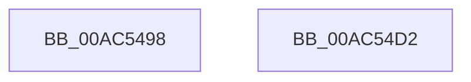

# PopClearSleepMarker

- RVA: `0x00AC5498`–`0x00AC54D3` (길이 `59` bytes)
- VA: `0x0000000140AC5498`
- 실행 섹션: `PAGE`
- PDB 이름 있음: `예`; PDB Function 태그: `아니요`
- unwind 정보 RVA: `0x0005C788`
- 디코드: `12`개 명령, `59/59` bytes 표시
- 미해석 바이트: `0` (있으면 어셈블리에 `.byte`로 보존)

> 이 문서는 커널 이미지의 기계어와 PDB 기호를 분석해 생성했습니다. 4번과 5번은 함수 원형과 자료형을 바이너리 사용 방식에서 추정한 C 해석이며 원본 소스 복구 결과는 아닙니다.

## 1. Dependencies

- 직접 호출 지점: **3**; 고유 호출 대상: **3**
- 직접 호출자로 확인된 함수: **1**
- RIP 상대 이미지 참조: **3**

### Outgoing calls
- `0x00AC54A3` → [PopAcquireRwLockExclusive](../../text/43/PopAcquireRwLockExclusive_function_00430B44.md) (function, `0x00430B44`)
- `0x00AC54BC` → [PopBsdHandleRequest](../../text/4B/PopBsdHandleRequest_function_004B27A0.md) (function, `0x004B27A0`)
- `0x00AC54C8` → [PopReleaseRwLock](../../text/2D/PopReleaseRwLock_function_002DFBBC.md) (function, `0x002DFBBC`)

### Direct callers
- [PopUnlockAfterSleepWorker](../../pagelk/B7/PopUnlockAfterSleepWorker_function_00B782A0.md) at `0x00B78341`

### Static image references
- `0x00AC549C` → RVA `0x00F0F1E0` (`.data`; read)
- `0x00AC54A8` → RVA `0x00E67410` (`.data`; read/write)
- `0x00AC54B5` → RVA `0x00E67418` (`.data`; read/write)

## 2. Other-region calls and transfers

- 다른 실행 섹션으로 향하는 call: **3**
  - `0x00AC54A3` → [PopAcquireRwLockExclusive](../../text/43/PopAcquireRwLockExclusive_function_00430B44.md) (`PAGE` → `.text`)
  - `0x00AC54BC` → [PopBsdHandleRequest](../../text/4B/PopBsdHandleRequest_function_004B27A0.md) (`PAGE` → `.text`)
  - `0x00AC54C8` → [PopReleaseRwLock](../../text/2D/PopReleaseRwLock_function_002DFBBC.md) (`PAGE` → `.text`)
- 별도 외부 분기/꼬리 이동을 확인하지 못했습니다.

## 3. Assembly (complete function range)

```asm
00AC5498  48 83 EC 28                     sub rsp, 0x28
00AC549C  48 8D 0D 3D 9D 44 00            lea rcx, [rip + 0x449d3d]
00AC54A3  E8 9C B6 96 FF                  call 0x140430b44
00AC54A8  48 83 25 60 1F 3A 00 00         and qword ptr [rip + 0x3a1f60], 0
00AC54B0  B9 09 00 00 00                  mov ecx, 9
00AC54B5  80 25 5C 1F 3A 00 0F            and byte ptr [rip + 0x3a1f5c], 0xf
00AC54BC  E8 DF D2 9E FF                  call 0x1404b27a0
00AC54C1  48 8D 0D 18 9D 44 00            lea rcx, [rip + 0x449d18]
00AC54C8  E8 EF A6 81 FF                  call 0x1402dfbbc
00AC54CD  48 83 C4 28                     add rsp, 0x28
00AC54D1  C3                              ret
00AC54D2  CC                              int3
```

## 4. C-style interpretation (structured pseudocode)

```c
__int64 __fastcall PopClearSleepMarker(void)
{
    __int64 result;
    __int64 v_rsp;

    v_rsp = (v_rsp) - (40);
    result = PopAcquireRwLockExclusive(v_rip + 4496701, a2, a3, a4);
    result = PopBsdHandleRequest(9, a2, a3, a4);
    result = PopReleaseRwLock(v_rip + 4496664, a2, a3, a4);
    v_rsp = (v_rsp) + (40);
    return result;
}
```

## 5. (Beta) C Style

```c
void PopClearSleepMarker(void)
{
    int64_t result;
    int64_t local_rsp;

    local_rsp = (local_rsp) - (40);
    result = PopAcquireRwLockExclusive(v_rip + 4496701, a2, a3, a4);
    result = PopBsdHandleRequest(9, a2, a3, a4);
    result = PopReleaseRwLock(v_rip + 4496664, a2, a3, a4);
    local_rsp = (local_rsp) + (40);
    return result;
}
```

## 6. Execution-region graph

[열기: 2D/3D 그래프와 함수 탐색 컨트롤 패널](../../../control-panel.html?section=page&rva=0x00AC5498&view=graph)

- 2D 그래프는 위에서 아래로 흐르고, 3D 그래프는 빈 공간을 드래그해 회전합니다. Shift+드래그는 이동, 휠은 확대·축소, 함수 노드 선택은 대상 보고서 이동입니다.

### Static fallback


