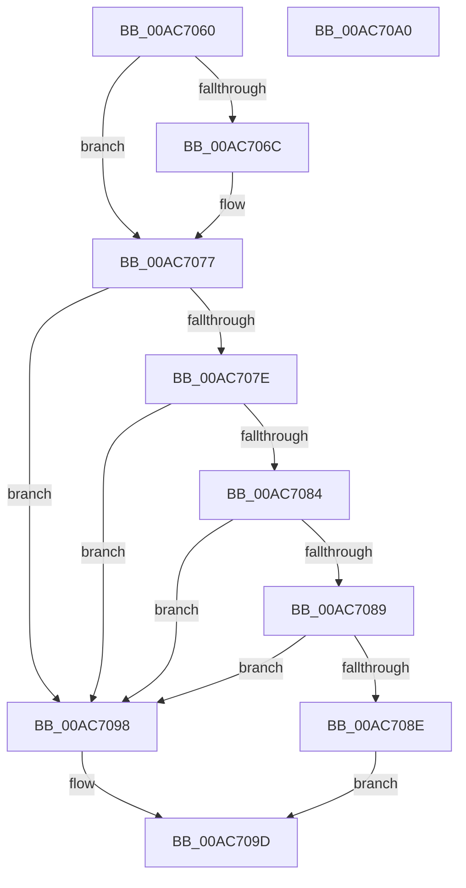

# PopDeviceIdlePolicySettingCallback

- RVA: `0x00AC7060`–`0x00AC70A1` (길이 `65` bytes)
- VA: `0x0000000140AC7060`
- 실행 섹션: `PAGE`
- PDB 이름 있음: `예`; PDB Function 태그: `아니요`
- unwind 정보 RVA: `0x000DB714`
- 디코드: `21`개 명령, `65/65` bytes 표시
- 미해석 바이트: `0` (있으면 어셈블리에 `.byte`로 보존)

> 이 문서는 커널 이미지의 기계어와 PDB 기호를 분석해 생성했습니다. 4번과 5번은 함수 원형과 자료형을 바이너리 사용 방식에서 추정한 C 해석이며 원본 소스 복구 결과는 아닙니다.

## 1. Dependencies

- 직접 호출 지점: **0**; 고유 호출 대상: **0**
- 직접 호출자로 확인된 함수: **0**
- RIP 상대 이미지 참조: **3**

### Outgoing calls
- 직접 디코드된 call 명령이 없습니다.

### Direct callers
- 이 함수 시작 RVA로 연결되는 직접 call은 확인되지 않았습니다. 간접 호출은 완전히 역산할 수 없습니다.

### Static image references
- `0x00AC7060` → RVA `0x0001E9D8` (`.rdata`; read)
- `0x00AC706C` → RVA `0x0001E9E0` (`.rdata`; read)
- `0x00AC7090` → RVA `0x00F0CE28` (`.data`; write)

## 2. Other-region calls and transfers

- 다른 실행 섹션으로 향하는 call: **0**
- 별도 외부 분기/꼬리 이동을 확인하지 못했습니다.

## 3. Assembly (complete function range)

```asm
00AC7060  4C 8B 0D 71 79 55 FF            mov r9, qword ptr [rip - 0xaa868f]
00AC7067  4C 2B 09                        sub r9, qword ptr [rcx]
00AC706A  75 0B                           jne 0x140ac7077
00AC706C  4C 8B 0D 6D 79 55 FF            mov r9, qword ptr [rip - 0xaa8693]
00AC7073  4C 2B 49 08                     sub r9, qword ptr [rcx + 8]
00AC7077  33 C9                           xor ecx, ecx
00AC7079  4D 85 C9                        test r9, r9
00AC707C  75 1A                           jne 0x140ac7098
00AC707E  41 83 F8 04                     cmp r8d, 4
00AC7082  75 14                           jne 0x140ac7098
00AC7084  48 85 D2                        test rdx, rdx
00AC7087  74 0F                           je 0x140ac7098
00AC7089  83 3A 01                        cmp dword ptr [rdx], 1
00AC708C  77 0A                           ja 0x140ac7098
00AC708E  8B 02                           mov eax, dword ptr [rdx]
00AC7090  89 05 92 5D 44 00               mov dword ptr [rip + 0x445d92], eax
00AC7096  EB 05                           jmp 0x140ac709d
00AC7098  B9 0D 00 00 C0                  mov ecx, 0xc000000d
00AC709D  8B C1                           mov eax, ecx
00AC709F  C3                              ret
00AC70A0  CC                              int3
```

## 4. C-style interpretation (structured pseudocode)

```c
__int64 __fastcall PopDeviceIdlePolicySettingCallback(__int64 a1, __int64 a2, int a3)
{
    a4 = (*(unsigned __int64 *)(v_rip - 11175567)) - (*(unsigned __int64 *)(a1));
    if (!(condition_is_not_equal)) {
        a4 = *(unsigned __int64 *)(v_rip - 11175571);
        a4 = (a4) - (*(unsigned __int64 *)(a1 + 8));
    }
    a1 = 0;
    if (a4 != 0) goto loc_00AC7098;
    if (a3 != 4) goto loc_00AC7098;
    if (a2 == 0) goto loc_00AC7098;
    if ((*(unsigned int *)(a2)) > 1) goto loc_00AC7098;
    *(unsigned int *)(v_rip + 4480402) = (unsigned int)((unsigned int)(*(unsigned int *)(a2)));
    goto loc_00AC709D;
loc_00AC7098:
loc_00AC709D:
    return (unsigned int)((unsigned int)((unsigned int)(0xC000000DULL)));
}
```

## 5. (Beta) C Style

```c
int64_t PopDeviceIdlePolicySettingCallback(void *Arg1, int64_t Arg2, int32_t Arg3)
{
    uint8_t *arg1 = (uint8_t *)Arg1;

    a4 = (*(uint64_t *)(v_rip - 0xAA868F)) - (*(uint64_t *)(arg1));
    if (!(condition_is_not_equal)) {
        a4 = *(uint64_t *)(v_rip - 0xAA8693);
        a4 = (a4) - (*(uint64_t *)(arg1 + 0x8));
    }
    Arg1 = 0;
    if (a4 != 0) goto loc_00AC7098;
    if (Arg3 != 4) goto loc_00AC7098;
    if (Arg2 == 0) goto loc_00AC7098;
    if ((*(uint32_t *)(Arg2)) > 1) goto loc_00AC7098;
    *(uint32_t *)(v_rip + 0x445D92) = (uint32_t)((uint32_t)(*(uint32_t *)(Arg2)));
    goto loc_00AC709D;
loc_00AC7098:
loc_00AC709D:
    return (uint32_t)((uint32_t)((uint32_t)(0xC000000DULL)));
}
```

### 관측된 메모리 오프셋

구조체 형식이 확인되지 않은 접근은 인자 기준의 오프셋으로만 기록했습니다.

| 기준 인자 | 오프셋 표현 | 폭 (bit) | 접근 |
|---|---:|---:|---|
| `Arg1` | `+ 0x0` | `64` | `R` |
| `Arg1` | `+ 0x8` | `64` | `R` |

## 6. Execution-region graph

[열기: 2D/3D 그래프와 함수 탐색 컨트롤 패널](../../../control-panel.html?section=page&rva=0x00AC7060&view=graph)

- 2D 그래프는 위에서 아래로 흐르고, 3D 그래프는 빈 공간을 드래그해 회전합니다. Shift+드래그는 이동, 휠은 확대·축소, 함수 노드 선택은 대상 보고서 이동입니다.

### Static fallback


