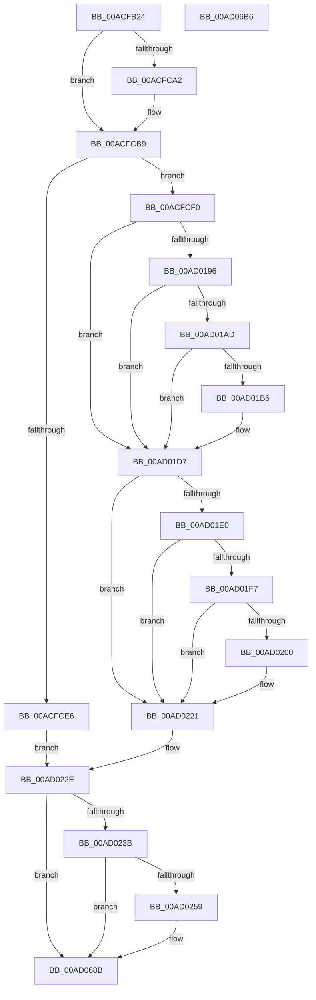

# PopDiagTraceCsExitReason

- RVA: `0x00ACFB24`–`0x00AD06B7` (길이 `2,963` bytes)
- VA: `0x0000000140ACFB24`
- 실행 섹션: `PAGE`
- PDB 이름 있음: `예`; PDB Function 태그: `아니요`
- unwind 정보 RVA: `0x000BE8E0`
- 디코드: `494`개 명령, `2,963/2,963` bytes 표시
- 미해석 바이트: `0` (있으면 어셈블리에 `.byte`로 보존)

> 이 문서는 커널 이미지의 기계어와 PDB 기호를 분석해 생성했습니다. 4번과 5번은 함수 원형과 자료형을 바이너리 사용 방식에서 추정한 C 해석이며 원본 소스 복구 결과는 아닙니다.

## 1. Dependencies

- 직접 호출 지점: **11**; 고유 호출 대상: **8**
- 직접 호출자로 확인된 함수: **1**
- RIP 상대 이미지 참조: **12**

### Outgoing calls
- `0x00ACFCD9` → [ExAllocatePool2](../../poolcode/B8/ExAllocatePool2_function_00B820F0.md) (function, `0x00B820F0`)
- `0x00AD01A4` → [EtwEventEnabled](../../text/39/EtwEventEnabled_function_00392450.md) (function, `0x00392450`)
- `0x00AD01AD` → [PopIsPlatformAoAcCapable](../../text/49/PopIsPlatformAoAcCapable_function_0049BF40.md) (function, `0x0049BF40`)
- `0x00AD01D2` → [EtwWrite](../../text/41/EtwWrite_function_0041C720.md) (function, `0x0041C720`)
- `0x00AD01EE` → [EtwEventEnabled](../../text/39/EtwEventEnabled_function_00392450.md) (function, `0x00392450`)
- `0x00AD01F7` → [PopIsPlatformAoAcCapable](../../text/49/PopIsPlatformAoAcCapable_function_0049BF40.md) (function, `0x0049BF40`)
- `0x00AD021C` → [EtwWrite](../../text/41/EtwWrite_function_0041C720.md) (function, `0x0041C720`)
- `0x00AD0229` → [ExFreePoolWithTag](../../poolcode/B8/ExFreePoolWithTag_function_00B82870.md) (function, `0x00B82870`)
- `0x00AD024C` → [tlgKeywordOn](../../text/42/tlgKeywordOn_function_0042EAA0.md) (function, `0x0042EAA0`)
- `0x00AD0686` → [tlgWriteTransfer_EtwWriteTransfer](../../text/42/tlgWriteTransfer_EtwWriteTransfer_function_004260E0.md) (function, `0x004260E0`)
- `0x00AD0695` → [_security_check_cookie](../../text/6A/_security_check_cookie_function_006AC640.md) (function, `0x006AC640`)

### Direct callers
- [PopCaptureSleepStudyStatistics](../../text/43/PopCaptureSleepStudyStatistics_function_004399F4.md) at `0x00439F73`

### Static image references
- `0x00ACFB49` → RVA `0x00E0A740` (`.data`; read)
- `0x00ACFC48` → RVA `0x00E67A54` (`.data`; read)
- `0x00ACFC53` → RVA `0x00E0B579` (`.data`; read)
- `0x00ACFF02` → RVA `0x00F0B6B0` (`.data`; read)
- `0x00ACFF26` → RVA `0x00E67858` (`.data`; read)
- `0x00AD0196` → RVA `0x00F0B408` (`.data`; read)
- `0x00AD019D` → RVA `0x00021838` (`.rdata`; read)
- `0x00AD01D7` → RVA `0x00E67859` (`.data`; read)
- `0x00AD01E0` → RVA `0x00F0B6B8` (`.data`; read)
- `0x00AD01E7` → RVA `0x00029818` (`.rdata`; read)
- `0x00AD022E` → RVA `0x00E07748` (`.data`; read)
- `0x00AD0653` → RVA `0x0004A5FD` (`.rdata`; read)

## 2. Other-region calls and transfers

- 다른 실행 섹션으로 향하는 call: **11**
  - `0x00ACFCD9` → [ExAllocatePool2](../../poolcode/B8/ExAllocatePool2_function_00B820F0.md) (`PAGE` → `POOLCODE`)
  - `0x00AD01A4` → [EtwEventEnabled](../../text/39/EtwEventEnabled_function_00392450.md) (`PAGE` → `.text`)
  - `0x00AD01AD` → [PopIsPlatformAoAcCapable](../../text/49/PopIsPlatformAoAcCapable_function_0049BF40.md) (`PAGE` → `.text`)
  - `0x00AD01D2` → [EtwWrite](../../text/41/EtwWrite_function_0041C720.md) (`PAGE` → `.text`)
  - `0x00AD01EE` → [EtwEventEnabled](../../text/39/EtwEventEnabled_function_00392450.md) (`PAGE` → `.text`)
  - `0x00AD01F7` → [PopIsPlatformAoAcCapable](../../text/49/PopIsPlatformAoAcCapable_function_0049BF40.md) (`PAGE` → `.text`)
  - `0x00AD021C` → [EtwWrite](../../text/41/EtwWrite_function_0041C720.md) (`PAGE` → `.text`)
  - `0x00AD0229` → [ExFreePoolWithTag](../../poolcode/B8/ExFreePoolWithTag_function_00B82870.md) (`PAGE` → `POOLCODE`)
  - `0x00AD024C` → [tlgKeywordOn](../../text/42/tlgKeywordOn_function_0042EAA0.md) (`PAGE` → `.text`)
  - `0x00AD0686` → [tlgWriteTransfer_EtwWriteTransfer](../../text/42/tlgWriteTransfer_EtwWriteTransfer_function_004260E0.md) (`PAGE` → `.text`)
  - `0x00AD0695` → [_security_check_cookie](../../text/6A/_security_check_cookie_function_006AC640.md) (`PAGE` → `.text`)
- 별도 외부 분기/꼬리 이동을 확인하지 못했습니다.

## 3. Assembly (complete function range)

```asm
00ACFB24  48 8B C4                        mov rax, rsp
00ACFB27  48 89 58 08                     mov qword ptr [rax + 8], rbx
00ACFB2B  48 89 70 18                     mov qword ptr [rax + 0x18], rsi
00ACFB2F  48 89 50 10                     mov qword ptr [rax + 0x10], rdx
00ACFB33  55                              push rbp
00ACFB34  57                              push rdi
00ACFB35  41 54                           push r12
00ACFB37  41 56                           push r14
00ACFB39  41 57                           push r15
00ACFB3B  48 8D A8 D8 FC FF FF            lea rbp, [rax - 0x328]
00ACFB42  48 81 EC 00 04 00 00            sub rsp, 0x400
00ACFB49  48 8B 05 F0 AB 33 00            mov rax, qword ptr [rip + 0x33abf0]
00ACFB50  48 33 C4                        xor rax, rsp
00ACFB53  48 89 85 F0 02 00 00            mov qword ptr [rbp + 0x2f0], rax
00ACFB5A  8B 01                           mov eax, dword ptr [rcx]
00ACFB5C  48 8B D9                        mov rbx, rcx
00ACFB5F  48 8B 51 20                     mov rdx, qword ptr [rcx + 0x20]
00ACFB63  45 33 F6                        xor r14d, r14d
00ACFB66  4C 8B 41 58                     mov r8, qword ptr [rcx + 0x58]
00ACFB6A  89 44 24 38                     mov dword ptr [rsp + 0x38], eax
00ACFB6E  48 8B 41 28                     mov rax, qword ptr [rcx + 0x28]
00ACFB72  48 89 45 D0                     mov qword ptr [rbp - 0x30], rax
00ACFB76  48 8B 41 30                     mov rax, qword ptr [rcx + 0x30]
00ACFB7A  48 89 45 B8                     mov qword ptr [rbp - 0x48], rax
00ACFB7E  8B 41 38                        mov eax, dword ptr [rcx + 0x38]
00ACFB81  89 44 24 3C                     mov dword ptr [rsp + 0x3c], eax
00ACFB85  48 8B 41 40                     mov rax, qword ptr [rcx + 0x40]
00ACFB89  48 89 45 C8                     mov qword ptr [rbp - 0x38], rax
00ACFB8D  48 8B 41 48                     mov rax, qword ptr [rcx + 0x48]
00ACFB91  48 89 45 C0                     mov qword ptr [rbp - 0x40], rax
00ACFB95  48 8B 41 60                     mov rax, qword ptr [rcx + 0x60]
00ACFB99  48 89 45 E8                     mov qword ptr [rbp - 0x18], rax
00ACFB9D  48 8B 41 68                     mov rax, qword ptr [rcx + 0x68]
00ACFBA1  48 89 45 00                     mov qword ptr [rbp], rax
00ACFBA5  48 8B 41 50                     mov rax, qword ptr [rcx + 0x50]
00ACFBA9  48 89 45 08                     mov qword ptr [rbp + 8], rax
00ACFBAD  48 8B 81 90 00 00 00            mov rax, qword ptr [rcx + 0x90]
00ACFBB4  0F B6 89 88 00 00 00            movzx ecx, byte ptr [rcx + 0x88]
00ACFBBB  48 89 45 F0                     mov qword ptr [rbp - 0x10], rax
00ACFBBF  8A C1                           mov al, cl
00ACFBC1  D0 E8                           shr al, 1
00ACFBC3  83 E1 01                        and ecx, 1
00ACFBC6  88 44 24 30                     mov byte ptr [rsp + 0x30], al
00ACFBCA  8B 83 80 00 00 00               mov eax, dword ptr [rbx + 0x80]
00ACFBD0  89 44 24 44                     mov dword ptr [rsp + 0x44], eax
00ACFBD4  48 8B 83 A8 00 00 00            mov rax, qword ptr [rbx + 0xa8]
00ACFBDB  48 89 45 F8                     mov qword ptr [rbp - 8], rax
00ACFBDF  89 4C 24 48                     mov dword ptr [rsp + 0x48], ecx
00ACFBE3  0F B6 8B 89 00 00 00            movzx ecx, byte ptr [rbx + 0x89]
00ACFBEA  8B C1                           mov eax, ecx
00ACFBEC  44 89 74 24 34                  mov dword ptr [rsp + 0x34], r14d
00ACFBF1  83 E0 01                        and eax, 1
00ACFBF4  D1 E9                           shr ecx, 1
00ACFBF6  89 44 24 50                     mov dword ptr [rsp + 0x50], eax
00ACFBFA  83 E1 01                        and ecx, 1
00ACFBFD  48 8B 83 F8 00 00 00            mov rax, qword ptr [rbx + 0xf8]
00ACFC04  48 89 45 18                     mov qword ptr [rbp + 0x18], rax
00ACFC08  48 8B 83 00 01 00 00            mov rax, qword ptr [rbx + 0x100]
00ACFC0F  48 89 45 10                     mov qword ptr [rbp + 0x10], rax
00ACFC13  48 8B 83 08 01 00 00            mov rax, qword ptr [rbx + 0x108]
00ACFC1A  48 89 45 20                     mov qword ptr [rbp + 0x20], rax
00ACFC1E  48 8B 83 10 01 00 00            mov rax, qword ptr [rbx + 0x110]
00ACFC25  48 89 45 28                     mov qword ptr [rbp + 0x28], rax
00ACFC29  48 8B 83 18 01 00 00            mov rax, qword ptr [rbx + 0x118]
00ACFC30  48 89 45 30                     mov qword ptr [rbp + 0x30], rax
00ACFC34  8B 83 C8 00 00 00               mov eax, dword ptr [rbx + 0xc8]
00ACFC3A  89 44 24 6C                     mov dword ptr [rsp + 0x6c], eax
00ACFC3E  8B 83 CC 00 00 00               mov eax, dword ptr [rbx + 0xcc]
00ACFC44  89 44 24 70                     mov dword ptr [rsp + 0x70], eax
00ACFC48  0F B6 05 05 7E 39 00            movzx eax, byte ptr [rip + 0x397e05]
00ACFC4F  89 44 24 58                     mov dword ptr [rsp + 0x58], eax
00ACFC53  0F B6 05 1F B9 33 00            movzx eax, byte ptr [rip + 0x33b91f]
00ACFC5A  89 44 24 54                     mov dword ptr [rsp + 0x54], eax
00ACFC5E  0F B6 83 D0 00 00 00            movzx eax, byte ptr [rbx + 0xd0]
00ACFC65  89 44 24 74                     mov dword ptr [rsp + 0x74], eax
00ACFC69  8B 83 D4 00 00 00               mov eax, dword ptr [rbx + 0xd4]
00ACFC6F  89 44 24 5C                     mov dword ptr [rsp + 0x5c], eax
00ACFC73  8B 83 D8 00 00 00               mov eax, dword ptr [rbx + 0xd8]
00ACFC79  89 44 24 60                     mov dword ptr [rsp + 0x60], eax
00ACFC7D  8B 83 F0 00 00 00               mov eax, dword ptr [rbx + 0xf0]
00ACFC83  89 44 24 64                     mov dword ptr [rsp + 0x64], eax
00ACFC87  8B 83 58 01 00 00               mov eax, dword ptr [rbx + 0x158]
00ACFC8D  89 44 24 68                     mov dword ptr [rsp + 0x68], eax
00ACFC91  48 89 55 E0                     mov qword ptr [rbp - 0x20], rdx
00ACFC95  4C 89 45 D8                     mov qword ptr [rbp - 0x28], r8
00ACFC99  89 4C 24 4C                     mov dword ptr [rsp + 0x4c], ecx
00ACFC9D  48 85 D2                        test rdx, rdx
00ACFCA0  75 17                           jne 0x140acfcb9
00ACFCA2  4C 89 75 B8                     mov qword ptr [rbp - 0x48], r14
00ACFCA6  45 8B C6                        mov r8d, r14d
00ACFCA9  4C 89 75 D0                     mov qword ptr [rbp - 0x30], r14
00ACFCAD  4C 89 75 C8                     mov qword ptr [rbp - 0x38], r14
00ACFCB1  4C 89 75 C0                     mov qword ptr [rbp - 0x40], r14
00ACFCB5  4C 89 75 D8                     mov qword ptr [rbp - 0x28], r14
00ACFCB9  4D 85 C0                        test r8, r8
00ACFCBC  41 8B C6                        mov eax, r14d
00ACFCBF  BA 40 03 00 00                  mov edx, 0x340
00ACFCC4  B9 00 01 00 00                  mov ecx, 0x100
00ACFCC9  0F 95 C0                        setne al
00ACFCCC  41 B8 54 56 45 50               mov r8d, 0x50455654
00ACFCD2  89 44 24 40                     mov dword ptr [rsp + 0x40], eax
00ACFCD6  41 8B F6                        mov esi, r14d
00ACFCD9  E8 12 24 0B 00                  call 0x140b820f0
00ACFCDE  48 8B F8                        mov rdi, rax
00ACFCE1  48 85 C0                        test rax, rax
00ACFCE4  75 0A                           jne 0x140acfcf0
00ACFCE6  BE 9A 00 00 C0                  mov esi, 0xc000009a
00ACFCEB  E9 3E 05 00 00                  jmp 0x140ad022e
00ACFCF0  48 C7 47 08 04 00 00 00         mov qword ptr [rdi + 8], 4
00ACFCF8  48 8D 44 24 38                  lea rax, [rsp + 0x38]
00ACFCFD  48 89 07                        mov qword ptr [rdi], rax
00ACFD00  48 8D 45 B8                     lea rax, [rbp - 0x48]
00ACFD04  48 89 47 10                     mov qword ptr [rdi + 0x10], rax
00ACFD08  48 8D 45 C0                     lea rax, [rbp - 0x40]
00ACFD0C  48 C7 47 18 08 00 00 00         mov qword ptr [rdi + 0x18], 8
00ACFD14  48 89 47 20                     mov qword ptr [rdi + 0x20], rax
00ACFD18  48 8D 45 C8                     lea rax, [rbp - 0x38]
00ACFD1C  48 C7 47 28 08 00 00 00         mov qword ptr [rdi + 0x28], 8
00ACFD24  48 89 47 30                     mov qword ptr [rdi + 0x30], rax
00ACFD28  48 8D 45 D0                     lea rax, [rbp - 0x30]
00ACFD2C  48 C7 47 38 08 00 00 00         mov qword ptr [rdi + 0x38], 8
00ACFD34  48 89 47 40                     mov qword ptr [rdi + 0x40], rax
00ACFD38  48 8D 45 E0                     lea rax, [rbp - 0x20]
00ACFD3C  48 C7 47 48 08 00 00 00         mov qword ptr [rdi + 0x48], 8
00ACFD44  48 89 47 50                     mov qword ptr [rdi + 0x50], rax
00ACFD48  48 8D 44 24 3C                  lea rax, [rsp + 0x3c]
00ACFD4D  48 C7 47 58 08 00 00 00         mov qword ptr [rdi + 0x58], 8
00ACFD55  48 89 47 60                     mov qword ptr [rdi + 0x60], rax
00ACFD59  48 8D 44 24 30                  lea rax, [rsp + 0x30]
00ACFD5E  48 C7 47 68 04 00 00 00         mov qword ptr [rdi + 0x68], 4
00ACFD66  48 89 47 70                     mov qword ptr [rdi + 0x70], rax
00ACFD6A  48 8D 44 24 40                  lea rax, [rsp + 0x40]
00ACFD6F  48 C7 47 78 01 00 00 00         mov qword ptr [rdi + 0x78], 1
00ACFD77  48 89 87 80 00 00 00            mov qword ptr [rdi + 0x80], rax
00ACFD7E  48 8D 44 24 44                  lea rax, [rsp + 0x44]
00ACFD83  48 C7 87 88 00 00 00 04 00 00 00  mov qword ptr [rdi + 0x88], 4
00ACFD8E  48 89 87 90 00 00 00            mov qword ptr [rdi + 0x90], rax
00ACFD95  48 8D 45 D8                     lea rax, [rbp - 0x28]
00ACFD99  48 C7 87 98 00 00 00 04 00 00 00  mov qword ptr [rdi + 0x98], 4
00ACFDA4  48 89 87 A0 00 00 00            mov qword ptr [rdi + 0xa0], rax
00ACFDAB  48 8D 45 E8                     lea rax, [rbp - 0x18]
00ACFDAF  48 C7 87 A8 00 00 00 08 00 00 00  mov qword ptr [rdi + 0xa8], 8
00ACFDBA  48 89 87 B0 00 00 00            mov qword ptr [rdi + 0xb0], rax
00ACFDC1  48 8D 44 24 48                  lea rax, [rsp + 0x48]
00ACFDC6  48 C7 87 B8 00 00 00 08 00 00 00  mov qword ptr [rdi + 0xb8], 8
00ACFDD1  48 89 87 C0 00 00 00            mov qword ptr [rdi + 0xc0], rax
00ACFDD8  48 8D 45 F0                     lea rax, [rbp - 0x10]
00ACFDDC  48 C7 87 C8 00 00 00 04 00 00 00  mov qword ptr [rdi + 0xc8], 4
00ACFDE7  48 89 87 D0 00 00 00            mov qword ptr [rdi + 0xd0], rax
00ACFDEE  48 8D 45 F8                     lea rax, [rbp - 8]
00ACFDF2  48 C7 87 D8 00 00 00 08 00 00 00  mov qword ptr [rdi + 0xd8], 8
00ACFDFD  48 89 87 E0 00 00 00            mov qword ptr [rdi + 0xe0], rax
00ACFE04  48 8D 44 24 4C                  lea rax, [rsp + 0x4c]
00ACFE09  48 C7 87 E8 00 00 00 08 00 00 00  mov qword ptr [rdi + 0xe8], 8
00ACFE14  48 89 87 F0 00 00 00            mov qword ptr [rdi + 0xf0], rax
00ACFE1B  48 8D 44 24 50                  lea rax, [rsp + 0x50]
00ACFE20  48 C7 87 F8 00 00 00 04 00 00 00  mov qword ptr [rdi + 0xf8], 4
00ACFE2B  48 89 87 00 01 00 00            mov qword ptr [rdi + 0x100], rax
00ACFE32  48 8D 45 00                     lea rax, [rbp]
00ACFE36  48 C7 87 08 01 00 00 04 00 00 00  mov qword ptr [rdi + 0x108], 4
00ACFE41  48 89 87 10 01 00 00            mov qword ptr [rdi + 0x110], rax
00ACFE48  48 8D 44 24 6C                  lea rax, [rsp + 0x6c]
00ACFE4D  48 C7 87 18 01 00 00 08 00 00 00  mov qword ptr [rdi + 0x118], 8
00ACFE58  48 89 87 20 01 00 00            mov qword ptr [rdi + 0x120], rax
00ACFE5F  48 8D 44 24 70                  lea rax, [rsp + 0x70]
00ACFE64  48 C7 87 28 01 00 00 04 00 00 00  mov qword ptr [rdi + 0x128], 4
00ACFE6F  48 89 87 30 01 00 00            mov qword ptr [rdi + 0x130], rax
00ACFE76  48 8D 44 24 54                  lea rax, [rsp + 0x54]
00ACFE7B  48 C7 87 38 01 00 00 04 00 00 00  mov qword ptr [rdi + 0x138], 4
00ACFE86  48 89 87 40 01 00 00            mov qword ptr [rdi + 0x140], rax
00ACFE8D  48 8D 44 24 58                  lea rax, [rsp + 0x58]
00ACFE92  48 C7 87 48 01 00 00 04 00 00 00  mov qword ptr [rdi + 0x148], 4
00ACFE9D  48 89 87 50 01 00 00            mov qword ptr [rdi + 0x150], rax
00ACFEA4  48 8D 85 38 03 00 00            lea rax, [rbp + 0x338]
00ACFEAB  48 C7 87 58 01 00 00 04 00 00 00  mov qword ptr [rdi + 0x158], 4
00ACFEB6  48 89 87 60 01 00 00            mov qword ptr [rdi + 0x160], rax
00ACFEBD  48 8D 44 24 74                  lea rax, [rsp + 0x74]
00ACFEC2  48 C7 87 68 01 00 00 01 00 00 00  mov qword ptr [rdi + 0x168], 1
00ACFECD  48 89 87 70 01 00 00            mov qword ptr [rdi + 0x170], rax
00ACFED4  48 8D 44 24 5C                  lea rax, [rsp + 0x5c]
00ACFED9  48 C7 87 78 01 00 00 04 00 00 00  mov qword ptr [rdi + 0x178], 4
00ACFEE4  48 89 87 80 01 00 00            mov qword ptr [rdi + 0x180], rax
00ACFEEB  48 8D 44 24 60                  lea rax, [rsp + 0x60]
00ACFEF0  48 C7 87 88 01 00 00 04 00 00 00  mov qword ptr [rdi + 0x188], 4
00ACFEFB  48 89 87 90 01 00 00            mov qword ptr [rdi + 0x190], rax
00ACFF02  48 8D 05 A7 B7 43 00            lea rax, [rip + 0x43b7a7]
00ACFF09  48 C7 87 98 01 00 00 04 00 00 00  mov qword ptr [rdi + 0x198], 4
00ACFF14  48 89 87 A0 01 00 00            mov qword ptr [rdi + 0x1a0], rax
00ACFF1B  48 C7 87 A8 01 00 00 08 00 00 00  mov qword ptr [rdi + 0x1a8], 8
00ACFF26  44 38 35 2B 79 39 00            cmp byte ptr [rip + 0x39792b], r14b
00ACFF2D  48 B8 C4 02 00 00 80 F7 FF FF   movabs rax, 0xfffff780000002c4
00ACFF37  48 89 87 B0 01 00 00            mov qword ptr [rdi + 0x1b0], rax
00ACFF3E  48 8D 44 24 64                  lea rax, [rsp + 0x64]
00ACFF43  48 C7 87 B8 01 00 00 04 00 00 00  mov qword ptr [rdi + 0x1b8], 4
00ACFF4E  48 89 87 C0 01 00 00            mov qword ptr [rdi + 0x1c0], rax
00ACFF55  48 8D 45 08                     lea rax, [rbp + 8]
00ACFF59  48 C7 87 C8 01 00 00 04 00 00 00  mov qword ptr [rdi + 0x1c8], 4
00ACFF64  48 89 87 D0 01 00 00            mov qword ptr [rdi + 0x1d0], rax
00ACFF6B  48 8D 45 10                     lea rax, [rbp + 0x10]
00ACFF6F  48 C7 87 D8 01 00 00 08 00 00 00  mov qword ptr [rdi + 0x1d8], 8
00ACFF7A  48 89 87 E0 01 00 00            mov qword ptr [rdi + 0x1e0], rax
00ACFF81  48 8D 45 18                     lea rax, [rbp + 0x18]
00ACFF85  48 C7 87 E8 01 00 00 08 00 00 00  mov qword ptr [rdi + 0x1e8], 8
00ACFF90  48 89 87 F0 01 00 00            mov qword ptr [rdi + 0x1f0], rax
00ACFF97  48 8D 45 20                     lea rax, [rbp + 0x20]
00ACFF9B  48 C7 87 F8 01 00 00 08 00 00 00  mov qword ptr [rdi + 0x1f8], 8
00ACFFA6  48 89 87 00 02 00 00            mov qword ptr [rdi + 0x200], rax
00ACFFAD  48 8D 45 28                     lea rax, [rbp + 0x28]
00ACFFB1  48 C7 87 08 02 00 00 08 00 00 00  mov qword ptr [rdi + 0x208], 8
00ACFFBC  48 89 87 10 02 00 00            mov qword ptr [rdi + 0x210], rax
00ACFFC3  48 8D 45 30                     lea rax, [rbp + 0x30]
00ACFFC7  48 C7 87 18 02 00 00 08 00 00 00  mov qword ptr [rdi + 0x218], 8
00ACFFD2  48 89 87 20 02 00 00            mov qword ptr [rdi + 0x220], rax
00ACFFD9  48 C7 87 28 02 00 00 08 00 00 00  mov qword ptr [rdi + 0x228], 8
00ACFFE4  0F B6 83 20 01 00 00            movzx eax, byte ptr [rbx + 0x120]
00ACFFEB  89 44 24 34                     mov dword ptr [rsp + 0x34], eax
00ACFFEF  48 8D 44 24 34                  lea rax, [rsp + 0x34]
00ACFFF4  48 89 87 30 02 00 00            mov qword ptr [rdi + 0x230], rax
00ACFFFB  48 8D 83 30 01 00 00            lea rax, [rbx + 0x130]
00AD0002  48 C7 87 38 02 00 00 04 00 00 00  mov qword ptr [rdi + 0x238], 4
00AD000D  48 89 87 40 02 00 00            mov qword ptr [rdi + 0x240], rax
00AD0014  48 8D 83 34 01 00 00            lea rax, [rbx + 0x134]
00AD001B  48 C7 87 48 02 00 00 04 00 00 00  mov qword ptr [rdi + 0x248], 4
00AD0026  48 89 87 50 02 00 00            mov qword ptr [rdi + 0x250], rax
00AD002D  48 8D 83 28 01 00 00            lea rax, [rbx + 0x128]
00AD0034  48 C7 87 58 02 00 00 04 00 00 00  mov qword ptr [rdi + 0x258], 4
00AD003F  48 89 87 60 02 00 00            mov qword ptr [rdi + 0x260], rax
00AD0046  48 8D 83 48 01 00 00            lea rax, [rbx + 0x148]
00AD004D  48 C7 87 68 02 00 00 08 00 00 00  mov qword ptr [rdi + 0x268], 8
00AD0058  48 89 87 70 02 00 00            mov qword ptr [rdi + 0x270], rax
00AD005F  48 8D 83 4C 01 00 00            lea rax, [rbx + 0x14c]
00AD0066  48 C7 87 78 02 00 00 04 00 00 00  mov qword ptr [rdi + 0x278], 4
00AD0071  48 89 87 80 02 00 00            mov qword ptr [rdi + 0x280], rax
00AD0078  48 8D 83 40 01 00 00            lea rax, [rbx + 0x140]
00AD007F  48 C7 87 88 02 00 00 04 00 00 00  mov qword ptr [rdi + 0x288], 4
00AD008A  48 89 87 90 02 00 00            mov qword ptr [rdi + 0x290], rax
00AD0091  48 8D 83 38 01 00 00            lea rax, [rbx + 0x138]
00AD0098  48 C7 87 98 02 00 00 08 00 00 00  mov qword ptr [rdi + 0x298], 8
00AD00A3  48 89 87 A0 02 00 00            mov qword ptr [rdi + 0x2a0], rax
00AD00AA  48 8D 83 3C 01 00 00            lea rax, [rbx + 0x13c]
00AD00B1  48 C7 87 A8 02 00 00 04 00 00 00  mov qword ptr [rdi + 0x2a8], 4
00AD00BC  48 89 87 B0 02 00 00            mov qword ptr [rdi + 0x2b0], rax
00AD00C3  48 8D 83 50 01 00 00            lea rax, [rbx + 0x150]
00AD00CA  48 C7 87 B8 02 00 00 04 00 00 00  mov qword ptr [rdi + 0x2b8], 4
00AD00D5  48 89 87 C0 02 00 00            mov qword ptr [rdi + 0x2c0], rax
00AD00DC  48 8D 83 54 01 00 00            lea rax, [rbx + 0x154]
00AD00E3  48 C7 87 C8 02 00 00 04 00 00 00  mov qword ptr [rdi + 0x2c8], 4
00AD00EE  48 89 87 D0 02 00 00            mov qword ptr [rdi + 0x2d0], rax
00AD00F5  48 8D 83 EC 00 00 00            lea rax, [rbx + 0xec]
00AD00FC  48 C7 87 D8 02 00 00 04 00 00 00  mov qword ptr [rdi + 0x2d8], 4
00AD0107  48 89 87 E0 02 00 00            mov qword ptr [rdi + 0x2e0], rax
00AD010E  48 8D 44 24 68                  lea rax, [rsp + 0x68]
00AD0113  48 C7 87 E8 02 00 00 04 00 00 00  mov qword ptr [rdi + 0x2e8], 4
00AD011E  48 89 87 F0 02 00 00            mov qword ptr [rdi + 0x2f0], rax
00AD0125  48 8D 83 90 01 00 00            lea rax, [rbx + 0x190]
00AD012C  48 C7 87 F8 02 00 00 04 00 00 00  mov qword ptr [rdi + 0x2f8], 4
00AD0137  48 89 87 00 03 00 00            mov qword ptr [rdi + 0x300], rax
00AD013E  48 8D 83 98 01 00 00            lea rax, [rbx + 0x198]
00AD0145  48 C7 87 08 03 00 00 08 00 00 00  mov qword ptr [rdi + 0x308], 8
00AD0150  48 89 87 10 03 00 00            mov qword ptr [rdi + 0x310], rax
00AD0157  48 8D 83 A0 01 00 00            lea rax, [rbx + 0x1a0]
00AD015E  48 C7 87 18 03 00 00 08 00 00 00  mov qword ptr [rdi + 0x318], 8
00AD0169  48 89 87 20 03 00 00            mov qword ptr [rdi + 0x320], rax
00AD0170  48 8D 83 A8 01 00 00            lea rax, [rbx + 0x1a8]
00AD0177  48 C7 87 28 03 00 00 08 00 00 00  mov qword ptr [rdi + 0x328], 8
00AD0182  48 89 87 30 03 00 00            mov qword ptr [rdi + 0x330], rax
00AD0189  48 C7 87 38 03 00 00 08 00 00 00  mov qword ptr [rdi + 0x338], 8
00AD0194  74 41                           je 0x140ad01d7
00AD0196  48 8B 0D 6B B2 43 00            mov rcx, qword ptr [rip + 0x43b26b]
00AD019D  48 8D 15 94 16 55 FF            lea rdx, [rip - 0xaae96c]
00AD01A4  E8 A7 22 8C FF                  call 0x140392450
00AD01A9  84 C0                           test al, al
00AD01AB  74 2A                           je 0x140ad01d7
00AD01AD  E8 8E BD 9C FF                  call 0x14049bf40
00AD01B2  84 C0                           test al, al
00AD01B4  74 21                           je 0x140ad01d7
00AD01B6  48 8B 0D 4B B2 43 00            mov rcx, qword ptr [rip + 0x43b24b]
00AD01BD  48 8D 15 74 16 55 FF            lea rdx, [rip - 0xaae98c]
00AD01C4  41 B9 34 00 00 00               mov r9d, 0x34
00AD01CA  48 89 7C 24 20                  mov qword ptr [rsp + 0x20], rdi
00AD01CF  45 33 C0                        xor r8d, r8d
00AD01D2  E8 49 C5 94 FF                  call 0x14041c720
00AD01D7  44 38 35 7B 76 39 00            cmp byte ptr [rip + 0x39767b], r14b
00AD01DE  74 41                           je 0x140ad0221
00AD01E0  48 8B 0D D1 B4 43 00            mov rcx, qword ptr [rip + 0x43b4d1]
00AD01E7  48 8D 15 2A 96 55 FF            lea rdx, [rip - 0xaa69d6]
00AD01EE  E8 5D 22 8C FF                  call 0x140392450
00AD01F3  84 C0                           test al, al
00AD01F5  74 2A                           je 0x140ad0221
00AD01F7  E8 44 BD 9C FF                  call 0x14049bf40
00AD01FC  84 C0                           test al, al
00AD01FE  74 21                           je 0x140ad0221
00AD0200  48 8B 0D B1 B4 43 00            mov rcx, qword ptr [rip + 0x43b4b1]
00AD0207  48 8D 15 0A 96 55 FF            lea rdx, [rip - 0xaa69f6]
00AD020E  41 B9 34 00 00 00               mov r9d, 0x34
00AD0214  48 89 7C 24 20                  mov qword ptr [rsp + 0x20], rdi
00AD0219  45 33 C0                        xor r8d, r8d
00AD021C  E8 FF C4 94 FF                  call 0x14041c720
00AD0221  BA 54 56 45 50                  mov edx, 0x50455654
00AD0226  48 8B CF                        mov rcx, rdi
00AD0229  E8 42 26 0B 00                  call 0x140b82870
00AD022E  83 3D 13 75 33 00 05            cmp dword ptr [rip + 0x337513], 5
00AD0235  0F 86 50 04 00 00               jbe 0x140ad068b
00AD023B  48 BA 00 00 00 00 00 40 00 00   movabs rdx, 0x400000000000
00AD0245  48 8D 0D FC 74 33 00            lea rcx, [rip + 0x3374fc]
00AD024C  E8 4F E8 95 FF                  call 0x14042eaa0
00AD0251  84 C0                           test al, al
00AD0253  0F 84 32 04 00 00               je 0x140ad068b
00AD0259  48 8B 05 50 B4 43 00            mov rax, qword ptr [rip + 0x43b450]
00AD0260  48 89 45 38                     mov qword ptr [rbp + 0x38], rax
00AD0264  48 8D 45 38                     lea rax, [rbp + 0x38]
00AD0268  48 89 85 E0 00 00 00            mov qword ptr [rbp + 0xe0], rax
00AD026F  8B 44 24 38                     mov eax, dword ptr [rsp + 0x38]
00AD0273  89 44 24 78                     mov dword ptr [rsp + 0x78], eax
00AD0277  48 8D 44 24 78                  lea rax, [rsp + 0x78]
00AD027C  48 89 85 F0 00 00 00            mov qword ptr [rbp + 0xf0], rax
00AD0283  48 8B 45 B8                     mov rax, qword ptr [rbp - 0x48]
00AD0287  48 89 45 40                     mov qword ptr [rbp + 0x40], rax
00AD028B  48 8D 45 40                     lea rax, [rbp + 0x40]
00AD028F  48 89 85 00 01 00 00            mov qword ptr [rbp + 0x100], rax
00AD0296  48 8B 45 C0                     mov rax, qword ptr [rbp - 0x40]
00AD029A  48 89 45 48                     mov qword ptr [rbp + 0x48], rax
00AD029E  48 8D 45 48                     lea rax, [rbp + 0x48]
00AD02A2  48 89 85 10 01 00 00            mov qword ptr [rbp + 0x110], rax
00AD02A9  48 8B 45 C8                     mov rax, qword ptr [rbp - 0x38]
00AD02AD  48 89 45 50                     mov qword ptr [rbp + 0x50], rax
00AD02B1  48 8D 45 50                     lea rax, [rbp + 0x50]
00AD02B5  48 89 85 20 01 00 00            mov qword ptr [rbp + 0x120], rax
00AD02BC  48 8B 45 D0                     mov rax, qword ptr [rbp - 0x30]
00AD02C0  48 89 45 58                     mov qword ptr [rbp + 0x58], rax
00AD02C4  48 8D 45 58                     lea rax, [rbp + 0x58]
00AD02C8  48 89 85 30 01 00 00            mov qword ptr [rbp + 0x130], rax
00AD02CF  48 8B 45 E0                     mov rax, qword ptr [rbp - 0x20]
00AD02D3  48 89 45 60                     mov qword ptr [rbp + 0x60], rax
00AD02D7  48 8D 45 60                     lea rax, [rbp + 0x60]
00AD02DB  48 89 85 40 01 00 00            mov qword ptr [rbp + 0x140], rax
00AD02E2  8B 44 24 3C                     mov eax, dword ptr [rsp + 0x3c]
00AD02E6  89 44 24 7C                     mov dword ptr [rsp + 0x7c], eax
00AD02EA  48 8D 44 24 7C                  lea rax, [rsp + 0x7c]
00AD02EF  48 89 85 50 01 00 00            mov qword ptr [rbp + 0x150], rax
00AD02F6  8A 44 24 30                     mov al, byte ptr [rsp + 0x30]
00AD02FA  88 44 24 31                     mov byte ptr [rsp + 0x31], al
00AD02FE  48 8D 44 24 31                  lea rax, [rsp + 0x31]
00AD0303  48 89 85 60 01 00 00            mov qword ptr [rbp + 0x160], rax
00AD030A  8B 44 24 40                     mov eax, dword ptr [rsp + 0x40]
00AD030E  89 45 80                        mov dword ptr [rbp - 0x80], eax
00AD0311  48 8D 45 80                     lea rax, [rbp - 0x80]
00AD0315  48 89 85 70 01 00 00            mov qword ptr [rbp + 0x170], rax
00AD031C  8B 44 24 44                     mov eax, dword ptr [rsp + 0x44]
00AD0320  89 45 84                        mov dword ptr [rbp - 0x7c], eax
00AD0323  48 8D 45 84                     lea rax, [rbp - 0x7c]
00AD0327  48 89 85 80 01 00 00            mov qword ptr [rbp + 0x180], rax
00AD032E  48 8B 45 D8                     mov rax, qword ptr [rbp - 0x28]
00AD0332  48 89 45 68                     mov qword ptr [rbp + 0x68], rax
00AD0336  48 8D 45 68                     lea rax, [rbp + 0x68]
00AD033A  48 89 85 90 01 00 00            mov qword ptr [rbp + 0x190], rax
00AD0341  48 8B 45 E8                     mov rax, qword ptr [rbp - 0x18]
00AD0345  48 89 45 70                     mov qword ptr [rbp + 0x70], rax
00AD0349  48 8D 45 70                     lea rax, [rbp + 0x70]
00AD034D  48 89 85 A0 01 00 00            mov qword ptr [rbp + 0x1a0], rax
00AD0354  8B 44 24 48                     mov eax, dword ptr [rsp + 0x48]
00AD0358  89 45 88                        mov dword ptr [rbp - 0x78], eax
00AD035B  48 8D 45 88                     lea rax, [rbp - 0x78]
00AD035F  48 89 85 B0 01 00 00            mov qword ptr [rbp + 0x1b0], rax
00AD0366  48 8B 45 F0                     mov rax, qword ptr [rbp - 0x10]
00AD036A  48 89 45 78                     mov qword ptr [rbp + 0x78], rax
00AD036E  48 8D 45 78                     lea rax, [rbp + 0x78]
00AD0372  48 89 85 C0 01 00 00            mov qword ptr [rbp + 0x1c0], rax
00AD0379  48 8B 45 F8                     mov rax, qword ptr [rbp - 8]
00AD037D  48 89 85 80 00 00 00            mov qword ptr [rbp + 0x80], rax
00AD0384  48 8D 85 80 00 00 00            lea rax, [rbp + 0x80]
00AD038B  48 89 85 D0 01 00 00            mov qword ptr [rbp + 0x1d0], rax
00AD0392  8B 44 24 4C                     mov eax, dword ptr [rsp + 0x4c]
00AD0396  48 C7 85 E8 00 00 00 08 00 00 00  mov qword ptr [rbp + 0xe8], 8
00AD03A1  48 C7 85 F8 00 00 00 04 00 00 00  mov qword ptr [rbp + 0xf8], 4
00AD03AC  48 C7 85 08 01 00 00 08 00 00 00  mov qword ptr [rbp + 0x108], 8
00AD03B7  48 C7 85 18 01 00 00 08 00 00 00  mov qword ptr [rbp + 0x118], 8
00AD03C2  48 C7 85 28 01 00 00 08 00 00 00  mov qword ptr [rbp + 0x128], 8
00AD03CD  48 C7 85 38 01 00 00 08 00 00 00  mov qword ptr [rbp + 0x138], 8
00AD03D8  48 C7 85 48 01 00 00 08 00 00 00  mov qword ptr [rbp + 0x148], 8
00AD03E3  48 C7 85 58 01 00 00 04 00 00 00  mov qword ptr [rbp + 0x158], 4
00AD03EE  48 C7 85 68 01 00 00 01 00 00 00  mov qword ptr [rbp + 0x168], 1
00AD03F9  48 C7 85 78 01 00 00 04 00 00 00  mov qword ptr [rbp + 0x178], 4
00AD0404  48 C7 85 88 01 00 00 04 00 00 00  mov qword ptr [rbp + 0x188], 4
00AD040F  48 C7 85 98 01 00 00 08 00 00 00  mov qword ptr [rbp + 0x198], 8
00AD041A  48 C7 85 A8 01 00 00 08 00 00 00  mov qword ptr [rbp + 0x1a8], 8
00AD0425  48 C7 85 B8 01 00 00 04 00 00 00  mov qword ptr [rbp + 0x1b8], 4
00AD0430  48 C7 85 C8 01 00 00 08 00 00 00  mov qword ptr [rbp + 0x1c8], 8
00AD043B  48 C7 85 D8 01 00 00 08 00 00 00  mov qword ptr [rbp + 0x1d8], 8
00AD0446  89 45 8C                        mov dword ptr [rbp - 0x74], eax
00AD0449  48 8D 45 8C                     lea rax, [rbp - 0x74]
00AD044D  48 89 85 E0 01 00 00            mov qword ptr [rbp + 0x1e0], rax
00AD0454  8B 44 24 50                     mov eax, dword ptr [rsp + 0x50]
00AD0458  89 45 90                        mov dword ptr [rbp - 0x70], eax
00AD045B  48 8D 45 90                     lea rax, [rbp - 0x70]
00AD045F  48 89 85 F0 01 00 00            mov qword ptr [rbp + 0x1f0], rax
00AD0466  48 8B 45 00                     mov rax, qword ptr [rbp]
00AD046A  48 89 85 88 00 00 00            mov qword ptr [rbp + 0x88], rax
00AD0471  48 8D 85 88 00 00 00            lea rax, [rbp + 0x88]
00AD0478  48 89 85 00 02 00 00            mov qword ptr [rbp + 0x200], rax
00AD047F  8B 44 24 54                     mov eax, dword ptr [rsp + 0x54]
00AD0483  89 45 94                        mov dword ptr [rbp - 0x6c], eax
00AD0486  48 8D 45 94                     lea rax, [rbp - 0x6c]
00AD048A  48 89 85 10 02 00 00            mov qword ptr [rbp + 0x210], rax
00AD0491  8B 44 24 58                     mov eax, dword ptr [rsp + 0x58]
00AD0495  89 45 98                        mov dword ptr [rbp - 0x68], eax
00AD0498  48 8D 45 98                     lea rax, [rbp - 0x68]
00AD049C  48 89 85 20 02 00 00            mov qword ptr [rbp + 0x220], rax
00AD04A3  8B 44 24 5C                     mov eax, dword ptr [rsp + 0x5c]
00AD04A7  89 45 9C                        mov dword ptr [rbp - 0x64], eax
00AD04AA  48 8D 45 9C                     lea rax, [rbp - 0x64]
00AD04AE  48 89 85 30 02 00 00            mov qword ptr [rbp + 0x230], rax
00AD04B5  8B 44 24 60                     mov eax, dword ptr [rsp + 0x60]
00AD04B9  89 45 A0                        mov dword ptr [rbp - 0x60], eax
00AD04BC  48 8D 45 A0                     lea rax, [rbp - 0x60]
00AD04C0  48 89 85 40 02 00 00            mov qword ptr [rbp + 0x240], rax
00AD04C7  48 8D 45 A4                     lea rax, [rbp - 0x5c]
00AD04CB  48 89 85 50 02 00 00            mov qword ptr [rbp + 0x250], rax
00AD04D2  8B 44 24 64                     mov eax, dword ptr [rsp + 0x64]
00AD04D6  89 45 A8                        mov dword ptr [rbp - 0x58], eax
00AD04D9  48 8D 45 A8                     lea rax, [rbp - 0x58]
00AD04DD  48 89 85 60 02 00 00            mov qword ptr [rbp + 0x260], rax
00AD04E4  48 8B 45 08                     mov rax, qword ptr [rbp + 8]
00AD04E8  48 89 85 90 00 00 00            mov qword ptr [rbp + 0x90], rax
00AD04EF  48 8D 85 90 00 00 00            lea rax, [rbp + 0x90]
00AD04F6  48 89 85 70 02 00 00            mov qword ptr [rbp + 0x270], rax
00AD04FD  48 8B 45 10                     mov rax, qword ptr [rbp + 0x10]
00AD0501  48 89 85 98 00 00 00            mov qword ptr [rbp + 0x98], rax
00AD0508  48 8D 85 98 00 00 00            lea rax, [rbp + 0x98]
00AD050F  48 89 85 80 02 00 00            mov qword ptr [rbp + 0x280], rax
00AD0516  48 8B 45 18                     mov rax, qword ptr [rbp + 0x18]
00AD051A  48 89 85 A0 00 00 00            mov qword ptr [rbp + 0xa0], rax
00AD0521  48 8D 85 A0 00 00 00            lea rax, [rbp + 0xa0]
00AD0528  48 89 85 90 02 00 00            mov qword ptr [rbp + 0x290], rax
00AD052F  48 8B 45 20                     mov rax, qword ptr [rbp + 0x20]
00AD0533  48 89 85 A8 00 00 00            mov qword ptr [rbp + 0xa8], rax
00AD053A  48 8D 85 A8 00 00 00            lea rax, [rbp + 0xa8]
00AD0541  48 89 85 A0 02 00 00            mov qword ptr [rbp + 0x2a0], rax
00AD0548  48 8B 45 28                     mov rax, qword ptr [rbp + 0x28]
00AD054C  48 89 85 B0 00 00 00            mov qword ptr [rbp + 0xb0], rax
00AD0553  48 8D 85 B0 00 00 00            lea rax, [rbp + 0xb0]
00AD055A  48 89 85 B0 02 00 00            mov qword ptr [rbp + 0x2b0], rax
00AD0561  48 8B 45 30                     mov rax, qword ptr [rbp + 0x30]
00AD0565  48 89 85 B8 00 00 00            mov qword ptr [rbp + 0xb8], rax
00AD056C  48 8D 85 B8 00 00 00            lea rax, [rbp + 0xb8]
00AD0573  48 89 85 C0 02 00 00            mov qword ptr [rbp + 0x2c0], rax
00AD057A  8B 44 24 68                     mov eax, dword ptr [rsp + 0x68]
00AD057E  89 45 AC                        mov dword ptr [rbp - 0x54], eax
00AD0581  48 8D 45 AC                     lea rax, [rbp - 0x54]
00AD0585  48 89 85 D0 02 00 00            mov qword ptr [rbp + 0x2d0], rax
00AD058C  8B 83 5C 01 00 00               mov eax, dword ptr [rbx + 0x15c]
00AD0592  89 45 B0                        mov dword ptr [rbp - 0x50], eax
00AD0595  48 8D 45 B0                     lea rax, [rbp - 0x50]
00AD0599  48 C7 85 E8 01 00 00 04 00 00 00  mov qword ptr [rbp + 0x1e8], 4
00AD05A4  48 C7 85 F8 01 00 00 04 00 00 00  mov qword ptr [rbp + 0x1f8], 4
00AD05AF  48 C7 85 08 02 00 00 08 00 00 00  mov qword ptr [rbp + 0x208], 8
00AD05BA  48 C7 85 18 02 00 00 04 00 00 00  mov qword ptr [rbp + 0x218], 4
00AD05C5  48 C7 85 28 02 00 00 04 00 00 00  mov qword ptr [rbp + 0x228], 4
00AD05D0  48 C7 85 38 02 00 00 04 00 00 00  mov qword ptr [rbp + 0x238], 4
00AD05DB  48 C7 85 48 02 00 00 04 00 00 00  mov qword ptr [rbp + 0x248], 4
00AD05E6  89 75 A4                        mov dword ptr [rbp - 0x5c], esi
00AD05E9  48 C7 85 58 02 00 00 04 00 00 00  mov qword ptr [rbp + 0x258], 4
00AD05F4  48 C7 85 68 02 00 00 04 00 00 00  mov qword ptr [rbp + 0x268], 4
00AD05FF  48 C7 85 78 02 00 00 08 00 00 00  mov qword ptr [rbp + 0x278], 8
00AD060A  48 C7 85 88 02 00 00 08 00 00 00  mov qword ptr [rbp + 0x288], 8
00AD0615  48 C7 85 98 02 00 00 08 00 00 00  mov qword ptr [rbp + 0x298], 8
00AD0620  48 C7 85 A8 02 00 00 08 00 00 00  mov qword ptr [rbp + 0x2a8], 8
00AD062B  48 C7 85 B8 02 00 00 08 00 00 00  mov qword ptr [rbp + 0x2b8], 8
00AD0636  48 C7 85 C8 02 00 00 08 00 00 00  mov qword ptr [rbp + 0x2c8], 8
00AD0641  48 C7 85 D8 02 00 00 04 00 00 00  mov qword ptr [rbp + 0x2d8], 4
00AD064C  48 89 85 E0 02 00 00            mov qword ptr [rbp + 0x2e0], rax
00AD0653  48 8D 15 A3 9F 57 FF            lea rdx, [rip - 0xa8605d]
00AD065A  48 8D 85 C0 00 00 00            lea rax, [rbp + 0xc0]
00AD0661  48 C7 85 E8 02 00 00 04 00 00 00  mov qword ptr [rbp + 0x2e8], 4
00AD066C  48 89 44 24 28                  mov qword ptr [rsp + 0x28], rax
00AD0671  48 8D 0D D0 70 33 00            lea rcx, [rip + 0x3370d0]
00AD0678  45 33 C9                        xor r9d, r9d
00AD067B  C7 44 24 20 23 00 00 00         mov dword ptr [rsp + 0x20], 0x23
00AD0683  45 33 C0                        xor r8d, r8d
00AD0686  E8 55 5A 95 FF                  call 0x1404260e0
00AD068B  48 8B 8D F0 02 00 00            mov rcx, qword ptr [rbp + 0x2f0]
00AD0692  48 33 CC                        xor rcx, rsp
00AD0695  E8 A6 BF BD FF                  call 0x1406ac640
00AD069A  4C 8D 9C 24 00 04 00 00         lea r11, [rsp + 0x400]
00AD06A2  49 8B 5B 30                     mov rbx, qword ptr [r11 + 0x30]
00AD06A6  49 8B 73 40                     mov rsi, qword ptr [r11 + 0x40]
00AD06AA  49 8B E3                        mov rsp, r11
00AD06AD  41 5F                           pop r15
00AD06AF  41 5E                           pop r14
00AD06B1  41 5C                           pop r12
00AD06B3  5F                              pop rdi
00AD06B4  5D                              pop rbp
00AD06B5  C3                              ret
00AD06B6  CC                              int3
```

## 4. C-style interpretation (structured pseudocode)

```c
__int64 __fastcall PopDiagTraceCsExitReason(__int64 a1, __int64 a2)
{
    __int64 result;
    __int64 v_r14;
    __int64 v_rsp;
    unsigned __int64 v_stack_m28;
    unsigned int v_stack_m3AC;
    unsigned int v_stack_m3B0;
    unsigned int v_stack_m3B4;
    unsigned int v_stack_m3B8;
    unsigned int v_stack_m3BC;
    unsigned int v_stack_m3C0;
    unsigned int v_stack_m3C4;
    unsigned int v_stack_m3C8;
    unsigned int v_stack_m3CC;
    unsigned int v_stack_m3D0;
    unsigned int v_stack_m3D4;
    unsigned int v_stack_m3D8;
    unsigned int v_stack_m3DC;
    unsigned int v_stack_m3E0;
    unsigned int v_stack_m3E4;
    unsigned int v_stack_m3E8;
    unsigned int v_stack_m3EC;
    unsigned int v_stack_m3F0;
    unsigned int v_stack_m3F4;
    unsigned __int8 v_stack_m3F7;
    unsigned __int8 v_stack_m3F8;
    unsigned __int64 v_stack_m400;
    unsigned __int64 v_stack_m408;

    *(unsigned __int64 *)(v_rsp + 8) = v_rbx;
    *(unsigned __int64 *)(v_rsp + 24) = v_rsi;
    *(unsigned __int64 *)(v_rsp + 16) = a2;
    v_rsp = (v_rsp) - (0x400ULL);
    result = (*(unsigned __int64 *)(v_rip + 3386352)) ^ (v_rsp);
    *(unsigned __int64 *)(v_rsp - 808 + 752) = result;
    v_r14 = 0;
    v_stack_m3F0 = (unsigned int)((unsigned int)(*(unsigned int *)(a1)));
    *(unsigned __int64 *)(v_rsp - 808 - 48) = *(unsigned __int64 *)(a1 + 40);
    *(unsigned __int64 *)(v_rsp - 808 - 72) = *(unsigned __int64 *)(a1 + 48);
    v_stack_m3EC = (unsigned int)((unsigned int)(*(unsigned int *)(a1 + 56)));
    *(unsigned __int64 *)(v_rsp - 808 - 56) = *(unsigned __int64 *)(a1 + 64);
    *(unsigned __int64 *)(v_rsp - 808 - 64) = *(unsigned __int64 *)(a1 + 72);
    *(unsigned __int64 *)(v_rsp - 808 - 24) = *(unsigned __int64 *)(a1 + 96);
    *(unsigned __int64 *)(v_rsp - 808) = *(unsigned __int64 *)(a1 + 104);
    *(unsigned __int64 *)(v_rsp - 808 + 8) = *(unsigned __int64 *)(a1 + 80);
    *(unsigned __int64 *)(v_rsp - 808 - 16) = *(unsigned __int64 *)(a1 + 144);
    result = (unsigned __int8)(((unsigned __int8)(*(unsigned __int8 *)(a1 + 136))) >> (1));
    a1 = (unsigned int)((*(unsigned __int8 *)(a1 + 136)) & (1));
    v_stack_m3F8 = (unsigned __int8)(result);
    v_stack_m3E4 = (unsigned int)((unsigned int)(*(unsigned int *)(a1 + 128)));
    *(unsigned __int64 *)(v_rsp - 808 - 8) = *(unsigned __int64 *)(a1 + 168);
    v_stack_m3E0 = (unsigned int)(a1);
    v_stack_m3F4 = 0;
    result = (unsigned int)(((unsigned int)((unsigned int)(*(unsigned __int8 *)(a1 + 137)))) & (1));
    a1 = (unsigned int)((*(unsigned __int8 *)(a1 + 137)) >> (1));
    v_stack_m3D8 = (unsigned int)(result);
    a1 = (unsigned int)((a1) & (1));
    *(unsigned __int64 *)(v_rsp - 808 + 24) = *(unsigned __int64 *)(a1 + 248);
    *(unsigned __int64 *)(v_rsp - 808 + 16) = *(unsigned __int64 *)(a1 + 256);
    *(unsigned __int64 *)(v_rsp - 808 + 32) = *(unsigned __int64 *)(a1 + 264);
    *(unsigned __int64 *)(v_rsp - 808 + 40) = *(unsigned __int64 *)(a1 + 272);
    *(unsigned __int64 *)(v_rsp - 808 + 48) = *(unsigned __int64 *)(a1 + 280);
    v_stack_m3BC = (unsigned int)((unsigned int)(*(unsigned int *)(a1 + 200)));
    v_stack_m3B8 = (unsigned int)((unsigned int)(*(unsigned int *)(a1 + 204)));
    v_stack_m3D0 = (unsigned int)(*(unsigned __int8 *)(v_rip + 3767813));
    v_stack_m3D4 = (unsigned int)(*(unsigned __int8 *)(v_rip + 3389727));
    v_stack_m3B4 = (unsigned int)(*(unsigned __int8 *)(a1 + 208));
    v_stack_m3CC = (unsigned int)((unsigned int)(*(unsigned int *)(a1 + 212)));
    v_stack_m3C8 = (unsigned int)((unsigned int)(*(unsigned int *)(a1 + 216)));
    v_stack_m3C4 = (unsigned int)((unsigned int)(*(unsigned int *)(a1 + 240)));
    v_stack_m3C0 = (unsigned int)((unsigned int)(*(unsigned int *)(a1 + 344)));
    *(unsigned __int64 *)(v_rsp - 808 - 32) = *(unsigned __int64 *)(a1 + 32);
    *(unsigned __int64 *)(v_rsp - 808 - 40) = *(unsigned __int64 *)(a1 + 88);
    v_stack_m3DC = (unsigned int)(a1);
    if (*(unsigned __int64 *)(a1 + 32) == 0) {
        *(unsigned __int64 *)(v_rsp - 808 - 72) = 0;
        a3 = 0;
        *(unsigned __int64 *)(v_rsp - 808 - 48) = 0;
        *(unsigned __int64 *)(v_rsp - 808 - 56) = 0;
        *(unsigned __int64 *)(v_rsp - 808 - 64) = 0;
        *(unsigned __int64 *)(v_rsp - 808 - 40) = 0;
    }
    result = (a3 != 0) ? 1 : 0;
    v_stack_m3E8 = (unsigned int)(result);
    result = ExAllocatePool2(256, 832, (unsigned int)(0x50455654ULL), a4);
    if (result != 0) goto loc_00ACFCF0;
    goto loc_00AD022E;
loc_00ACFCF0:
    *(unsigned __int64 *)(result + 8) = 4;
    *(unsigned __int64 *)(result) = v_stack_m3F0;
    *(unsigned __int64 *)(result + 16) = v_rsp - 808 - 72;
    *(unsigned __int64 *)(result + 24) = 8;
    *(unsigned __int64 *)(result + 32) = v_rsp - 808 - 64;
    *(unsigned __int64 *)(result + 40) = 8;
    *(unsigned __int64 *)(result + 48) = v_rsp - 808 - 56;
    *(unsigned __int64 *)(result + 56) = 8;
    *(unsigned __int64 *)(result + 64) = v_rsp - 808 - 48;
    *(unsigned __int64 *)(result + 72) = 8;
    *(unsigned __int64 *)(result + 80) = v_rsp - 808 - 32;
    *(unsigned __int64 *)(result + 88) = 8;
    *(unsigned __int64 *)(result + 96) = v_stack_m3EC;
    *(unsigned __int64 *)(result + 104) = 4;
    *(unsigned __int64 *)(result + 112) = v_stack_m3F8;
    *(unsigned __int64 *)(result + 120) = 1;
    *(unsigned __int64 *)(result + 128) = v_stack_m3E8;
    *(unsigned __int64 *)(result + 136) = 4;
    *(unsigned __int64 *)(result + 144) = v_stack_m3E4;
    *(unsigned __int64 *)(result + 152) = 4;
    *(unsigned __int64 *)(result + 160) = v_rsp - 808 - 40;
    *(unsigned __int64 *)(result + 168) = 8;
    *(unsigned __int64 *)(result + 176) = v_rsp - 808 - 24;
    *(unsigned __int64 *)(result + 184) = 8;
    *(unsigned __int64 *)(result + 192) = v_stack_m3E0;
    *(unsigned __int64 *)(result + 200) = 4;
    *(unsigned __int64 *)(result + 208) = v_rsp - 808 - 16;
    *(unsigned __int64 *)(result + 216) = 8;
    *(unsigned __int64 *)(result + 224) = v_rsp - 808 - 8;
    *(unsigned __int64 *)(result + 232) = 8;
    *(unsigned __int64 *)(result + 240) = v_stack_m3DC;
    *(unsigned __int64 *)(result + 248) = 4;
    *(unsigned __int64 *)(result + 256) = v_stack_m3D8;
    *(unsigned __int64 *)(result + 264) = 4;
    *(unsigned __int64 *)(result + 272) = v_rsp - 808;
    *(unsigned __int64 *)(result + 280) = 8;
    *(unsigned __int64 *)(result + 288) = v_stack_m3BC;
    *(unsigned __int64 *)(result + 296) = 4;
    *(unsigned __int64 *)(result + 304) = v_stack_m3B8;
    *(unsigned __int64 *)(result + 312) = 4;
    *(unsigned __int64 *)(result + 320) = v_stack_m3D4;
    *(unsigned __int64 *)(result + 328) = 4;
    *(unsigned __int64 *)(result + 336) = v_stack_m3D0;
    *(unsigned __int64 *)(result + 344) = 4;
    *(unsigned __int64 *)(result + 352) = v_rsp - 808 + 824;
    *(unsigned __int64 *)(result + 360) = 1;
    *(unsigned __int64 *)(result + 368) = v_stack_m3B4;
    *(unsigned __int64 *)(result + 376) = 4;
    *(unsigned __int64 *)(result + 384) = v_stack_m3CC;
    *(unsigned __int64 *)(result + 392) = 4;
    *(unsigned __int64 *)(result + 400) = v_stack_m3C8;
    *(unsigned __int64 *)(result + 408) = 4;
    *(unsigned __int64 *)(result + 416) = v_rip + 4437927;
    *(unsigned __int64 *)(result + 424) = 8;
    *(unsigned __int64 *)(result + 432) = v_rip + 4437927;
    *(unsigned __int64 *)(result + 440) = 4;
    *(unsigned __int64 *)(result + 448) = v_stack_m3C4;
    *(unsigned __int64 *)(result + 456) = 4;
    *(unsigned __int64 *)(result + 464) = v_rsp - 808 + 8;
    *(unsigned __int64 *)(result + 472) = 8;
    *(unsigned __int64 *)(result + 480) = v_rsp - 808 + 16;
    *(unsigned __int64 *)(result + 488) = 8;
    *(unsigned __int64 *)(result + 496) = v_rsp - 808 + 24;
    *(unsigned __int64 *)(result + 504) = 8;
    *(unsigned __int64 *)(result + 512) = v_rsp - 808 + 32;
    *(unsigned __int64 *)(result + 520) = 8;
    *(unsigned __int64 *)(result + 528) = v_rsp - 808 + 40;
    *(unsigned __int64 *)(result + 536) = 8;
    *(unsigned __int64 *)(result + 544) = v_rsp - 808 + 48;
    *(unsigned __int64 *)(result + 552) = 8;
    v_stack_m3F4 = (unsigned int)(*(unsigned __int8 *)(a1 + 288));
    *(unsigned __int64 *)(result + 560) = v_stack_m3F4;
    *(unsigned __int64 *)(result + 568) = 4;
    *(unsigned __int64 *)(result + 576) = a1 + 304;
    *(unsigned __int64 *)(result + 584) = 4;
    *(unsigned __int64 *)(result + 592) = a1 + 308;
    *(unsigned __int64 *)(result + 600) = 4;
    *(unsigned __int64 *)(result + 608) = a1 + 296;
    *(unsigned __int64 *)(result + 616) = 8;
    *(unsigned __int64 *)(result + 624) = a1 + 328;
    *(unsigned __int64 *)(result + 632) = 4;
    *(unsigned __int64 *)(result + 640) = a1 + 332;
    *(unsigned __int64 *)(result + 648) = 4;
    *(unsigned __int64 *)(result + 656) = a1 + 320;
    *(unsigned __int64 *)(result + 664) = 8;
    *(unsigned __int64 *)(result + 672) = a1 + 312;
    *(unsigned __int64 *)(result + 680) = 4;
    *(unsigned __int64 *)(result + 688) = a1 + 316;
    *(unsigned __int64 *)(result + 696) = 4;
    *(unsigned __int64 *)(result + 704) = a1 + 336;
    *(unsigned __int64 *)(result + 712) = 4;
    *(unsigned __int64 *)(result + 720) = a1 + 340;
    *(unsigned __int64 *)(result + 728) = 4;
    *(unsigned __int64 *)(result + 736) = a1 + 236;
    *(unsigned __int64 *)(result + 744) = 4;
    *(unsigned __int64 *)(result + 752) = v_stack_m3C0;
    *(unsigned __int64 *)(result + 760) = 4;
    *(unsigned __int64 *)(result + 768) = a1 + 400;
    *(unsigned __int64 *)(result + 776) = 8;
    *(unsigned __int64 *)(result + 784) = a1 + 408;
    *(unsigned __int64 *)(result + 792) = 8;
    *(unsigned __int64 *)(result + 800) = a1 + 416;
    *(unsigned __int64 *)(result + 808) = 8;
    *(unsigned __int64 *)(result + 816) = a1 + 424;
    *(unsigned __int64 *)(result + 824) = 8;
    if ((*(unsigned __int8 *)(v_rip + 3766571)) == 0) goto loc_00AD01D7;
    result = EtwEventEnabled(*(unsigned __int64 *)(v_rip + 4436587), v_rip - 11200876, (unsigned int)(0x50455654ULL), a4);
    if ((unsigned __int8)(result) == 0) goto loc_00AD01D7;
    result = PopIsPlatformAoAcCapable(*(unsigned __int64 *)(v_rip + 4436587), v_rip - 11200876, (unsigned int)(0x50455654ULL), a4);
    if ((unsigned __int8)(result) != 0) {
        a1 = *(unsigned __int64 *)(v_rip + 4436555);
        a2 = v_rip - 11200908;
        a4 = 52;
        v_stack_m408 = result;
        a3 = 0;
        result = EtwWrite(a1, a2, a3, a4);
    }
    if ((*(unsigned __int8 *)(v_rip + 3765883)) == 0) goto loc_00AD0221;
    result = EtwEventEnabled(*(unsigned __int64 *)(v_rip + 4437201), v_rip - 11168214, a3, a4);
    if ((unsigned __int8)(result) == 0) goto loc_00AD0221;
    result = PopIsPlatformAoAcCapable(*(unsigned __int64 *)(v_rip + 4437201), v_rip - 11168214, a3, a4);
    if ((unsigned __int8)(result) != 0) {
        a1 = *(unsigned __int64 *)(v_rip + 4437169);
        a2 = v_rip - 11168246;
        a4 = 52;
        v_stack_m408 = result;
        a3 = 0;
        result = EtwWrite(a1, a2, a3, a4);
    }
    result = ExFreePoolWithTag(result, (unsigned int)(0x50455654ULL), a3, a4);
loc_00AD022E:
    if ((*(unsigned int *)(v_rip + 3372307)) <= 5) goto loc_00AD068B;
    result = tlgKeywordOn(v_rip + 3372284, (unsigned int)(0x50455654ULL), a3, a4);
    if ((unsigned __int8)(result) != 0) {
        result = *(unsigned __int64 *)(v_rip + 4437072);
        *(unsigned __int64 *)(v_rsp - 808 + 56) = result;
        result = v_rsp - 808 + 56;
        *(unsigned __int64 *)(v_rsp - 808 + 224) = result;
        result = v_stack_m3F0;
        v_stack_m3B0 = (unsigned int)(result);
        result = v_stack_m3B0;
        *(unsigned __int64 *)(v_rsp - 808 + 240) = result;
        result = *(unsigned __int64 *)(v_rsp - 808 - 72);
        *(unsigned __int64 *)(v_rsp - 808 + 64) = result;
        result = v_rsp - 808 + 64;
        *(unsigned __int64 *)(v_rsp - 808 + 256) = result;
        result = *(unsigned __int64 *)(v_rsp - 808 - 64);
        *(unsigned __int64 *)(v_rsp - 808 + 72) = result;
        result = v_rsp - 808 + 72;
        *(unsigned __int64 *)(v_rsp - 808 + 272) = result;
        result = *(unsigned __int64 *)(v_rsp - 808 - 56);
        *(unsigned __int64 *)(v_rsp - 808 + 80) = result;
        result = v_rsp - 808 + 80;
        *(unsigned __int64 *)(v_rsp - 808 + 288) = result;
        result = *(unsigned __int64 *)(v_rsp - 808 - 48);
        *(unsigned __int64 *)(v_rsp - 808 + 88) = result;
        result = v_rsp - 808 + 88;
        *(unsigned __int64 *)(v_rsp - 808 + 304) = result;
        result = *(unsigned __int64 *)(v_rsp - 808 - 32);
        *(unsigned __int64 *)(v_rsp - 808 + 96) = result;
        result = v_rsp - 808 + 96;
        *(unsigned __int64 *)(v_rsp - 808 + 320) = result;
        result = v_stack_m3EC;
        v_stack_m3AC = (unsigned int)(result);
        result = v_stack_m3AC;
        *(unsigned __int64 *)(v_rsp - 808 + 336) = result;
        result = v_stack_m3F8;
        v_stack_m3F7 = (unsigned __int8)(result);
        result = v_stack_m3F7;
        *(unsigned __int64 *)(v_rsp - 808 + 352) = result;
        result = v_stack_m3E8;
        *(unsigned int *)(v_rsp - 808 - 128) = (unsigned int)(result);
        result = v_rsp - 808 - 128;
        *(unsigned __int64 *)(v_rsp - 808 + 368) = result;
        result = v_stack_m3E4;
        *(unsigned int *)(v_rsp - 808 - 124) = (unsigned int)(result);
        result = v_rsp - 808 - 124;
        *(unsigned __int64 *)(v_rsp - 808 + 384) = result;
        result = *(unsigned __int64 *)(v_rsp - 808 - 40);
        *(unsigned __int64 *)(v_rsp - 808 + 104) = result;
        result = v_rsp - 808 + 104;
        *(unsigned __int64 *)(v_rsp - 808 + 400) = result;
        result = *(unsigned __int64 *)(v_rsp - 808 - 24);
        *(unsigned __int64 *)(v_rsp - 808 + 112) = result;
        result = v_rsp - 808 + 112;
        *(unsigned __int64 *)(v_rsp - 808 + 416) = result;
        result = v_stack_m3E0;
        *(unsigned int *)(v_rsp - 808 - 120) = (unsigned int)(result);
        result = v_rsp - 808 - 120;
        *(unsigned __int64 *)(v_rsp - 808 + 432) = result;
        result = *(unsigned __int64 *)(v_rsp - 808 - 16);
        *(unsigned __int64 *)(v_rsp - 808 + 120) = result;
        result = v_rsp - 808 + 120;
        *(unsigned __int64 *)(v_rsp - 808 + 448) = result;
        result = *(unsigned __int64 *)(v_rsp - 808 - 8);
        *(unsigned __int64 *)(v_rsp - 808 + 128) = result;
        result = v_rsp - 808 + 128;
        *(unsigned __int64 *)(v_rsp - 808 + 464) = result;
        result = v_stack_m3DC;
        *(unsigned __int64 *)(v_rsp - 808 + 232) = 8;
        *(unsigned __int64 *)(v_rsp - 808 + 248) = 4;
        *(unsigned __int64 *)(v_rsp - 808 + 264) = 8;
        *(unsigned __int64 *)(v_rsp - 808 + 280) = 8;
        *(unsigned __int64 *)(v_rsp - 808 + 296) = 8;
        *(unsigned __int64 *)(v_rsp - 808 + 312) = 8;
        *(unsigned __int64 *)(v_rsp - 808 + 328) = 8;
        *(unsigned __int64 *)(v_rsp - 808 + 344) = 4;
        *(unsigned __int64 *)(v_rsp - 808 + 360) = 1;
        *(unsigned __int64 *)(v_rsp - 808 + 376) = 4;
        *(unsigned __int64 *)(v_rsp - 808 + 392) = 4;
        *(unsigned __int64 *)(v_rsp - 808 + 408) = 8;
        *(unsigned __int64 *)(v_rsp - 808 + 424) = 8;
        *(unsigned __int64 *)(v_rsp - 808 + 440) = 4;
        *(unsigned __int64 *)(v_rsp - 808 + 456) = 8;
        *(unsigned __int64 *)(v_rsp - 808 + 472) = 8;
        *(unsigned int *)(v_rsp - 808 - 116) = (unsigned int)(result);
        result = v_rsp - 808 - 116;
        *(unsigned __int64 *)(v_rsp - 808 + 480) = result;
        result = v_stack_m3D8;
        *(unsigned int *)(v_rsp - 808 - 112) = (unsigned int)(result);
        result = v_rsp - 808 - 112;
        *(unsigned __int64 *)(v_rsp - 808 + 496) = result;
        result = *(unsigned __int64 *)(v_rsp - 808);
        *(unsigned __int64 *)(v_rsp - 808 + 136) = result;
        result = v_rsp - 808 + 136;
        *(unsigned __int64 *)(v_rsp - 808 + 512) = result;
        result = v_stack_m3D4;
        *(unsigned int *)(v_rsp - 808 - 108) = (unsigned int)(result);
        result = v_rsp - 808 - 108;
        *(unsigned __int64 *)(v_rsp - 808 + 528) = result;
        result = v_stack_m3D0;
        *(unsigned int *)(v_rsp - 808 - 104) = (unsigned int)(result);
        result = v_rsp - 808 - 104;
        *(unsigned __int64 *)(v_rsp - 808 + 544) = result;
        result = v_stack_m3CC;
        *(unsigned int *)(v_rsp - 808 - 100) = (unsigned int)(result);
        result = v_rsp - 808 - 100;
        *(unsigned __int64 *)(v_rsp - 808 + 560) = result;
        result = v_stack_m3C8;
        *(unsigned int *)(v_rsp - 808 - 96) = (unsigned int)(result);
        result = v_rsp - 808 - 96;
        *(unsigned __int64 *)(v_rsp - 808 + 576) = result;
        result = v_rsp - 808 - 92;
        *(unsigned __int64 *)(v_rsp - 808 + 592) = result;
        result = v_stack_m3C4;
        *(unsigned int *)(v_rsp - 808 - 88) = (unsigned int)(result);
        result = v_rsp - 808 - 88;
        *(unsigned __int64 *)(v_rsp - 808 + 608) = result;
        result = *(unsigned __int64 *)(v_rsp - 808 + 8);
        *(unsigned __int64 *)(v_rsp - 808 + 144) = result;
        result = v_rsp - 808 + 144;
        *(unsigned __int64 *)(v_rsp - 808 + 624) = result;
        result = *(unsigned __int64 *)(v_rsp - 808 + 16);
        *(unsigned __int64 *)(v_rsp - 808 + 152) = result;
        result = v_rsp - 808 + 152;
        *(unsigned __int64 *)(v_rsp - 808 + 640) = result;
        result = *(unsigned __int64 *)(v_rsp - 808 + 24);
        *(unsigned __int64 *)(v_rsp - 808 + 160) = result;
        result = v_rsp - 808 + 160;
        *(unsigned __int64 *)(v_rsp - 808 + 656) = result;
        result = *(unsigned __int64 *)(v_rsp - 808 + 32);
        *(unsigned __int64 *)(v_rsp - 808 + 168) = result;
        result = v_rsp - 808 + 168;
        *(unsigned __int64 *)(v_rsp - 808 + 672) = result;
        result = *(unsigned __int64 *)(v_rsp - 808 + 40);
        *(unsigned __int64 *)(v_rsp - 808 + 176) = result;
        result = v_rsp - 808 + 176;
        *(unsigned __int64 *)(v_rsp - 808 + 688) = result;
        result = *(unsigned __int64 *)(v_rsp - 808 + 48);
        *(unsigned __int64 *)(v_rsp - 808 + 184) = result;
        result = v_rsp - 808 + 184;
        *(unsigned __int64 *)(v_rsp - 808 + 704) = result;
        result = v_stack_m3C0;
        *(unsigned int *)(v_rsp - 808 - 84) = (unsigned int)(result);
        result = v_rsp - 808 - 84;
        *(unsigned __int64 *)(v_rsp - 808 + 720) = result;
        result = *(unsigned int *)(a1 + 348);
        *(unsigned int *)(v_rsp - 808 - 80) = (unsigned int)(result);
        result = v_rsp - 808 - 80;
        *(unsigned __int64 *)(v_rsp - 808 + 488) = 4;
        *(unsigned __int64 *)(v_rsp - 808 + 504) = 4;
        *(unsigned __int64 *)(v_rsp - 808 + 520) = 8;
        *(unsigned __int64 *)(v_rsp - 808 + 536) = 4;
        *(unsigned __int64 *)(v_rsp - 808 + 552) = 4;
        *(unsigned __int64 *)(v_rsp - 808 + 568) = 4;
        *(unsigned __int64 *)(v_rsp - 808 + 584) = 4;
        *(unsigned int *)(v_rsp - 808 - 92) = (unsigned int)((unsigned int)(0xC000009AULL));
        *(unsigned __int64 *)(v_rsp - 808 + 600) = 4;
        *(unsigned __int64 *)(v_rsp - 808 + 616) = 4;
        *(unsigned __int64 *)(v_rsp - 808 + 632) = 8;
        *(unsigned __int64 *)(v_rsp - 808 + 648) = 8;
        *(unsigned __int64 *)(v_rsp - 808 + 664) = 8;
        *(unsigned __int64 *)(v_rsp - 808 + 680) = 8;
        *(unsigned __int64 *)(v_rsp - 808 + 696) = 8;
        *(unsigned __int64 *)(v_rsp - 808 + 712) = 8;
        *(unsigned __int64 *)(v_rsp - 808 + 728) = 4;
        *(unsigned __int64 *)(v_rsp - 808 + 736) = result;
        a2 = v_rip - 11034717;
        result = v_rsp - 808 + 192;
        *(unsigned __int64 *)(v_rsp - 808 + 744) = 4;
        v_stack_m400 = result;
        a1 = v_rip + 3371216;
        a4 = 0;
        v_stack_m408 = 35;
        a3 = 0;
        result = tlgWriteTransfer_EtwWriteTransfer(a1, a2, a3, a4);
    }
    a1 = (*(unsigned __int64 *)(v_rsp - 808 + 752)) ^ (v_rsp);
    result = _security_check_cookie(a1, a2, a3, a4);
    return result;
}
```

## 5. (Beta) C Style

```c
int64_t PopDiagTraceCsExitReason(void *Arg1, int64_t Arg2)
{
    uint8_t *arg1 = (uint8_t *)Arg1;

    int64_t result;
    int64_t local_r14;
    int64_t local_rsp;
    uint64_t v_stack_m28;
    uint32_t v_stack_m3AC;
    uint32_t v_stack_m3B0;
    uint32_t v_stack_m3B4;
    uint32_t v_stack_m3B8;
    uint32_t v_stack_m3BC;
    uint32_t v_stack_m3C0;
    uint32_t v_stack_m3C4;
    uint32_t v_stack_m3C8;
    uint32_t v_stack_m3CC;
    uint32_t v_stack_m3D0;
    uint32_t v_stack_m3D4;
    uint32_t v_stack_m3D8;
    uint32_t v_stack_m3DC;
    uint32_t v_stack_m3E0;
    uint32_t v_stack_m3E4;
    uint32_t v_stack_m3E8;
    uint32_t v_stack_m3EC;
    uint32_t v_stack_m3F0;
    uint32_t v_stack_m3F4;
    uint8_t v_stack_m3F7;
    uint8_t v_stack_m3F8;
    uint64_t v_stack_m400;
    uint64_t v_stack_m408;

    *(uint64_t *)(local_rsp + 0x8) = local_rbx;
    *(uint64_t *)(local_rsp + 0x18) = local_rsi;
    *(uint64_t *)(local_rsp + 0x10) = Arg2;
    local_rsp = (local_rsp) - (0x400ULL);
    result = (*(uint64_t *)(v_rip + 0x33ABF0)) ^ (local_rsp);
    *(uint64_t *)(local_rsp - 0x328 + 0x2F0) = result;
    local_r14 = 0;
    v_stack_m3F0 = (uint32_t)((uint32_t)(*(uint32_t *)(arg1)));
    *(uint64_t *)(local_rsp - 0x328 - 0x30) = *(uint64_t *)(arg1 + 0x28);
    *(uint64_t *)(local_rsp - 0x328 - 0x48) = *(uint64_t *)(arg1 + 0x30);
    v_stack_m3EC = (uint32_t)((uint32_t)(*(uint32_t *)(arg1 + 0x38)));
    *(uint64_t *)(local_rsp - 0x328 - 0x38) = *(uint64_t *)(arg1 + 0x40);
    *(uint64_t *)(local_rsp - 0x328 - 0x40) = *(uint64_t *)(arg1 + 0x48);
    *(uint64_t *)(local_rsp - 0x328 - 0x18) = *(uint64_t *)(arg1 + 0x60);
    *(uint64_t *)(local_rsp - 0x328) = *(uint64_t *)(arg1 + 0x68);
    *(uint64_t *)(local_rsp - 0x328 + 0x8) = *(uint64_t *)(arg1 + 0x50);
    *(uint64_t *)(local_rsp - 0x328 - 0x10) = *(uint64_t *)(arg1 + 0x90);
    result = (uint8_t)(((uint8_t)(*(uint8_t *)(arg1 + 0x88))) >> (1));
    Arg1 = (uint32_t)((*(uint8_t *)(arg1 + 0x88)) & (1));
    v_stack_m3F8 = (uint8_t)(result);
    v_stack_m3E4 = (uint32_t)((uint32_t)(*(uint32_t *)(arg1 + 0x80)));
    *(uint64_t *)(local_rsp - 0x328 - 0x8) = *(uint64_t *)(arg1 + 0xA8);
    v_stack_m3E0 = (uint32_t)(Arg1);
    v_stack_m3F4 = 0;
    result = (uint32_t)(((uint32_t)((uint32_t)(*(uint8_t *)(arg1 + 0x89)))) & (1));
    Arg1 = (uint32_t)((*(uint8_t *)(arg1 + 0x89)) >> (1));
    v_stack_m3D8 = (uint32_t)(result);
    Arg1 = (uint32_t)((Arg1) & (1));
    *(uint64_t *)(local_rsp - 0x328 + 0x18) = *(uint64_t *)(arg1 + 0xF8);
    *(uint64_t *)(local_rsp - 0x328 + 0x10) = *(uint64_t *)(arg1 + 0x100);
    *(uint64_t *)(local_rsp - 0x328 + 0x20) = *(uint64_t *)(arg1 + 0x108);
    *(uint64_t *)(local_rsp - 0x328 + 0x28) = *(uint64_t *)(arg1 + 0x110);
    *(uint64_t *)(local_rsp - 0x328 + 0x30) = *(uint64_t *)(arg1 + 0x118);
    v_stack_m3BC = (uint32_t)((uint32_t)(*(uint32_t *)(arg1 + 0xC8)));
    v_stack_m3B8 = (uint32_t)((uint32_t)(*(uint32_t *)(arg1 + 0xCC)));
    v_stack_m3D0 = (uint32_t)(*(uint8_t *)(v_rip + 0x397E05));
    v_stack_m3D4 = (uint32_t)(*(uint8_t *)(v_rip + 0x33B91F));
    v_stack_m3B4 = (uint32_t)(*(uint8_t *)(arg1 + 0xD0));
    v_stack_m3CC = (uint32_t)((uint32_t)(*(uint32_t *)(arg1 + 0xD4)));
    v_stack_m3C8 = (uint32_t)((uint32_t)(*(uint32_t *)(arg1 + 0xD8)));
    v_stack_m3C4 = (uint32_t)((uint32_t)(*(uint32_t *)(arg1 + 0xF0)));
    v_stack_m3C0 = (uint32_t)((uint32_t)(*(uint32_t *)(arg1 + 0x158)));
    *(uint64_t *)(local_rsp - 0x328 - 0x20) = *(uint64_t *)(arg1 + 0x20);
    *(uint64_t *)(local_rsp - 0x328 - 0x28) = *(uint64_t *)(arg1 + 0x58);
    v_stack_m3DC = (uint32_t)(Arg1);
    if (*(uint64_t *)(arg1 + 0x20) == 0) {
        *(uint64_t *)(local_rsp - 0x328 - 0x48) = 0;
        a3 = 0;
        *(uint64_t *)(local_rsp - 0x328 - 0x30) = 0;
        *(uint64_t *)(local_rsp - 0x328 - 0x38) = 0;
        *(uint64_t *)(local_rsp - 0x328 - 0x40) = 0;
        *(uint64_t *)(local_rsp - 0x328 - 0x28) = 0;
    }
    result = (a3 != 0) ? 1 : 0;
    v_stack_m3E8 = (uint32_t)(result);
    result = ExAllocatePool2(256, 832, (uint32_t)(0x50455654ULL), a4);
    if (result != 0) goto loc_00ACFCF0;
    goto loc_00AD022E;
loc_00ACFCF0:
    *(uint64_t *)(result + 0x8) = 4;
    *(uint64_t *)(result) = v_stack_m3F0;
    *(uint64_t *)(result + 0x10) = local_rsp - 808 - 72;
    *(uint64_t *)(result + 0x18) = 8;
    *(uint64_t *)(result + 0x20) = local_rsp - 808 - 64;
    *(uint64_t *)(result + 0x28) = 8;
    *(uint64_t *)(result + 0x30) = local_rsp - 808 - 56;
    *(uint64_t *)(result + 0x38) = 8;
    *(uint64_t *)(result + 0x40) = local_rsp - 808 - 48;
    *(uint64_t *)(result + 0x48) = 8;
    *(uint64_t *)(result + 0x50) = local_rsp - 808 - 32;
    *(uint64_t *)(result + 0x58) = 8;
    *(uint64_t *)(result + 0x60) = v_stack_m3EC;
    *(uint64_t *)(result + 0x68) = 4;
    *(uint64_t *)(result + 0x70) = v_stack_m3F8;
    *(uint64_t *)(result + 0x78) = 1;
    *(uint64_t *)(result + 0x80) = v_stack_m3E8;
    *(uint64_t *)(result + 0x88) = 4;
    *(uint64_t *)(result + 0x90) = v_stack_m3E4;
    *(uint64_t *)(result + 0x98) = 4;
    *(uint64_t *)(result + 0xA0) = local_rsp - 808 - 40;
    *(uint64_t *)(result + 0xA8) = 8;
    *(uint64_t *)(result + 0xB0) = local_rsp - 808 - 24;
    *(uint64_t *)(result + 0xB8) = 8;
    *(uint64_t *)(result + 0xC0) = v_stack_m3E0;
    *(uint64_t *)(result + 0xC8) = 4;
    *(uint64_t *)(result + 0xD0) = local_rsp - 808 - 16;
    *(uint64_t *)(result + 0xD8) = 8;
    *(uint64_t *)(result + 0xE0) = local_rsp - 808 - 8;
    *(uint64_t *)(result + 0xE8) = 8;
    *(uint64_t *)(result + 0xF0) = v_stack_m3DC;
    *(uint64_t *)(result + 0xF8) = 4;
    *(uint64_t *)(result + 0x100) = v_stack_m3D8;
    *(uint64_t *)(result + 0x108) = 4;
    *(uint64_t *)(result + 0x110) = local_rsp - 808;
    *(uint64_t *)(result + 0x118) = 8;
    *(uint64_t *)(result + 0x120) = v_stack_m3BC;
    *(uint64_t *)(result + 0x128) = 4;
    *(uint64_t *)(result + 0x130) = v_stack_m3B8;
    *(uint64_t *)(result + 0x138) = 4;
    *(uint64_t *)(result + 0x140) = v_stack_m3D4;
    *(uint64_t *)(result + 0x148) = 4;
    *(uint64_t *)(result + 0x150) = v_stack_m3D0;
    *(uint64_t *)(result + 0x158) = 4;
    *(uint64_t *)(result + 0x160) = local_rsp - 808 + 824;
    *(uint64_t *)(result + 0x168) = 1;
    *(uint64_t *)(result + 0x170) = v_stack_m3B4;
    *(uint64_t *)(result + 0x178) = 4;
    *(uint64_t *)(result + 0x180) = v_stack_m3CC;
    *(uint64_t *)(result + 0x188) = 4;
    *(uint64_t *)(result + 0x190) = v_stack_m3C8;
    *(uint64_t *)(result + 0x198) = 4;
    *(uint64_t *)(result + 0x1A0) = v_rip + 4437927;
    *(uint64_t *)(result + 0x1A8) = 8;
    *(uint64_t *)(result + 0x1B0) = v_rip + 4437927;
    *(uint64_t *)(result + 0x1B8) = 4;
    *(uint64_t *)(result + 0x1C0) = v_stack_m3C4;
    *(uint64_t *)(result + 0x1C8) = 4;
    *(uint64_t *)(result + 0x1D0) = local_rsp - 808 + 8;
    *(uint64_t *)(result + 0x1D8) = 8;
    *(uint64_t *)(result + 0x1E0) = local_rsp - 808 + 16;
    *(uint64_t *)(result + 0x1E8) = 8;
    *(uint64_t *)(result + 0x1F0) = local_rsp - 808 + 24;
    *(uint64_t *)(result + 0x1F8) = 8;
    *(uint64_t *)(result + 0x200) = local_rsp - 808 + 32;
    *(uint64_t *)(result + 0x208) = 8;
    *(uint64_t *)(result + 0x210) = local_rsp - 808 + 40;
    *(uint64_t *)(result + 0x218) = 8;
    *(uint64_t *)(result + 0x220) = local_rsp - 808 + 48;
    *(uint64_t *)(result + 0x228) = 8;
    v_stack_m3F4 = (uint32_t)(*(uint8_t *)(arg1 + 0x120));
    *(uint64_t *)(result + 0x230) = v_stack_m3F4;
    *(uint64_t *)(result + 0x238) = 4;
    *(void **)(result + 0x240) = Arg1 + 304;
    *(uint64_t *)(result + 0x248) = 4;
    *(void **)(result + 0x250) = Arg1 + 308;
    *(uint64_t *)(result + 0x258) = 4;
    *(void **)(result + 0x260) = Arg1 + 296;
    *(uint64_t *)(result + 0x268) = 8;
    *(void **)(result + 0x270) = Arg1 + 328;
    *(uint64_t *)(result + 0x278) = 4;
    *(void **)(result + 0x280) = Arg1 + 332;
    *(uint64_t *)(result + 0x288) = 4;
    *(void **)(result + 0x290) = Arg1 + 320;
    *(uint64_t *)(result + 0x298) = 8;
    *(void **)(result + 0x2A0) = Arg1 + 312;
    *(uint64_t *)(result + 0x2A8) = 4;
    *(void **)(result + 0x2B0) = Arg1 + 316;
    *(uint64_t *)(result + 0x2B8) = 4;
    *(void **)(result + 0x2C0) = Arg1 + 336;
    *(uint64_t *)(result + 0x2C8) = 4;
    *(void **)(result + 0x2D0) = Arg1 + 340;
    *(uint64_t *)(result + 0x2D8) = 4;
    *(void **)(result + 0x2E0) = Arg1 + 236;
    *(uint64_t *)(result + 0x2E8) = 4;
    *(uint64_t *)(result + 0x2F0) = v_stack_m3C0;
    *(uint64_t *)(result + 0x2F8) = 4;
    *(void **)(result + 0x300) = Arg1 + 400;
    *(uint64_t *)(result + 0x308) = 8;
    *(void **)(result + 0x310) = Arg1 + 408;
    *(uint64_t *)(result + 0x318) = 8;
    *(void **)(result + 0x320) = Arg1 + 416;
    *(uint64_t *)(result + 0x328) = 8;
    *(void **)(result + 0x330) = Arg1 + 424;
    *(uint64_t *)(result + 0x338) = 8;
    if ((*(uint8_t *)(v_rip + 0x39792B)) == 0) goto loc_00AD01D7;
    result = EtwEventEnabled(*(uint64_t *)(v_rip + 0x43B26B), v_rip - 11200876, (uint32_t)(0x50455654ULL), a4);
    if ((uint8_t)(result) == 0) goto loc_00AD01D7;
    result = PopIsPlatformAoAcCapable(*(uint64_t *)(v_rip + 0x43B26B), v_rip - 11200876, (uint32_t)(0x50455654ULL), a4);
    if ((uint8_t)(result) != 0) {
        Arg1 = *(uint64_t *)(v_rip + 0x43B24B);
        Arg2 = v_rip - 11200908;
        a4 = 52;
        v_stack_m408 = result;
        a3 = 0;
        result = EtwWrite(Arg1, Arg2, a3, a4);
    }
    if ((*(uint8_t *)(v_rip + 0x39767B)) == 0) goto loc_00AD0221;
    result = EtwEventEnabled(*(uint64_t *)(v_rip + 0x43B4D1), v_rip - 11168214, a3, a4);
    if ((uint8_t)(result) == 0) goto loc_00AD0221;
    result = PopIsPlatformAoAcCapable(*(uint64_t *)(v_rip + 0x43B4D1), v_rip - 11168214, a3, a4);
    if ((uint8_t)(result) != 0) {
        Arg1 = *(uint64_t *)(v_rip + 0x43B4B1);
        Arg2 = v_rip - 11168246;
        a4 = 52;
        v_stack_m408 = result;
        a3 = 0;
        result = EtwWrite(Arg1, Arg2, a3, a4);
    }
    result = ExFreePoolWithTag(result, (uint32_t)(0x50455654ULL), a3, a4);
loc_00AD022E:
    if ((*(uint32_t *)(v_rip + 0x337513)) <= 5) goto loc_00AD068B;
    result = tlgKeywordOn(v_rip + 3372284, (uint32_t)(0x50455654ULL), a3, a4);
    if ((uint8_t)(result) != 0) {
        result = *(uint64_t *)(v_rip + 0x43B450);
        *(uint64_t *)(local_rsp - 0x328 + 0x38) = result;
        result = local_rsp - 808 + 56;
        *(uint64_t *)(local_rsp - 0x328 + 0xE0) = result;
        result = v_stack_m3F0;
        v_stack_m3B0 = (uint32_t)(result);
        result = v_stack_m3B0;
        *(uint64_t *)(local_rsp - 0x328 + 0xF0) = result;
        result = *(uint64_t *)(local_rsp - 0x328 - 0x48);
        *(uint64_t *)(local_rsp - 0x328 + 0x40) = result;
        result = local_rsp - 808 + 64;
        *(uint64_t *)(local_rsp - 0x328 + 0x100) = result;
        result = *(uint64_t *)(local_rsp - 0x328 - 0x40);
        *(uint64_t *)(local_rsp - 0x328 + 0x48) = result;
        result = local_rsp - 808 + 72;
        *(uint64_t *)(local_rsp - 0x328 + 0x110) = result;
        result = *(uint64_t *)(local_rsp - 0x328 - 0x38);
        *(uint64_t *)(local_rsp - 0x328 + 0x50) = result;
        result = local_rsp - 808 + 80;
        *(uint64_t *)(local_rsp - 0x328 + 0x120) = result;
        result = *(uint64_t *)(local_rsp - 0x328 - 0x30);
        *(uint64_t *)(local_rsp - 0x328 + 0x58) = result;
        result = local_rsp - 808 + 88;
        *(uint64_t *)(local_rsp - 0x328 + 0x130) = result;
        result = *(uint64_t *)(local_rsp - 0x328 - 0x20);
        *(uint64_t *)(local_rsp - 0x328 + 0x60) = result;
        result = local_rsp - 808 + 96;
        *(uint64_t *)(local_rsp - 0x328 + 0x140) = result;
        result = v_stack_m3EC;
        v_stack_m3AC = (uint32_t)(result);
        result = v_stack_m3AC;
        *(uint64_t *)(local_rsp - 0x328 + 0x150) = result;
        result = v_stack_m3F8;
        v_stack_m3F7 = (uint8_t)(result);
        result = v_stack_m3F7;
        *(uint64_t *)(local_rsp - 0x328 + 0x160) = result;
        result = v_stack_m3E8;
        *(uint32_t *)(local_rsp - 0x328 - 0x80) = (uint32_t)(result);
        result = local_rsp - 808 - 128;
        *(uint64_t *)(local_rsp - 0x328 + 0x170) = result;
        result = v_stack_m3E4;
        *(uint32_t *)(local_rsp - 0x328 - 0x7C) = (uint32_t)(result);
        result = local_rsp - 808 - 124;
        *(uint64_t *)(local_rsp - 0x328 + 0x180) = result;
        result = *(uint64_t *)(local_rsp - 0x328 - 0x28);
        *(uint64_t *)(local_rsp - 0x328 + 0x68) = result;
        result = local_rsp - 808 + 104;
        *(uint64_t *)(local_rsp - 0x328 + 0x190) = result;
        result = *(uint64_t *)(local_rsp - 0x328 - 0x18);
        *(uint64_t *)(local_rsp - 0x328 + 0x70) = result;
        result = local_rsp - 808 + 112;
        *(uint64_t *)(local_rsp - 0x328 + 0x1A0) = result;
        result = v_stack_m3E0;
        *(uint32_t *)(local_rsp - 0x328 - 0x78) = (uint32_t)(result);
        result = local_rsp - 808 - 120;
        *(uint64_t *)(local_rsp - 0x328 + 0x1B0) = result;
        result = *(uint64_t *)(local_rsp - 0x328 - 0x10);
        *(uint64_t *)(local_rsp - 0x328 + 0x78) = result;
        result = local_rsp - 808 + 120;
        *(uint64_t *)(local_rsp - 0x328 + 0x1C0) = result;
        result = *(uint64_t *)(local_rsp - 0x328 - 0x8);
        *(uint64_t *)(local_rsp - 0x328 + 0x80) = result;
        result = local_rsp - 808 + 128;
        *(uint64_t *)(local_rsp - 0x328 + 0x1D0) = result;
        result = v_stack_m3DC;
        *(uint64_t *)(local_rsp - 0x328 + 0xE8) = 8;
        *(uint64_t *)(local_rsp - 0x328 + 0xF8) = 4;
        *(uint64_t *)(local_rsp - 0x328 + 0x108) = 8;
        *(uint64_t *)(local_rsp - 0x328 + 0x118) = 8;
        *(uint64_t *)(local_rsp - 0x328 + 0x128) = 8;
        *(uint64_t *)(local_rsp - 0x328 + 0x138) = 8;
        *(uint64_t *)(local_rsp - 0x328 + 0x148) = 8;
        *(uint64_t *)(local_rsp - 0x328 + 0x158) = 4;
        *(uint64_t *)(local_rsp - 0x328 + 0x168) = 1;
        *(uint64_t *)(local_rsp - 0x328 + 0x178) = 4;
        *(uint64_t *)(local_rsp - 0x328 + 0x188) = 4;
        *(uint64_t *)(local_rsp - 0x328 + 0x198) = 8;
        *(uint64_t *)(local_rsp - 0x328 + 0x1A8) = 8;
        *(uint64_t *)(local_rsp - 0x328 + 0x1B8) = 4;
        *(uint64_t *)(local_rsp - 0x328 + 0x1C8) = 8;
        *(uint64_t *)(local_rsp - 0x328 + 0x1D8) = 8;
        *(uint32_t *)(local_rsp - 0x328 - 0x74) = (uint32_t)(result);
        result = local_rsp - 808 - 116;
        *(uint64_t *)(local_rsp - 0x328 + 0x1E0) = result;
        result = v_stack_m3D8;
        *(uint32_t *)(local_rsp - 0x328 - 0x70) = (uint32_t)(result);
        result = local_rsp - 808 - 112;
        *(uint64_t *)(local_rsp - 0x328 + 0x1F0) = result;
        result = *(uint64_t *)(local_rsp - 0x328);
        *(uint64_t *)(local_rsp - 0x328 + 0x88) = result;
        result = local_rsp - 808 + 136;
        *(uint64_t *)(local_rsp - 0x328 + 0x200) = result;
        result = v_stack_m3D4;
        *(uint32_t *)(local_rsp - 0x328 - 0x6C) = (uint32_t)(result);
        result = local_rsp - 808 - 108;
        *(uint64_t *)(local_rsp - 0x328 + 0x210) = result;
        result = v_stack_m3D0;
        *(uint32_t *)(local_rsp - 0x328 - 0x68) = (uint32_t)(result);
        result = local_rsp - 808 - 104;
        *(uint64_t *)(local_rsp - 0x328 + 0x220) = result;
        result = v_stack_m3CC;
        *(uint32_t *)(local_rsp - 0x328 - 0x64) = (uint32_t)(result);
        result = local_rsp - 808 - 100;
        *(uint64_t *)(local_rsp - 0x328 + 0x230) = result;
        result = v_stack_m3C8;
        *(uint32_t *)(local_rsp - 0x328 - 0x60) = (uint32_t)(result);
        result = local_rsp - 808 - 96;
        *(uint64_t *)(local_rsp - 0x328 + 0x240) = result;
        result = local_rsp - 808 - 92;
        *(uint64_t *)(local_rsp - 0x328 + 0x250) = result;
        result = v_stack_m3C4;
        *(uint32_t *)(local_rsp - 0x328 - 0x58) = (uint32_t)(result);
        result = local_rsp - 808 - 88;
        *(uint64_t *)(local_rsp - 0x328 + 0x260) = result;
        result = *(uint64_t *)(local_rsp - 0x328 + 0x8);
        *(uint64_t *)(local_rsp - 0x328 + 0x90) = result;
        result = local_rsp - 808 + 144;
        *(uint64_t *)(local_rsp - 0x328 + 0x270) = result;
        result = *(uint64_t *)(local_rsp - 0x328 + 0x10);
        *(uint64_t *)(local_rsp - 0x328 + 0x98) = result;
        result = local_rsp - 808 + 152;
        *(uint64_t *)(local_rsp - 0x328 + 0x280) = result;
        result = *(uint64_t *)(local_rsp - 0x328 + 0x18);
        *(uint64_t *)(local_rsp - 0x328 + 0xA0) = result;
        result = local_rsp - 808 + 160;
        *(uint64_t *)(local_rsp - 0x328 + 0x290) = result;
        result = *(uint64_t *)(local_rsp - 0x328 + 0x20);
        *(uint64_t *)(local_rsp - 0x328 + 0xA8) = result;
        result = local_rsp - 808 + 168;
        *(uint64_t *)(local_rsp - 0x328 + 0x2A0) = result;
        result = *(uint64_t *)(local_rsp - 0x328 + 0x28);
        *(uint64_t *)(local_rsp - 0x328 + 0xB0) = result;
        result = local_rsp - 808 + 176;
        *(uint64_t *)(local_rsp - 0x328 + 0x2B0) = result;
        result = *(uint64_t *)(local_rsp - 0x328 + 0x30);
        *(uint64_t *)(local_rsp - 0x328 + 0xB8) = result;
        result = local_rsp - 808 + 184;
        *(uint64_t *)(local_rsp - 0x328 + 0x2C0) = result;
        result = v_stack_m3C0;
        *(uint32_t *)(local_rsp - 0x328 - 0x54) = (uint32_t)(result);
        result = local_rsp - 808 - 84;
        *(uint64_t *)(local_rsp - 0x328 + 0x2D0) = result;
        result = *(uint32_t *)(arg1 + 0x15C);
        *(uint32_t *)(local_rsp - 0x328 - 0x50) = (uint32_t)(result);
        result = local_rsp - 808 - 80;
        *(uint64_t *)(local_rsp - 0x328 + 0x1E8) = 4;
        *(uint64_t *)(local_rsp - 0x328 + 0x1F8) = 4;
        *(uint64_t *)(local_rsp - 0x328 + 0x208) = 8;
        *(uint64_t *)(local_rsp - 0x328 + 0x218) = 4;
        *(uint64_t *)(local_rsp - 0x328 + 0x228) = 4;
        *(uint64_t *)(local_rsp - 0x328 + 0x238) = 4;
        *(uint64_t *)(local_rsp - 0x328 + 0x248) = 4;
        *(uint32_t *)(local_rsp - 0x328 - 0x5C) = (uint32_t)((uint32_t)(0xC000009AULL));
        *(uint64_t *)(local_rsp - 0x328 + 0x258) = 4;
        *(uint64_t *)(local_rsp - 0x328 + 0x268) = 4;
        *(uint64_t *)(local_rsp - 0x328 + 0x278) = 8;
        *(uint64_t *)(local_rsp - 0x328 + 0x288) = 8;
        *(uint64_t *)(local_rsp - 0x328 + 0x298) = 8;
        *(uint64_t *)(local_rsp - 0x328 + 0x2A8) = 8;
        *(uint64_t *)(local_rsp - 0x328 + 0x2B8) = 8;
        *(uint64_t *)(local_rsp - 0x328 + 0x2C8) = 8;
        *(uint64_t *)(local_rsp - 0x328 + 0x2D8) = 4;
        *(uint64_t *)(local_rsp - 0x328 + 0x2E0) = result;
        Arg2 = v_rip - 11034717;
        result = local_rsp - 808 + 192;
        *(uint64_t *)(local_rsp - 0x328 + 0x2E8) = 4;
        v_stack_m400 = result;
        Arg1 = v_rip + 3371216;
        a4 = 0;
        v_stack_m408 = 35;
        a3 = 0;
        result = tlgWriteTransfer_EtwWriteTransfer(Arg1, Arg2, a3, a4);
    }
    Arg1 = (*(uint64_t *)(local_rsp - 0x328 + 0x2F0)) ^ (local_rsp);
    result = _security_check_cookie(Arg1, Arg2, a3, a4);
    return result;
}
```

### 관측된 메모리 오프셋

구조체 형식이 확인되지 않은 접근은 인자 기준의 오프셋으로만 기록했습니다.

| 기준 인자 | 오프셋 표현 | 폭 (bit) | 접근 |
|---|---:|---:|---|
| `Arg1` | `+ 0x0` | `32` | `R` |
| `Arg1` | `+ 0x20` | `64` | `R` |
| `Arg1` | `+ 0x28` | `64` | `R` |
| `Arg1` | `+ 0x30` | `64` | `R` |
| `Arg1` | `+ 0x38` | `32` | `R` |
| `Arg1` | `+ 0x40` | `64` | `R` |
| `Arg1` | `+ 0x48` | `64` | `R` |
| `Arg1` | `+ 0x50` | `64` | `R` |
| `Arg1` | `+ 0x58` | `64` | `R` |
| `Arg1` | `+ 0x60` | `64` | `R` |
| `Arg1` | `+ 0x68` | `64` | `R` |
| `Arg1` | `+ 0x80` | `32` | `R` |
| `Arg1` | `+ 0x88` | `8` | `R` |
| `Arg1` | `+ 0x89` | `8` | `R` |
| `Arg1` | `+ 0x90` | `64` | `R` |
| `Arg1` | `+ 0xA8` | `64` | `R` |
| `Arg1` | `+ 0xC8` | `32` | `R` |
| `Arg1` | `+ 0xCC` | `32` | `R` |
| `Arg1` | `+ 0xD0` | `8` | `R` |
| `Arg1` | `+ 0xD4` | `32` | `R` |
| `Arg1` | `+ 0xD8` | `32` | `R` |
| `Arg1` | `+ 0xEC` | `64` | `R` |
| `Arg1` | `+ 0xF0` | `32` | `R` |
| `Arg1` | `+ 0xF8` | `64` | `R` |
| `Arg1` | `+ 0x100` | `64` | `R` |
| `Arg1` | `+ 0x108` | `64` | `R` |
| `Arg1` | `+ 0x110` | `64` | `R` |
| `Arg1` | `+ 0x118` | `64` | `R` |
| `Arg1` | `+ 0x120` | `8` | `R` |
| `Arg1` | `+ 0x128` | `64` | `R` |
| `Arg1` | `+ 0x130` | `64` | `R` |
| `Arg1` | `+ 0x134` | `64` | `R` |

추가 오프셋 13개는 표에서 생략했습니다.

## 6. Execution-region graph

[열기: 2D/3D 그래프와 함수 탐색 컨트롤 패널](../../../control-panel.html?section=page&rva=0x00ACFB24&view=graph)

- 2D 그래프는 위에서 아래로 흐르고, 3D 그래프는 빈 공간을 드래그해 회전합니다. Shift+드래그는 이동, 휠은 확대·축소, 함수 노드 선택은 대상 보고서 이동입니다.

### Static fallback


