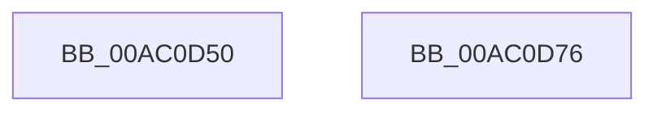

# PopDiagTraceIoCoalescingOff

- RVA: `0x00AC0D50`–`0x00AC0D77` (길이 `39` bytes)
- VA: `0x0000000140AC0D50`
- 실행 섹션: `PAGE`
- PDB 이름 있음: `예`; PDB Function 태그: `아니요`
- unwind 정보 RVA: `0x0005C788`
- 디코드: `9`개 명령, `39/39` bytes 표시
- 미해석 바이트: `0` (있으면 어셈블리에 `.byte`로 보존)

> 이 문서는 커널 이미지의 기계어와 PDB 기호를 분석해 생성했습니다. 4번과 5번은 함수 원형과 자료형을 바이너리 사용 방식에서 추정한 C 해석이며 원본 소스 복구 결과는 아닙니다.

## 1. Dependencies

- 직접 호출 지점: **2**; 고유 호출 대상: **2**
- 직접 호출자로 확인된 함수: **1**
- RIP 상대 이미지 참조: **2**

### Outgoing calls
- `0x00AC0D60` → [PopPrintEx](../../text/48/PopPrintEx_function_0048EF24.md) (function, `0x0048EF24`)
- `0x00AC0D6C` → [PopDiagTraceEventNoPayload](../../text/49/PopDiagTraceEventNoPayload_function_004982F8.md) (function, `0x004982F8`)

### Direct callers
- [PopCoalescingSetActiveState](../../text/4B/PopCoalescingSetActiveState_function_004B7E18.md) at `0x004B7E47`

### Static image references
- `0x00AC0D54` → RVA `0x00B02250` (` ?? ::NNGAKEGL::`string'`; read)
- `0x00AC0D65` → RVA `0x0001E860` (`.rdata`; read)

## 2. Other-region calls and transfers

- 다른 실행 섹션으로 향하는 call: **2**
  - `0x00AC0D60` → [PopPrintEx](../../text/48/PopPrintEx_function_0048EF24.md) (`PAGE` → `.text`)
  - `0x00AC0D6C` → [PopDiagTraceEventNoPayload](../../text/49/PopDiagTraceEventNoPayload_function_004982F8.md) (`PAGE` → `.text`)
- 별도 외부 분기/꼬리 이동을 확인하지 못했습니다.

## 3. Assembly (complete function range)

```asm
00AC0D50  48 83 EC 28                     sub rsp, 0x28
00AC0D54  48 8D 15 F5 14 04 00            lea rdx, [rip + 0x414f5]
00AC0D5B  B9 03 00 00 00                  mov ecx, 3
00AC0D60  E8 BF E1 9C FF                  call 0x14048ef24
00AC0D65  48 8D 0D F4 DA 55 FF            lea rcx, [rip - 0xaa250c]
00AC0D6C  E8 87 75 9D FF                  call 0x1404982f8
00AC0D71  48 83 C4 28                     add rsp, 0x28
00AC0D75  C3                              ret
00AC0D76  CC                              int3
```

## 4. C-style interpretation (structured pseudocode)

```c
__int64 __fastcall PopDiagTraceIoCoalescingOff(void)
{
    __int64 result;
    __int64 v_rsp;

    v_rsp = (v_rsp) - (40);
    result = PopPrintEx(3, v_rip + 267509, a3, a4);
    result = PopDiagTraceEventNoPayload(v_rip - 11150604, v_rip + 267509, a3, a4);
    v_rsp = (v_rsp) + (40);
    return result;
}
```

## 5. (Beta) C Style

```c
void PopDiagTraceIoCoalescingOff(void)
{
    int64_t result;
    int64_t local_rsp;

    local_rsp = (local_rsp) - (40);
    result = PopPrintEx(3, v_rip + 267509, a3, a4);
    result = PopDiagTraceEventNoPayload(v_rip - 11150604, v_rip + 267509, a3, a4);
    local_rsp = (local_rsp) + (40);
    return result;
}
```

## 6. Execution-region graph

[열기: 2D/3D 그래프와 함수 탐색 컨트롤 패널](../../../control-panel.html?section=page&rva=0x00AC0D50&view=graph)

- 2D 그래프는 위에서 아래로 흐르고, 3D 그래프는 빈 공간을 드래그해 회전합니다. Shift+드래그는 이동, 휠은 확대·축소, 함수 노드 선택은 대상 보고서 이동입니다.

### Static fallback


